# 12.2 การผสาน MQTT Client บน Flutter (MQTT Client Integration in Flutter)

---

## 12.2.1 แนะนำแพ็กเกจ `mqtt_client` สำหรับภาษา Dart

ในการพัฒนาแอปพลิเคชัน Flutter ที่ต้องสื่อสารผ่านโปรโตคอล MQTT แพ็กเกจที่ได้รับการยอมรับและเป็นมาตรฐานอุตสาหกรรมสูงสุดคือ **`mqtt_client`** (พัฒนาโดย Steve Hamblett) ซึ่งรองรับมาตรฐาน **MQTT v3.1.1** และ **MQTT v5.0** อย่างสมบูรณ์


> [!INFO] **จุดเด่นของแพ็กเกจ `mqtt_client` (pub.dev)**
> * **โปรโตคอลการเชื่อมต่อ** รองรับทั้ง Raw TCP Sockets (พอร์ต 1883 / 8883) และ WebSockets (พอร์ต 8083 / 9001)
> * **โมเดลการประมวลผล** ทำงานแบบ Asynchronous และ Stream-based เต็มรูปแบบ
> * **ความเข้ากันได้** ครอบคลุมทั้ง Android, iOS, Windows, macOS, Linux และ Web

### การติดตั้งแพ็กเกจในไฟล์ `pubspec.yaml`
```yaml
dependencies:
  flutter:
    sdk: flutter
  mqtt_client: ^10.3.0    # ไลบรารี MQTT Client สำหรับ Dart
```
หรือรันคำสั่งผ่านเทอร์มินัล
```powershell
flutter pub add mqtt_client
```

---

## 12.2.2 รูปแบบการเชื่อมต่อ TCP Socket vs WebSocket

เมื่อนำ Flutter ไปรันบนแพลตฟอร์มที่แตกต่างกัน ตัวกลางในการขนส่งข้อมูล (Transport Layer) มีความแตกต่างกันอย่างสำคัญ

<p align="center"></p>
<p align="center">  12.2.2 รูปแบบการเชื่อมต่อ TCP Socket vs WebSocket</p>

1. **`MqttServerClient` (ใช้กับแอปพลิเคชันมือถือ Android, iOS และ Desktop)**
   * เชื่อมต่อผ่าน Raw TCP Socket ตรงๆ ไปยังพอร์ต **1883** (ไม่เข้ารหัส) หรือ **8883** (TLS)
   * มีความเร็วสูงและ Packet Overhead ต่ำที่สุด
2. **`MqttBrowserClient` (ใช้กับเว็บเบราว์เซอร์ Flutter Web)**
   * เว็บเบราว์เซอร์มีนโยบายความปลอดภัยที่ไม่อนุญาตให้เปิด Raw TCP Socket จึงต้องห่อแพ็กเก็ต MQTT ในโพรโทคอล **WebSocket** ผ่านพอร์ต **8083** หรือ **9001**

---

## 12.2.3 ขั้นตอนการสร้างการเชื่อมต่อกับ Broker (Connection Workflow)

การเชื่อมต่อกับ Broker มีขั้นตอนที่เป็นลำดับชั้น (Pipeline) ดังแสดงในแผนภาพ

<p align="center"></p>
<p align="center">  12.2.3 ขั้นตอนการสร้างการเชื่อมต่อกับ Broker (Connection Workflow)</p>

### โครงสร้างโค้ดการเชื่อมต่อพื้นฐาน (Connection Setup Code)

```dart
import 'dart:io';
import 'package:flutter/foundation.dart';
import 'package:mqtt_client/mqtt_client.dart';
import 'package:mqtt_client/mqtt_server_client.dart';

class MqttService {
  late MqttServerClient client;
  final String broker = '192.168.1.100'; // หมายเลข IP ของเครื่องรัน Broker
  final int port = 1883;
  final String clientId = 'Flutter_App_${DateTime.now().millisecondsSinceEpoch}';

  void initializeClient() {
    client = MqttServerClient(broker, clientId);
    client.port = port;
    client.keepAlivePeriod = 20; // ส่ง Ping ทุก 20 วินาที
    client.autoReconnect = true; // เปิดระบบเชื่อมต่อใหม่อัตโนมัติ
    client.logging(on: false);

    // กำหนด Callbacks สำหรับติดตามสถานะ
    client.onConnected = onConnected;
    client.onDisconnected = onDisconnected;
    client.onSubscribed = onSubscribed;
    client.pongCallback = pong;

    // กำหนดพารามิเตอร์การเชื่อมต่อ (Connect Message)
    final connMessage = MqttConnectMessage()
        .withClientIdentifier(clientId)
        .startClean() // Clean Session = true
        .withWillTopic('iot/flutter/status') // Last Will and Testament
        .withWillMessage('offline')
        .withWillQos(MqttQos.atLeastOnce);

    client.connectionMessage = connMessage;
  }

  Future<bool> connect() async {
    try {
      debugPrint('กำลังเชื่อมต่อไปยัง MQTT Broker: $broker:$port ...');
      await client.connect();
      return true;
    } on NoConnectionException catch (e) {
      debugPrint('Client Exception: $e');
      client.disconnect();
      return false;
    } on SocketException catch (e) {
      debugPrint('Socket Exception: $e');
      client.disconnect();
      return false;
    } catch (e) {
      debugPrint('Exception ทั่วไป: $e');
      client.disconnect();
      return false;
    }
  }

  void onConnected() => debugPrint('✅ เชื่อมต่อ MQTT Broker สำเร็จ!');
  void onDisconnected() => debugPrint('❌ การเชื่อมต่อกับ MQTT Broker หลุด!');
  void onSubscribed(String topic) => debugPrint('📢 บอกรับหัวข้อ (Subscribed): $topic สำเร็จ');
  void pong() => debugPrint('💓 ได้รับสัญญาณ PONG ตอบกลับจาก Broker');
}
```

---

## 12.2.4 การบอกรับหัวข้อและการประมวลผลข้อความ (Subscribe & Stream Handling)

จุดเด่นของแพ็กเกจ `mqtt_client` บน Dart คือ การส่งข้อมูลขาเข้าในรูปของ **Stream** ทำให้นักพัฒนาสามารถใช้ `StreamSubscription` คอยดักฟังและแปลงข้อความแบบ Asynchronous ได้อย่างทรงพลัง

```dart
void subscribeToTopic(String topic) {
  if (client.connectionStatus?.state == MqttConnectionState.connected) {
    client.subscribe(topic, MqttQos.atMostOnce);

    // ดักฟังข้อความที่ไหลเข้ามาใน Stream
    client.updates?.listen((List<MqttReceivedMessage<MqttMessage>> messages) {
      final recMess = messages[0].payload as MqttPublishMessage;
      final topicName = messages[0].topic;
      
      // แปลง Binary Payload เป็น UTF-8 String
      final payloadString = MqttPublishPayload.bytesToStringAsString(
        recMess.payload.message,
      );

      debugPrint('📩 หัวข้อ: $topicName | ข้อความ: $payloadString');
      processPayload(topicName, payloadString);
    });
  }
}
```

---

## 12.2.5 การแปลงข้อมูล JSON Payload (Serialization & Deserialization)

ในระบบ IoT นิยมส่งข้อมูลเซนเซอร์ในรูปของข้อความ **JSON** เช่น
```json
{
  "voltage": 1.65,
  "raw": 2048,
  "uptime": 1240
}
```

ในภาษา Dart เราควรสร้างคลาสข้อมูล (Data Model) เพื่อรองรับการแปลงข้อมูล (Deserialization) แบบปลอดภัย

```dart
import 'dart:convert';

class SensorTelemetry {
  final double voltage;
  final int raw;
  final int uptime;

  SensorTelemetry({
    required this.voltage,
    required this.raw,
    required this.uptime,
  });

  // Factory Constructor สำหรับแปลงข้อมูลจาก JSON Map
  factory SensorTelemetry.fromJson(Map<String, dynamic> json) {
    return SensorTelemetry(
      voltage: (json['voltage'] as num?)?.toDouble() ?? 0.0,
      raw: (json['raw'] as num?)?.toInt() ?? 0,
      uptime: (json['uptime'] as num?)?.toInt() ?? 0,
    );
  }
}

// ฟังก์ชันถอดรหัสและแปลงเข้า Data Model
void processPayload(String topic, String payloadString) {
  if (topic == 'iot/esp32/telemetry') {
    try {
      final Map<String, dynamic> dataMap = jsonDecode(payloadString);
      final telemetry = SensorTelemetry.fromJson(dataMap);
      debugPrint('⚡ ค่าแรงดันที่อ่านได้: ${telemetry.voltage.toStringAsFixed(2)} V');
    } catch (e) {
      debugPrint('ข้อผิดพลาดในการแปลง JSON: $e');
    }
  }
}
```

---

## 12.2.6 การส่งคำสั่งควบคุม (Publishing Commands)

การส่งคำสั่งเปิด-ปิดไฟ หรือปรับค่าพารามิเตอร์จากมือถือไปยังบอร์ด ESP32 ทำได้โดยการเรียกฟังก์ชัน `publishMessage` พร้อมกับสร้าง Payload Builder

```dart
void sendLedCommand(bool turnOn) {
  final builder = MqttClientPayloadBuilder();
  
  // สร้าง JSON คำสั่ง เช่น {"led": "ON"}
  final commandMap = {'led': turnOn ? 'ON' : 'OFF'};
  final jsonString = jsonEncode(commandMap);
  builder.addString(jsonString);

  // Publish ไปยัง Topic ควบคุม
  client.publishMessage(
    'iot/esp32/control',
    MqttQos.atLeastOnce, // QoS 1 การันตีว่าคำสั่งส่งถึง
    builder.payload!,
    retain: false,
  );

  debugPrint('🚀 ส่งคำสั่งไปยัง ESP32: $jsonString');
}
```

---

## 12.2.7 กลยุทธ์การเชื่อมต่อใหม่อัตโนมัติ (Resilient Auto-Reconnect Strategy)

บนสมาร์ตโฟน เครือข่ายอาจขาดหายเมื่อผู้ใช้เดินเข้าลิฟต์ หรือระบบสลับคลื่นจาก Wi-Fi ไป 4G เพื่อให้แอปพลิเคชันมีความทนทาน (Fault-Tolerant) เราสามารถวางระบบเชื่อมต่อใหม่แบบ Exponential Backoff

```dart
bool _isReconnecting = false;

void handleDisconnect() async {
  if (_isReconnecting) return;
  _isReconnecting = true;

  int retryDelay = 2; // เริ่มต้นรอ 2 วินาที
  const int maxDelay = 32;

  while (client.connectionStatus?.state != MqttConnectionState.connected) {
    debugPrint('⏳ พยายามเชื่อมต่อใหม่ในอีก $retryDelay วินาที...');
    await Future.delayed(Duration(seconds: retryDelay));

    try {
      await connect();
      if (client.connectionStatus?.state == MqttConnectionState.connected) {
        debugPrint('🎉 เชื่อมต่อใหม่สำเร็จ!');
        // ทำการ Re-subscribe หัวข้อที่จำเป็นใหม่ทั้งหมด
        subscribeToTopic('iot/esp32/telemetry');
        subscribeToTopic('iot/esp32/status');
        break;
      }
    } catch (_) {}

    retryDelay = (retryDelay * 2).clamp(2, maxDelay); // ทวีคูณเวลาหน่วง
  }

  _isReconnecting = false;
}
```
