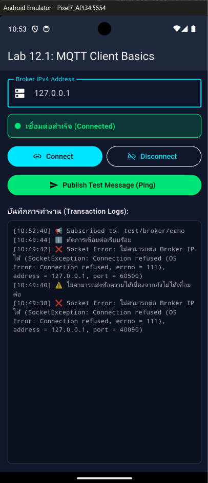
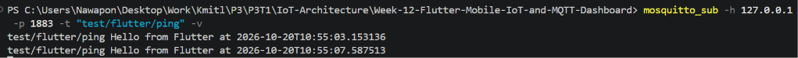

#### 4. ทดสอบส่งข้อความสองทาง
* บนหน้าจอ Flutter: กรอก IP เป็น **`127.0.0.1`** (หรือ IP ของ Broker ที่เปิดรับ) แล้วกดปุ่ม **Connect**

* เมื่อสถานะเปลี่ยนเป็นสีเขียว ให้กดปุ่ม **Publish Test Message**
* สังเกตหน้าต่าง PowerShell `mosquitto_sub` ว่าได้รับข้อความ Ping หรือไม่
* ในอีกหน้าต่าง PowerShell ส่งข้อความตอบกลับไปยังหัวข้อที่ Flutter รอฟัง:

```powershell
mosquitto_pub -h 127.0.0.1 -p 1883 -t "test/broker/echo" -m "Echo response from CLI"
```
* ตรวจสอบว่าในช่อง Logs ของ Flutter App แสดงข้อความที่ได้รับอย่างถูกต้อง

---

## 4. คำถามท้ายการทดลอง (Review Questions)
1. เพราะเหตุใดเราจึงต้องสุ่มชื่อ `clientId` เช่นการใส่ Timestamp ต่อท้าย แทนที่จะตั้งชื่อแบบคงที่?

**ตอบ** ควรใช้ `clientId` ที่ไม่ซ้ำกัน เพราะ MQTT Broker ใช้ค่านี้ระบุตัว Client หากมี Client หลายตัวใช้ ID เดียวกัน Broker อาจตัดการเชื่อมต่อของตัวเดิมเมื่อมีตัวใหม่เชื่อมต่อเข้ามา การเติม Timestamp จึงช่วยลดโอกาสที่ ID จะซ้ำกัน


2. หากหน้าจอ Flutter รันบนอุปกรณ์จริง (Physical Android Phone) เหตุใดการกรอก IP `127.0.0.1` จึงไม่สามารถเชื่อมต่อ Broker ได้? และต้องใช้ IP ใด?

**ตอบ** `127.0.0.1` เป็น Loopback Address ซึ่งหมายถึงอุปกรณ์ที่กำลังรันแอปอยู่ ไม่ใช่คอมพิวเตอร์ที่เปิด Broker ดังนั้นเมื่อรันแอปบนมือถือจริง ต้องใช้ IPv4 Address ของคอมพิวเตอร์ที่เปิด Broker และอยู่ในเครือข่าย Wi-Fi เดียวกัน เช่น `192.168.1.10` โดย Broker และ Firewall ต้องอนุญาตการเชื่อมต่อผ่านพอร์ต `1883` ด้วย


3. การตั้งค่า `keepAlivePeriod` มีความจำเป็นอย่างไรในสภาพแวดล้อมเครือข่ายไร้สาย?

**ตอบ** `keepAlivePeriod` กำหนดช่วงเวลาที่ Client ใช้ส่งสัญญาณ Keep Alive ไปยัง Broker เมื่อไม่มีข้อมูลอื่นส่ง ช่วยให้ Broker ตรวจพบ Client ที่ขาดการเชื่อมต่อจากเครือข่ายไร้สายได้ภายในเวลาที่เหมาะสม และช่วยให้สถานะการเชื่อมต่อเป็นปัจจุบัน ทั้งนี้ไม่ได้ป้องกันสัญญาณ Wi-Fi หลุด