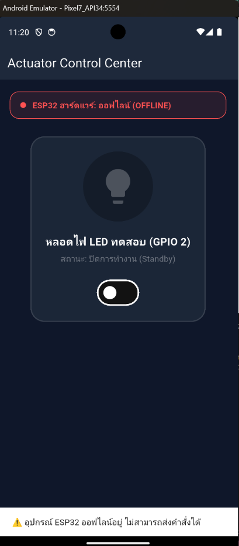
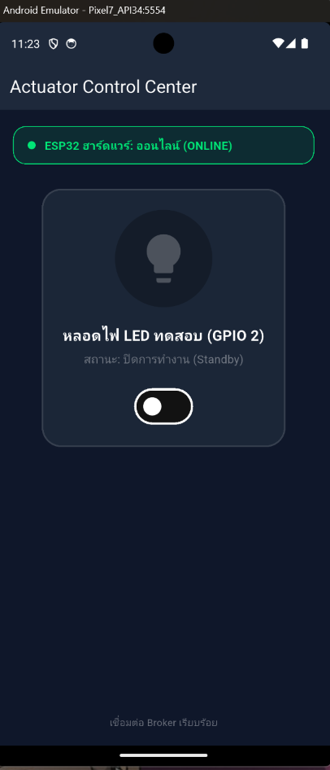
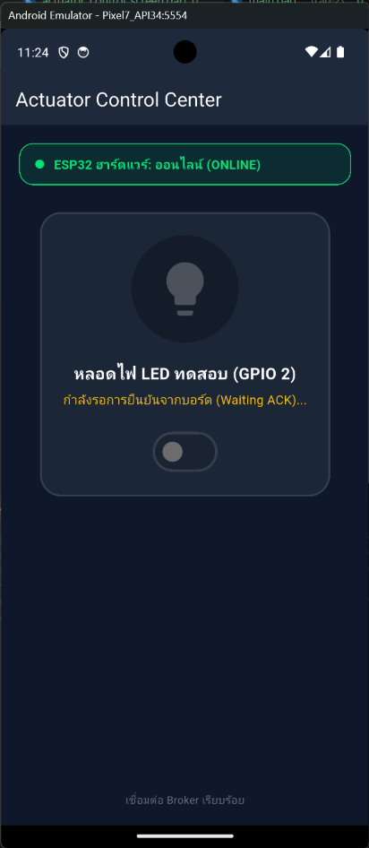
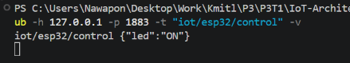
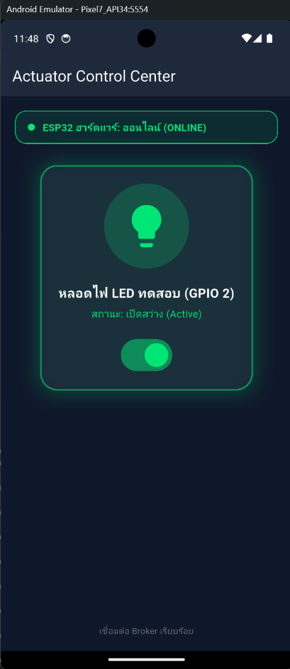
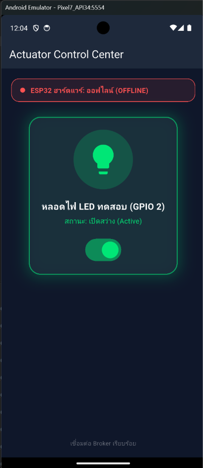

### กิจกรรมที่ 12-2.2: การทดสอบร่วมกับสคริปต์จำลองฮาร์ดแวร์ (Mock Simulation)

หากยังไม่ได้ต่อบอร์ด ESP32 จริง สามารถใช้ PowerShell ทดสอบจำลองพฤติกรรมของฮาร์ดแวร์ได้

#### 1. จำลองส่งสถานะ Online (เสมือน ESP32 บูตเสร็จ)
```powershell
mosquitto_pub -h 127.0.0.1 -p 1883 -t "iot/esp32/status" -m "online" -r
```
*สังเกตหน้าจอ Flutter แถบสถานะด้านบนจะเปลี่ยนเป็นสีเขียวทันที*





#### 2. เฝ้าดูคำสั่งที่ส่งมาจากแอป Flutter
```powershell
mosquitto_sub -h 127.0.0.1 -p 1883 -t "iot/esp32/control" -v
```
*เมื่อแตะสวิตช์บน Flutter จะเห็นแพ็กเก็ต `{"led":"ON"}` หรือ `{"led":"OFF"}` ปรากฏในเทอร์มินัล*





#### 3. ส่งคำสั่งยืนยันกลับไปยังแอป (เสมือนบอร์ดเปลี่ยนสถานะขา GPIO สำเร็จ)
```powershell
mosquitto_pub -h 127.0.0.1 -p 1883 -t "iot/esp32/led_ack" -m '{"led_state": true, "ack": true}'
```
*สังเกตสวิตช์และไอคอนหลอดไฟบนมือถือจะเรืองแสงสีเขียวทันที*



#### 4. จำลองเหตุการณ์บอร์ดดับหรือเน็ตหลุด (เสมือน Broker ส่ง LWT)
```powershell
mosquitto_pub -h 127.0.0.1 -p 1883 -t "iot/esp32/status" -m "offline" -r
```
*สังเกตว่าหน้าจอจะแจ้งเตือนว่า ESP32 ออฟไลน์ทันที และสวิตช์จะไม่ยอมให้สั่งการ*



---

## 4. สรุปผลและคำถามท้ายการทดลอง
1. ประโยชน์ของการรอสัญญาณ ACK จากหัวข้อ `iot/esp32/led_ack` แทนการเปลี่ยน UI ทันที (Optimistic Update) คืออะไร?

**ตอบ** การรอ ACK จาก `iot/esp32/led_ack` ทำให้แอปเปลี่ยนสถานะ UI ตามผลที่อุปกรณ์ยืนยันว่าทำงานจริง ไม่ใช่เปลี่ยนทันทีหลังส่งคำสั่งเพียงอย่างเดียว หากคำสั่งส่งไม่ถึงหรืออุปกรณ์ทำงานไม่สำเร็จ หน้าจอจะไม่แสดงสถานะคลาดเคลื่อน ทั้งนี้ ACK ในหัวข้อนี้เป็นการยืนยันระดับแอปพลิเคชันจากอุปกรณ์ ไม่ใช่เพียงการยืนยันว่า Broker ได้รับข้อความแล้ว


2. ทำไมเราจึงควรตั้งแฟล็ก Retain (`-r`) สำหรับหัวข้อสถานะ `iot/esp32/status`?

**ตอบ** Retain (`-r`) ทำให้ Broker เก็บข้อความสถานะล่าสุดไว้ เมื่อแอปหรือ Client ใหม่ subscribe หัวข้อนี้ภายหลัง Broker จะส่งสถานะล่าสุดให้ทันที จึงทราบว่าอุปกรณ์ออนไลน์หรือออฟไลน์โดยไม่ต้องรอให้มีการเปลี่ยนสถานะครั้งถัดไป ควรอัปเดต retained status ทุกครั้งที่สถานะเปลี่ยน เพื่อไม่ให้ Client ใหม่ได้รับข้อมูลเก่าที่ไม่ตรงกับสถานะจริง
