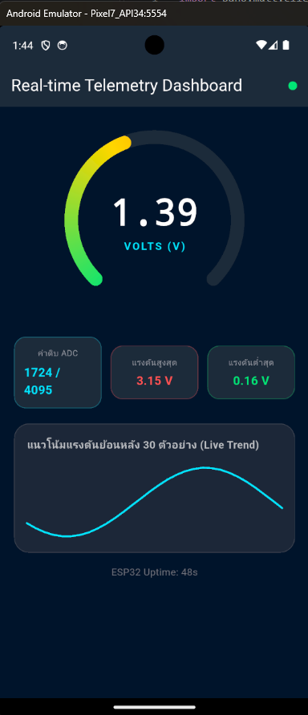
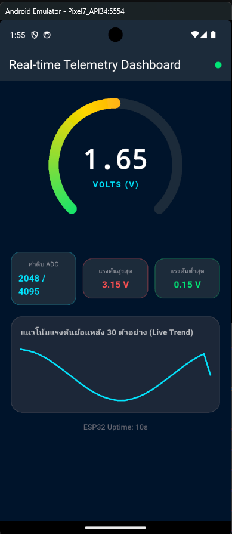
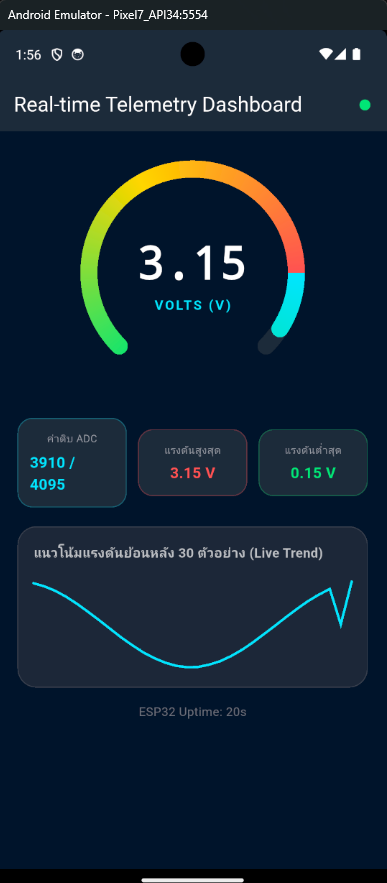

#### การทดสอบแบบเจาะจงค่าผ่าน Mosquitto CLI (PowerShell)
สามารถใช้คำสั่ง `mosquitto_pub` ทดสอบส่งค่าเฉพาะเพื่อตรวจสอบพฤติกรรมของ Gauge ในสภาวะต่างๆ:


- **ทดสอบส่งค่าปกติ (1.65 V):**
```powershell
mosquitto_pub -h 127.0.0.1 -p 1883 -t "iot/esp32/telemetry" -m '{"voltage": 1.65, "raw": 2048, "uptime": 10}'
```
*สังเกตเข็ม Radial Gauge หมุนไปที่กึ่งกลาง (1.65 V) และการ์ดแสดงค่า 2048 / 4095*


- **ทดสอบส่งค่าแรงดันสูงแตะขีดจำกัด (3.15 V):**
```powershell
mosquitto_pub -h 127.0.0.1 -p 1883 -t "iot/esp32/telemetry" -m '{"voltage": 3.15, "raw": 3910, "uptime": 20}'
```
*สังเกตเข็มหมุนเข้าสู่โซนสีแดง และการ์ด "แรงดันสูงสุด" ปรับค่าเป็น `3.15 V` ทันที*


- **จำลองสตรีมข้อมูลต่อเนื่อง 30 ค่าด้วย PowerShell Loop:**
```powershell
1..30 | ForEach-Object {
    $v = [Math]::Round(1.65 + 1.5 * [Math]::Sin($_ * 0.4), 2)
    $raw = [int](($v / 3.3) * 4095)
    mosquitto_pub -h 127.0.0.1 -p 1883 -t "iot/esp32/telemetry" -m "{`"voltage`": $v, `"raw`": $raw, `"uptime`": $_}"
    Start-Sleep -Milliseconds 500
}
```

---

## 4. สรุปผลและคำถามท้ายการทดลอง
1. เหตุใดการใช้ `TweenAnimationBuilder` จึงทำให้เข็มมาตรวัดดูนุ่มนวลและไม่กระตุก แม้ข้อมูลเซนเซอร์จะเข้ามาทุกๆ 500 มิลลิวินาที?  
   **คำตอบ:** เพราะ `TweenAnimationBuilder` ค่อยๆ interpolate ค่ามาตรวัดจากค่าปัจจุบันไปยังค่าใหม่ในช่วงเวลาที่กำหนด แทนการเปลี่ยนตำแหน่งทันที จึงทำให้การเคลื่อนไหวดูต่อเนื่องและนุ่มนวล
2. การจำกัดความยาวของอาร์เรย์ `_history` ให้เก็บไม่เกิน 30 ตัวอย่าง ส่งผลดีต่อประสิทธิภาพหน่วยความจำของสมาร์ตโฟนอย่างไร?  
   **คำตอบ:** ทำให้แอปเก็บข้อมูลย้อนหลังเพียงจำนวนคงที่ ไม่สะสมข้อมูลเพิ่มขึ้นเรื่อยๆ ระหว่างเปิดแอป จึงช่วยควบคุมการใช้หน่วยความจำและต้นทุนในการอัปเดตกราฟ
3. หากเซนเซอร์ส่งค่าผิดพลาด เช่น ค่านอกช่วง 0 - 3.3V หรือค่าเป็น `null` โค้ดส่วนใดใน `telemetry_dashboard_screen.dart` ที่ช่วยป้องกันไม่ให้แอปแครช?  
   **คำตอบ:** `(data['voltage'] as num?)?.toDouble() ?? 0.0` ช่วยใช้ค่าเริ่มต้นเมื่อแรงดันเป็น `null` และ `try/catch` รอบการถอดรหัส JSON ช่วยจัดการข้อมูลที่ไม่ถูกต้อง อย่างไรก็ตาม โค้ดยังไม่ได้ตรวจหรือจำกัดค่าตัวเลขให้อยู่ในช่วง 0–3.3 V ดังนั้นค่านอกช่วงอาจทำให้การแสดงผลผิดเพี้ยน
