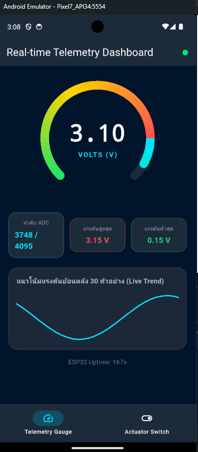
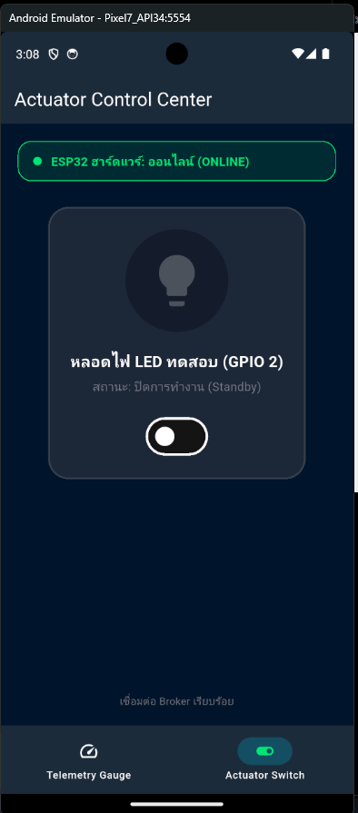
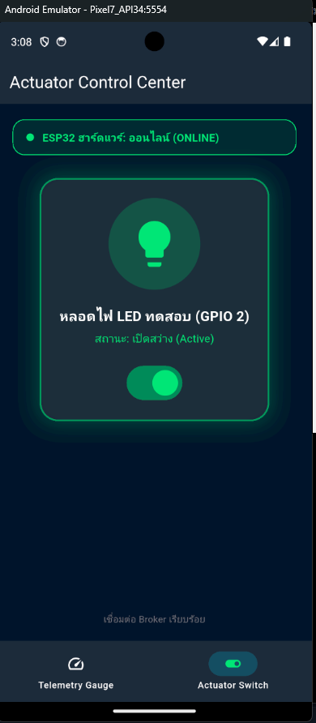
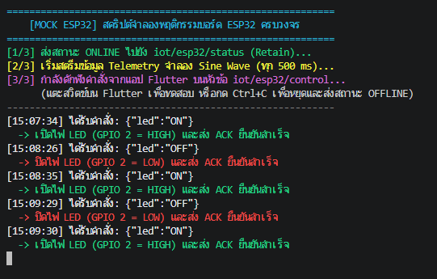
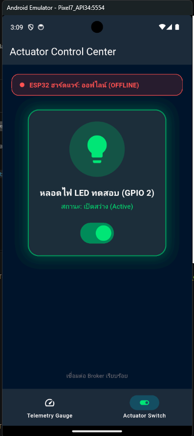

### กิจกรรมที่ 12-4.3: การทดสอบ 4 กรณีทดสอบวิกฤต (Verification Test Matrix)

ให้นักศึกษาทำการทดสอบระบบครบวงจรและบันทึกผลการทดลองลงในตาราง:

| รายการทดสอบ                                | การกระทำเชิงกายภาพ (Hardware Action) / การจำลอง (Mock Action)                                                                        | พฤติกรรมที่คาดหวังบน Flutter App                                                                                                                                                                | ผลการทดลองจริง (ผ่าน/ไม่ผ่าน) |
| :----------------------------------------- | :----------------------------------------------------------------------------------------------------------------------------------- | :---------------------------------------------------------------------------------------------------------------------------------------------------------------------------------------------- | :---------------------------- |
| **Test Case 1: Telemetry Monitoring**      | **ฮาร์ดแวร์:** หมุน Potentiometer จากซ้ายสุดไปขวาสุด **จำลอง:** สคริปต์ PowerShell สตรีมค่า Sine Wave อัตโนมัติ                   | เข็มบน Radial Gauge หมุนระหว่าง 0.0V ถึง 3.3V อย่างนุ่มนวล ค่าดิบ ADC เปลี่ยนแปลง และกราฟประวัติ Live Sparkline ขยับต่อเนื่อง                                                                   | ผ่าน                          |
| **Test Case 2: Actuator Remote Control**   | แตะสวิตช์บนแอปเพื่อเปิดหรือปิดไฟ LED                                                                                                 | **ฮาร์ดแวร์:** หลอดไฟ LED บนขา GPIO 2 สว่างขึ้น **จำลอง:** PowerShell แสดงข้อความ `ได้รับคำสั่ง: {"command": "ON"}` สวิตช์และไอคอนบนแอปเรืองแสงสีเขียว พร้อมการสั่นตอบสนอง (Haptic Feedback) | ผ่าน                          |
| **Test Case 3: State Sync & Physical ACK** | ปลดสายหรือสลับสถานะหลอดไฟโดยตรง หรือปล่อยให้สคริปต์ส่งสัญญาณ ACK                                                                     | แอปพลิเคชันได้รับค่า ACK และปรับปรุงสวิตช์ตามความเป็นจริง หากไม่ได้รับ ACK สวิตช์จะไม่อัปเดตสถานะคงที่                                                                                          | ผ่าน                          |
| **Test Case 4: Fault Tolerance (LWT)**     | **ฮาร์ดแวร์:** ถอดสาย USB จ่ายไฟของบอร์ด ESP32 ออกกะทันหัน **จำลอง:** กด `Ctrl + C` บนหน้าต่าง PowerShell ที่รัน `mock_esp32.ps1` | ป้ายสถานะฮาร์ดแวร์บนแอปเปลี่ยนเป็น "OFFLINE" สีแดง และสวิตช์สั่งการจะถูกปิดกั้น (Disabled) ไม่ให้ส่งคำสั่ง                                                                                      | ผ่าน                          |

---
### ภาพหลักฐานการทดลอง

**Test Case 1: Telemetry Monitoring** — `image.png` แสดงหน้า Telemetry Gauge ที่ได้รับค่าเซนเซอร์ มีค่าแรงดัน ADC และกราฟแนวโน้ม

**Test Case 2: Actuator Remote Control** — `image-1.png` แสดงหน้าควบคุมก่อนเปิดไฟ และ `image-2.png` แสดงสถานะหลอดไฟเปิดหลังได้รับ ACK

**Test Case 2–3: คำสั่งควบคุมและ ACK** — `image-3.png` แสดง Terminal ของตัวจำลองที่ได้รับคำสั่ง ON/OFF และส่ง ACK กลับ

**Test Case 4: Fault Tolerance** — `image-4.png` แสดงป้ายสถานะอุปกรณ์เป็น OFFLINE หลังหยุดตัวจำลอง อย่างไรก็ตาม ภาพยังแสดงหลอดไฟเป็น Active จึงยังไม่ยืนยันว่า UI ปิดกั้นสวิตช์เมื่อออฟไลน์ หากต้องการยืนยันเงื่อนไขนี้ ควรถ่ายภาพเพิ่มหลังอุปกรณ์ OFFLINE และแสดงว่าสวิตช์ถูกปิดใช้งาน

### กิจกรรมที่ 12-4.4: การวัดความหน่วงเวลาในการควบคุม (Control Latency Benchmark)

1. วัดเวลาตั้งแต่แตะสวิตช์ในแอป จนกระทั่งได้รับข้อความยืนยัน `iot/esp32/led_ack` กลับมายังสมาร์ตโฟน (Round-Trip Time - RTT)
2. สังเกตความหน่วงและบันทึกผลเปรียบเทียบในตาราง:

| สภาพแวดล้อมเครือข่าย | ประเภทการเชื่อมต่อ | เวลาตอบสนองโดยเฉลี่ย (RTT: ms) | ความเสถียร / ข้อสังเกต |
| :--- | :--- | :--- | :--- |
| **Local Wi-Fi LAN** | สมาร์ตโฟนและบอร์ด ESP32 ต่อเข้ากับ Wi-Fi Router เดียวกันในห้องทดลอง | ประมาณ 20 – 60 ms | รวดเร็ว ตอบสนองแทบจะทันที |
| **Mobile Hotspot / 4G** | สมาร์ตโฟนเชื่อมต่อ 4G/5G ชี้มายัง Broker ผ่าน Public IP หรือ Tailscale/VPN | ประมาณ 80 – 250 ms | ขึ้นอยู่กับความแรงสัญญาณและ Routing |

---

## 4. สรุปผลและคำถามท้ายบทเรียน
1. เหตุใดการใช้ `IndexedStack` ใน `MainNavigationShell` จึงมีความสำคัญอย่างยิ่งสำหรับแอปพลิเคชัน IoT แบบ Multi-tab เมื่อเทียบกับการสลับวิดเจ็ตด้วย `body: _pages[_currentIndex]`?

**คำตอบ** `IndexedStack` เก็บหน้าจอแต่ละแท็บไว้ใน widget tree แม้จะแสดงเพียงแท็บที่เลือก จึงรักษา state, subscription และการเชื่อมต่อ MQTT ของแต่ละหน้าจอไว้ เมื่อสลับแท็บจึงไม่ต้องสร้างหน้าจอใหม่และเชื่อมต่อ Broker ซ้ำ ซึ่งช่วยลดการหลุดของข้อมูลและความหน่วงเมื่อกลับมาใช้งาน ตรงข้ามกับ `body: _pages[_currentIndex]` ที่หน้าจอซึ่งไม่แสดงอาจถูกถอดออกจาก tree และถูกสร้างใหม่เมื่อเลือกอีกครั้ง อย่างไรก็ตาม การเก็บทุกหน้าไว้ก็ใช้ทรัพยากรต่อเนื่อง จึงควรจัดการ subscription หรือหยุดงานที่ไม่จำเป็นเมื่อแอปอยู่เบื้องหลัง

2. เมื่อเปรียบเทียบการพัฒนาด้วย Flutter ในสัปดาห์นี้ กับการเปิดหน้าเว็บ HTTP บนเบราว์เซอร์ในสัปดาห์ที่ 8-10 ข้อใดให้ประสบการณ์การใช้งาน (UX) และความเสถียรที่ดีกว่าเมื่อข้อมูลเซนเซอร์มาด้วยความถี่สูง? เพราะเหตุใด?

**คำตอบ** สำหรับข้อมูลที่เข้ามาถี่ แอป Flutter ที่ใช้การเชื่อมต่อ MQTT แบบต่อเนื่องมักให้ UX ตอบสนองได้ดี เพราะรับข้อความแบบ push ไม่ต้องส่ง HTTP request ซ้ำเพื่อ polling ทุกครั้ง และวาด UI ด้วย widget ที่อัปเดตเฉพาะเมื่อมีข้อมูลใหม่ จึงลด overhead และความหน่วงได้เมื่อเทียบกับเว็บที่ใช้ HTTP polling อย่างไรก็ตาม ไม่ได้หมายความว่า Flutter เสถียรกว่าเสมอ เว็บที่ใช้ MQTT over WebSocket หรือกลไก streaming และมีการจัดการการเชื่อมต่อ/การวาดกราฟที่เหมาะสมก็ทำงานได้ดีเช่นกัน ความเสถียรจริงยังขึ้นกับเครือข่าย การจัดการ reconnect และประสิทธิภาพของการประมวลผลข้อมูล

3. หากต้องการนำแอปพลิเคชันนี้ไปเผยแพร่จริงบน Google Play Store หรือ Apple App Store ขั้นตอนความปลอดภัยที่ต้องปรับปรุงเพิ่มเติมมีอะไรบ้าง? (พิจารณาเรื่อง MQTTS / TLS พอร์ต 8883, การเข้ารหัส Token ยืนยันตัวตน, และการเก็บรักษา Credential)

**คำตอบ** ก่อนเผยแพร่ ควรเปลี่ยนจาก MQTT แบบไม่เข้ารหัสบนพอร์ต `1883` ไปใช้ MQTTS/TLS บนพอร์ต `8883` และตรวจสอบใบรับรอง Broker อย่างถูกต้อง ห้ามปิดการตรวจสอบ certificate เพื่อแก้ปัญหาการเชื่อมต่อ ควรปิด anonymous access และกำหนดสิทธิ์ ACL ให้แต่ละอุปกรณ์หรือผู้ใช้เข้าถึงเฉพาะ topic ที่จำเป็น ใช้ token ที่มีอายุจำกัด ขอบเขตสิทธิ์แคบ และสามารถเพิกถอนหรือหมุนเวียนได้ โดยออก token ผ่านระบบ backend ที่เชื่อถือได้ ไม่ฝัง credential หรือ secret ถาวรไว้ใน source code หรือในแอปที่เผยแพร่ หากต้องเก็บ token บนอุปกรณ์ ให้ใช้ secure storage ที่อาศัย Android Keystore หรือ iOS Keychain พร้อมหลีกเลี่ยงการบันทึก token ลง log และเตรียมขั้นตอนหมดอายุ/ออก token ใหม่เมื่อจำเป็น

