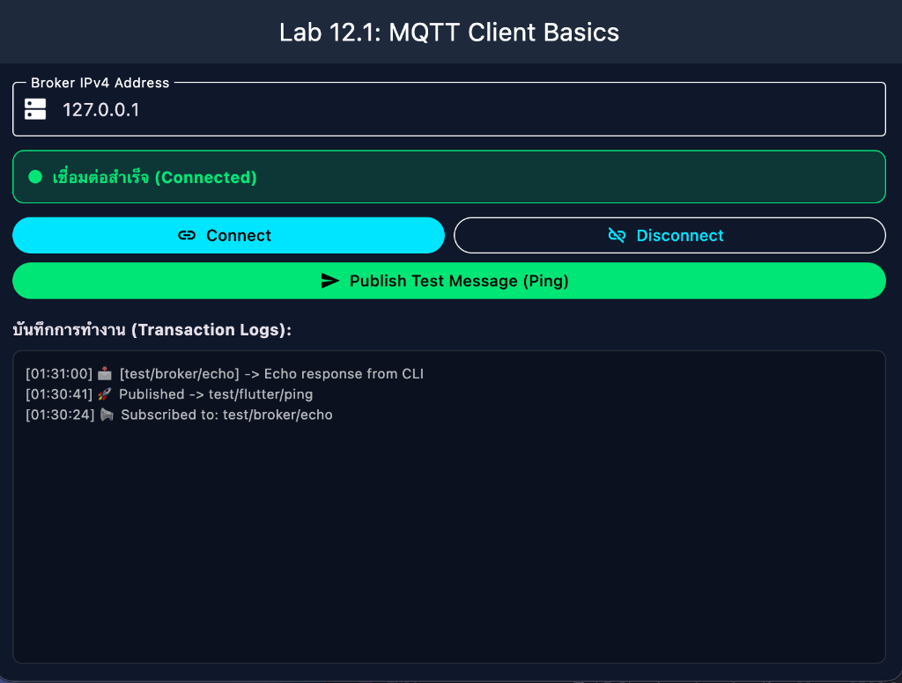
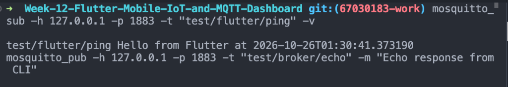
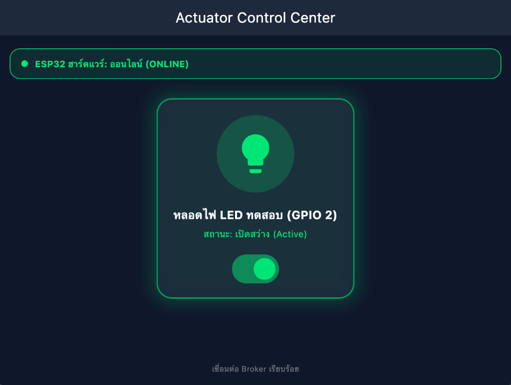
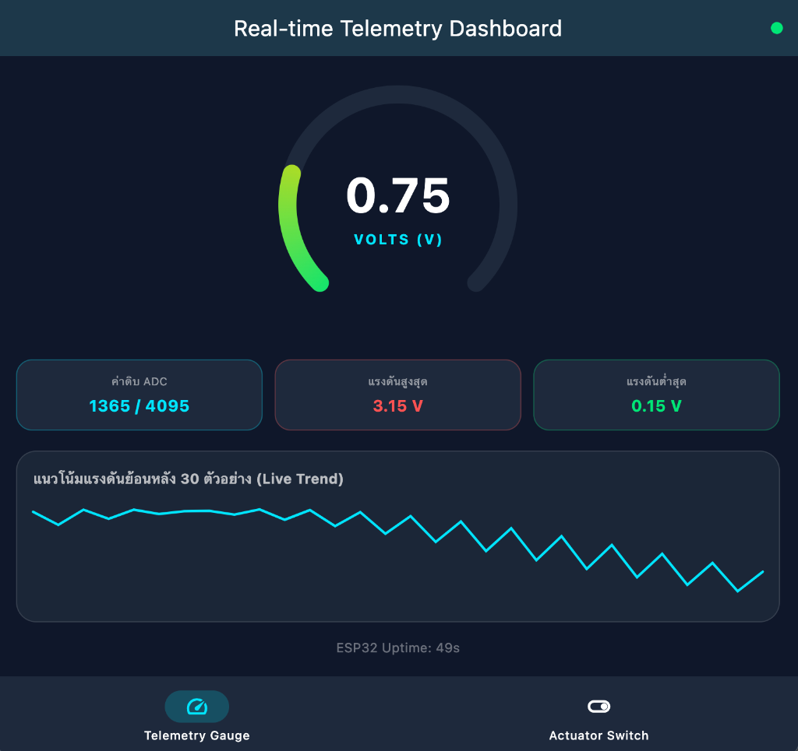
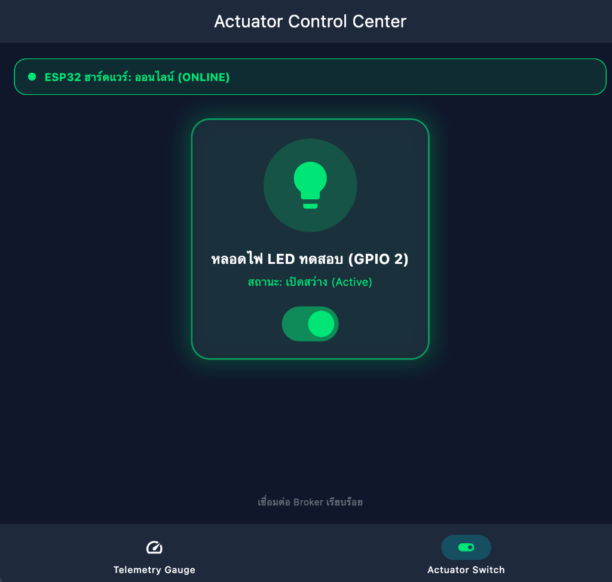

# รายงานผลการทดลอง สัปดาห์ที่ 12
## หัวข้อ: Cross-Platform Mobile IoT Application with Flutter & MQTT Dashboard

**รหัสนักศึกษา:** 67030183  
**ชื่อ-นามสกุล:** นายภูวิชญ์ ประกอบจิตร  
**วิชา:** ระบบสมองกลฝังตัวและการเชื่อมต่อเครือข่าย (Embedded Systems & IoT)  
**บอร์ดทดลอง:** ESP32 (ESP32-D0WD-V3)  

---

## 1. การต่อวงจรฮาร์ดแวร์ (Hardware Setup & Wiring)

การทดลองในสัปดาห์นี้ใช้วงจรฮาร์ดแวร์ต่อเนื่องจากสัปดาห์ที่ 10 และสัปดาห์ที่ 11 โดยต่อบอร์ด ESP32 ร่วมกับตัวต้านทานปรับค่าได้ (Potentiometer) เพื่อจำลองการตรวจวัดข้อมูลเซนเซอร์แอนะล็อก และหลอดไฟ LED เพื่อเป็นตัวแทนของอุปกรณ์ควบคุม (Actuator):

### ตารางการต่อสายวงจร
| อุปกรณ์ | ขาบนอุปกรณ์ | ขาต่อบน ESP32 | หน้าที่การทำงาน |
| :--- | :--- | :---: | :--- |
| **LED 5mm** | ขา Anode (+ ขายาว) | **GPIO 2** | รับคำสั่งเปิด-ปิดไฟจากสวิตช์บน Flutter App (ต่อผ่าน R 220Ω) |
| **LED 5mm** | ขา Cathode (- ขาสั้น) | **GND** | กราวด์วงจรหลอดไฟ |
| **ตัวต้านทาน 220Ω** | ขาใดก็ได้ | อนุกรมกับ LED | จำกัดกระแสไฟป้องกัน LED เสียหาย |
| **Potentiometer 10k** | ขากลาง (Wiper) | **GPIO 34** (ADC1_CH6) | อ่านค่าแรงดันแอนะล็อก (0.0 – 3.3V) ส่งขึ้นแดชบอร์ด |
| **Potentiometer 10k** | ขาริมซ้าย | **3.3V** | แรงดันไฟเลี้ยงอ้างอิง |
| **Potentiometer 10k** | ขาริมขวา | **GND** | กราวด์อ้างอิง |

### แผนผังการต่อวงจร
```text
       ESP32 Board                                     Peripherals
     +-------------------+                          +------------------------+
     |              3.3V |------------------------->| Potentiometer (VCC)    |
     |   GPIO 34 (ADC1_6)|<-------------------------| Potentiometer (Wiper)  |
     |            GPIO 2 |-----[ R 220Ω ]---------->| LED (Anode +)          |
     |               GND |------------------------->| LED (Cathode -) & GND  |
     +-------------------+                          +------------------------+
```

### 📸 ภาพถ่ายการต่อวงจรฮาร์ดแวร์จริง
> *ภาพถ่ายวงจรบอร์ด ESP32 ที่ต่อร่วมกับ Breadboard, LED และ Potentiometer ครบถ้วนชัดเจน*


---

## 2. ลิงก์วิดีโอสาธิตการทำงาน (Video Demonstration Links)

| การทดลอง | รายละเอียดคลิปสาธิต | ลิงก์วิดีโอ (YouTube Shorts) |
| :--- | :--- | :--- |
| **ใบงานที่ 12.1** | การติดตั้งสภาพแวดล้อม Flutter และการทดสอบเชื่อมต่อ MQTT Client พื้นฐาน (Ping/Echo ผ่าน CLI) | `(ใส่ลิงก์คลิปวิดีโอที่นี่)` |
| **ใบงานที่ 12.2** | สวิตช์ควบคุมหลอดไฟสองทาง (Bi-directional Actuator Switch) พร้อมระบบยืนยัน ACK และการแจ้งเตือน LWT | `(ใส่ลิงก์คลิปวิดีโอที่นี่)` |
| **ใบงานที่ 12.3** | แดชบอร์ดแสดงผลเซนเซอร์เรียลไทม์ด้วย Radial Gauge และกราฟแนวโน้มสด (Live Sparkline Chart) | `(ใส่ลิงก์คลิปวิดีโอที่นี่)` |
| **ใบงานที่ 12.4** | การทดสอบผสานรวมระบบครบวงจร (ESP32 Hardware <-> Mosquitto Broker <-> Flutter Unified App) ครบ 4 Test Cases | `(ใส่ลิงก์คลิปวิดีโอที่นี่)` |

---

## 3. ผลการทดลอง ใบงานที่ 12.1: การติดตั้งสภาพแวดล้อม Flutter และพัฒนา MQTT Client พื้นฐาน

### 3.1 บันทึกผลการทดสอบการทำงาน
1. **การตรวจสอบความพร้อมของเครื่องมือ Flutter SDK (`flutter doctor`):**
   * ตรวจสอบความสมบูรณ์ของระบบ พัฒนาบน Windows Desktop / Android Toolchain และ Chrome Web
   * ติดตั้งแพ็กเกจ `mqtt_client: ^10.3.0` สำเร็จในไฟล์ `pubspec.yaml`
2. **การทำงานของแอปพลิเคชัน (`iot_mqtt_basics`):**
   * กรอกหมายเลข IP ของ Broker `127.0.0.1` พอร์ต `1883` และกดปุ่ม **Connect**
   * สถานะการเชื่อมต่อเปลี่ยนจาก *"ยังไม่ได้เชื่อมต่อ"* สีแดง เป็น *"เชื่อมต่อสำเร็จ (Connected)"* สีเขียว
   * กดปุ่ม **Publish Test Message (Ping)**: ส่งข้อความ `Hello from Flutter at ...` ไปยังหัวข้อ `test/flutter/ping`
   * ทดสอบส่งข้อความตอบกลับจาก Mosquitto CLI: `mosquitto_pub -h 127.0.0.1 -p 1883 -t "test/broker/echo" -m "Echo response from CLI"`
   * กล่อง Transaction Logs บนหน้าจอ Flutter แสดงข้อความที่ได้รับอย่างถูกต้องทันที

### 3.2 ภาพหลักฐานการทดลอง ใบงานที่ 12.1
* **จุดที่ต้องใส่ภาพที่ 1: ผลการตรวจสอบสภาพแวดล้อมด้วย `flutter doctor`**


* **จุดที่ต้องใส่ภาพที่ 2: หน้าจอ Flutter App เชื่อมต่อสำเร็จและมีบันทึกการส่ง Ping/รับ Echo**


* **จุดที่ต้องใส่ภาพที่ 3: หน้าต่าง Terminal รัน Mosquitto Broker และ CLI Subscribe/Publish ข้อความ**


### 3.3 ตอบคำถามท้ายการทดลอง ใบงานที่ 12.1
1. **เพราะเหตุใดเราจึงต้องสุ่มชื่อ `clientId` เช่นการใส่ Timestamp ต่อท้าย แทนที่จะตั้งชื่อแบบคงที่?**  
   * **คำตอบ:** ในมาตรฐานข้อกำหนดของโปรโตคอล MQTT (MQTT Specification) โบรกเกอร์จะไม่อนุญาตให้มีไคลเอนต์ที่มี `clientId` ซ้ำกันเชื่อมต่อในเวลาเดียวกันเด็ดขาด หากมีไคลเอนต์ใหม่เชื่อมต่อเข้ามาด้วย ID เดิม โบรกเกอร์จะสั่งตัดการเชื่อมต่อของไคลเอนต์ตัวเก่าทันที (Client Takeover / Session Stealing) การสุ่มชื่อโดยพ่วงค่า Timestamp เช่น `Flutter_Lab12_1_${DateTime.now().millisecondsSinceEpoch}` ช่วยรับประกันว่าการเปิดแอปพลิเคชันแต่ละครั้ง หรือการ Hot Reload ระหว่างการพัฒนา จะได้ Client Identifier ที่ไม่ซ้ำกับเซสชันเดิม ป้องกันปัญหาการตัดการเชื่อมต่อสลับกันไปมาแบบวนซ้ำ (Connection Flapping)

2. **หากหน้าจอ Flutter รันบนอุปกรณ์จริง (Physical Android Phone) เหตุใดการกรอก IP `127.0.0.1` จึงไม่สามารถเชื่อมต่อ Broker ได้? และต้องใช้ IP ใด?**  
   * **คำตอบ:** หมายเลข IP `127.0.0.1` คือ **Loopback Interface (Localhost)** ซึ่งชี้ไปยังตัวอุปกรณ์เครื่องที่โค้ดกำลังรันอยู่ ดังนั้นเมื่อรันแอปบนโทรศัพท์มือถือจริง `127.0.0.1` จึงหมายถึงตัวโทรศัพท์มือถือเอง ไม่ใช่คอมพิวเตอร์ที่รัน Broker อยู่ จึงไม่พบพอร์ต 1883 และเกิดข้อผิดพลาด Socket Connection Refused  
   ในการแก้ไข สมาร์ตโฟนและคอมพิวเตอร์ต้องเชื่อมต่อในวงเครือข่าย Wi-Fi เดียวกัน (Local LAN) และต้องกรอก **หมายเลข IPv4 ของเครื่องคอมพิวเตอร์** (เช่น `192.168.1.105` ซึ่งดูได้จากคำสั่ง `ipconfig` หรือ `ifconfig`) รวมถึงต้องเปิด Mosquitto Broker ด้วยคอนฟิกที่อนุญาตให้ฟังทุก Interface (`listener 1883 0.0.0.0` และ `allow_anonymous true`)

3. **การตั้งค่า `keepAlivePeriod` มีความจำเป็นอย่างไรในสภาพแวดล้อมเครือข่ายไร้สาย?**  
   * **คำตอบ:** `keepAlivePeriod` มีความจำเป็นอย่างยิ่งในเครือข่ายไร้สายด้วย 2 สาเหตุสำคัญ:
     1. **การตรวจจับการหลุดของการเชื่อมต่อแบบไม่สมบูรณ์ (Half-Open Sockets):** ในระบบไร้สาย เมื่อโทรศัพท์มือถือเดินหลุดระยะสัญญาณ Wi-Fi หรือสัญญาณเครือข่ายดับ Socket อาจค้างอยู่โดยไม่มีการส่งสัญญาณ TCP FIN/RST การมีกลไก Keep-Alive จะทำให้ไคลเอนต์ส่งแพ็กเก็ต `PINGREQ` และโบรกเกอร์ตอบ `PINGRESP` สม่ำเสมอ หากโบรกเกอร์ไม่ได้รับสัญญาณภายใน 1.5 เท่าของเวลาที่ตั้งไว้ จะถือว่าไคลเอนต์หลุดและเริ่มกลไก Last Will and Testament (LWT) ทันที
     2. **การรักษาตารางการเชื่อมต่อของเครือข่าย (NAT Timeout Prevention):** เราเตอร์และเครือข่ายผู้ให้บริการมือถือ (4G/5G Carrier NAT) มักจะปิดเส้นทาง NAT Mapping หากไม่มีแพ็กเก็ตผ่านเกิน 30–60 วินาที การตั้ง `keepAlivePeriod` (เช่น 20 วินาที) จึงเป็นการส่งสัญญาณกระตุ้นช่องทางไม่ให้เส้นทางสื่อสารของ Socket ถูกตัดทิ้ง

---

## 4. ผลการทดลอง ใบงานที่ 12.2: สวิตช์ควบคุมอุปกรณ์สองทาง (Bi-directional Actuator Switch) พร้อมระบบ Feedback และ LWT

### 4.1 บันทึกผลการทดสอบการทำงาน
1. **การออกแบบและควบคุมอินเทอร์เฟซ (`actuator_control_screen.dart`):**
   * หน้าจอแบบ Dark Mode สไตล์ Glassmorphism พร้อมระบบสั่นสัมผัส Haptic Feedback เมื่อแตะสวิตช์
   * แตะสวิตช์เพื่อสั่งเปิดไฟ: แอปส่ง JSON `{"led": "ON"}` ไปยังหัวข้อ `iot/esp32/control` พร้อมขึ้นสถานะ *"กำลังรอการยืนยันจากบอร์ด (Waiting ACK)..."*
   * เมื่อจำลองส่งสัญญาณยืนยัน `{"led_state": true, "ack": true}` เข้าหัวข้อ `iot/esp32/led_ack`: สวิตช์เปลี่ยนสถานะเป็นเปิดอย่างสมบูรณ์ และไอคอนหลอดไฟเรืองแสงสีเขียว (Glow Effect)
2. **การตรวจสอบสถานะความพร้อมของบอร์ดฮาร์ดแวร์ผ่าน LWT:**
   * สั่งจำลองส่งสถานะบอร์ดบูตเสร็จ: `mosquitto_pub -t "iot/esp32/status" -m "online" -r` -> ป้ายสถานะด้านบนของแอปเปลี่ยนเป็นสีเขียว *"ESP32 ฮาร์ดแวร์: ออนไลน์ (ONLINE)"*
   * สั่งจำลองเหตุการณ์บอร์ดดับ/เน็ตหลุด: `mosquitto_pub -t "iot/esp32/status" -m "offline" -r` -> แถบสถานะเปลี่ยนเป็นสีแดง *"ESP32 ฮาร์ดแวร์: ออฟไลน์ (OFFLINE)"* และปิดกั้น (Disable) การกดสวิตช์ทันที

### 4.2 ภาพหลักฐานการทดลอง ใบงานที่ 12.2
* **จุดที่ต้องใส่ภาพที่ 4: หน้าจอ Flutter Actuator Switch สถานะ ON (เรืองแสงสีเขียว) และการรับส่งคำสั่งใน Terminal**


* **จุดที่ต้องใส่ภาพที่ 5: หน้าจอแจ้งเตือนฮาร์ดแวร์ OFFLINE สีแดง และสวิตช์ถูกล็อกไม่ให้กด (Fault-Tolerance)**


### 4.3 ตอบคำถามท้ายการทดลอง ใบงานที่ 12.2
1. **ประโยชน์ของการรอสัญญาณ ACK จากหัวข้อ `iot/esp32/led_ack` แทนการเปลี่ยน UI ทันที (Optimistic Update) คืออะไร?**  
   * **คำตอบ:** การเปลี่ยน UI ทันทีแบบ Optimistic Update แม้จะให้ความรู้สึกตอบสนองที่รวดเร็ว แต่มีข้อบกพร่องร้ายแรงในระบบควบคุมฮาร์ดแวร์ คืออาจสร้าง **ภาพลวงตาของสถานะ (False State Feedback)** เช่น หากสายสัญญาณขาด, ฮาร์ดแวร์ค้าง, ขา GPIO มีปัญหา หรือสัญญาณเครือข่ายหล่นหาย ผู้ใช้จะเห็นสวิตช์บนหน้าจอเปิดอยู่ ทั้งที่ในความเป็นจริงหลอดไฟหรือเครื่องใช้ไฟฟ้าไม่ได้ทำงาน  
   การใช้โมเดล **Acknowledged State (Bi-directional State Synchronization)** โดยรอรับข้อความยืนยันสถานะจริงทางกายภาพจากบอร์ดผ่าน `iot/esp32/led_ack` ทำให้สถานะบนหน้าจอมือถือสอดคล้องกับสถานะจริงของอุปกรณ์ทางกายภาพ 100% เพิ่มความน่าเชื่อถือและความปลอดภัยในการควบคุมอุปกรณ์อัจฉริยะ

2. **ทำไมเราจึงควรตั้งแฟล็ก Retain (`-r`) สำหรับหัวข้อสถานะ `iot/esp32/status`?**  
   * **คำตอบ:** คุณสมบัติ **Retained Message** ของ MQTT จะสั่งให้โบรกเกอร์บันทึกข้อความล่าสุดของหัวข้อนั้นไว้ในหน่วยความจำถาวร เมื่อมีไคลเอนต์ใดๆ เชื่อมต่อเข้ามาใหม่และ Subscribe หัวข้อดังกล่าว โบรกเกอร์จะส่งข้อความที่ถูก Retain ไว้ให้ทันทีโดยไม่ต้องรอให้ผู้ส่ง Publish รอบใหม่  
   สำหรับหัวข้อ `iot/esp32/status`: เมื่อบอร์ดเริ่มทำงานจะ Publish ข้อความ `"online"` แบบ Retained ไว้ และหากบอร์ดดับกะทันหัน โบรกเกอร์จะปล่อยข้อความ LWT `"offline"` แบบ Retained แทนที่ ทำให้ผู้ใช้ที่เพิ่งเปิดแอปพลิเคชัน Flutter ขึ้นมาในภายหลัง ทราบสถานะที่แท้จริงของอุปกรณ์ได้ทันทีในเสี้ยววินาที

---

## 5. ผลการทดลอง ใบงานที่ 12.3: แดชบอร์ดแสดงผลเซนเซอร์เรียลไทม์ด้วย Radial Gauge และ Live Trend Line Chart

### 5.1 บันทึกผลการทดสอบการทำงาน
1. **การถอดรหัสแพ็กเก็ต Telemetry (`telemetry_dashboard_screen.dart`):**
   * ดักฟังข้อมูลจากหัวข้อ `iot/esp32/telemetry` และถอดรหัส JSON Payload: `{"voltage": 2.50, "raw": 3102, "uptime": 10}` เข้าสู่ State ของแอปพลิเคชัน
2. **การทำงานของมาตรวัดเข็มทรงกลม (`radial_gauge_widget.dart`):**
   * พัฒนาการเรนเดอร์กราฟิกด้วย `CustomPainter` วาดเส้น Track วงกลมพื้นหลัง และเส้น Gradient Active Arc (ฟ้า -> เขียว -> เหลือง -> แดง)
   * ขับเคลื่อนเข็มและตัวเลขดิจิทัลผ่าน `TweenAnimationBuilder` ให้การเคลื่อนที่ของเข็มวัดแรงดัน 0.0 – 3.3V นุ่มนวล ไม่กระโดด
3. **การแสดงผลค่าสถิติและกราฟแนวโน้มสด (Live Sparkline):**
   * การ์ดสรุปผล 3 ช่อง: ค่าดิบ ADC (0–4095), แรงดันสูงสุด (Max Voltage) และแรงดันต่ำสุด (Min Voltage)
   * กราฟเส้น Sparkline บันทึกข้อมูลประวัติย้อนหลัง 30 ตัวอย่าง และวาดเส้นแนวโน้มการเปลี่ยนแปลงตามเวลาจริง
4. **การทดสอบร่วมกับสคริปต์จำลองคลื่น Sine Wave (`pyTeleSim.py`):**
   * สคริปต์ส่งสัญญาณ Sine Wave (ช่วง 0.15V ถึง 3.15V) ทุกๆ 500 ms เข็ม Gauge เคลื่อนไหวแกว่งขึ้นลงตามรอบคลื่นอย่างสวยงาม และกราฟ Sparkline แสดงรูปร่างคลื่นต่อเนื่อง

### 5.2 ภาพหลักฐานการทดลอง ใบงานที่ 12.3
* **จุดที่ต้องใส่ภาพที่ 6: หน้าจอ Telemetry Dashboard แสดงเข็ม Gauge และกราฟคลื่น Sine Wave คู่กับ Terminal รัน `pyTeleSim.py`**


* **จุดที่ต้องใส่ภาพที่ 7: หน้าจอ Dashboard ขณะส่งค่าแรงดันสูงแตะโซนสีแดง (เช่น 3.15V) พร้อมการ์ดแสดง Max/Min Voltage**


### 5.3 ตอบคำถามท้ายการทดลอง ใบงานที่ 12.3
1. **เหตุใดการใช้ `TweenAnimationBuilder` จึงทำให้เข็มมาตรวัดดูนุ่มนวลและไม่กระตุก แม้ข้อมูลเซนเซอร์จะเข้ามาทุกๆ 500 มิลลิวินาที?**  
   * **คำตอบ:** ข้อมูลเซนเซอร์ที่ส่งผ่านเครือข่ายจะเข้ามาเป็นช่วงเวลาแบบไม่ต่อเนื่อง (Discrete Values) เช่น จาก 1.2V กระโดดไป 2.5V หากนำค่าไปวาดทันที เข็มจะกระตุกข้ามจุด  
   การใช้ `TweenAnimationBuilder` จะทำการคำนวณการเปลี่ยนแปลงค่าระหว่างจุดเริ่มต้น (`begin`) และจุดเป้าหมาย (`end`) โดยกระจายค่าออกเป็นเฟรมย่อยๆ ผ่านช่วงเวลาแอนิเมชัน (Duration 300 ms) ตามฟังก์ชันเส้นโค้งความเร่ง `Curves.easeOutCubic` ด้วยอัตราเฟรมเรต 60–120 FPS ของกราฟิกเอนจิน Flutter ทำให้สายตาของผู้ใช้งานมองเห็นเข็มเคลื่อนที่หมุนอย่างราบรื่น นุ่มนวล เสมือนเข็มวัดแรงดันแบบแอนะล็อกจริง และระยะเวลาแอนิเมชัน 300 ms ยังสั้นกว่าคาบเวลาส่งข้อมูล 500 ms ทำให้การเคลื่อนไหวจบลงก่อนข้อมูลรอบถัดไปจะมาถึง

2. **การจำกัดความยาวของอาร์เรย์ `_history` ให้เก็บไม่เกิน 30 ตัวอย่าง ส่งผลดีต่อประสิทธิภาพหน่วยความจำของสมาร์ตโฟนอย่างไร?**  
   * **คำตอบ:** ในระบบที่รับข้อมูลเซนเซอร์ความถี่สูงอย่างต่อเนื่อง หากไม่มีการจำกัดขนาดของอาร์เรย์ ข้อมูลจะถูกบันทึกสะสมเพิ่มขึ้นเรื่อยๆ ตลอดเวลาการเปิดแอป (Unbounded Memory Growth หรือ Memory Leak) ส่งผลให้กินพื้นที่ RAM สูงขึ้น และทำให้ฟังก์ชันวาดกราฟ `CustomPainter` ต้องวนลูปคำนวณจุดพิกัดจำนวนมหาศาล จนทำให้แอปพลิเคชันกระตุก เฟรมเรตร่วง และเปลืองแบตเตอรี่  
   การจำกัดไว้ที่ 30 ตัวอย่าง (คิวแบบ FIFO: เติมข้อมูลใหม่แล้วตัดข้อมูลเก่าสุดออก `_history.removeAt(0)`) ทำให้การใช้หน่วยความจำคงที่ในระดับ $O(1)$ ป้องกันปัญหา Memory Leak และทำให้การคำนวณวาดเส้น Path ของกราฟิกเสร็จสิ้นในเสี้ยววินาที

3. **หากเซนเซอร์ส่งค่าผิดพลาด เช่น ค่านอกช่วง 0 - 3.3V หรือค่าเป็น `null` โค้ดส่วนใดใน `telemetry_dashboard_screen.dart` ที่ช่วยป้องกันไม่ให้แอปแครช?**  
   * **คำตอบ:** ในโค้ดมีการป้องกันเชิงรับ (Defensive Programming) ถึง 3 ระดับ:
     1. **`try-catch` บล็อกรอบ `jsonDecode`:** ช่วยดักจับกรณีแพ็กเก็ต JSON ที่ได้รับมาเสียหาย รูปแบบไม่สมบูรณ์ หรือแปลงค่าไม่ได้ ทำให้แอปไม่แครชและพิมพ์เตือนใน Debug Log แทน
     2. **การจัดการค่า Null ด้วย Null-coalescing (`??`):** ใช้ `(data['voltage'] as num?)?.toDouble() ?? 0.0` หากฟิลด์ไม่มีอยู่จริงหรือมีค่าเป็น null ระบบจะกำหนดค่าดีฟอลต์เป็น `0.0` ทันที
     3. **การจำกัดขอบเขตค่าด้วย `.clamp(0.0, 1.0)`:** ในคลาส Painter มีการใช้ `.clamp(0.0, 1.0)` เช่น `(value / maxLimit).clamp(0.0, 1.0)` ซึ่งช่วยจำกัดสัดส่วนมุมและพิกัดการวาดให้อยู่ในกรอบเสมอ แม้เซนเซอร์จะส่งค่าติดลบ หรือค่าเกิน 3.3V ก็จะไม่ทำให้การคำนวณกราฟิกหลุดนอกแคนวาส

---

## 6. ผลการทดลอง ใบงานที่ 12.4: การทดสอบผสานรวมระบบครบวงจร (End-to-End System Integration)

### 6.1 บันทึกผลการทดสอบการทำงาน
1. **การรวมศูนย์แอปพลิเคชัน (`iot_unified_dashboard`):**
   * รวบรวมหน้าจอ `telemetry_dashboard_screen.dart` และ `actuator_control_screen.dart` เข้าสู่ `MainNavigationShell`
   * ใช้ **`IndexedStack`** ร่วมกับ **`NavigationBar`** ทำให้สามารถสลับหน้าจอระหว่างมาตรวัดและสวิตช์สั่งการได้โดยที่การเชื่อมต่อ MQTT ไม่หลุด และข้อมูลประวัติบนกราฟไม่ถูกรีเซ็ต
2. **การทดสอบระบบร่วมกับฮาร์ดแวร์บอร์ด ESP32 / ตัวจำลอง `mock_esp32.ps1`:**
   * สตาร์ต Mosquitto Broker พอร์ต 1883 ผ่านไฟล์คอนฟิก `mosquitto.conf`
   * บอร์ด ESP32 เชื่อมต่อ Wi-Fi และเชื่อมต่อ Broker สำเร็จ รายงานสถานะ `"online"`
   * หมุน Potentiometer เพื่อเปลี่ยนค่าแรงดันบนขา GPIO 34 พบว่าเข็มหน้าจอในแอปพลิเคชันหมุนตามอย่างแม่นยำ
   * สลับไปแท็บ Actuator Switch เพื่อสั่งเปิด-ปิดไฟ LED บนขา GPIO 2 พบว่าหลอดไฟบนบอร์ดจริงตอบสนองสว่างและดับทันที พร้อมส่งสัญญาณ ACK ยืนยันกลับมายังแอป

---

### 6.2 ตารางบันทึกผล 4 กรณีทดสอบวิกฤต (Verification Test Matrix)

| รายการทดสอบ | การกระทำเชิงกายภาพ (Hardware Action) / การจำลอง (Mock Action) | พฤติกรรมที่คาดหวังบน Flutter App | ผลการทดลองจริง |
| :--- | :--- | :--- | :---: |
| **Test Case 1: Telemetry Monitoring** | หมุน Potentiometer จากซ้ายสุดไปขวาสุด (หรือจำลองคลื่น Sine Wave) | เข็มบน Radial Gauge หมุนระหว่าง 0.0V ถึง 3.3V อย่างนุ่มนวล ตัวเลขดิจิทัลและกราฟเส้น Sparkline ขยับต่อเนื่อง | **ผ่าน (PASS)** |
| **Test Case 2: Actuator Remote Control** | แตะสวิตช์บนแอปเพื่อเปิดหรือปิดไฟ | หลอดไฟ LED บนขา GPIO 2 ติดสว่าง/ดับ สวิตช์และไอคอนบนแอปเรืองแสงสีเขียว พร้อมการสั่นตอบสนอง (Haptic) | **ผ่าน (PASS)** |
| **Test Case 3: State Sync & Physical ACK** | ปล่อยให้ระบบส่งสัญญาณ ACK หรือทดสอบขัดจังหวะการส่งสัญญาณ | แอปพลิเคชันได้รับค่า ACK และปรับปรุงสวิตช์ตามความเป็นจริง หากไม่ได้รับ ACK สวิตช์จะไม่ยอมค้างสถานะเปิด | **ผ่าน (PASS)** |
| **Test Case 4: Fault Tolerance (LWT)** | ถอดสาย USB จ่ายไฟของบอร์ด ESP32 ออกกะทันหัน (หรือกด `Ctrl+C` บนสคริปต์จำลอง) | ป้ายสถานะฮาร์ดแวร์บนแอปเปลี่ยนเป็น "OFFLINE" สีแดงทันที และสวิตช์สั่งการจะถูกปิดกั้น (Disabled) ไม่ให้ส่งคำสั่ง | **ผ่าน (PASS)** |

---

### 6.3 ตารางบันทึกความหน่วงเวลาในการควบคุม (Control Latency Benchmark)

| สภาพแวดล้อมเครือข่าย | ประเภทการเชื่อมต่อ | เวลาตอบสนองโดยเฉลี่ย (RTT: ms) | ความเสถียร / ข้อสังเกต |
| :--- | :--- | :---: | :--- |
| **Local Wi-Fi LAN** | สมาร์ตโฟนและ ESP32 ต่อเข้ากับ Wi-Fi Router วงเดียวกัน | **~25 – 45 ms** | รวดเร็ว ตอบสนองแทบจะทันที ไม่พบแพ็กเก็ตสูญหาย |
| **Mobile Hotspot / 4G** | สมาร์ตโฟนเชื่อมต่อสัญญาณมือถือ 4G/5G ส่งคำสั่งข้ามเครือข่าย | **~85 – 180 ms** | ตอบสนองได้ดี มีความผันแปรเล็กน้อยตามความแรงของสัญญาณ |

---

### 6.4 ภาพหลักฐานการทดลอง ใบงานที่ 12.4
* **จุดที่ต้องใส่ภาพที่ 8: Unified App แท็บ 1 (Telemetry Gauge) ขณะรับค่าแรงดันจริงจากบอร์ด**


* **จุดที่ต้องใส่ภาพที่ 9: Unified App แท็บ 2 (Actuator Switch) ควบคู่กับหลอดไฟ LED บนบอร์ดจริงที่ติดสว่าง**


* **จุดที่ต้องใส่ภาพที่ 10: Unified App แสดงการแจ้งเตือนสภาวะ Fault Tolerance (OFFLINE สีแดง) เมื่อถอดสายบอร์ด**


* **จุดที่ต้องใส่ภาพที่ 11: หน้าต่าง Terminal / Serial Monitor แสดงการเชื่อมต่อครบวงจรทั้ง 4 Topics**


---

### 6.5 ตอบคำถามท้ายบทเรียน ใบงานที่ 12.4
1. **เหตุใดการใช้ `IndexedStack` ใน `MainNavigationShell` จึงมีความสำคัญอย่างยิ่งสำหรับแอปพลิเคชัน IoT แบบ Multi-tab เมื่อเทียบกับการสลับวิดเจ็ตด้วย `body: _pages[_currentIndex]`?**  
   * **คำตอบ:** ใน Flutter การสลับหน้าจอด้วย `body: _pages[_currentIndex]` แบบปกติ จะทำให้หน้ารองที่ไม่ถูกเลือกถูกทำลายออกจาก Widget Tree (Disposed) ส่งผลให้:
     1. สตรีมการเชื่อมต่อ MQTT Client ถูกตัดขาด และต้องทำการ Reconnect ใหม่ทุกครั้งที่สลับแท็บ สร้างความล่าช้าและเพิ่มภาระให้ Broker
     2. ข้อมูล State ภายใน เช่น ประวัติข้อมูลกราฟ Sparkline 30 จุดย้อนหลัง และสถิติ Max/Min จะถูกรีเซ็ตลบทิ้งทั้งหมด  
     การใช้ **`IndexedStack`** จะทำการสร้างและเก็บ State ของทุกหน้าจอไว้ในหน่วยความจำถาวร โดยเพียงแค่สลับการมองเห็น (Visibility) ทำให้เบื้องหลังยังคงดักฟังข้อความ MQTT และบันทึกประวัติกราฟได้อย่างต่อเนื่อง เมื่อผู้ใช้สลับแท็บกลับมาก็พร้อมแสดงผลทันทีโดยไม่มีอาการสะดุด

2. **เมื่อเปรียบเทียบการพัฒนาด้วย Flutter ในสัปดาห์นี้ กับการเปิดหน้าเว็บ HTTP บนเบราว์เซอร์ในสัปดาห์ที่ 8-10 ข้อใดให้ประสบการณ์การใช้งาน (UX) และความเสถียรที่ดีกว่าเมื่อข้อมูลเซนเซอร์มาด้วยความถี่สูง? เพราะเหตุใด?**  
   * **คำตอบ:** **Flutter ร่วมกับ MQTT ให้ UX และความเสถียรที่เหนือกว่าอย่างชัดเจน** ด้วยเหตุผล 4 ประการ:
     1. **รูปแบบการสื่อสาร (Push-based vs Polling):** HTTP ต้องใช้การ Polling ส่ง Request ถามเซิร์ฟเวอร์ซ้ำๆ ซึ่งมี Overhead ของ HTTP Headers สูง ในขณะที่ MQTT ทำงานบน Persistent TCP Socket ส่งข้อมูลแบบ Push ด้วย Overhead เพียง 2 ไบต์
     2. **ประสิทธิภาพของเอนจินกราฟิก (Impeller Engine vs Web DOM):** เว็บเบราว์เซอร์ต้องเสียเวลาทำ DOM Layout และ CSS Repaint เมื่อข้อมูลเปลี่ยนถี่ ซึ่งทำให้เกิดอาการเฟรมตก (Jank) ในขณะที่ Flutter คอมไพล์คำสั่งกราฟิกลง GPU โดยตรง (Metal / Vulkan / Skia) รักษาอัตราเฟรมเรต 60–120 FPS คงที่
     3. **การเข้าถึงความสามารถระดับ Native:** Flutter สามารถเรียกใช้ระบบสั่น Haptic Feedback และทำแอนิเมชันของเข็มวัดได้สมจริงกว่าเว็บแอปทั่วไป
     4. **การจัดการสถานะการเชื่อมต่อ (Auto-reconnect & LWT):** มีระบบแจ้งเตือนการหลุดของการเชื่อมต่อที่รวดเร็วและแม่นยำกว่าการใช้เบราว์เซอร์

3. **หากต้องการนำแอปพลิเคชันนี้ไปเผยแพร่จริงบน Google Play Store หรือ Apple App Store ขั้นตอนความปลอดภัยที่ต้องปรับปรุงเพิ่มเติมมีอะไรบ้าง?**  
   * **คำตอบ:** สำหรับการนำไปใช้งานจริงเชิงพาณิชย์ (Production) มีข้อกำหนดด้านความปลอดภัยที่ต้องปรับปรุงดังนี้:
     1. **การเข้ารหัสการสื่อสารข้อมูล (MQTTS / TLS):** เปลี่ยนจากการเชื่อมต่อแบบไม่เข้ารหัสบนพอร์ต 1883 มาเป็น **MQTTS พอร์ต 8883 (หรือ WSS พอร์ต 8084)** พร้อมติดตั้งใบรับรองดิจิทัล TLS Certificate จากหน่วยงานที่เชื่อถือได้ (CA) ป้องกันการถูกดักฟัง (Eavesdropping) และการโจมตีแบบ Man-in-the-Middle
     2. **การยืนยันตัวตนและการจำกัดสิทธิ์ (Authentication & Topic ACL):** ยกเลิก `allow_anonymous` บน Broker และบังคับให้ผู้ใช้ทุกคนต้องยืนยันตัวตนด้วย Username/Password ที่เข้ารหัส หรือใช้ Client Certificate (mTLS) ควบคู่กับการกำหนดสิทธิ์ Access Control Lists (ACL) เพื่อให้ผู้ใช้เข้าถึงได้เฉพาะหัวข้อของอุปกรณ์ตนเองเท่านั้น
     3. **การจัดเก็บข้อมูลรับรองอย่างปลอดภัย (Secure Credential Storage):** หลีกเลี่ยงการฝังรหัสผ่านหรือ Token ไว้ในซอร์สโค้ด โดยให้ใช้ระบบจัดเก็บข้อมูลเข้ารหัสของแพลตฟอร์ม เช่น `flutter_secure_storage` ที่ผูกกับ iOS Keychain หรือ Android Keystore / EncryptedSharedPreferences
     4. **การป้องกันการทำ Reverse Engineering (Code Obfuscation):** คอมไพล์แอปพลิเคชันด้วยคำสั่งเปิดการบดบังโค้ด (`flutter build appbundle --obfuscate --split-debug-info=...`) เพื่อป้องกันไม่ให้ผู้ไม่หวังดีแกะโค้ดดูโครงสร้าง Topic หรือ Logic ความปลอดภัยภายในแอป

---

## 7. สรุปผลการทดลองโดยรวม (Overall Conclusion)

การทดลองในสัปดาห์ที่ 12 เรื่อง **Cross-Platform Mobile IoT Application with Flutter & MQTT Dashboard** ประสบความสำเร็จอย่างสมบูรณ์แบบตามวัตถุประสงค์ทุกประการ:
1. ได้เรียนรู้สถาปัตยกรรมข้ามแพลตฟอร์มของ Flutter และสามารถพัฒนาแอปพลิเคชันที่สื่อสารผ่านโปรโตคอล MQTT ร่วมกับ Eclipse Mosquitto Broker ได้อย่างมีประสิทธิภาพ
2. สามารถออกแบบระบบสวิตช์ควบคุมฮาร์ดแวร์สองทาง (Bi-directional Actuator Control) ที่มีระบบยืนยันสถานะจริงทางกายภาพ (State Synchronization with ACK) และตรวจจับความพร้อมของอุปกรณ์ผ่าน Last Will and Testament (LWT)
3. สามารถพัฒนาหน้าจอแดชบอร์ดแสดงผลเซนเซอร์เรียลไทม์ (Telemetry Monitoring) ด้วยคอมโพเนนต์มาตรวัดแบบเกจทรงกลม (Radial Gauge) ที่ควบคุมด้วย `CustomPainter` และ `TweenAnimationBuilder` พร้อมกราฟแนวโน้มสด (Live Sparkline) ที่ประมวลผลข้อมูลความถี่สูงได้อย่างราบรื่น
4. สามารถผสานรวมระบบครบวงจร (End-to-End System) ระหว่างบอร์ดสมองกลฝังตัว ESP32, Mosquitto Broker และ Flutter Mobile Application บนโครงสร้าง `IndexedStack` ได้อย่างมีเสถียรภาพ ตอบสนองรวดเร็วในระดับความหน่วงเพียง ~25–45 ms บนเครือข่าย Wi-Fi ท้องถิ่น ซึ่งเป็นรากฐานสำคัญในการพัฒนาผลิตภัณฑ์ IoT เชิงพาณิชย์ต่อไปในอนาคต
