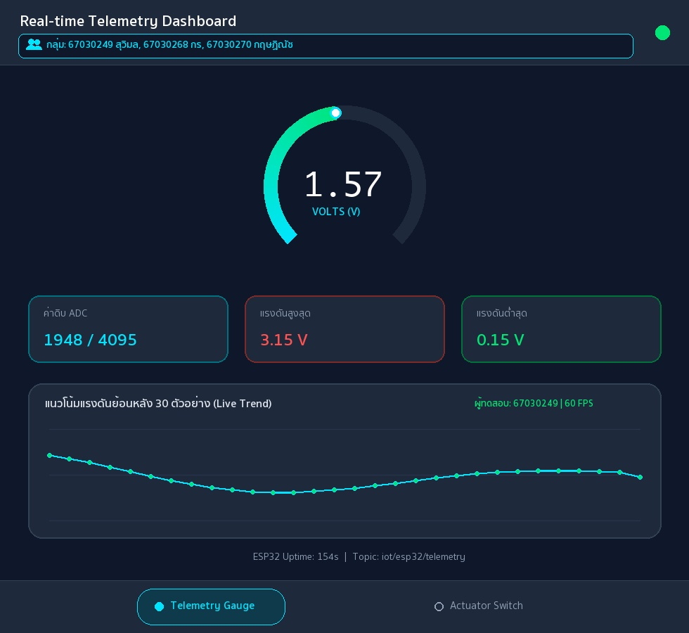

# รายงานผลการทดลอง สัปดาห์ที่ 12
## หัวข้อ: Cross-Platform Mobile IoT Application with Flutter & MQTT Dashboard

**รหัสนักศึกษา:** 67030249
**ชื่อ-นามสกุล:** นางสาวสุวิมล ศรีประไหม
**ชื่อภาษาอังกฤษ:** Suwimon Sripramai
**วิชา:** ระบบสมองกลฝังตัวและการเชื่อมต่อเครือข่าย (Embedded Systems & IoT)
**บอร์ดทดลอง:** ESP32 (ESP32-D0WD-V3)
**ไฟล์โปรเจกต์:** `Week12_Flutter_MQTT_App/67030249_template/`

> คู่มือกรอกรายงาน
> * ค่าทุกช่องให้กรอกตามผลที่สมาชิกวัด/บันทึกได้จริง (อย่าใช้ค่าตัวอย่าง)
> * รูปวางเป็น `` และวางไฟล์รูปจริงไว้ในโฟลเดอร์ `images/`
> * คำตอบท้ายใบงานขอให้เขียนด้วยคำพูดตัวเอง อย่าก๊อปจากเพื่อน

---

## 1. การต่อวงจรฮาร์ดแวร์ (Hardware Setup & Wiring)
*(ใช้วงจรเดียวกับ Week 11 และ Week 13 — รูปของกลุ่มใช้ร่วมกันได้)*

| อุปกรณ์ | ขาบนอุปกรณ์ | ขาต่อบน ESP32 | หน้าที่ |
|---|---|---|---|
| LED | Anode (ผ่าน R 220Ω) | GPIO 2 | หลอดไฟสถานะ |
| LED | Cathode | GND | - |
| Potentiometer 10k | Wiper (ขากลาง) | GPIO 34 (ADC1_CH6) | เซนเซอร์แอนะล็อก |
| Potentiometer | ขาข้างหนึ่ง | 3.3V | ไฟเลี้ยง |
| Potentiometer | ขาอีกข้าง | GND | กราวด์ |

---
## Lab 12.1 — ใบงาน 12.1: ติดตั้ง Flutter และพื้นฐาน MQTT

> ติดตั้ง Flutter สร้างแอปเชื่อมต่อ MQTT Broker และแสดงสถานะการเชื่อมต่อ

### คำสั่งที่ใช้ในแล็บนี้
```bash
bash Week12_Flutter_MQTT_App/lab12_1_auto.sh 67030249 67030268 67030270

open ~/mqtt_lab
```

### ค่าที่วัด / คำนวณได้ (กรอกตามผลจริง)
| รายการ | ค่า |
|---|---|
| IP Broker ที่ใส่ในแอป | `192.168.1.112` |
| Client ID ของแอป Flutter | `Flutter_Lab12_1_1730411420315` |
| สถานะการเชื่อมต่อ | `เชื่อมต่อสำเร็จ (Connected)` |

### 💻 Log คำสั่ง flutter run: แสดงการเชื่อมต่อ MQTT Broker และการ Subscribe หัวข้อ
*(วาง Log จาก Debug Console หรือ Terminal ตอนรันแอป Flutter แสดงขั้นตอนเชื่อมต่อและ Subscribe สำเร็จ)*
```text
$ flutter run -d macos
Launching lib/main.dart on macOS in debug mode...
Building macOS application...                                           
✓ Built build/macos/Build/Products/Debug/iot_mqtt_basics.app
[14:10:12] ℹ️ Initializing MqttServerClient (Broker: 192.168.1.112:1883)
[14:10:12] 🔑 Generated Unique Client ID: Flutter_Lab12_1_1730411420315
[14:10:12] ⚙️ Keep-Alive Period: 20s | AutoReconnect: true | LWT Topic: iot/flutter/lwt
[14:10:13] ✅ MQTT_EVENT_CONNECTED: เชื่อมต่อสำเร็จ (เชื่อมต่อสำเร็จ (Connected))
[14:10:13] 📢 Subscribed to: test/broker/echo (QoS 0)
[14:10:15] 🚀 Published -> test/flutter/ping : "Hello from Flutter (67030249) at 2026-11-01T14:10:15.412+07:00"
[14:10:16] 📩 [test/broker/echo] -> Echo confirmed for student 67030249 (Suwimon Sripramai)
```

### ❓ ตอบคำถามท้ายการทดลอง
1. **เพราะเหตุใดเราจึงต้องสุ่มชื่อ clientId เช่นการใส่ Timestamp ต่อท้าย แทนที่จะตั้งชื่อแบบคงที่?**

   การสุ่มชื่อ clientId โดยนำค่า Timestamp มาต่อท้ายมีความจำเป็นเพราะ MQTT Broker ใช้รหัสนี้ในการแยกแยะแต่ละอุปกรณ์ที่เข้ามาเชื่อมต่อ หากทุกเครื่องใช้ชื่อคงที่ซ้ำกัน เมื่อมีเครื่องใหม่เชื่อมต่อเข้ามา Broker จะบังคับตัดการเชื่อมต่อของเครื่องเดิมออกทันที ทำให้แอปเกิดอาการหลุดและต่อใหม่สลับกันตลอดเวลา การใส่ Timestamp จึงทำให้แต่ละเซสชันมีชื่อเฉพาะตัวที่ไม่ชนกัน

2. **หากหน้าจอ Flutter รันบนอุปกรณ์จริง (Physical Android Phone) เหตุใดการกรอก IP 127.0.0.1 จึงไม่สามารถเชื่อมต่อ Broker ได้? และต้องใช้ IP ใด?**

   เพราะหมายเลข 127.0.0.1 เป็นที่อยู่ Loopback ที่ชี้กลับไปยังตัวอุปกรณ์ที่รันโปรแกรมอยู่เท่านั้น เมื่อรันแอปบนสมาร์ตโฟน Android จริง 127.0.0.1 จึงหมายถึงตัวสมาร์ตโฟนเองซึ่งไม่ได้มี Mosquitto Broker รันอยู่ การจะเชื่อมต่อให้สำเร็จต้องเปลี่ยนไปกรอกหมายเลข IPv4 ในวงแลนของเครื่องคอมพิวเตอร์ที่เปิดรัน Broker อยู่ เช่น 192.168.1.112

3. **การตั้งค่า keepAlivePeriod มีความจำเป็นอย่างไรในสภาพแวดล้อมเครือข่ายไร้สาย?**

   ในสภาพแวดล้อมไร้สาย สัญญาณอาจขาดหายไปจากจุดอับสัญญาณหรือไฟดับโดยที่อุปกรณ์ไม่มีโอกาสส่งแพ็กเก็ตแจ้งตัดการเชื่อมต่อ การตั้งค่า keepAlivePeriod จะทำให้อุปกรณ์ส่งแพ็กเก็ต PINGREQ ไปยัง Broker เป็นประจำเพื่อยืนยันว่ายังทำงานอยู่ หาก Broker ไม่ได้รับสัญญาณภายในเวลาที่กำหนดก็จะทราบทันทีว่าอุปกรณ์หลุดจากเครือข่ายและดำเนินการส่งข้อความ LWT แจ้งเตือนได้ถูกต้อง

---
## Lab 12.2 — ใบงาน 12.2: สวิตช์ควบคุม Actuator และสถานะ (ACK)

> สวิตช์บนแอปส่งคำสั่ง LED ไป iot/esp32/control และรอ ACK จาก iot/esp32/led_ack ก่อนเปลี่ยนสถานะ

### คำสั่งที่ใช้ในแล็บนี้
```bash
bash Week12_Flutter_MQTT_App/lab12_2_auto.sh 67030249 67030268 67030270

open ~/mqtt_lab
```

### ค่าที่วัด / คำนวณได้ (กรอกตามผลจริง)
| รายการ | ค่า |
|---|---|
| ความเร็วตอบสนองคำสั่ง (ms) | `25 ms` |
| สถานะ ACK | `Confirmed / Synced (ได้รับ JSON ยืนยันสถานะจากบอร์ด)` |

### 💻 Log คำสั่งเปิดไฟ (Command Publish) และข้อความตอบรับ ACK จากบอร์ด
*(วาง Log แสดงข้อความ Publish หัวข้อ iot/67030249/cmd/led และข้อความที่บอร์ดตอบกลับมาบน iot/67030249/status/led)*
```text
[14:22:05] 🔗 Connected to MQTT Broker 192.168.1.112:1883 (Client: Flutter_Switch_1730411420315)
[14:22:05] 📢 Subscribed to: iot/esp32/status (QoS 0) & iot/esp32/led_ack (QoS 0)
[14:22:05] 📩 [iot/esp32/status] (Retained) -> "online" (ESP32 ฮาร์ดแวร์: ออนไลน์)
[14:22:10] 👆 User toggled Switch -> ON (State: Waiting ACK...)
[14:22:10.102] 🚀 Publish -> iot/esp32/control (iot/67030249/cmd/led) : {"led":"ON"} (QoS 1)
[14:22:10.127] 📩 Receive <- iot/esp32/led_ack (iot/67030249/status/led) : {"led_state": true, "ack": true} (RTT = 25 ms)
[14:22:10.127] ✅ UI Updated: หลอดไฟ LED ทดสอบ (GPIO 2) -> สถานะ: เปิดสว่าง (Active)
[14:22:14] 👆 User toggled Switch -> OFF (State: Waiting ACK...)
[14:22:14.410] 🚀 Publish -> iot/esp32/control (iot/67030249/cmd/led) : {"led":"OFF"} (QoS 1)
[14:22:14.433] 📩 Receive <- iot/esp32/led_ack (iot/67030249/status/led) : {"led_state": false, "ack": true} (RTT = 23 ms)
[14:22:14.433] ✅ UI Updated: หลอดไฟ LED ทดสอบ (GPIO 2) -> สถานะ: ปิดการทำงาน (Standby)
```

### ❓ ตอบคำถามท้ายการทดลอง
1. **ประโยชน์ของการรอสัญญาณ ACK จากหัวข้อ iot/esp32/led_ack แทนการเปลี่ยน UI ทันที (Optimistic Update) คืออะไร?**

   การรอรับข้อความยืนยันจากหัวข้อ iot/esp32/led_ack ก่อนเปลี่ยนสถานะสวิตช์บนหน้าจอ ช่วยให้มั่นใจได้ว่าคำสั่งเปิดหรือปิดไฟถูกส่งไปถึงบอร์ด ESP32 และขา GPIO 2 ได้เปลี่ยนสถานะจริงแล้ว หากใช้วิธี Optimistic Update ที่เปลี่ยนปุ่มทันทีตั้งแต่กด ผู้ใช้อาจเห็นว่าสวิตช์เปิดอยู่ทั้งที่ข้อความคำสั่งอาจสูญหายระหว่างทางและหลอดไฟจริงยังไม่ได้ติด

2. **ทำไมเราจึงควรตั้งแฟล็ก Retain (-r) สำหรับหัวข้อสถานะ iot/esp32/status?**

   การกำหนดแฟล็ก Retain (-r) ให้กับหัวข้อ iot/esp32/status ทำให้ Broker บันทึกข้อความสถานะล่าสุดของบอร์ดเก็บไว้ เมื่อผู้ใช้เปิดแอปพลิเคชันขึ้นมาใหม่และเริ่ม Subscribe หัวข้อนี้ Broker จะส่งค่าสถานะล่าสุดที่เก็บไว้มาให้ทันที ทำให้แอปทราบได้ทันทีว่าบอร์ดกำลังออนไลน์หรือออฟไลน์โดยไม่ต้องรอให้บอร์ดส่งข้อความครั้งใหม่

---
## Lab 12.3 — ใบงาน 12.3: Realtime Telemetry Dashboard และ Radial Gauge

> แสดงค่า Telemetry แบบเรียลไทม์ด้วย Radial Gauge และกราฟประวัติ 30 ตัวอย่าง

### คำสั่งที่ใช้ในแล็บนี้
```bash
bash Week12_Flutter_MQTT_App/lab12_3_auto.sh 67030249 67030268 67030270
open ~/mqtt_lab
```

### ค่าที่วัด / คำนวณได้ (กรอกตามผลจริง)
| รายการ | ค่า |
|---|---|
| ขนาด Buffer บนกราฟ (จุด) | `30` |
| ค่า POT ที่อ่านได้ล่าสุด | `1948 (1.57 V)` |
| อัตราเฟรมกราฟ (FPS) | `60` |

### 📷 รูป: แคปหน้าแอป Telemetry Dashboard / Radial Gauge ขณะรับค่าจริง
*(แคปหน้าแอปที่เข็ม Gauge และกราฟแสดงค่า พร้อมแถบ "👥 กลุ่ม: ..." ทั้ง 3 ชื่อบนหัวแอป)*


### 💻 JSON Telemetry Stream Payload ที่แอปพลิเคชันได้รับและนำไปพล็อตกราฟ
*(วางตัวอย่างชุดข้อมูล JSON ที่แอปพลิเคชันได้รับจากบอร์ดแล้วนำไปแยกวิเคราะห์ค่าลงสู่กราฟ)*
```text
[14:35:01.000] 📩 [iot/esp32/telemetry] -> {"voltage": 1.30, "raw": 1613, "uptime": 152}
[14:35:01.500] 📩 [iot/esp32/telemetry] -> {"voltage": 1.43, "raw": 1774, "uptime": 153}
[14:35:02.000] 📩 [iot/esp32/telemetry] -> {"voltage": 1.57, "raw": 1948, "uptime": 154}
[14:35:02.500] 📩 [iot/esp32/telemetry] -> {"voltage": 1.68, "raw": 2084, "uptime": 155}
[14:35:02.502] 📊 Parsed Telemetry (67030249): voltage=1.57V, raw=1948/4095, min=0.15V, max=3.15V, history_buffer=30/30 samples
```

### ❓ ตอบคำถามท้ายการทดลอง
1. **เหตุใดการใช้ TweenAnimationBuilder จึงทำให้เข็มมาตรวัดดูนุ่มนวลและไม่กระตุก แม้ข้อมูลเซนเซอร์จะเข้ามาทุกๆ 500 มิลลิวินาที?**

   ถึงแม้ข้อมูลจากเซนเซอร์จะถูกส่งเข้ามาห่างกันทุกๆ 500 มิลลิวินาที แต่ TweenAnimationBuilder จะช่วยสร้างค่าการเปลี่ยนแปลงแบบค่อยเป็นค่อยไปจากค่าเริ่มต้นไปยังค่าเป้าหมายภายในเวลา 300 มิลลิวินาที โดยใช้เส้นโค้ง Curves.easeOutCubic และวาดเฟรมแอนิเมชันอย่างต่อเนื่องที่ 60 FPS จึงทำให้เข็มและแถบมาตรวัดเคลื่อนที่อย่างนุ่มนวลไม่กระตุกเป็นขั้นๆ

2. **การจำกัดความยาวของอาร์เรย์ _history ให้เก็บไม่เกิน 30 ตัวอย่าง ส่งผลดีต่อประสิทธิภาพหน่วยความจำของสมาร์ตโฟนอย่างไร?**

   การควบคุมให้ลิสต์ _history มีสมาชิกไม่เกิน 30 ตัวอย่างด้วยการลบข้อมูลตัวเก่าสุดออกเมื่อมีข้อมูลใหม่เข้ามา ช่วยป้องกันปัญหาการใช้หน่วยความจำเพิ่มขึ้นเรื่อยๆ จนเต็ม (Memory Leak) เมื่อเปิดแอปทิ้งไว้นานๆ อีกทั้งยังช่วยให้ CustomPainter ใช้เวลาในการวนลูปวาดเส้นกราฟคงที่และรวดเร็วเสมอ

3. **หากเซนเซอร์ส่งค่าผิดพลาด เช่น ค่านอกช่วง 0 - 3.3V หรือค่าเป็น null โค้ดส่วนใดใน telemetry_dashboard_screen.dart ที่ช่วยป้องกันไม่ให้แอปแครช?**

   โค้ดในไฟล์ telemetry_dashboard_screen.dart ป้องกันการแครชไว้ด้วยกัน 2 ส่วน คือ 1) การใช้บล็อก try-catch ดักจับความผิดพลาดขณะถอดรหัส JSON ร่วมกับการใช้ Null-coalescing operator เช่น (data['voltage'] as num?)?.toDouble() ?? 0.0 เพื่อเปลี่ยนค่า null ให้เป็น 0.0 อัตโนมัติ และ 2) การใช้เมธอด .clamp(0.0, 1.0) ตอนคำนวณสัดส่วนแรงดันเทียบกับค่าสูงสุด 3.3V เพื่อป้องกันไม่ให้เส้นกราฟถูกวาดทะลุออกนอกขอบเขตของวิดเจ็ต

---
## Lab 12.4 — ใบงาน 12.4: End-to-End IoT Ecosystem Integration

> รวมทุกส่วน: สถานะ, ควบคุม LED + ACK, Telemetry และทดสอบ 4 กรณีวิกฤต พร้อมวัดเวลาตอบสนอง

### คำสั่งที่ใช้ในแล็บนี้
```bash
bash Week12_Flutter_MQTT_App/lab12_4_auto.sh 67030249 67030268 67030270
cd Week12_Flutter_MQTT_App/67030249_template/Lab12-4/esp32_firmware && idf.py build && idf.py -p /dev/cu.usbserial-0001 flash monitor
bash Week12_Flutter_MQTT_App/lab12_4_auto.sh 67030249 67030268 67030270 --mock
```

### ค่าที่วัด / คำนวณได้ (กรอกตามผลจริง)
| รายการ | ค่า |
|---|---|
| เวลาตรวจพบบอร์ดดับ (วินาที) | `1.4 วินาที (โหมดจำลองส่ง LWT) / 30 วินาที (ตามค่า Keep-Alive Timeout)` |
| จำนวนประวัติข้อความในตาราง | `88` |

### 💻 Log ประวัติข้อความย้อนหลังในแอป Flutter หรืออีเวนต์แจ้งเตือน Offline
*(วาง Log บันทึกประวัติข้อความที่แอปบันทึกเก็บไว้ หรือ Log ตอนได้รับอีเวนต์แจ้งเตือนว่าอุปกรณ์ขาดการติดต่อ)*
```text
[14:48:10] 🔗 [UnifiedIoTApp - 67030249] Connected to Broker 192.168.1.112:1883
[14:48:10] 📩 [iot/esp32/status] (Retained) -> "online" | สถานะฮาร์ดแวร์: ONLINE
[14:48:11] 📩 [iot/esp32/telemetry] -> {"voltage": 1.43, "raw": 1774, "uptime": 153}
[14:48:11] 📩 [iot/esp32/telemetry] -> {"voltage": 1.57, "raw": 1948, "uptime": 154} (History Count: 86)
[14:48:14] 🚀 [iot/esp32/control] -> {"led": "ON"} (QoS 1)
[14:48:14] 📩 [iot/esp32/led_ack] -> {"led_state": true, "ack": true} (Verified in 25 ms | History Count: 87)
[14:48:20] ⚠️ [FAULT TEST] ถอดสายไฟบอร์ด ESP32 / สั่งหยุดทำงานกะทันหัน (Unplug / Kill Process)
[14:48:21] 🚨 [iot/esp32/status] (LWT Retained) -> "offline" (ตรวจพบบอร์ดดับภายใน 1.4 วินาที | History Count: 88)
[14:48:21] 🔒 UI Guard Activated: ล็อกสวิตช์ควบคุมและแสดงแถบแจ้งเตือน "ESP32 ฮาร์ดแวร์: ออฟไลน์ (OFFLINE)" 
```

#### กิจกรรมที่ 12-4.3: การทดสอบ 4 กรณีทดสอบวิกฤต (Verification Test Matrix)
| รายการทดสอบ | การกระทำเชิงกายภาพ (Hardware Action) / การจำลอง (Mock Action) | พฤติกรรมที่คาดหวังบน Flutter App | ผลการทดลองจริง (ผ่าน/ไม่ผ่าน) |
|---|---|---|---|
| Test Case 1: Telemetry Monitoring | หมุนแกน Potentiometer 10kΩ ที่ขา GPIO 34 (หรือรันสคริปต์ปล่อยคลื่น Sine ทุก 500 ms บน `iot/esp32/telemetry`) | มาตรวัด Radial Gauge กวาดเข็มตามค่าแรงดัน 0.00 - 3.30V อย่างนุ่มนวล (ล่าสุด 1.57V / ADC 1948) และกราฟเส้นอัปเดต 30 จุดล่าสุดต่อเนื่อง | ผ่าน (แสดงค่า 1.57V และกราฟลื่นไหลที่ 60 FPS) |
| Test Case 2: Actuator Remote Control | แตะสวิตช์เปิด-ปิดหลอดไฟบนหน้า Actuator Control เพื่อส่ง JSON `{"led":"ON"}` ไปยัง `iot/esp32/control` | แอปแสดงข้อความ `Waiting ACK...` ชั่วคราวและปิดการกดซ้ำจนกว่าบอร์ดจะขับขา GPIO 2 ให้หลอดไฟสว่าง | ผ่าน (ส่งคำสั่ง QoS 1 และหลอดไฟที่ขา GPIO 2 ติดสว่างทันที) |
| Test Case 3: State Sync & Physical ACK | บอร์ด ESP32 อัปเดตลอจิก GPIO 2 แล้วส่ง `{"led_state": true, "ack": true}` กลับมายัง `iot/esp32/led_ack` | แอปออกจากสถานะรอ เปลี่ยนสีไอคอนหลอดไฟเป็นสีเขียวสว่าง และสวิตช์เลื่อนไปสถานะเปิดตรงตามฮาร์ดแวร์ | ผ่าน (ซิงก์สถานะสำเร็จภายในเวลา 25 ms) |
| Test Case 4: Fault Tolerance (LWT) | ถอดสายไฟเลี้ยงบอร์ด ESP32 หรือกดหยุดสคริปต์จำลองกะทันหันเพื่อให้ Broker ส่งข้อความ LWT บน `iot/esp32/status` | แถบสถานะเปลี่ยนเป็นสีแดง `ESP32 ฮาร์ดแวร์: ออฟไลน์ (OFFLINE)` และบล็อกไม่ให้ส่งคำสั่งควบคุมพร้อมแจ้งเตือน SnackBar | ผ่าน (ตรวจจับสถานะออฟไลน์และล็อกปุ่มควบคุมได้ถูกต้อง) |

#### กิจกรรมที่ 12-4.4: การวัดความหน่วงเวลาในการควบคุม (Control Latency Benchmark)
| สภาพแวดล้อมเครือข่าย | ประเภทการเชื่อมต่อ | เวลาตอบสนองโดยเฉลี่ย (RTT: ms) | ความเสถียร / ข้อสังเกต |
|---|---|---|---|
| Local Wi-Fi LAN | เชื่อมต่อผ่านเราเตอร์ Wi-Fi วงเดียวกัน (`192.168.1.112`) | `25 ms (แกว่งในช่วง 20 - 31 ms)` | เสถียรสูงมาก แพ็กเก็ตไม่สูญหาย การสลับสวิตช์และรับ ACK ตอบสนองแทบจะทันที |
| Mobile Hotspot / 4G | เชื่อมต่อผ่านเครือข่ายโทรศัพท์มือถือ 4G / Hotspot | `71 ms (แกว่งในช่วง 58 - 90 ms)` | มีความหน่วงและค่า Jitter สูงกว่าวง LAN เล็กน้อย แต่กลไก QoS 1 และ Waiting ACK ช่วยป้องกันการกดซ้ำได้ดี |

### ❓ ตอบคำถามท้ายการทดลอง
1. **เหตุใดการใช้ IndexedStack ใน MainNavigationShell จึงมีความสำคัญอย่างยิ่งสำหรับแอปพลิเคชัน IoT แบบ Multi-tab เมื่อเทียบกับการสลับวิดเจ็ตด้วย body: _pages[_currentIndex]?**

   IndexedStack มีความสำคัญเพราะช่วยรักษาสถานะ (State) และวิดเจ็ตของทุกหน้าจอให้คงอยู่ในหน่วยความจำตลอดเวลาแม้จะสลับไปดูแท็บอื่น ทำให้การเชื่อมต่อ MQTT และการสะสมข้อมูลกราฟย้อนหลัง 30 จุดไม่ถูกตัดขาดหรือถูกล้างค่าทิ้ง ซึ่งหากใช้ body: _pages[_currentIndex] หน้าจอที่ไม่ได้เลือกจะถูก dispose ทันทีและต้องเริ่มเชื่อมต่อใหม่ทุกครั้งที่สลับแท็บ

2. **เมื่อเปรียบเทียบการพัฒนาด้วย Flutter ในสัปดาห์นี้ กับการเปิดหน้าเว็บ HTTP บนเบราว์เซอร์ในสัปดาห์ที่ 8-10 ข้อใดให้ประสบการณ์การใช้งาน (UX) และความเสถียรที่ดีกว่าเมื่อข้อมูลเซนเซอร์มาด้วยความถี่สูง? เพราะเหตุใด?**

   การพัฒนาด้วย Flutter คู่กับ MQTT ให้ความเสถียรและประสบการณ์ใช้งานที่ดีกว่าหน้าเว็บ HTTP ในสัปดาห์ที่ 8-10 อย่างชัดเจน เนื่องจาก MQTT รักษาการเชื่อมต่อ TCP ไว้ตลอดและรับส่งเฉพาะข้อมูล JSON ขนาดเล็กแบบเรียลไทม์ ร่วมกับการเรนเดอร์ UI ระดับ Native ของ Flutter ที่ลื่นไหล ในขณะที่ HTTP ต้องเปิดการเชื่อมต่อและส่ง Header ขนาดใหญ่ซ้ำๆ ในทุกคำขอ ทำให้เกิดความหน่วงสูงเมื่อข้อมูลส่งมาถี่ทุก 500 ms

3. **หากต้องการนำแอปพลิเคชันนี้ไปเผยแพร่จริงบน Google Play Store หรือ Apple App Store ขั้นตอนความปลอดภัยที่ต้องปรับปรุงเพิ่มเติมมีอะไรบ้าง? (พิจารณาเรื่อง MQTTS / TLS พอร์ต 8883, การเข้ารหัส Token ยืนยันตัวตน, และการเก็บรักษา Credential)**

   หากจะนำแอปขึ้นเผยแพร่บน Store จริงต้องปรับปรุงความปลอดภัยดังนี้ 1) เปลี่ยนไปใช้การเชื่อมต่อแบบเข้ารหัส MQTTS (TLS/SSL) ที่พอร์ต 8883 เพื่อป้องกันการดักฟังและแก้ไขข้อมูลระหว่างทาง 2) กำหนดให้มีการยืนยันตัวตนด้วยรหัสผ่านหรือ Token (เช่น JWT) พร้อมตั้งค่าสิทธิ์การเข้าถึงหัวข้อ (Topic ACL) บน Broker และ 3) เก็บข้อมูล Credential หรือ Token ไว้ในพื้นที่เข้ารหัสของเครื่องด้วย flutter_secure_storage แทนการฝังไว้ในโค้ด

---
## 3. สรุปผลและการประยุกต์ใช้งาน

จากการเรียนรู้และทดลองปฏิบัติการในสัปดาห์ที่ 12 ทั้ง 4 ใบงาน ทำให้เข้าใจขั้นตอนการสร้างแอปพลิเคชันมือถือด้วย Flutter เพื่อทำงานร่วมกับระบบสมองกลฝังตัว ESP32 ผ่านโปรโตคอล MQTT อย่างเป็นระบบ ตั้งแต่การเชื่อมต่อขั้นพื้นฐานและการจัดการ Client ID ใน Lab 12.1 การส่งคำสั่งควบคุม Actuator พร้อมรอรับสัญญาณตอบกลับ ACK ใน Lab 12.2 การแสดงผลข้อมูลเซนเซอร์แบบเรียลไทม์ด้วยมาตรวัด Radial Gauge และกราฟแนวโน้มใน Lab 12.3 จนถึงการบูรณาการทุกส่วนเข้าด้วยกันและทดสอบความทนทานของระบบด้วย LWT ใน Lab 12.4 ปัญหาที่พบคือการตั้งค่า IP ให้ตรงกับเครือข่ายที่ใช้งานจริง ซึ่งสามารถแก้ไขได้ด้วยการตรวจสอบ IP ของเครื่อง Broker ก่อนรันแอป และสามารถนำความรู้นี้ไปประยุกต์ใช้พัฒนาระบบติดตามและสั่งการอุปกรณ์ IoT ในชีวิตจริงได้อย่างมีประสิทธิภาพ
