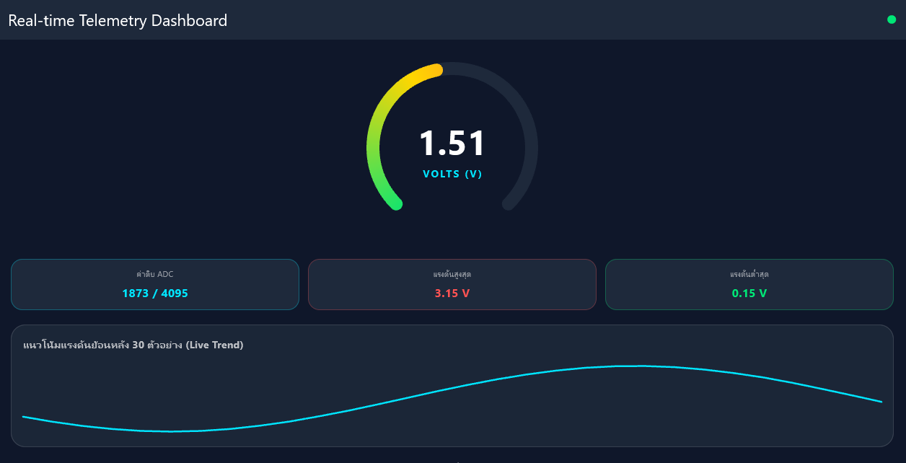
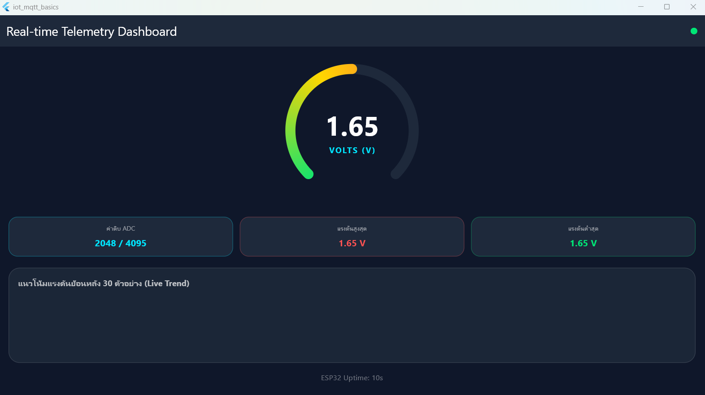
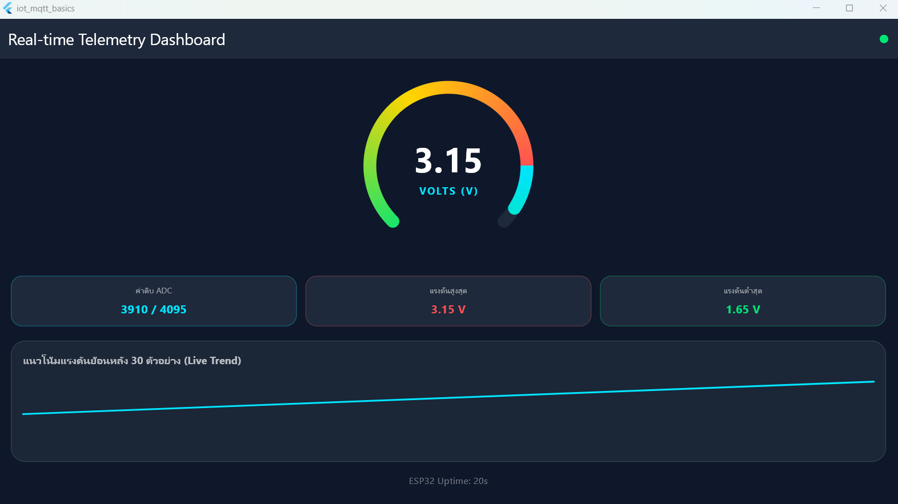

# ใบงานการทดลองที่ 12.3
### การสร้างแดชบอร์ดแสดงผลเซนเซอร์เรียลไทม์ด้วย Radial Gauge และ Live Trend Line Chart

**รหัสนักศึกษา:** 67030260

> [!NOTE] **คำชี้แจง**
> ในใบงานนี้นักศึกษาจะได้สร้างหน้าจอแดชบอร์ดแสดงผลการตรวจวัดแรงดันไฟฟ้าแอนะล็อกแบบเรียลไทม์ โดยถอดรหัสแพ็กเก็ต JSON ที่ส่งมาจาก ESP32 นำมาขับเคลื่อนเข็มมาตรวัดทรงกลม (Radial Gauge) ด้วยแอนิเมชันที่นุ่มนวล พร้อมทั้งวาดกราฟเส้นแนวโน้มย้อนหลัง (Live Trend Chart) โดยประมวลผลข้อมูลด้วยความเร็วสูงผ่านเอนจินกราฟิกของ Flutter

---

## 1. วัตถุประสงค์การทดลอง
1. สามารถเขียนโค้ดถอดรหัส JSON Payload จากหัวข้อ `iot/esp32/telemetry` เข้าสู่ Data Model ในภาษา Dart ได้
2. สามารถพัฒนามาตรวัดทรงกลม (Radial Gauge) ผ่าน `CustomPainter` และทำแอนิเมชันปรับความนุ่มนวลของเข็มด้วย `TweenAnimationBuilder` ได้
3. สามารถบันทึกประวัติข้อมูลแรงดันและวาดกราฟเส้น (Live Trend Sparkline) ได้อย่างต่อเนื่อง
4. สามารถคำนวณและแสดงผลค่าสถิติ (Max, Min, Uptime) ได้

---

## 2. โครงสร้างหัวข้อ MQTT และการไหลของข้อมูล (Topic Architecture & Data Flow)

<p align="center"></p>

| ชื่อหัวข้อ (Topic) | ทิศทางการส่ง | ชนิดข้อมูล (Payload Format) | วัตถุประสงค์ |
| :--- | :--- | :--- | :--- |
| `iot/esp32/telemetry` | ESP32 -> Flutter | JSON: `{"voltage": 2.50, "raw": 3102, "uptime": 10}` | ส่งข้อมูลตรวจวัดแรงดันไฟฟ้าแอนะล็อกและสถานะระบบแบบเรียลไทม์ |

---

## 3. ขั้นตอนการทดลอง (Step-by-Step Activities)

### กิจกรรมที่ 12-3.1: การเตรียมโปรเจกต์และการสร้างคอมโพเนนต์มาตรวัด

#### 1. คัดลอกโปรเจกต์จาก Lab ก่อนหน้า
เพื่อประหยัดเวลาและไม่ต้องติดตั้งแพ็กเกจ `mqtt_client` ใหม่อีกครั้ง ให้นักศึกษาคัดลอกโฟลเดอร์โปรเจกต์จาก Lab 12-1 (หรือ Lab 12-2) มาเป็นโฟลเดอร์สำหรับ Lab 12-3:

**คำสั่ง PowerShell:**
```powershell
# กรณีที่ 1: คัดลอกโฟลเดอร์โปรเจกต์จาก Lab12-1 มาเป็น Lab12-3 (แนะนำ)
Copy-Item -Recurse -Path "..\Lab12-1\iot_mqtt_basics" -Destination "..\Lab12-3\iot_telemetry_gauge"

# กรณีที่ 2: หรือหากต้องการคัดลอกจาก Lab12-2
Copy-Item -Recurse -Path "..\Lab12-2\iot_actuator_switch" -Destination "..\Lab12-3\iot_telemetry_gauge"

# ย้ายเข้าไปยังโฟลเดอร์โปรเจกต์ใหม่
cd ..\Lab12-3\iot_telemetry_gauge

# ล้างแคชการคอมไพล์เดิมออก (จำเป็นอย่างยิ่งเพื่อป้องกัน CMake Error จาก Path เก่า)
flutter clean
```
*(หรือคลิกขวา Copy โฟลเดอร์ใน File Explorer แล้ว Paste วางในโฟลเดอร์ใหม่ และรันคำสั่ง `flutter clean` เสมอ)*

#### 2. สร้างคอมโพเนนต์มาตรวัด (`lib/radial_gauge_widget.dart`)
ในโฟลเดอร์ `lib/` ให้สร้างไฟล์ใหม่ชื่อ `radial_gauge_widget.dart` สำหรับวาดมาตรวัดความเร็ว/แรงดัน:

```dart
import 'dart:math' as math;
import 'package:flutter/material.dart';

class RadialGaugeWidget extends StatelessWidget {
  final double value; // ค่าแรงดัน (0.0 ถึง 3.3V)
  final double maxLimit;

  const RadialGaugeWidget({
    super.key,
    required this.value,
    this.maxLimit = 3.3,
  });

  @override
  Widget build(BuildContext context) {
    return TweenAnimationBuilder<double>(
      tween: Tween<double>(begin: 0.0, end: value),
      duration: const Duration(milliseconds: 300),
      curve: Curves.easeOutCubic,
      builder: (context, animatedValue, child) {
        return SizedBox(
          width: 260,
          height: 260,
          child: Stack(
            alignment: Alignment.center,
            children: [
              CustomPaint(
                size: const Size(260, 260),
                painter: _GaugePainter(value: animatedValue, maxLimit: maxLimit),
              ),
              Column(
                mainAxisSize: MainAxisSize.min,
                children: [
                  Text(
                    animatedValue.toStringAsFixed(2),
                    style: const TextStyle(
                      fontSize: 48,
                      fontWeight: FontWeight.bold,
                      color: Colors.white,
                      fontFamily: 'monospace',
                    ),
                  ),
                  const Text(
                    'VOLTS (V)',
                    style: TextStyle(
                      fontSize: 14,
                      letterSpacing: 2,
                      fontWeight: FontWeight.bold,
                      color: Color(0xFF00E5FF),
                    ),
                  ),
                ],
              ),
            ],
          ),
        );
      },
    );
  }
}

class _GaugePainter extends CustomPainter {
  final double value;
  final double maxLimit;

  _GaugePainter({required this.value, required this.maxLimit});

  @override
  void paint(Canvas canvas, Size size) {
    final center = Offset(size.width / 2, size.height / 2);
    final radius = size.width / 2 - 20;

    const startAngle = 135 * (math.pi / 180);
    const sweepAngle = 270 * (math.pi / 180);

    // 1. เส้น Track วงกลมพื้นหลัง
    final trackPaint = Paint()
      ..color = const Color(0xFF1E293B)
      ..style = PaintingStyle.stroke
      ..strokeWidth = 18
      ..strokeCap = StrokeCap.round;

    canvas.drawArc(
      Rect.fromCircle(center: center, radius: radius),
      startAngle,
      sweepAngle,
      false,
      trackPaint,
    );

    // 2. เส้นแสดงระดับค่า (Gradient Active Arc)
    final ratio = (value / maxLimit).clamp(0.0, 1.0);
    final currentSweep = sweepAngle * ratio;

    final activePaint = Paint()
      ..shader = const SweepGradient(
        colors: [Color(0xFF00E5FF), Color(0xFF00E676), Color(0xFFFFD600), Color(0xFFFF5252)],
        startAngle: 0.0,
        endAngle: math.pi * 2,
      ).createShader(Rect.fromCircle(center: center, radius: radius))
      ..style = PaintingStyle.stroke
      ..strokeWidth = 18
      ..strokeCap = StrokeCap.round;

    canvas.drawArc(
      Rect.fromCircle(center: center, radius: radius),
      startAngle,
      currentSweep,
      false,
      activePaint,
    );
  }

  @override
  bool shouldRepaint(covariant _GaugePainter oldDelegate) =>
      oldDelegate.value != value;
}
```

---

### กิจกรรมที่ 12-3.2: การสร้างหน้าจอ Telemetry Dashboard (`telemetry_dashboard_screen.dart`)

#### 1. สร้างไฟล์หน้าจอแดชบอร์ด (`lib/telemetry_dashboard_screen.dart`)
ในโฟลเดอร์ `lib/` ให้สร้างไฟล์ใหม่ชื่อ `telemetry_dashboard_screen.dart` และใส่โค้ดต่อไปนี้:

```dart
import 'dart:convert';
import 'dart:math' as math;
import 'package:flutter/material.dart';
import 'package:mqtt_client/mqtt_client.dart';
import 'package:mqtt_client/mqtt_server_client.dart';
import 'radial_gauge_widget.dart';

class TelemetryDashboardScreen extends StatefulWidget {
  final String brokerIp;
  const TelemetryDashboardScreen({super.key, required this.brokerIp});

  @override
  State<TelemetryDashboardScreen> createState() => _TelemetryDashboardScreenState();
}

class _TelemetryDashboardScreenState extends State<TelemetryDashboardScreen> {
  MqttServerClient? _client;
  double _currentVoltage = 0.0;
  int _currentRaw = 0;
  int _currentUptime = 0;
  double _maxVoltage = 0.0;
  double _minVoltage = 3.3;

  final List<double> _history = [];
  bool _isConnected = false;

  @override
  void initState() {
    super.initState();
    _connect();
  }

  @override
  void dispose() {
    _client?.disconnect();
    super.dispose();
  }

  Future<void> _connect() async {
    final clientId = 'Flutter_Telemetry_${DateTime.now().millisecondsSinceEpoch}';
    _client = MqttServerClient(widget.brokerIp, clientId);
    _client!.port = 1883;

    _client!.onConnected = () {
      setState(() => _isConnected = true);
      _client!.subscribe('iot/esp32/telemetry', MqttQos.atMostOnce);
      _client!.updates?.listen(_handleIncomingMessage);
    };

    _client!.onDisconnected = () {
      setState(() => _isConnected = false);
    };

    try {
      await _client!.connect();
    } catch (_) {}
  }

  void _handleIncomingMessage(List<MqttReceivedMessage<MqttMessage>> c) {
    final recMess = c[0].payload as MqttPublishMessage;
    final payload = MqttPublishPayload.bytesToStringAsString(recMess.payload.message);

    try {
      final data = jsonDecode(payload) as Map<String, dynamic>;
      final v = (data['voltage'] as num?)?.toDouble() ?? 0.0;
      final raw = (data['raw'] as num?)?.toInt() ?? 0;
      final up = (data['uptime'] as num?)?.toInt() ?? 0;

      setState(() {
        _currentVoltage = v;
        _currentRaw = raw;
        _currentUptime = up;
        _maxVoltage = math.max(_maxVoltage, v);
        _minVoltage = math.min(_minVoltage, v);

        _history.add(v);
        if (_history.length > 30) _history.removeAt(0);
      });
    } catch (e) {
      debugPrint('Parsing error: $e');
    }
  }

  @override
  Widget build(BuildContext context) {
    return Scaffold(
      backgroundColor: const Color(0xFF0F172A),
      appBar: AppBar(
        title: const Text('Real-time Telemetry Dashboard'),
        backgroundColor: const Color(0xFF1E293B),
        actions: [
          Padding(
            padding: const EdgeInsets.only(right: 16.0),
            child: Icon(
              Icons.circle,
              size: 14,
              color: _isConnected ? const Color(0xFF00E676) : Colors.redAccent,
            ),
          )
        ],
      ),
      body: SingleChildScrollView(
        padding: const EdgeInsets.all(20),
        child: Column(
          children: [
            // 1. มาตรวัดเข็มทรงกลม
            Center(
              child: RadialGaugeWidget(value: _currentVoltage, maxLimit: 3.3),
            ),
            const SizedBox(height: 24),

            // 2. การ์ดสรุปค่าสถิติ (Statistics Cards)
            Row(
              children: [
                _buildMetricCard('ค่าดิบ ADC', '$_currentRaw / 4095', const Color(0xFF00E5FF)),
                const SizedBox(width: 12),
                _buildMetricCard('แรงดันสูงสุด', '${_maxVoltage.toStringAsFixed(2)} V', const Color(0xFFFF5252)),
                const SizedBox(width: 12),
                _buildMetricCard('แรงดันต่ำสุด', '${_minVoltage == 3.3 ? 0.0 : _minVoltage.toStringAsFixed(2)} V', const Color(0xFF00E676)),
              ],
            ),
            const SizedBox(height: 20),

            // 3. กราฟเส้นแนวโน้มสด (Live Sparkline Graph)
            Container(
              padding: const EdgeInsets.all(16),
              decoration: BoxDecoration(
                color: const Color(0xFF1E293B).withOpacity(0.8),
                borderRadius: BorderRadius.circular(20),
                border: Border.all(color: Colors.white12),
              ),
              child: Column(
                crossAxisAlignment: CrossAxisAlignment.start,
                children: [
                  const Text(
                    'แนวโน้มแรงดันย้อนหลัง 30 ตัวอย่าง (Live Trend)',
                    style: TextStyle(fontWeight: FontWeight.bold, color: Colors.white70),
                  ),
                  const SizedBox(height: 16),
                  SizedBox(
                    height: 100,
                    width: double.infinity,
                    child: CustomPaint(
                      painter: _SparklinePainter(history: _history, maxLimit: 3.3),
                    ),
                  ),
                ],
              ),
            ),
            const SizedBox(height: 16),
            Text(
              'ESP32 Uptime: ${_currentUptime}s',
              style: const TextStyle(color: Colors.white38, fontSize: 13),
            ),
          ],
        ),
      ),
    );
  }

  Widget _buildMetricCard(String title, String val, Color color) {
    return Expanded(
      child: Container(
        padding: const EdgeInsets.all(12),
        decoration: BoxDecoration(
          color: const Color(0xFF1E293B),
          borderRadius: BorderRadius.circular(16),
          border: Border.all(color: color.withOpacity(0.3)),
        ),
        child: Column(
          children: [
            Text(title, style: const TextStyle(fontSize: 11, color: Colors.white54)),
            const SizedBox(height: 6),
            Text(val, style: TextStyle(fontSize: 16, fontWeight: FontWeight.bold, color: color)),
          ],
        ),
      ),
    );
  }
}

class _SparklinePainter extends CustomPainter {
  final List<double> history;
  final double maxLimit;

  _SparklinePainter({required this.history, required this.maxLimit});

  @override
  void paint(Canvas canvas, Size size) {
    if (history.length < 2) return;

    final paint = Paint()
      ..color = const Color(0xFF00E5FF)
      ..strokeWidth = 2.5
      ..style = PaintingStyle.stroke
      ..strokeCap = StrokeCap.round;

    final path = Path();
    final dx = size.width / (history.length - 1);

    for (int i = 0; i < history.length; i++) {
      final x = i * dx;
      final y = size.height - ((history[i] / maxLimit).clamp(0.0, 1.0) * size.height);
      if (i == 0) {
        path.moveTo(x, y);
      } else {
        path.lineTo(x, y);
      }
    }

    canvas.drawPath(path, paint);
  }

  @override
  bool shouldRepaint(covariant _SparklinePainter oldDelegate) => true;
}
```

#### 2. ปรับปรุงไฟล์ `lib/main.dart` เพื่อเรียกใช้งานหน้าจอใหม่
เปิดไฟล์ `lib/main.dart` และแก้ไขโค้ดทั้งหมดให้เรียกใช้งาน `TelemetryDashboardScreen` เป็นหน้าจอเริ่มต้น (Home Screen):

```dart
import 'package:flutter/material.dart';
import 'telemetry_dashboard_screen.dart';

void main() {
  runApp(const TelemetryApp());
}

class TelemetryApp extends StatelessWidget {
  const TelemetryApp({super.key});

  @override
  Widget build(BuildContext context) {
    return MaterialApp(
      title: 'Lab 12.3 Telemetry Dashboard',
      theme: ThemeData.dark().copyWith(
        scaffoldBackgroundColor: const Color(0xFF0F172A),
        colorScheme: const ColorScheme.dark(
          primary: Color(0xFF00E5FF),
          secondary: Color(0xFF00E676),
        ),
      ),
      // กำหนด IP ของ Mosquitto Broker (ใช้ 127.0.0.1 หากรันบนคอมพิวเตอร์เครื่องเดียวกัน)
      home: const TelemetryDashboardScreen(brokerIp: '127.0.0.1'),
      debugShowCheckedModeBanner: false,
    );
  }
}
```

#### 3. สั่งรัน Flutter App
```powershell
# รันบน Windows Desktop
flutter run -d windows

# หรือรันบน Android Device / Emulator
flutter run -d <device-id>
```

---

### กิจกรรมที่ 12-3.3: การทดสอบร่วมกับสคริปต์จำลองเซนเซอร์ (Telemetry Mock Simulation)

หากยังไม่ได้ต่อบอร์ด ESP32 จริงกับวงจรแบ่งแรงดัน (Potentiometer) สามารถทดสอบจำลองส่งข้อมูลเซนเซอร์เข้าสู่ Broker ได้ทั้งการใช้สคริปต์ Python และคำสั่ง Mosquitto CLI บน PowerShell:

#### 1. การทดสอบด้วยสคริปต์ Python Telemetry Simulator
สร้างไฟล์สคริปต์ `pyTeleSim.py` (หรือ `Sine_wave_gen.py`) เพื่อจำลองส่งคลื่นสัญญาณ Sine Wave ของแรงดันไฟฟ้า (0.0 ถึง 3.3V) ไปยัง Broker อย่างต่อเนื่อง:

```python
import paho.mqtt.client as mqtt
import time
import json
import math

client = mqtt.Client(mqtt.CallbackAPIVersion.VERSION2, "PyTelemetrySim")
client.connect("127.0.0.1", 1883)

t = 0
while True:
    # สร้างคลื่น Sine จำลองแรงดัน 0.0 ถึง 3.3V
    voltage = round(1.65 + 1.5 * math.sin(t * 0.2), 2)
    raw = int((voltage / 3.3) * 4095)
    payload = json.dumps({"voltage": voltage, "raw": raw, "uptime": t})
    
    client.publish("iot/esp32/telemetry", payload)
    print(f"Published: {payload}")
    t += 1
    time.sleep(0.5)
```

รันสคริปต์ด้วยคำสั่ง:
```powershell
python pyTeleSim.py
```

เมื่อเปิดดูหน้าจอแดชบอร์ดบน Flutter: เข็ม Radial Gauge จะเคลื่อนไหวขึ้นลงอย่างนุ่มนวลตามคลื่น Sine พร้อมกับการ์ดสถิติ (Max, Min, Raw ADC) และกราฟประวัติย้อนหลัง 30 ตัวอย่าง (Live Trend Sparkline) ที่วาดเป็นระลอกคลื่นอย่างสวยงาม:

<p align="center">
  
  <br>
  <em>รูปที่ 12.3-2 ผลการทดสอบแดชบอร์ดแสดงผลค่าแรงดันแบบเรียลไทม์ร่วมกับสัญญาณ Sine Wave</em>
</p>

#### 2. การทดสอบแบบเจาะจงค่าผ่าน Mosquitto CLI (PowerShell)
สามารถใช้คำสั่ง `mosquitto_pub` ทดสอบส่งค่าเฉพาะเพื่อตรวจสอบพฤติกรรมของ Gauge ในสภาวะต่างๆ:

- **ทดสอบส่งค่าปกติ (1.65 V):**
```powershell
mosquitto_pub -h 127.0.0.1 -p 1883 -t "iot/esp32/telemetry" -m '{"voltage": 1.65, "raw": 2048, "uptime": 10}'
```
*สังเกตเข็ม Radial Gauge หมุนไปที่กึ่งกลาง (1.65 V) และการ์ดแสดงค่า 2048 / 4095*



- **ทดสอบส่งค่าแรงดันสูงแตะขีดจำกัด (3.15 V):**
```powershell
mosquitto_pub -h 127.0.0.1 -p 1883 -t "iot/esp32/telemetry" -m '{"voltage": 3.15, "raw": 3910, "uptime": 20}'
```
*สังเกตเข็มหมุนเข้าสู่โซนสีแดง และการ์ด "แรงดันสูงสุด" ปรับค่าเป็น `3.15 V` ทันที*



- **จำลองสตรีมข้อมูลต่อเนื่อง 30 ค่าด้วย PowerShell Loop:**
```powershell
1..30 | ForEach-Object {
    $v = [Math]::Round(1.65 + 1.5 * [Math]::Sin($_ * 0.4), 2)
    $raw = [int](($v / 3.3) * 4095)
    mosquitto_pub -h 127.0.0.1 -p 1883 -t "iot/esp32/telemetry" -m "{`"voltage`": $v, `"raw`": $raw, `"uptime`": $_}"
    Start-Sleep -Milliseconds 500
}
```
<video controls width="100%" src="Videos/814071778.968864.mp4" title="Telemetry Stream Video Demo"></video>

> 🎬 **คลิปวิดีโอบันทึกผลการทดสอบสตรีมข้อมูลเซนเซอร์ (Sine Wave):**  
> 👉 **[▶️ คลิกที่นี่เพื่อเปิดเล่นคลิปวิดีโอ (Videos/814071778.968864.mp4)](Videos/814071778.968864.mp4)**

---

## 4. สรุปผลและคำถามท้ายการทดลอง

### สรุปผลการทดลอง
จากการทดลองที่ 12.3 ได้ศึกษาและพัฒนาระบบแสดงผลข้อมูลเซนเซอร์แบบเรียลไทม์ (Real-time Telemetry Dashboard) ด้วย Flutter ร่วมกับ MQTT Protocol โดยมีข้อสรุปที่สำคัญดังนี้:
1. **การประมวลผลข้อมูล Telemetry:** สามารถรับและแปลงข้อมูล JSON Payload จากหัวข้อ `iot/esp32/telemetry` แปลงเข้าสู่ตัวแปรสถานะใน Flutter ได้อย่างถูกต้อง และมีการป้องกันข้อผิดพลาดด้วย `try-catch` และ Null Safety
2. **การวาดกราฟิกขั้นสูงด้วย CustomPainter:** ออกแบบมาตรวัดแรงดันทรงกลม (Radial Gauge) ที่มีเส้น Gradient สีไล่ระดับตามความเข้มข้นของแรงดัน และใช้ `TweenAnimationBuilder` ในการ Interpolate ค่า ทำให้เข็มขยับได้อย่างนุ่มนวลและเป็นธรรมชาติ
3. **การแสดงผลเชิงสถิติและกราฟเส้นสด (Live Trend):** สามารถเก็บประวัติข้อมูลในอาร์เรย์แบบ Circular Buffer (Fixed-size 30 ตัวอย่าง) และวาดกราฟเส้น Sparkline แสดงแนวโน้มคลื่น Sine Wave ได้อย่างมีประสิทธิภาพ โดยไม่ส่งผลกระทบต่อหน่วยความจำของเครื่อง

---

### คำถามท้ายการทดลอง
1. **เหตุใดการใช้ `TweenAnimationBuilder` จึงทำให้เข็มมาตรวัดดูนุ่มนวลและไม่กระตุก แม้ข้อมูลเซนเซอร์จะเข้ามาทุกๆ 500 มิลลิวินาที?**
   * **ตอบ:** เพราะ `TweenAnimationBuilder` ทำหน้าที่สร้างการประมาณค่าระหว่างจุด (**Linear/Curve Interpolation**) โดยระบบจะคำนวณและเกลี่ยค่าจากจุดเริ่มต้น (`begin` ค่าเก่า) ไปยังจุดเป้าหมาย (`end` ค่าใหม่ที่ส่งเข้ามา) ตลอดช่วงเวลาของแอนิเมชัน (เช่น `Duration(milliseconds: 300)`) ร่วมกับฟังก์ชันความเร็ว `Curves.easeOutCubic` 
   * ทำให้ในช่วง 500ms นั้น หน้าจอจะ Rebuild และวาดตำแหน่งเข็มทีละเฟรมอย่างต่อเนื่องที่ 60/120 fps สายตาของผู้ใช้จึงมองเห็นเข็มค่อยๆ กวาดไปยังค่าใหม่อย่างนุ่มนวล แทนที่จะเป็นการกระโดดข้ามตำแหน่ง (Snap/Jitter) ในทุกๆ 500ms

2. **การจำกัดความยาวของอาร์เรย์ `_history` ให้เก็บไม่เกิน 30 ตัวอย่าง ส่งผลดีต่อประสิทธิภาพหน่วยความจำของสมาร์ตโฟนอย่างไร?**
   * **ตอบ:** 
     * **ป้องกันปัญหา Memory Leak (Unbounded Growth):** หากไม่จำกัดความยาว ข้อมูลที่ส่งเข้ามาทุก 0.5 วินาที (1 ชั่วโมงจะมีมากถึง 7,200 ค่า) จะสะสมใน RAM ไปเรื่อยๆ จนทำให้สมาร์ตโฟนหน่วยความจำเต็ม และ Garbage Collector ต้องทำงานหนักจนแอปกระตุก
     * **รักษาประสิทธิภาพการวาดผล (Rendering Performance):** คลาส `_SparklinePainter` ต้องวนลูปคำนวณพิกัด `(x, y)` เพื่อวาดเส้นกราฟทุกครั้งที่หน้าจอรีเฟรช การคุมขนาดไว้ที่ 30 ค่า ทำให้ความซับซ้อนในการคำนวณมีค่าคงที่คงที่ ($O(1)$ Complexity) ทำให้ GPU และ CPU ไม่ต้องรับภาระหนัก รักษา Frame Rate ให้นิ่ง ไม่เกิดอาการหน้าจอดรอปหรือเครื่องร้อน

3. **หากเซนเซอร์ส่งค่าผิดพลาด เช่น ค่านอกช่วง 0 - 3.3V หรือค่าเป็น `null` โค้ดส่วนใดใน `telemetry_dashboard_screen.dart` ที่ช่วยป้องกันไม่ให้แอปแครช?**
   * **ตอบ:** มีการป้องกันหลักๆ 3 จุดด้วยกัน:
     1. **การป้องกันค่า `null` และ Type Casting ด้วย Null Safety & Null-coalescing (`??`):**
        ```dart
        final v = (data['voltage'] as num?)?.toDouble() ?? 0.0;
        final raw = (data['raw'] as num?)?.toInt() ?? 0;
        final up = (data['uptime'] as num?)?.toInt() ?? 0;
        ```
        หากเซนเซอร์ส่งค่า `null` หรือไม่มีคีย์นั้นส่งมา ระบบจะแปลงให้กลายเป็นค่า Default เช่น `0.0` หรือ `0` ทันที ป้องกันไม่ให้เกิดข้อผิดพลาด `NullCheckError` หรือ `TypeError`
     2. **การครอบด้วย `try-catch` บล็อก:**
        ```dart
        try {
          final data = jsonDecode(payload) as Map<String, dynamic>;
          ...
        } catch (e) {
          debugPrint('Parsing error: $e');
        }
        ```
        หากข้อความ JSON เสียหาย (Malformed JSON) หรือเกิด Parsing Error ตัวบล็อก `try-catch` จะดักไว้และพิมพ์เตือนใน Console แทนที่จะปล่อยให้แอป Crash ปิดตัวเองลง
     3. **การป้องกันค่านอกช่วงด้วย `.clamp(0.0, 1.0)` ในตัววาดกราฟิก:**
        ```dart
        final ratio = (value / maxLimit).clamp(0.0, 1.0);
        ```
        (และใน `_SparklinePainter` มี `((history[i] / maxLimit).clamp(0.0, 1.0) * size.height)`)
        ฟังก์ชัน `.clamp()` จะช่วยล็อกสัดส่วนค่าให้อยู่ในช่วง 0.0 ถึง 1.0 เสมอ แม้เซนเซอร์จะอ่านค่าเพี้ยน เช่น ติดลบ หรือแรงดันพุ่งเกิน 3.3V ก็จะไม่ทำให้เส้นกราฟหรือส่วนโค้งเข็มวาดหลุดทะลุกรอบ Canvas ออกไป


