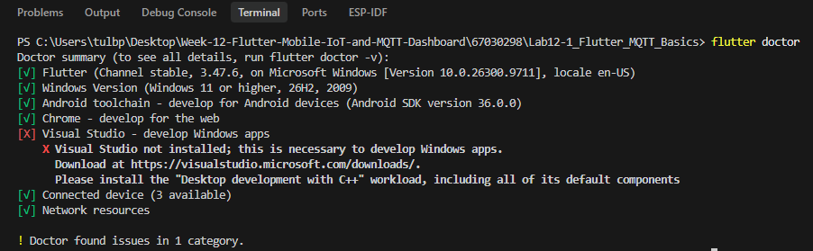
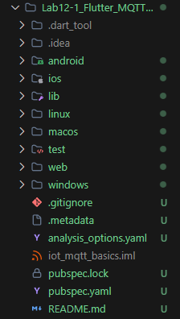
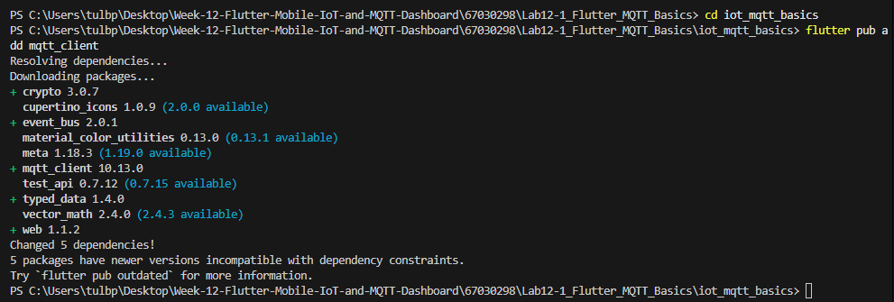
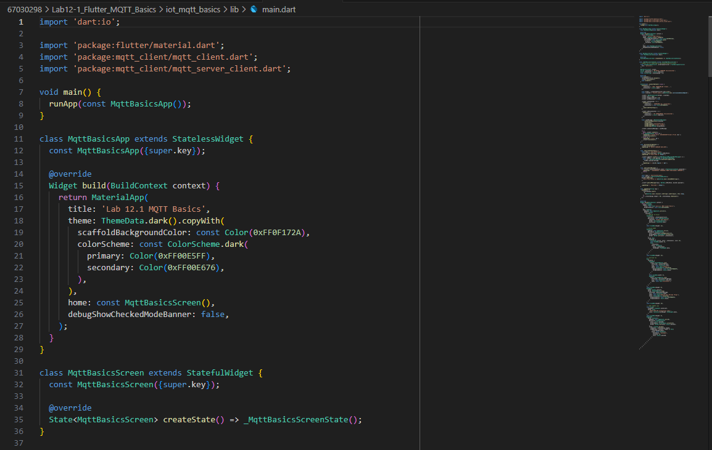
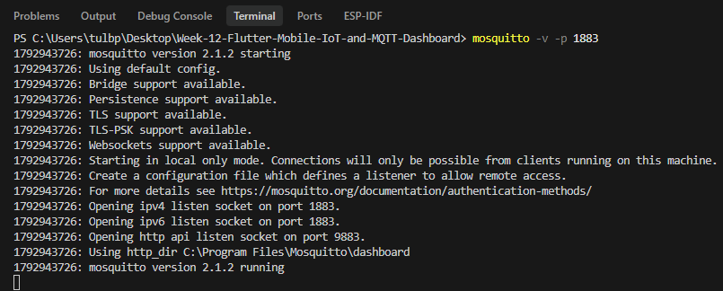
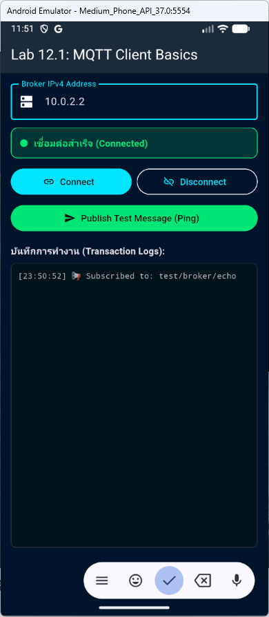
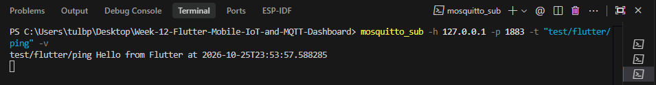

# รายงานผลการทดลองที่ 12.1
## การติดตั้งสภาพแวดล้อม Flutter และการพัฒนา MQTT Client พื้นฐานบนสมาร์ตโฟน

---

## 1. บันทึกผลการทดลอง (Experimental Results)

### กิจกรรมที่ 12-1.1: ตรวจสอบและสร้างโปรเจกต์ Flutter

#### 1. ตรวจสอบความพร้อมของเครื่องมือ Flutter
* **คำสั่งที่ใช้ตรวจสอบ:**
```powershell
flutter doctor
```

* **บันทึก Log ผลการรันคำสั่ง flutter doctor:**
```text
PS C:\Users\tulbp\Desktop\Week-12-Flutter-Mobile-IoT-and-MQTT-Dashboard\67030298\Lab12-1_Flutter_MQTT_Basics> flutter doctor
Doctor summary (to see all details, run flutter doctor -v):
[√] Flutter (Channel stable, 3.47.6, on Microsoft Windows [Version 10.0.26300.9711], locale en-US)
[√] Windows Version (Windows 11 or higher, 26H2, 2009)
[√] Android toolchain - develop for Android devices (Android SDK version 36.0.0)
[√] Chrome - develop for the web
[X] Visual Studio - develop Windows apps
    X Visual Studio not installed; this is necessary to develop Windows apps.
      Download at https://visualstudio.microsoft.com/downloads/.
      Please install the "Desktop development with C++" workload, including all of its default components
[√] Connected device (3 available)
[√] Network resources

! Doctor found issues in 1 category.
```

#### 2. ภาพหน้าจอผลการรันคำสั่ง flutter doctor



---

#### 3. การสร้างโปรเจกต์และติดตั้งแพ็กเกจ `mqtt_client`
* **คำสั่งที่ใช้:**
```powershell
flutter create iot_mqtt_basics
cd iot_mqtt_basics
flutter pub add mqtt_client
```

* **บันทึก Log การรันคำสั่งติดตั้งแพ็กเกจ (flutter pub add mqtt_client):**
```text
Resolving dependencies...
Downloading packages...
+ crypto 3.0.7
  cupertino_icons 1.0.9 (2.0.0 available)
+ event_bus 2.0.1
  material_color_utilities 0.13.0 (0.13.1 available)
  meta 1.18.3 (1.19.0 available)
+ mqtt_client 10.13.0
  test_api 0.7.12 (0.7.15 available)
+ typed_data 1.4.0
  vector_math 2.4.0 (2.4.3 available)
+ web 1.1.2
Changed 5 dependencies!
5 packages have newer versions incompatible with dependency constraints.
Try `flutter pub outdated` for more information.
```

* **บันทึกผลการเพิ่ม Dependencies ในไฟล์ `pubspec.yaml`:**
```yaml
dependencies:
  flutter:
    sdk: flutter
  cupertino_icons: ^1.0.8
  mqtt_client: ^10.13.0
```

#### 4. ภาพหน้าจอการสร้างโปรเจกต์และการติดตั้งแพ็กเกจ mqtt_client สำเร็จ






---

### กิจกรรมที่ 12-1.2: การเขียนโปรแกรม MQTT Client (`lib/main.dart`)

#### 1. การกำหนดค่าการเชื่อมต่อ Broker และ Callback Listeners
* **คอมโพเนนต์สำคัญ:** `MqttServerClient`, `onConnected`, `onDisconnected`, `updates.listen`
* **พอร์ตที่ใช้เชื่อมต่อ:** 1883 (Raw TCP Socket)
* **การตั้งค่า LWT (Last Will and Testament):** Topic `iot/flutter/lwt`, Payload `"Client crashed"`

#### 2. ภาพหน้าจอซอร์สโค้ด lib/main.dart ในโปรแกรม VS Code



---

### กิจกรรมที่ 12-1.3: การทดสอบร่วมกับ Mosquitto CLI

#### 1. การเริ่มต้น Mosquitto Broker บนเครื่องคอมพิวเตอร์
* **คำสั่งที่ใช้เปิด Broker:**
```powershell
mosquitto -v -p 1883
```

* **บันทึก Log ขณะเริ่มต้น Broker:**
```text
PS C:\Users\tulbp\Desktop\Week-12-Flutter-Mobile-IoT-and-MQTT-Dashboard> mosquitto -v -p 1883
1792943726: mosquitto version 2.1.2 starting
1792943726: Using default config.
1792943726: Bridge support available.
1792943726: Persistence support available.
1792943726: TLS support available.
1792943726: TLS-PSK support available.
1792943726: Websockets support available.
1792943726: Starting in local only mode. Connections will only be possible from clients running on this machine.
1792943726: Create a configuration file which defines a listener to allow remote access.
1792943726: For more details see https://mosquitto.org/documentation/authentication-methods/
1792943726: Opening ipv4 listen socket on port 1883.
1792943726: Opening ipv6 listen socket on port 1883.
1792943726: Opening http api listen socket on port 9883.
1792943726: Using http_dir C:\Program Files\Mosquitto\dashboard
1792943726: mosquitto version 2.1.2 running
```

#### 2. ภาพหน้าจอการทำงานของ Mosquitto Broker



---

#### 3. การทดสอบรับส่งข้อความระหว่าง Flutter App และ Mosquitto CLI
* **คำสั่ง Subscriber ดักฟัง Ping จาก Flutter (PowerShell):**
```powershell
mosquitto_sub -h 127.0.0.1 -p 1883 -t "test/flutter/ping" -v
```

* **บันทึกข้อความ Ping ที่ได้รับจาก Flutter บน Mosquitto CLI:**
```text
PS C:\Users\tulbp\Desktop\Week-12-Flutter-Mobile-IoT-and-MQTT-Dashboard> mosquitto_sub -h 127.0.0.1 -p 1883 -t "test/flutter/ping" -v
test/flutter/ping Hello from Flutter at 2026-10-25T23:53:57.588285
```

---

#### 4. ภาพหน้าจอแอปพลิเคชัน Flutter เชื่อมต่อกับ Broker สำเร็จ (สถานะ Connected)



---

#### 5. ภาพหน้าจอการกดปุ่ม Publish Test Message (Ping) และผลลัพธ์บน Mosquitto CLI




---

#### 6. การส่งข้อความตอบกลับจาก CLI ไปยัง Flutter
* **คำสั่ง Publisher ส่งข้อความ Echo (PowerShell):**
```powershell
mosquitto_pub -h 127.0.0.1 -p 1883 -t "test/broker/echo" -m "Echo response from CLI"
```

* **บันทึก Transaction Logs ที่ปรากฏบน Flutter App:**
```text
[23:56:27] 📩 [test/broker/echo] -> Echo response from CLI
[23:53:57] 🚀 Published -> test/flutter/ping
[23:50:52] 📢 Subscribed to: test/broker/echo
```

---

#### 7. ภาพหน้าจอแอปพลิเคชัน Flutter ได้รับข้อความ Echo ในช่อง Transaction Logs


---

## 2. คำถามท้ายการทดลองและการวิเคราะห์ผลเชิงวิศวกรรม (Post-Lab Questions)

### ข้อ 1: เพราะเหตุใดเราจึงต้องสุ่มชื่อ `clientId` เช่นการใส่ Timestamp ต่อท้าย แทนที่จะตั้งชื่อแบบคงที่?
> **คำตอบ:** เพราะโพรโทคอล MQTT กำหนดว่า `clientId` ในระบบจะต้องไม่ซ้ำกัน หากมีเครื่องอื่นใช้ชื่อเดียวกันเชื่อมต่อเข้ามา ตัว Broker จะตัดการเชื่อมต่อของเครื่องเดิมทันที การใส่ Timestamp ต่อท้ายจึงช่วยให้ได้ชื่อที่ไม่ซ้ำกัน ทำให้เชื่อมต่อพร้อมกันหรือกดต่อใหม่ได้โดยไม่ถูกตัดสาย

---

### ข้อ 2: หากหน้าจอ Flutter รันบนอุปกรณ์จริง (Physical Android Phone) เหตุใดการกรอก IP `127.0.0.1` จึงไม่สามารถเชื่อมต่อ Broker ได้? และต้องใช้ IP ใด?
> **คำตอบ:** เพราะ `127.0.0.1` คือ Localhost ซึ่งหมายถึงตัวเครื่องโทรศัพท์เอง ไม่ใช่คอมพิวเตอร์ที่รัน Broker ทำให้หากันไม่เจอ หากต้องการเชื่อมต่อ จะต้องให้โทรศัพท์และคอมพิวเตอร์ต่อ Wi-Fi วงเดียวกัน แล้วกรอกหมายเลข IP จริงของคอมพิวเตอร์ เช่น `192.168.1.X`

---

### ข้อ 3: การตั้งค่า `keepAlivePeriod` มีความจำเป็นอย่างไรในสภาพแวดล้อมเครือข่ายไร้สาย?
> **คำตอบ:** จำเป็นเพราะสัญญาณ Wi-Fi หรือเน็ตมือถืออาจหลุดหายได้ตลอดเวลาโดยไม่มีการส่งสัญญาณบอกเลิกการเชื่อมต่อ ค่านี้จะคอยส่งสัญญาณตรวจสอบเป็นระยะ ทำให้ Broker ทราบได้อย่างรวดเร็วเมื่อแอปหลุดไป และสามารถส่งข้อความแจ้งเตือนตามที่ตั้งค่าไว้ได้อย่างถูกต้อง
