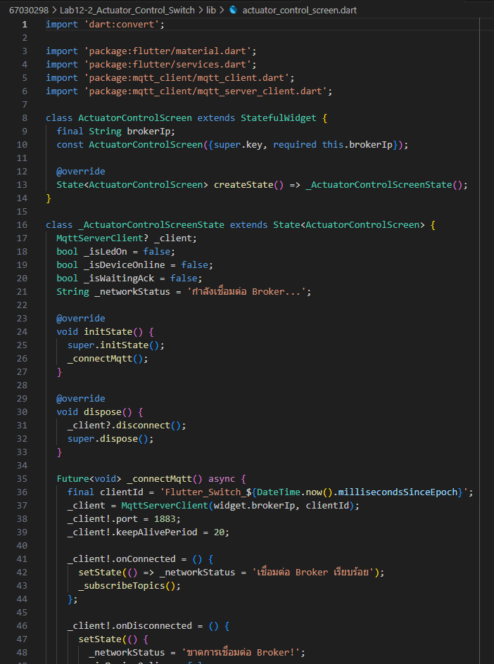
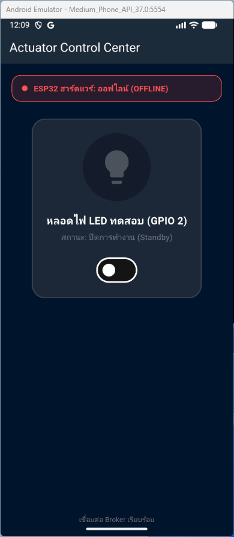
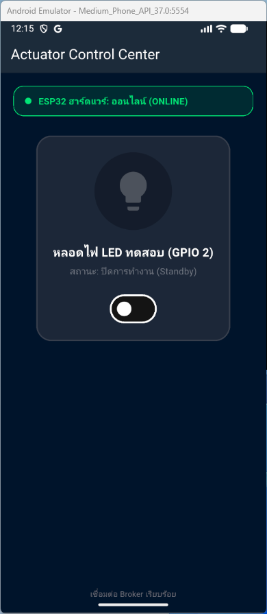
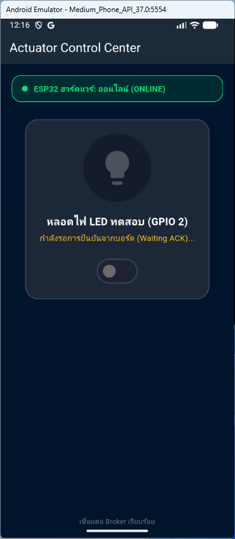
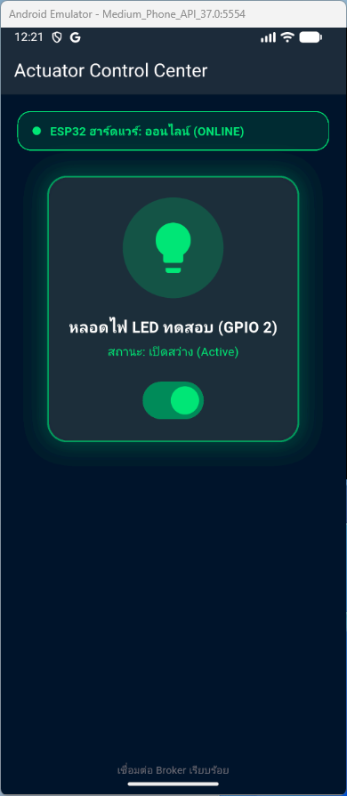
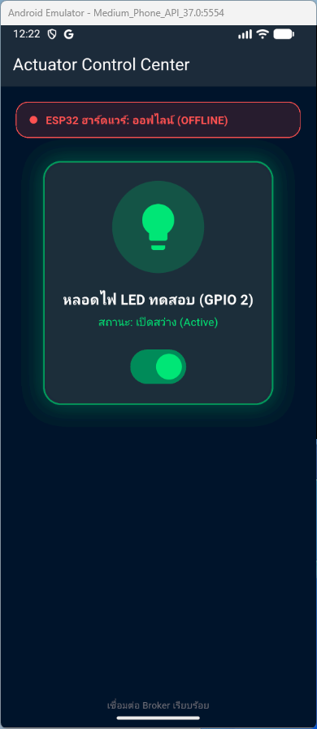

# รายงานผลการทดลองที่ 12.2
## การสร้างสวิตช์ควบคุมอุปกรณ์สองทาง (Bi-directional Actuator Switch) พร้อมระบบ Feedback และสถานะ LWT

---

## 1. บันทึกผลการทดลอง (Experimental Results)

### กิจกรรมที่ 12-2.1: การเตรียมโปรเจกต์และการสร้างหน้าจอควบคุมสวิตช์

#### 1. คำสั่งคัดลอกโปรเจกต์และล้างแคชการคอมไพล์
* **คำสั่ง PowerShell ที่ใช้:**
```powershell
Copy-Item -Recurse -Path "..\Lab12-1\iot_mqtt_basics" -Destination "..\Lab12-2\iot_actuator_switch"
cd ..\Lab12-2\iot_actuator_switch
flutter clean
```

#### 2. ภาพหน้าจอซอร์สโค้ด actuator_control_screen.dart ใน VS Code



---

#### 3. คำสั่งรันแอปพลิเคชัน Flutter
* **คำสั่งที่ใช้:**
```powershell
flutter run -d windows
```

#### 4. ภาพหน้าจอเริ่มต้นของแอปพลิเคชัน Actuator Control Center (สถานะเริ่มต้น Standby / Offline)



---

### กิจกรรมที่ 12-2.2: การทดสอบร่วมกับสคริปต์จำลองฮาร์ดแวร์ (Mock Simulation)

#### 1. การจำลองส่งสถานะ Online ของ ESP32 (พร้อม Retain Flag)
* **คำสั่ง Publisher (PowerShell):**
```powershell
mosquitto_pub -h 127.0.0.1 -p 1883 -t "iot/esp32/status" -m "online" -r
```

* **ผลการเปลี่ยนแปลงบน Flutter App:**
  - แถบสถานะด้านบนเปลี่ยนเป็นสีเขียว: `ESP32 ฮาร์ดแวร์: ออนไลน์ (ONLINE)`

#### 2. ภาพหน้าจอการส่งสถานะ Online และแอปพลิเคชันเปลี่ยนสถานะเป็นสีเขียว



---

#### 3. การเฝ้าดูคำสั่งที่ส่งมาจากแอป Flutter
* **คำสั่ง Subscriber ดักฟังหัวข้อควบคุม (PowerShell):**
```powershell
mosquitto_sub -h 127.0.0.1 -p 1883 -t "iot/esp32/control" -v
```

* **บันทึก Log ข้อความคำสั่งควบคุม JSON ที่ได้รับเมื่อแตะสวิตช์เปิด/ปิดบนแอป:**
```text
PS C:\Users\tulbp\Desktop\Week-12-Flutter-Mobile-IoT-and-MQTT-Dashboard> mosquitto_sub -h 127.0.0.1 -p 1883 -t "iot/esp32/control" -v
iot/esp32/control {"led":"ON"}
```

* **การตอบสนองบนแอปพลิเคชัน:**
  - เกิดการสั่นตอบสนอง Haptic Feedback (`HapticFeedback.lightImpact()`)
  - ข้อความแสดงสถานะใต้หลอดไฟเปลี่ยนเป็น `กำลังรอการยืนยันจากบอร์ด (Waiting ACK)...` สีส้ม/เหลือง
  - สวิตช์ถูกหน่วงเวลา (Disable) ป้องกันการกดย้ำระหว่างรอคำตอบรับ

#### 4. ภาพหน้าจอเทอร์มินัลได้รับคำสั่งควบคุม และหน้าจอแอปแสดงสถานะ Waiting ACK



---

#### 5. การส่งสัญญาณตอบรับทางกายภาพ (Physical ACK) กลับไปยังแอป
* **คำสั่ง Publisher ส่งสัญญาณ ACK (PowerShell):**
```powershell
mosquitto_pub -h 127.0.0.1 -p 1883 -t "iot/esp32/led_ack" -m '{"led_state": true, "ack": true}'
```

* **ผลการเปลี่ยนแปลงบน Flutter App:**
  - ตัวแปร `_isWaitingAck` เปลี่ยนเป็น `false`
  - สวิตช์สลับตำแหน่งเป็น ON อย่างสมบูรณ์
  - ไอคอนหลอดไฟเรืองแสงสีเขียว (Glow BoxShadow Effect)
  - ข้อความสถานะเปลี่ยนเป็น `สถานะ: เปิดสว่าง (Active)`

#### 6. ภาพหน้าจอแอปพลิเคชันได้รับการยืนยัน ACK และหลอดไฟเรืองแสงสีเขียวสมบูรณ์



---

#### 7. การจำลองเหตุการณ์บอร์ดตัดการเชื่อมต่อหรือไฟดับ (Last Will and Testament - LWT)
* **คำสั่ง Publisher จำลอง LWT Offline (PowerShell):**
```powershell
mosquitto_pub -h 127.0.0.1 -p 1883 -t "iot/esp32/status" -m "offline" -r
```

* **ผลการเปลี่ยนแปลงบน Flutter App:**
  - แถบสถานะด้านบนเปลี่ยนเป็นสีแดง: `ESP32 ฮาร์ดแวร์: ออฟไลน์ (OFFLINE)`
  - สวิตช์ควบคุมถูกปิดกั้นการทำงาน (Disabled) ไม่สามารถแตะสั่งการได้
  - หากพยายามกด จะมี SnackBar แจ้งเตือน `⚠️ อุปกรณ์ ESP32 ออฟไลน์อยู่ ไม่สามารถส่งคำสั่งได้`

#### 8. ภาพหน้าจอแอปพลิเคชันแจ้งเตือนสถานะ OFFLINE และสวิตช์ถูกล็อกการสั่งการ



---

## 2. คำถามท้ายการทดลองและการวิเคราะห์ผลเชิงวิศวกรรม (Post-Lab Questions)

### ข้อ 1: ประโยชน์ของการรอสัญญาณ ACK จากหัวข้อ `iot/esp32/led_ack` แทนการเปลี่ยน UI ทันที (Optimistic Update) คืออะไร?
> **คำตอบ:** ช่วยป้องกันปัญหาหน้าจอแสดงผลไม่ตรงกับความเป็นจริง เพราะหากส่งคำสั่งแล้วสัญญาณหลุดหรือบอร์ดทำงานไม่สำเร็จ หน้าจอจะไม่เปลี่ยนสถานะหลอกตาผู้ใช้ การรอการตอบรับจึงช่วยยืนยันว่าบอร์ดได้เปิดหรือปิดไฟจริงแล้ว ทำให้สถานะบนหน้าจอกับอุปกรณ์จริงตรงกันเสมอ

---

### ข้อ 2: ทำไมเราจึงควรตั้งแฟล็ก Retain (`-r`) สำหรับหัวข้อสถานะ `iot/esp32/status`?
> **คำตอบ:** เพื่อให้ตัว Broker บันทึกสถานะล่าสุดเก็บไว้ในระบบ เมื่อแอปพลิเคชันเพิ่งเปิดขึ้นมาใหม่หรือเชื่อมต่อเข้ามาทีหลัง จะได้รับสถานะว่าอุปกรณ์กำลังออนไลน์หรือออฟไลน์อยู่ได้ทันที โดยไม่ต้องรอบอร์ดส่งข้อความรอบใหม่
