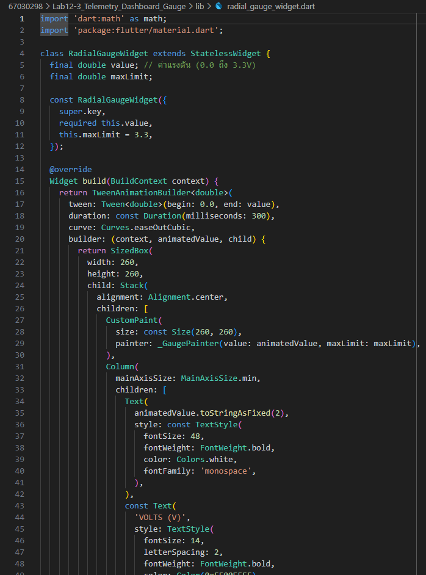
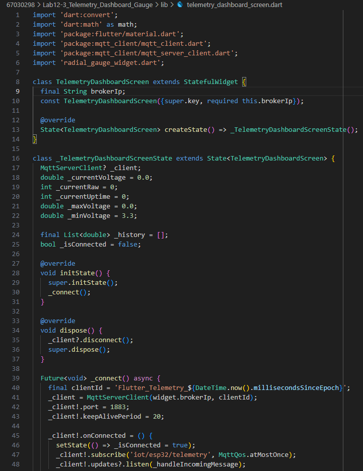
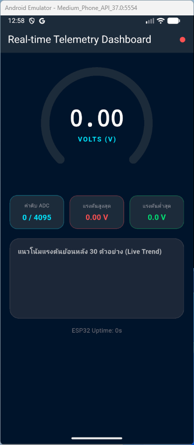
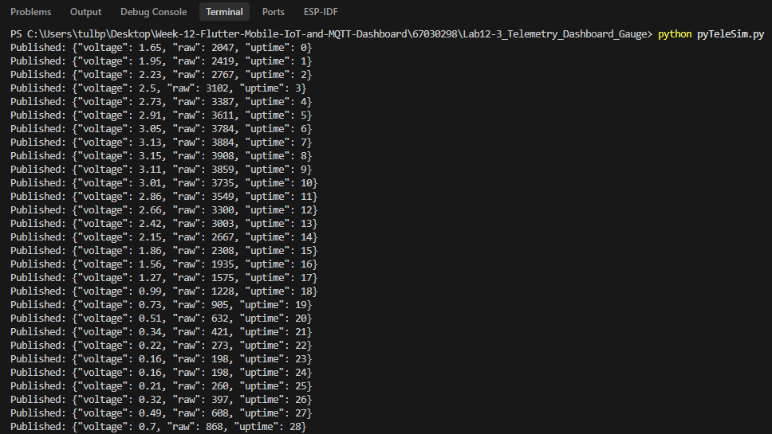
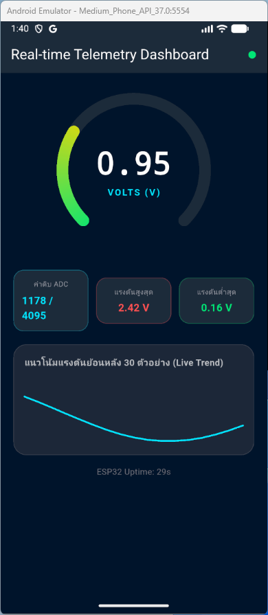
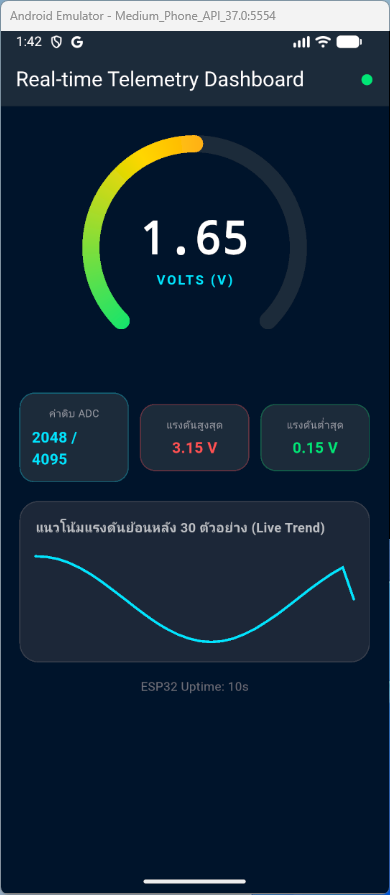
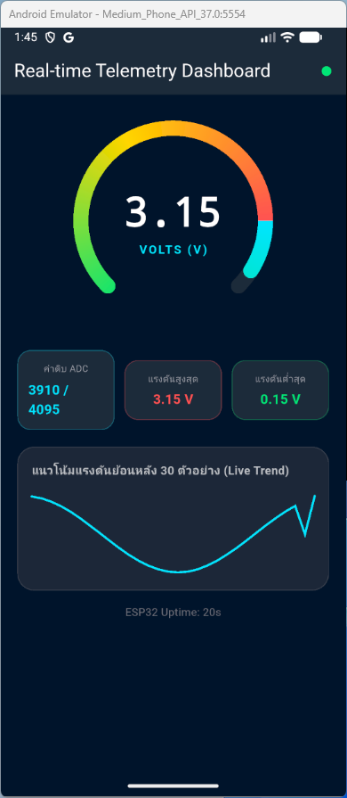
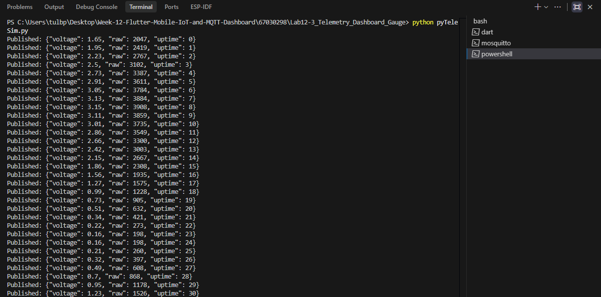
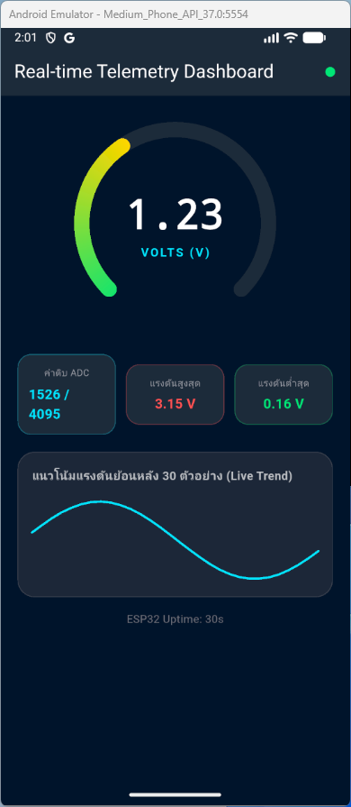

# รายงานผลการทดลองที่ 12.3
## การสร้างแดชบอร์ดแสดงผลเซนเซอร์เรียลไทม์ด้วย Radial Gauge และ Live Trend Line Chart

---

## 1. บันทึกผลการทดลอง (Experimental Results)

### กิจกรรมที่ 12-3.1: การเตรียมโปรเจกต์และการสร้างคอมโพเนนต์มาตรวัด

#### 1. คำสั่งคัดลอกโปรเจกต์และสร้างคอมโพเนนต์
* **คำสั่ง PowerShell ที่ใช้:**
```powershell
Copy-Item -Recurse -Path "..\Lab12-1\iot_mqtt_basics" -Destination "..\Lab12-3\iot_telemetry_gauge"
cd ..\Lab12-3\iot_telemetry_gauge
flutter clean
```

#### 2. ภาพหน้าจอโครงสร้างซอร์สโค้ด radial_gauge_widget.dart ใน VS Code



---

### กิจกรรมที่ 12-3.2: การสร้างหน้าจอ Telemetry Dashboard (`telemetry_dashboard_screen.dart`)

#### 1. ซอร์สโค้ดหน้าจอแดชบอร์ดและการกำหนดหน้าเริ่มต้นใน `lib/main.dart`
* ไฟล์ที่พัฒนา: `lib/radial_gauge_widget.dart`, `lib/telemetry_dashboard_screen.dart`, `lib/main.dart`
* การประมวลผลข้อมูล JSON Payload: ถอดรหัสค่า `voltage`, `raw`, `uptime` และคำนวณ `_maxVoltage`, `_minVoltage`, `_history`

#### 2. ภาพหน้าจอซอร์สโค้ด telemetry_dashboard_screen.dart ใน VS Code



---

#### 3. คำสั่งรันแอปพลิเคชัน Flutter
* **คำสั่งที่ใช้:**
```powershell
flutter run -d windows
```

#### 4. ภาพหน้าจอเริ่มต้นของหน้าจอ Real-time Telemetry Dashboard (ก่อนรับสตรีมข้อมูล)



---

### กิจกรรมที่ 12-3.3: การทดสอบร่วมกับสคริปต์จำลองเซนเซอร์ (Telemetry Mock Simulation)

#### 1. การทดสอบด้วยสคริปต์ Python Telemetry Simulator (`pyTeleSim.py`)
* **คำสั่งรันสคริปต์ Python:**
```powershell
python pyTeleSim.py
```

* **บันทึก Log การส่งสัญญาณ Sine Wave จาก Python Telemetry Simulator:**
```text
PS C:\Users\tulbp\Desktop\Week-12-Flutter-Mobile-IoT-and-MQTT-Dashboard\67030298\Lab12-3_Telemetry_Dashboard_Gauge> python pyTeleSim.py
Published: {"voltage": 1.65, "raw": 2047, "uptime": 0}
Published: {"voltage": 1.95, "raw": 2419, "uptime": 1}
Published: {"voltage": 2.23, "raw": 2767, "uptime": 2}
Published: {"voltage": 2.5, "raw": 3102, "uptime": 3}
Published: {"voltage": 2.73, "raw": 3387, "uptime": 4}
Published: {"voltage": 2.91, "raw": 3611, "uptime": 5}
Published: {"voltage": 3.05, "raw": 3784, "uptime": 6}
Published: {"voltage": 3.13, "raw": 3884, "uptime": 7}
Published: {"voltage": 3.15, "raw": 3908, "uptime": 8}
Published: {"voltage": 3.11, "raw": 3859, "uptime": 9}
Published: {"voltage": 3.01, "raw": 3735, "uptime": 10}
Published: {"voltage": 2.86, "raw": 3549, "uptime": 11}
Published: {"voltage": 2.66, "raw": 3300, "uptime": 12}
Published: {"voltage": 2.42, "raw": 3003, "uptime": 13}
Published: {"voltage": 2.15, "raw": 2667, "uptime": 14}
Published: {"voltage": 1.86, "raw": 2308, "uptime": 15}
Published: {"voltage": 1.56, "raw": 1935, "uptime": 16}
Published: {"voltage": 1.27, "raw": 1575, "uptime": 17}
Published: {"voltage": 0.99, "raw": 1228, "uptime": 18}
Published: {"voltage": 0.73, "raw": 905, "uptime": 19}
Published: {"voltage": 0.51, "raw": 632, "uptime": 20}
Published: {"voltage": 0.34, "raw": 421, "uptime": 21}
Published: {"voltage": 0.22, "raw": 273, "uptime": 22}
Published: {"voltage": 0.16, "raw": 198, "uptime": 23}
Published: {"voltage": 0.16, "raw": 198, "uptime": 24}
Published: {"voltage": 0.21, "raw": 260, "uptime": 25}
Published: {"voltage": 0.32, "raw": 397, "uptime": 26}
Published: {"voltage": 0.49, "raw": 608, "uptime": 27}
Published: {"voltage": 0.7, "raw": 868, "uptime": 28}
```

#### 2. ภาพหน้าจอสคริปต์ Python กำลังส่งข้อมูล Sine Wave ในเทอร์มินัล



---

#### 3. ภาพหน้าจอเข็ม Radial Gauge เคลื่อนไหว และกราฟ Live Trend Sparkline วาดระลอกคลื่นบน Flutter App



---

#### 4. การทดสอบแบบเจาะจงค่าผ่าน Mosquitto CLI (PowerShell)

##### ก. ทดสอบส่งค่าปกติ (1.65 V / ADC 2048)
* **คำสั่ง Publisher (PowerShell):**
```powershell
mosquitto_pub -h 127.0.0.1 -p 1883 -t "iot/esp32/telemetry" -m '{"voltage": 1.65, "raw": 2048, "uptime": 10}'
```

* **พฤติกรรมบนแดชบอร์ด:**
  - เข็ม Radial Gauge หมุนชี้กึ่งกลางสเกลที่ค่า `1.65` V
  - การ์ด "ค่าดิบ ADC" แสดงผล `2048 / 4095`

##### ข. ภาพหน้าจอแดชบอร์ดเมื่อได้รับค่าแรงดันปกติ 1.65 V



---

##### ค. ทดสอบส่งค่าแรงดันสูงแตะขีดจำกัด (3.15 V / ADC 3910)
* **คำสั่ง Publisher (PowerShell):**
```powershell
mosquitto_pub -h 127.0.0.1 -p 1883 -t "iot/esp32/telemetry" -m '{"voltage": 3.15, "raw": 3910, "uptime": 20}'
```

* **พฤติกรรมบนแดชบอร์ด:**
  - เข็มหมุนเข้าสู่โซนสีแดง (ใกล้เต็มสเกล 3.3V)
  - การ์ด "แรงดันสูงสุด" ปรับค่าเป็น `3.15 V` สีแดง

##### ง. ภาพหน้าจอแดชบอร์ดเมื่อได้รับค่าแรงดันสูง 3.15 V



---

##### จ. การจำลองสตรีมข้อมูลต่อเนื่อง 30 ตัวอย่างด้วย PowerShell Loop
* **คำสั่ง PowerShell Loop:**
```powershell
1..30 | ForEach-Object {
    $v = [Math]::Round(1.65 + 1.5 * [Math]::Sin($_ * 0.4), 2)
    $raw = [int](($v / 3.3) * 4095)
    mosquitto_pub -h 127.0.0.1 -p 1883 -t "iot/esp32/telemetry" -m "{`"voltage`": $v, `"raw`": $raw, `"uptime`": $_}"
    Start-Sleep -Milliseconds 500
}
```

* **บันทึกพฤติกรรมกราฟ Sparkline:** กราฟเส้นวาดตามจุดข้อมูลต่อเนื่องครบทั้ง 30 จุดย้อนหลัง

##### ฉ. ภาพหน้าจอการรัน PowerShell Loop สตรีมข้อมูล 30 ตัวอย่าง และผลลัพธ์บน Flutter





---

## 2. คำถามท้ายการทดลองและการวิเคราะห์ผลเชิงวิศวกรรม (Post-Lab Questions)

### ข้อ 1: เหตุใดการใช้ `TweenAnimationBuilder` จึงทำให้เข็มมาตรวัดดูนุ่มนวลและไม่กระตุก แม้ข้อมูลเซนเซอร์จะเข้ามาทุกๆ 500 มิลลิวินาที?
> **คำตอบ:** เพราะตัววิดเจ็ตจะช่วยเกลี่ยค่าระหว่างมุมเดิมไปยังมุมใหม่ให้ค่อยๆ ขยับอย่างต่อเนื่อง แทนที่จะกระโดดเปลี่ยนตำแหน่งทันที ทำให้เข็มเคลื่อนไหวได้อย่างนุ่มนวลและสบายตา

---

### ข้อ 2: การจำกัดความยาวของอาร์เรย์ `_history` ให้เก็บไม่เกิน 30 ตัวอย่าง ส่งผลดีต่อประสิทธิภาพหน่วยความจำของสมาร์ตโฟนอย่างไร?
> **คำตอบ:** ช่วยป้องกันไม่ให้ขนาดข้อมูลสะสมเพิ่มขึ้นเรื่อยๆ จนกินแรมของเครื่อง และทำให้ระบบวาดกราฟเฉพาะ 30 จุดล่าสุดได้รวดเร็ว แอปจึงทำงานได้ลื่นไหลต่อเนื่องโดยเครื่องไม่ค้างหรือแรมเต็ม

---

### ข้อ 3: หากเซนเซอร์ส่งค่าผิดพลาด เช่น ค่านอกช่วง 0 - 3.3V หรือค่าเป็น `null` โค้ดส่วนใดใน `telemetry_dashboard_screen.dart` ที่ช่วยป้องกันไม่ให้แอปแครช?
> **คำตอบ:** มีการใช้บล็อก `try-catch` ช่วยดักจับข้อผิดพลาดตอนแปลงข้อมูล และใช้ตัวกำหนดค่าเริ่มต้น `?? 0.0` ป้องกันกรณีค่าเป็นค่าว่าง รวมถึงในวิดเจ็ตมาตรวัดมีการใช้คำสั่ง `clamp` เพื่อจำกัดไม่ให้ค่าหลุดออกนอกช่วง 0 ถึง 3.3 โวลต์
