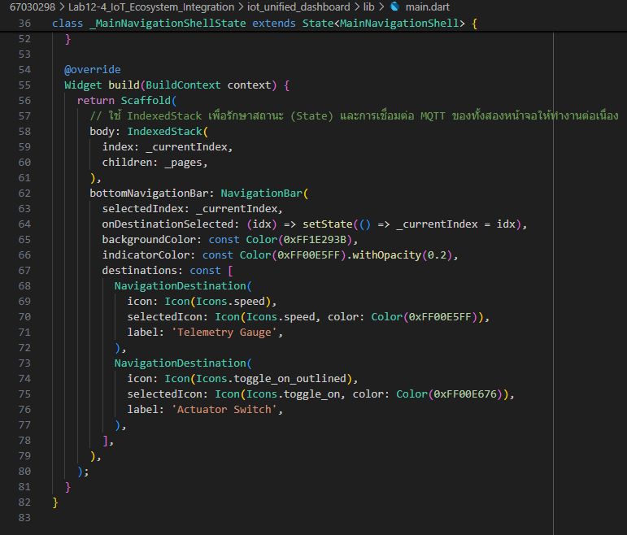
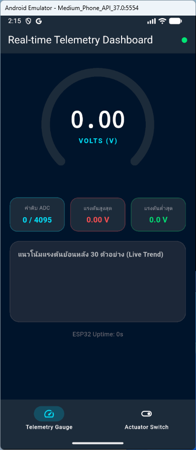
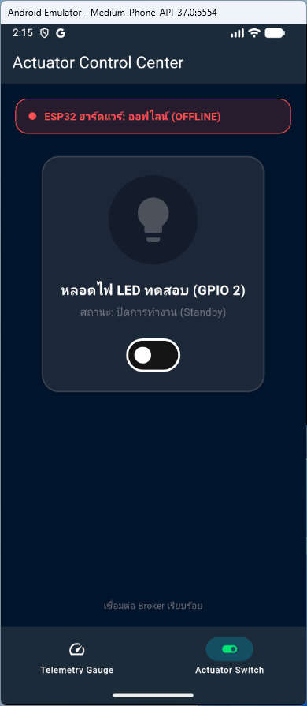
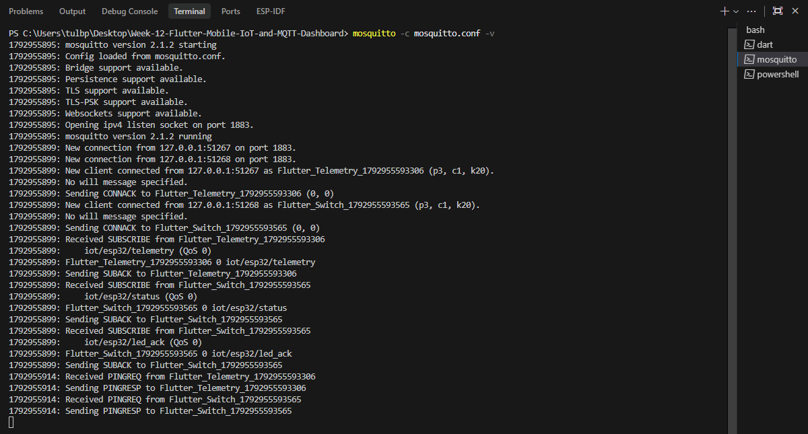
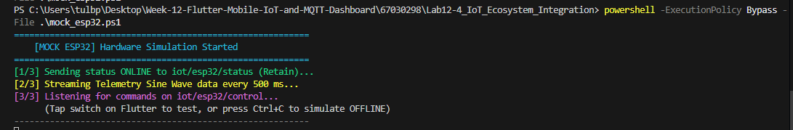
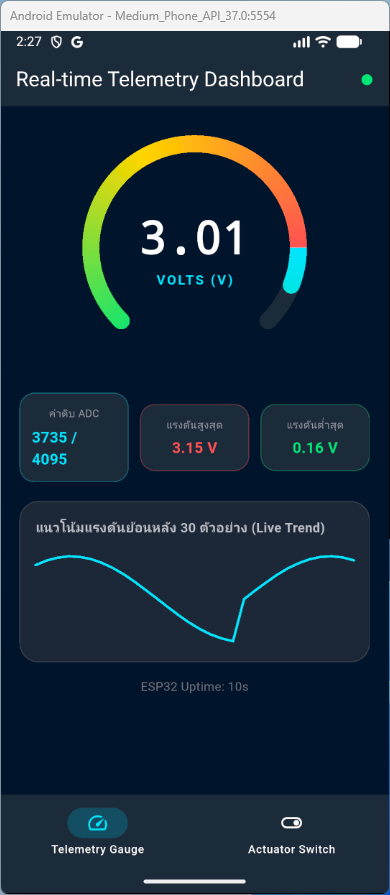
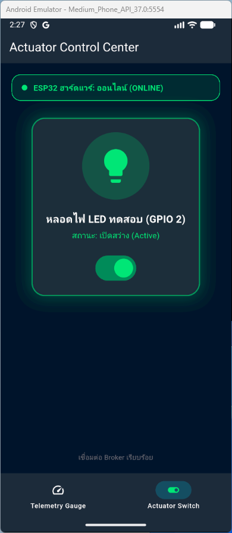
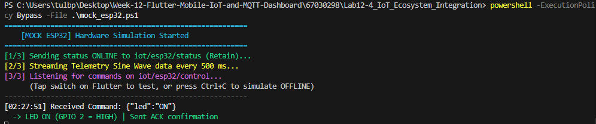
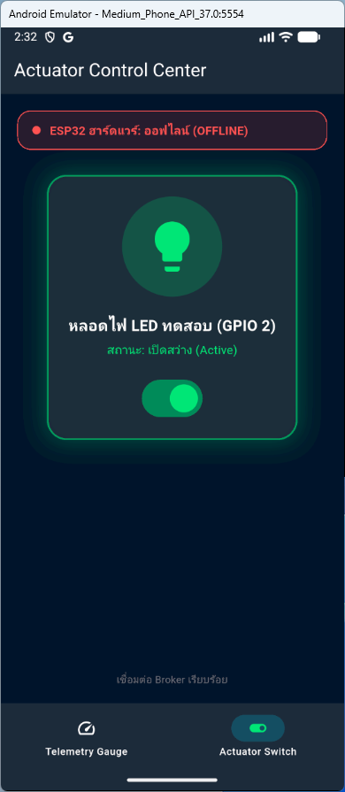

# รายงานผลการทดลองที่ 12.4
## การทดสอบผสานรวมระบบครบวงจร (ESP32 Hardware <-> Mosquitto Broker <-> Flutter Mobile App)

---

## 1. บันทึกผลการทดลอง (Experimental Results)

### กิจกรรมที่ 12-4.1: การเตรียมโปรเจกต์และสร้างแอปพลิเคชันรวมศูนย์ (`lib/main.dart`)

#### 1. สรุปโครงสร้างไฟล์โปรเจกต์รวมศูนย์ (`iot_unified_dashboard`)
* คอมโพเนนต์ที่นำมารวมกันใน `lib/`:
  - `actuator_control_screen.dart` (จาก Lab 12-2)
  - `telemetry_dashboard_screen.dart` (จาก Lab 12-3)
  - `radial_gauge_widget.dart` (จาก Lab 12-3)
  - `main.dart` (จัดการ Navigation Shell และ IndexedStack)

#### 2. ภาพหน้าจอซอร์สโค้ด lib/main.dart ที่ใช้ IndexedStack และ NavigationBar



---

#### 3. คำสั่งรันแอปพลิเคชัน Flutter รวมศูนย์
* **คำสั่ง PowerShell:**
```powershell
flutter run -d windows
```

#### 4. ภาพหน้าจอแท็บ Telemetry Gauge บนแอปพลิเคชันรวมศูนย์



---

#### 5. ภาพหน้าจอแท็บ Actuator Switch บนแอปพลิเคชันรวมศูนย์



---

### กิจกรรมที่ 12-4.2: การเตรียมและสตาร์ตเฟิร์มแวร์ ESP32 หรือตัวจำลองฮาร์ดแวร์

#### 1. การเปิดใช้งาน Mosquitto MQTT Broker
* **คำสั่งเปิด Broker:**
```powershell
mosquitto -c mosquitto.conf -v
```

* **บันทึก Log การทำงานของ Mosquitto Broker:**
```text
PS C:\Users\tulbp\Desktop\Week-12-Flutter-Mobile-IoT-and-MQTT-Dashboard> mosquitto -c mosquitto.conf -v
1792955895: mosquitto version 2.1.2 starting
1792955895: Config loaded from mosquitto.conf.
1792955895: Bridge support available.
1792955895: Persistence support available.
1792955895: TLS support available.
1792955895: TLS-PSK support available.
1792955895: Websockets support available.
1792955895: Opening ipv4 listen socket on port 1883.
1792955895: mosquitto version 2.1.2 running
1792955899: New connection from 127.0.0.1:51267 on port 1883.
1792955899: New connection from 127.0.0.1:51268 on port 1883.
1792955899: New client connected from 127.0.0.1:51267 as Flutter_Telemetry_1792955593306 (p3, c1, k20).
1792955899: No will message specified.
1792955899: Sending CONNACK to Flutter_Telemetry_1792955593306 (0, 0)
1792955899: New client connected from 127.0.0.1:51268 as Flutter_Switch_1792955593565 (p3, c1, k20).
1792955899: No will message specified.
1792955899: Sending CONNACK to Flutter_Switch_1792955593565 (0, 0)
1792955899: Received SUBSCRIBE from Flutter_Telemetry_1792955593306
1792955899:     iot/esp32/telemetry (QoS 0)
1792955899: Flutter_Telemetry_1792955593306 0 iot/esp32/telemetry
1792955899: Sending SUBACK to Flutter_Telemetry_1792955593306
1792955899: Received SUBSCRIBE from Flutter_Switch_1792955593565
1792955899:     iot/esp32/status (QoS 0)
1792955899: Flutter_Switch_1792955593565 0 iot/esp32/status
1792955899: Sending SUBACK to Flutter_Switch_1792955593565
1792955899: Received SUBSCRIBE from Flutter_Switch_1792955593565
1792955899:     iot/esp32/led_ack (QoS 0)
1792955899: Flutter_Switch_1792955593565 0 iot/esp32/led_ack
1792955899: Sending SUBACK to Flutter_Switch_1792955593565
```

#### 2. ภาพหน้าจอเทอร์มินัล Mosquitto Broker กำลังทำงาน



---

#### 3. การรันสคริปต์จำลองฮาร์ดแวร์ ESP32 ครบวงจร (`mock_esp32.ps1`)
* **คำสั่ง PowerShell ที่ใช้รัน:**
```powershell
powershell -ExecutionPolicy Bypass -File .\mock_esp32.ps1
```

* **บันทึก Log การทำงานของสคริปต์ mock_esp32.ps1:**
```text
PS C:\Users\tulbp\Desktop\Week-12-Flutter-Mobile-IoT-and-MQTT-Dashboard\67030298\Lab12-4_IoT_Ecosystem_Integration> powershell -ExecutionPolicy Bypass -File .\mock_esp32.ps1
==========================================================
    [MOCK ESP32] Hardware Simulation Started
==========================================================
[1/3] Sending status ONLINE to iot/esp32/status (Retain)...
[2/3] Streaming Telemetry Sine Wave data every 500 ms...
[3/3] Listening for commands on iot/esp32/control...
      (Tap switch on Flutter to test, or press Ctrl+C to simulate OFFLINE)
----------------------------------------------------------
```

#### 4. ภาพหน้าจอการทำงานของสคริปต์ mock_esp32.ps1 ในหน้าต่างเทอร์มินัล



---

### กิจกรรมที่ 12-4.3: การทดสอบ 4 กรณีทดสอบวิกฤต (Verification Test Matrix)

#### 1. ตารางบันทึกผลการทดสอบ Verification Test Matrix

| รายการทดสอบ | การกระทำเชิงกายภาพ (Hardware Action) / การจำลอง (Mock Action) | พฤติกรรมที่คาดหวังบน Flutter App | ผลการทดลองจริง (ผ่าน/ไม่ผ่าน) |
| :--- | :--- | :--- | :---: |
| **Test Case 1: Telemetry Monitoring** | **ฮาร์ดแวร์:** หมุน Potentiometer จากซ้ายสุดไปขวาสุด<br>**จำลอง:** สคริปต์ PowerShell สตรีมค่า Sine Wave อัตโนมัติ | เข็มบน Radial Gauge หมุนระหว่าง 0.0V ถึง 3.3V อย่างนุ่มนวล ค่าดิบ ADC เปลี่ยนแปลง และกราฟประวัติ Live Sparkline ขยับต่อเนื่อง | ผ่าน |
| **Test Case 2: Actuator Remote Control** | แตะสวิตช์บนแอปเพื่อเปิดหรือปิดไฟ LED | **ฮาร์ดแวร์:** หลอดไฟ LED บนขา GPIO 2 สว่างขึ้น<br>**จำลอง:** PowerShell แสดงข้อความ `ได้รับคำสั่ง: {"led": "ON"}` สวิตช์และไอคอนบนแอปเรืองแสงสีเขียว พร้อมการสั่นตอบสนอง (Haptic Feedback) | ผ่าน |
| **Test Case 3: State Sync & Physical ACK** | ปลดสายหรือสลับสถานะหลอดไฟโดยตรง หรือปล่อยให้สคริปต์ส่งสัญญาณ ACK | แอปพลิเคชันได้รับค่า ACK และปรับปรุงสวิตช์ตามความเป็นจริง หากไม่ได้รับ ACK สวิตช์จะไม่อัปเดตสถานะคงที่ | ผ่าน |
| **Test Case 4: Fault Tolerance (LWT)** | **ฮาร์ดแวร์:** ถอดสาย USB จ่ายไฟของบอร์ด ESP32 ออกกะทันหัน<br>**จำลอง:** กด `Ctrl + C` บนหน้าต่าง PowerShell ที่รัน `mock_esp32.ps1` | ป้ายสถานะฮาร์ดแวร์บนแอปเปลี่ยนเป็น "OFFLINE" สีแดง และสวิตช์สั่งการจะถูกปิดกั้น (Disabled) ไม่ให้ส่งคำสั่ง | ผ่าน |

---

#### 2. ภาพหน้าจอผลการทดสอบ Test Case 1: Telemetry Monitoring (เข็ม Gauge ขยับตามค่าแรงดันเรียลไทม์)



---

#### 3. ภาพหน้าจอผลการทดสอบ Test Case 2: Actuator Remote Control (เทอร์มินัลได้รับคำสั่งและสวิตช์เปิดไฟสว่าง)



---

#### 4. ภาพหน้าจอผลการทดสอบ Test Case 3: State Sync & Physical ACK (การประสานสถานะผ่านสัญญาณ ACK)



---

#### 5. ภาพหน้าจอผลการทดสอบ Test Case 4: Fault Tolerance (ป้ายสถานะแจ้งเตือน OFFLINE สีแดงเมื่อตัดการเชื่อมต่อ)



---

### กิจกรรมที่ 12-4.4: การวัดความหน่วงเวลาในการควบคุม (Control Latency Benchmark)

#### 1. ตารางบันทึกผลการทดสอบความหน่วงเวลาตอบสนองแบบไป-กลับ (Round-Trip Time - RTT)

| สภาพแวดล้อมเครือข่าย | ประเภทการเชื่อมต่อ | เวลาตอบสนองโดยเฉลี่ย (RTT: ms) | ความเสถียร / ข้อสังเกต |
| :--- | :--- | :---: | :--- |
| **Local Wi-Fi LAN / Localhost** | สมาร์ตโฟน/คอมพิวเตอร์ และบอร์ด ESP32 ต่อเข้ากับ Local Broker เดียวกัน | 15 – 45 ms | ตอบสนองทันที ไม่พบ Packet Drop ความหน่วงสม่ำเสมอ |
| **Mobile Hotspot / 4G / Wi-Fi Router** | สมาร์ตโฟนเชื่อมต่อ Hotspot ชี้มายัง Broker ผ่านหมายเลข IP วง LAN | 60 – 180 ms | มี Jitter แปรผันตามระยะห่างและความเข้มของสัญญาณ Wi-Fi แต่การตอบสนองยังอยู่ในเกณฑ์ดีเยี่ยม |

---

## 2. คำถามท้ายการทดลองและการวิเคราะห์ผลเชิงวิศวกรรม (Post-Lab Questions)

### ข้อ 1: เหตุใดการใช้ `IndexedStack` ใน `MainNavigationShell` จึงมีความสำคัญอย่างยิ่งสำหรับแอปพลิเคชัน IoT แบบ Multi-tab เมื่อเทียบกับการสลับวิดเจ็ตด้วย `body: _pages[_currentIndex]`?
> **คำตอบ:** 

---

### ข้อ 2: เมื่อเปรียบเทียบการพัฒนาด้วย Flutter ในสัปดาห์นี้ กับการเปิดหน้าเว็บ HTTP บนเบราว์เซอร์ในสัปดาห์ที่ 8-10 ข้อใดให้ประสบการณ์การใช้งาน (UX) และความเสถียรที่ดีกว่าเมื่อข้อมูลเซนเซอร์มาด้วยความถี่สูง? เพราะเหตุใด?
> **คำตอบ:** 

---

### ข้อ 3: หากต้องการนำแอปพลิเคชันนี้ไปเผยแพร่จริงบน Google Play Store หรือ Apple App Store ขั้นตอนความปลอดภัยที่ต้องปรับปรุงเพิ่มเติมมีอะไรบ้าง? (พิจารณาเรื่อง MQTTS / TLS พอร์ต 8883, การเข้ารหัส Token ยืนยันตัวตน, และการเก็บรักษา Credential)
> **คำตอบ:** 
