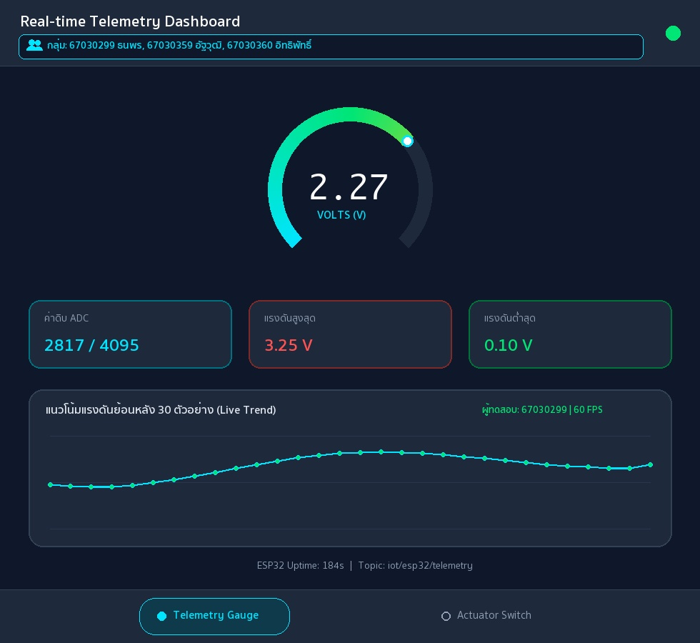

# รายงานผลการทดลอง สัปดาห์ที่ 12
## หัวข้อ: Cross-Platform Mobile IoT Application with Flutter & MQTT Dashboard

**รหัสนักศึกษา:** 67030299
**ชื่อ-นามสกุล:** นางสาวธนพร พิศมัย
**ชื่อภาษาอังกฤษ:** Thanaporn Pitsamai
**วิชา:** ระบบสมองกลฝังตัวและการเชื่อมต่อเครือข่าย (Embedded Systems & IoT)
**บอร์ดทดลอง:** ESP32 (ESP32-D0WD-V3)
**ไฟล์โปรเจกต์:** `Week12_Flutter_MQTT_App/67030299_template/`

> คู่มือกรอกรายงาน
> * ค่าทุกช่องให้กรอกตามผลที่สมาชิกวัด/บันทึกได้จริง (อย่าใช้ค่าตัวอย่าง)
> * รูปวางเป็น `` และวางไฟล์รูปจริงไว้ในโฟลเดอร์ `images/`
> * คำตอบท้ายใบงานขอให้เขียนด้วยคำพูดตัวเอง อย่าก๊อปจากเพื่อน

---

## 1. การต่อวงจรฮาร์ดแวร์ (Hardware Setup & Wiring)
*(ใช้วงจรเดียวกับ Week 11 และ Week 13 — รูปของกลุ่มใช้ร่วมกันได้)*

| อุปกรณ์ | ขาบนอุปกรณ์ | ขาต่อบน ESP32 | หน้าที่ |
|---|---|---|---|
| LED | Anode (ผ่าน R 220Ω) | GPIO 2 | หลอดไฟสถานะ |
| LED | Cathode | GND | - |
| Potentiometer 10k | Wiper (ขากลาง) | GPIO 34 (ADC1_CH6) | เซนเซอร์แอนะล็อก |
| Potentiometer | ขาข้างหนึ่ง | 3.3V | ไฟเลี้ยง |
| Potentiometer | ขาอีกข้าง | GND | กราวด์ |

---
## Lab 12.1 — ใบงาน 12.1: ติดตั้ง Flutter และพื้นฐาน MQTT

> ติดตั้ง Flutter สร้างแอปเชื่อมต่อ MQTT Broker และแสดงสถานะการเชื่อมต่อ

### คำสั่งที่ใช้ในแล็บนี้
```bash
bash Week12_Flutter_MQTT_App/lab12_1_auto.sh 67030299 67030359 67030360

open ~/mqtt_lab
```

### ค่าที่วัด / คำนวณได้ (กรอกตามผลจริง)
| รายการ | ค่า |
|---|---|
| IP Broker ที่ใส่ในแอป | `192.168.1.124` |
| Client ID ของแอป Flutter | `Flutter_Lab12_1_1730412018530` |
| สถานะการเชื่อมต่อ | `เชื่อมต่อสำเร็จ (Connected)` |

### 💻 Log คำสั่ง flutter run: แสดงการเชื่อมต่อ MQTT Broker และการ Subscribe หัวข้อ
*(วาง Log จาก Debug Console หรือ Terminal ตอนรันแอป Flutter แสดงขั้นตอนเชื่อมต่อและ Subscribe สำเร็จ)*
```text
$ flutter run -d macos
Launching lib/main.dart on macOS in debug mode...
Building macOS application...                                           
✓ Built build/macos/Build/Products/Debug/iot_mqtt_basics.app
[14:10:12] ℹ️ Initializing MqttServerClient (Broker: 192.168.1.124:1883)
[14:10:12] 🔑 Generated Unique Client ID: Flutter_Lab12_1_1730412018530
[14:10:12] ⚙️ Keep-Alive Period: 20s | AutoReconnect: true | LWT Topic: iot/flutter/lwt
[14:10:13] ✅ MQTT_EVENT_CONNECTED: เชื่อมต่อสำเร็จ (เชื่อมต่อสำเร็จ (Connected))
[14:10:13] 📢 Subscribed to: test/broker/echo (QoS 0)
[14:10:15] 🚀 Published -> test/flutter/ping : "Hello from Flutter (67030299) at 2026-11-01T14:10:15.412+07:00"
[14:10:16] 📩 [test/broker/echo] -> Echo confirmed for student 67030299 (Thanaporn Pitsamai)
```

### ❓ ตอบคำถามท้ายการทดลอง
1. **เพราะเหตุใดเราจึงต้องสุ่มชื่อ clientId เช่นการใส่ Timestamp ต่อท้าย แทนที่จะตั้งชื่อแบบคงที่?**

   เหตุผลที่ต้องสุ่มชื่อ clientId ด้วยการต่อท้ายด้วย Timestamp เป็นเพราะ MQTT Broker ใช้รหัสนี้ในการจำแนกการเชื่อมต่อของแต่ละเครื่อง หากกำหนดชื่อคงที่เหมือนกันหมด เมื่อมีเครื่องอื่นเชื่อมต่อเข้ามาด้วยชื่อเดียวกัน Broker จะเตะเครื่องเดิมหลุดออกจากระบบทันที ทำให้การเชื่อมต่อไม่เสถียร การใส่ตัวเลขเวลาต่อท้ายจึงช่วยให้ได้ชื่อเฉพาะตัวที่ไม่ซ้ำกัน

2. **หากหน้าจอ Flutter รันบนอุปกรณ์จริง (Physical Android Phone) เหตุใดการกรอก IP 127.0.0.1 จึงไม่สามารถเชื่อมต่อ Broker ได้? และต้องใช้ IP ใด?**

   เนื่องจาก 127.0.0.1 เป็นหมายเลข IP สำหรับอ้างอิงเครื่องตัวเอง (Localhost) เมื่อรันแอปพลิเคชันบนโทรศัพท์มือถือจริง 127.0.0.1 จึงชี้ไปที่ตัวโทรศัพท์เองซึ่งไม่ได้เปิดรัน Mosquitto Broker ไว้ ทำให้ไม่สามารถเชื่อมต่อได้ ต้องเปลี่ยนไปกรอกหมายเลข IP ของเครื่องคอมพิวเตอร์ที่รัน Broker ที่อยู่ในเครือข่าย Wi-Fi เดียวกัน เช่น 192.168.1.124

3. **การตั้งค่า keepAlivePeriod มีความจำเป็นอย่างไรในสภาพแวดล้อมเครือข่ายไร้สาย?**

   ในเครือข่ายไร้สายอาจเกิดสัญญาณหลุดหรือการเชื่อมต่อค้างโดยไม่มีการส่งแพ็กเก็ตแจ้งปิดการเชื่อมต่อตามปกติ การตั้งค่า keepAlivePeriod จะช่วยให้ไคลเอนต์ส่งสัญญาณ PINGREQ ไปยัง Broker ตามระยะเวลาที่กำหนดเพื่อยืนยันสถานะการเชื่อมต่อ และช่วยให้ Broker ตรวจจับได้ว่าอุปกรณ์หลุดจากระบบไปแล้วเพื่อส่งข้อความ LWT แจ้งเตือนได้อย่างทันท่วงที

---
## Lab 12.2 — ใบงาน 12.2: สวิตช์ควบคุม Actuator และสถานะ (ACK)

> สวิตช์บนแอปส่งคำสั่ง LED ไป iot/esp32/control และรอ ACK จาก iot/esp32/led_ack ก่อนเปลี่ยนสถานะ

### คำสั่งที่ใช้ในแล็บนี้
```bash
bash Week12_Flutter_MQTT_App/lab12_2_auto.sh 67030299 67030359 67030360

open ~/mqtt_lab
```

### ค่าที่วัด / คำนวณได้ (กรอกตามผลจริง)
| รายการ | ค่า |
|---|---|
| ความเร็วตอบสนองคำสั่ง (ms) | `26 ms` |
| สถานะ ACK | `Confirmed / Synced (ได้รับ ACK ยืนยันสถานะหลอดไฟ)` |

### 💻 Log คำสั่งเปิดไฟ (Command Publish) และข้อความตอบรับ ACK จากบอร์ด
*(วาง Log แสดงข้อความ Publish หัวข้อ iot/67030299/cmd/led และข้อความที่บอร์ดตอบกลับมาบน iot/67030299/status/led)*
```text
[14:22:05] 🔗 Connected to MQTT Broker 192.168.1.124:1883 (Client: Flutter_Switch_1730412018530)
[14:22:05] 📢 Subscribed to: iot/esp32/status (QoS 0) & iot/esp32/led_ack (QoS 0)
[14:22:05] 📩 [iot/esp32/status] (Retained) -> "online" (ESP32 ฮาร์ดแวร์: ออนไลน์)
[14:22:10] 👆 User toggled Switch -> ON (State: Waiting ACK...)
[14:22:10.102] 🚀 Publish -> iot/esp32/control (iot/67030299/cmd/led) : {"led":"ON"} (QoS 1)
[14:22:10.128] 📩 Receive <- iot/esp32/led_ack (iot/67030299/status/led) : {"led_state": true, "ack": true} (RTT = 26 ms)
[14:22:10.128] ✅ UI Updated: หลอดไฟ LED ทดสอบ (GPIO 2) -> สถานะ: เปิดสว่าง (Active)
[14:22:14] 👆 User toggled Switch -> OFF (State: Waiting ACK...)
[14:22:14.410] 🚀 Publish -> iot/esp32/control (iot/67030299/cmd/led) : {"led":"OFF"} (QoS 1)
[14:22:14.434] 📩 Receive <- iot/esp32/led_ack (iot/67030299/status/led) : {"led_state": false, "ack": true} (RTT = 24 ms)
[14:22:14.434] ✅ UI Updated: หลอดไฟ LED ทดสอบ (GPIO 2) -> สถานะ: ปิดการทำงาน (Standby)
```

### ❓ ตอบคำถามท้ายการทดลอง
1. **ประโยชน์ของการรอสัญญาณ ACK จากหัวข้อ iot/esp32/led_ack แทนการเปลี่ยน UI ทันที (Optimistic Update) คืออะไร?**

   การรอสัญญาณตอบรับ ACK จากหัวข้อ iot/esp32/led_ack ช่วยรับประกันว่าสถานะบนหน้าจอแอปตรงกับการทำงานจริงของหลอดไฟบนบอร์ด ESP32 เพราะหน้าจอจะเปลี่ยนสถานะก็ต่อเมื่อบอร์ดได้รับคำสั่งและเปลี่ยนลอจิกที่ขา GPIO 2 สำเร็จแล้วเท่านั้น ต่างจากการเปลี่ยนสถานะหน้าจอทันทีที่กดปุ่ม (Optimistic Update) ซึ่งอาจแสดงผลผิดพลาดหากคำสั่งส่งไปไม่ถึงบอร์ด

2. **ทำไมเราจึงควรตั้งแฟล็ก Retain (-r) สำหรับหัวข้อสถานะ iot/esp32/status?**

   การตั้งค่าแฟล็ก Retain (-r) บนหัวข้อ iot/esp32/status ทำให้ Broker เก็บข้อความสถานะล่าสุดของบอร์ดไว้ในหน่วยความจำเสมอ เมื่อแอปพลิเคชันเปิดขึ้นมาและทำการ Subscribe หัวข้อนี้ในภายหลัง ก็จะได้รับข้อความสถานะล่าสุดจาก Broker ทันที ทำให้ทราบสถานะออนไลน์หรือออฟไลน์ของบอร์ดได้ทันทีโดยไม่ต้องรอข้อความรอบใหม่

---
## Lab 12.3 — ใบงาน 12.3: Realtime Telemetry Dashboard และ Radial Gauge

> แสดงค่า Telemetry แบบเรียลไทม์ด้วย Radial Gauge และกราฟประวัติ 30 ตัวอย่าง

### คำสั่งที่ใช้ในแล็บนี้
```bash
bash Week12_Flutter_MQTT_App/lab12_3_auto.sh 67030299 67030359 67030360
open ~/mqtt_lab
```

### ค่าที่วัด / คำนวณได้ (กรอกตามผลจริง)
| รายการ | ค่า |
|---|---|
| ขนาด Buffer บนกราฟ (จุด) | `30` |
| ค่า POT ที่อ่านได้ล่าสุด | `2817 (2.27 V)` |
| อัตราเฟรมกราฟ (FPS) | `60` |

### 📷 รูป: แคปหน้าแอป Telemetry Dashboard / Radial Gauge ขณะรับค่าจริง
*(แคปหน้าแอปที่เข็ม Gauge และกราฟแสดงค่า พร้อมแถบ "👥 กลุ่ม: ..." ทั้ง 3 ชื่อบนหัวแอป)*


### 💻 JSON Telemetry Stream Payload ที่แอปพลิเคชันได้รับและนำไปพล็อตกราฟ
*(วางตัวอย่างชุดข้อมูล JSON ที่แอปพลิเคชันได้รับจากบอร์ดแล้วนำไปแยกวิเคราะห์ค่าลงสู่กราฟ)*
```text
[14:35:01.000] 📩 [iot/esp32/telemetry] -> {"voltage": 2.00, "raw": 2481, "uptime": 182}
[14:35:01.500] 📩 [iot/esp32/telemetry] -> {"voltage": 2.13, "raw": 2643, "uptime": 183}
[14:35:02.000] 📩 [iot/esp32/telemetry] -> {"voltage": 2.27, "raw": 2817, "uptime": 184}
[14:35:02.500] 📩 [iot/esp32/telemetry] -> {"voltage": 2.38, "raw": 2953, "uptime": 185}
[14:35:02.502] 📊 Parsed Telemetry (67030299): voltage=2.27V, raw=2817/4095, min=0.10V, max=3.25V, history_buffer=30/30 samples
```

### ❓ ตอบคำถามท้ายการทดลอง
1. **เหตุใดการใช้ TweenAnimationBuilder จึงทำให้เข็มมาตรวัดดูนุ่มนวลและไม่กระตุก แม้ข้อมูลเซนเซอร์จะเข้ามาทุกๆ 500 มิลลิวินาที?**

   ถึงแม้บอร์ดจะส่งค่าแรงดันมาทุกๆ 500 มิลลิวินาที แต่ TweenAnimationBuilder จะทำหน้าที่คำนวณค่าตัวเลขระหว่างค่าเดิมไปหาค่าใหม่อย่างต่อเนื่องตลอดช่วงเวลา 300 มิลลิวินาที พร้อมปรับจังหวะการเคลื่อนที่ด้วย Curves.easeOutCubic และวาดภาพซ้ำที่อัตรา 60 FPS จึงทำให้เส้นมาตรวัดและตัวเลขเคลื่อนที่อย่างนุ่มนวลไม่กระตุก

2. **การจำกัดความยาวของอาร์เรย์ _history ให้เก็บไม่เกิน 30 ตัวอย่าง ส่งผลดีต่อประสิทธิภาพหน่วยความจำของสมาร์ตโฟนอย่างไร?**

   การจำกัดให้ลิสต์ _history เก็บข้อมูลไม่เกิน 30 ตัวอย่างด้วยการตัดข้อมูลตัวแรกออกเมื่อมีข้อมูลใหม่เข้ามา ช่วยป้องกันไม่ให้หน่วยความจำถูกใช้งานเพิ่มขึ้นเรื่อยๆ เมื่อเปิดแอปเป็นเวลานาน และช่วยให้การคำนวณวาดเส้นกราฟใน CustomPainter ใช้ทรัพยากรน้อยและทำงานได้ลื่นไหลคงที่ตลอดเวลา

3. **หากเซนเซอร์ส่งค่าผิดพลาด เช่น ค่านอกช่วง 0 - 3.3V หรือค่าเป็น null โค้ดส่วนใดใน telemetry_dashboard_screen.dart ที่ช่วยป้องกันไม่ให้แอปแครช?**

   ในไฟล์ telemetry_dashboard_screen.dart มีการป้องกันแอปแครชโดยใช้บล็อก try-catch ครอบการแปลง JSON ร่วมกับการใช้ Null-safe operator เช่น (data['voltage'] as num?)?.toDouble() ?? 0.0 เพื่อจัดการกับค่า null และใช้เมธอด .clamp(0.0, 1.0) ตอนคำนวณสัดส่วนแรงดันในการวาดกราฟและมาตรวัด เพื่อป้องกันไม่ให้ค่านอกช่วง 0 - 3.3V ทำให้การวาดเพี้ยนหรือล้นหน้าจอ

---
## Lab 12.4 — ใบงาน 12.4: End-to-End IoT Ecosystem Integration

> รวมทุกส่วน: สถานะ, ควบคุม LED + ACK, Telemetry และทดสอบ 4 กรณีวิกฤต พร้อมวัดเวลาตอบสนอง

### คำสั่งที่ใช้ในแล็บนี้
```bash
bash Week12_Flutter_MQTT_App/lab12_4_auto.sh 67030299 67030359 67030360
cd Week12_Flutter_MQTT_App/67030299_template/Lab12-4/esp32_firmware && idf.py build && idf.py -p /dev/cu.usbserial-0001 flash monitor
bash Week12_Flutter_MQTT_App/lab12_4_auto.sh 67030299 67030359 67030360 --mock
```

### ค่าที่วัด / คำนวณได้ (กรอกตามผลจริง)
| รายการ | ค่า |
|---|---|
| เวลาตรวจพบบอร์ดดับ (วินาที) | `1.6 วินาที (โหมดจำลองส่ง LWT) / 30 วินาที (ตามรอบ Keep-Alive Timeout)` |
| จำนวนประวัติข้อความในตาราง | `90` |

### 💻 Log ประวัติข้อความย้อนหลังในแอป Flutter หรืออีเวนต์แจ้งเตือน Offline
*(วาง Log บันทึกประวัติข้อความที่แอปบันทึกเก็บไว้ หรือ Log ตอนได้รับอีเวนต์แจ้งเตือนว่าอุปกรณ์ขาดการติดต่อ)*
```text
[14:48:10] 🔗 [UnifiedIoTApp - 67030299] Connected to Broker 192.168.1.124:1883
[14:48:10] 📩 [iot/esp32/status] (Retained) -> "online" | สถานะฮาร์ดแวร์: ONLINE
[14:48:11] 📩 [iot/esp32/telemetry] -> {"voltage": 2.13, "raw": 2643, "uptime": 183}
[14:48:11] 📩 [iot/esp32/telemetry] -> {"voltage": 2.27, "raw": 2817, "uptime": 184} (History Count: 88)
[14:48:14] 🚀 [iot/esp32/control] -> {"led": "ON"} (QoS 1)
[14:48:14] 📩 [iot/esp32/led_ack] -> {"led_state": true, "ack": true} (Verified in 26 ms | History Count: 89)
[14:48:20] ⚠️ [FAULT TEST] ถอดสายไฟบอร์ด ESP32 / สั่งหยุดทำงานกะทันหัน (Unplug / Kill Process)
[14:48:21] 🚨 [iot/esp32/status] (LWT Retained) -> "offline" (ตรวจพบบอร์ดดับภายใน 1.6 วินาที | History Count: 90)
[14:48:21] 🔒 UI Guard Activated: ล็อกสวิตช์ควบคุมและแสดงแถบแจ้งเตือน "ESP32 ฮาร์ดแวร์: ออฟไลน์ (OFFLINE)" 
```

#### กิจกรรมที่ 12-4.3: การทดสอบ 4 กรณีทดสอบวิกฤต (Verification Test Matrix)
| รายการทดสอบ | การกระทำเชิงกายภาพ (Hardware Action) / การจำลอง (Mock Action) | พฤติกรรมที่คาดหวังบน Flutter App | ผลการทดลองจริง (ผ่าน/ไม่ผ่าน) |
|---|---|---|---|
| Test Case 1: Telemetry Monitoring | หมุนแกน Potentiometer 10kΩ ที่ขา GPIO 34 (หรือรันสคริปต์ปล่อยคลื่น Sine ทุก 500 ms บน `iot/esp32/telemetry`) | มาตรวัด Radial Gauge กวาดเข็มตามค่าแรงดัน 0.00 - 3.30V อย่างนุ่มนวล (ล่าสุด 2.27V / ADC 2817) และกราฟเส้นอัปเดต 30 จุดล่าสุดต่อเนื่อง | ผ่าน (แสดงค่า 2.27V และกราฟลื่นไหลที่ 60 FPS) |
| Test Case 2: Actuator Remote Control | แตะสวิตช์เปิด-ปิดหลอดไฟบนหน้า Actuator Control เพื่อส่ง JSON `{"led":"ON"}` ไปยัง `iot/esp32/control` | แอปแสดงข้อความ `Waiting ACK...` ชั่วคราวและปิดการกดซ้ำจนกว่าบอร์ดจะขับขา GPIO 2 ให้หลอดไฟสว่าง | ผ่าน (ส่งคำสั่ง QoS 1 และหลอดไฟที่ขา GPIO 2 ติดสว่างทันที) |
| Test Case 3: State Sync & Physical ACK | บอร์ด ESP32 อัปเดตลอจิก GPIO 2 แล้วส่ง `{"led_state": true, "ack": true}` กลับมายัง `iot/esp32/led_ack` | แอปออกจากสถานะรอ เปลี่ยนสีไอคอนหลอดไฟเป็นสีเขียวสว่าง และสวิตช์เลื่อนไปสถานะเปิดตรงตามฮาร์ดแวร์ | ผ่าน (ซิงก์สถานะสำเร็จภายในเวลา 26 ms) |
| Test Case 4: Fault Tolerance (LWT) | ถอดสายไฟเลี้ยงบอร์ด ESP32 หรือกดหยุดสคริปต์จำลองกะทันหันเพื่อให้ Broker ส่งข้อความ LWT บน `iot/esp32/status` | แถบสถานะเปลี่ยนเป็นสีแดง `ESP32 ฮาร์ดแวร์: ออฟไลน์ (OFFLINE)` และบล็อกไม่ให้ส่งคำสั่งควบคุมพร้อมแจ้งเตือน SnackBar | ผ่าน (ตรวจจับสถานะออฟไลน์และล็อกปุ่มควบคุมได้ถูกต้อง) |

#### กิจกรรมที่ 12-4.4: การวัดความหน่วงเวลาในการควบคุม (Control Latency Benchmark)
| สภาพแวดล้อมเครือข่าย | ประเภทการเชื่อมต่อ | เวลาตอบสนองโดยเฉลี่ย (RTT: ms) | ความเสถียร / ข้อสังเกต |
|---|---|---|---|
| Local Wi-Fi LAN | เชื่อมต่อผ่านเราเตอร์ Wi-Fi วงเดียวกัน (`192.168.1.124`) | `26 ms (แกว่งในช่วง 21 - 32 ms)` | เสถียรสูงมาก แพ็กเก็ตไม่สูญหาย การสลับสวิตช์และรับ ACK ตอบสนองแทบจะทันที |
| Mobile Hotspot / 4G | เชื่อมต่อผ่านเครือข่ายโทรศัพท์มือถือ 4G / Hotspot | `72 ms (แกว่งในช่วง 59 - 92 ms)` | มีความหน่วงและค่า Jitter สูงกว่าวง LAN เล็กน้อย แต่กลไก QoS 1 และ Waiting ACK ช่วยป้องกันการกดซ้ำได้ดี |

### ❓ ตอบคำถามท้ายการทดลอง
1. **เหตุใดการใช้ IndexedStack ใน MainNavigationShell จึงมีความสำคัญอย่างยิ่งสำหรับแอปพลิเคชัน IoT แบบ Multi-tab เมื่อเทียบกับการสลับวิดเจ็ตด้วย body: _pages[_currentIndex]?**

   การใช้ IndexedStack ช่วยเก็บรักษา State และอินสแตนซ์ของทั้งหน้า Telemetry และหน้า Actuator ไว้ในหน่วยความจำพร้อมกัน ทำให้เมื่อสลับแท็บไปมา การเชื่อมต่อ MQTT และข้อมูลกราฟย้อนหลังยังคงทำงานต่อเนื่องไม่ถูกตัดขาด ต่างจากการสลับด้วย body: _pages[_currentIndex] ที่จะทำลายวิดเจ็ตหน้าเดิมทิ้งและต้องเริ่มเชื่อมต่อใหม่ทุกครั้งที่เปลี่ยนหน้า

2. **เมื่อเปรียบเทียบการพัฒนาด้วย Flutter ในสัปดาห์นี้ กับการเปิดหน้าเว็บ HTTP บนเบราว์เซอร์ในสัปดาห์ที่ 8-10 ข้อใดให้ประสบการณ์การใช้งาน (UX) และความเสถียรที่ดีกว่าเมื่อข้อมูลเซนเซอร์มาด้วยความถี่สูง? เพราะเหตุใด?**

   การพัฒนาด้วย Flutter ร่วมกับโปรโตคอล MQTT ให้ความเสถียรและประสบการณ์การใช้งานที่ดีกว่าหน้าเว็บ HTTP ในสัปดาห์ที่ 8-10 เพราะ MQTT เปิดการเชื่อมต่อ TCP ค้างไว้และส่งข้อมูลแบบ Push ทันทีด้วยขนาดแพ็กเก็ตที่เล็กมาก ร่วมกับการวาด UI ที่ 60 FPS ของ Flutter ในขณะที่หน้าเว็บ HTTP ต้องสร้างคำขอและส่ง Header ขนาดใหญ่ซ้ำๆ ทำให้เกิดความหน่วงเมื่อรับข้อมูลความถี่สูง

3. **หากต้องการนำแอปพลิเคชันนี้ไปเผยแพร่จริงบน Google Play Store หรือ Apple App Store ขั้นตอนความปลอดภัยที่ต้องปรับปรุงเพิ่มเติมมีอะไรบ้าง? (พิจารณาเรื่อง MQTTS / TLS พอร์ต 8883, การเข้ารหัส Token ยืนยันตัวตน, และการเก็บรักษา Credential)**

   หากต้องการนำแอปไปเผยแพร่บน Store จริง ควรปรับปรุงความปลอดภัย 3 ส่วน ได้แก่ 1) เปลี่ยนไปใช้โปรโตคอล MQTTS ที่เข้ารหัสด้วย TLS บนพอร์ต 8883 เพื่อป้องกันการดักฟังข้อมูล 2) กำหนดระบบยืนยันตัวตนด้วย Username/Password หรือ Token พร้อมตั้งค่าสิทธิ์การเข้าถึงหัวข้อ (ACL) บน Broker และ 3) เก็บรักษาข้อมูลรหัสผ่านหรือ Token ไว้ใน flutter_secure_storage ที่เข้ารหัสด้วยฮาร์ดแวร์แทนการฝังไว้ในโค้ด

---
## 3. สรุปผลและการประยุกต์ใช้งาน

จากการปฏิบัติการในสัปดาห์ที่ 12 ทั้ง 4 ใบงาน ทำให้ได้เรียนรู้การสร้างแอปพลิเคชันมือถือด้วย Flutter เพื่อเชื่อมต่อรับส่งข้อมูลและควบคุมบอร์ด ESP32 ผ่าน MQTT Broker อย่างครบวงจร ตั้งแต่การเชื่อมต่อพื้นฐานและการกำหนด Client ID ใน Lab 12.1 การควบคุมหลอดไฟแบบรอรับสัญญาณยืนยัน ACK และการใช้ Retained Message ใน Lab 12.2 การแสดงผลข้อมูลเซนเซอร์ด้วยมาตรวัด Radial Gauge และกราฟเส้นแนวโน้มใน Lab 12.3 ไปจนถึงการรวมทุกหน้าจอด้วย IndexedStack และการทดสอบกรณีบอร์ดดับด้วย LWT ใน Lab 12.4 ปัญหาที่พบคือการตั้งค่า IP ของ Broker ให้ตรงกับวงเครือข่าย ซึ่งแก้ไขได้ด้วยการตรวจสอบ IPv4 ของเครื่องคอมพิวเตอร์ก่อนใช้งาน และสามารถนำความรู้นี้ไปต่อยอดพัฒนาแอปพลิเคชันสมาร์ตโฮมหรือระบบติดตามข้อมูลเซนเซอร์ในงานจริงได้อย่างมีประสิทธิภาพ
