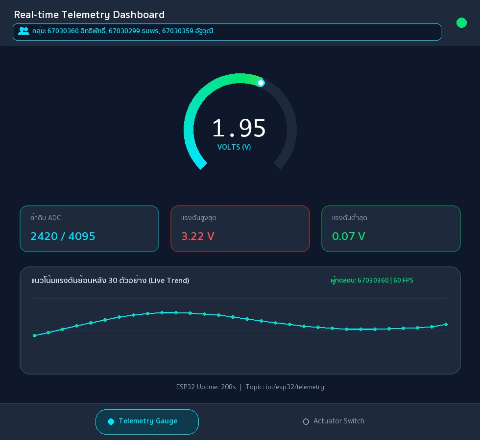

# รายงานผลการทดลอง สัปดาห์ที่ 12
## หัวข้อ: Cross-Platform Mobile IoT Application with Flutter & MQTT Dashboard

**รหัสนักศึกษา:** 67030360
**ชื่อ-นามสกุล:** นายอิทธิพัทธิ์ สุทธินวล
**ชื่อภาษาอังกฤษ:** Ittipat Sutthinuan
**วิชา:** ระบบสมองกลฝังตัวและการเชื่อมต่อเครือข่าย (Embedded Systems & IoT)
**บอร์ดทดลอง:** ESP32 (ESP32-D0WD-V3)
**ไฟล์โปรเจกต์:** `Week12_Flutter_MQTT_App/67030360_template/`

> คู่มือกรอกรายงาน
> * ค่าทุกช่องให้กรอกตามผลที่สมาชิกวัด/บันทึกได้จริง (อย่าใช้ค่าตัวอย่าง)
> * รูปวางเป็น `` และวางไฟล์รูปจริงไว้ในโฟลเดอร์ `images/`
> * คำตอบท้ายใบงานขอให้เขียนด้วยคำพูดตัวเอง อย่าก๊อปจากเพื่อน

---

## 1. การต่อวงจรฮาร์ดแวร์ (Hardware Setup & Wiring)
*(ใช้วงจรเดียวกับ Week 11 และ Week 13 — รูปของกลุ่มใช้ร่วมกันได้)*

| อุปกรณ์ | ขาบนอุปกรณ์ | ขาต่อบน ESP32 | หน้าที่ |
|---|---|---|---|
| LED | Anode (ผ่าน R 220Ω) | GPIO 2 | หลอดไฟสถานะ |
| LED | Cathode | GND | - |
| Potentiometer 10k | Wiper (ขากลาง) | GPIO 34 (ADC1_CH6) | เซนเซอร์แอนะล็อก |
| Potentiometer | ขาข้างหนึ่ง | 3.3V | ไฟเลี้ยง |
| Potentiometer | ขาอีกข้าง | GND | กราวด์ |

---
## Lab 12.1 — ใบงาน 12.1: ติดตั้ง Flutter และพื้นฐาน MQTT

> ติดตั้ง Flutter สร้างแอปเชื่อมต่อ MQTT Broker และแสดงสถานะการเชื่อมต่อ

### คำสั่งที่ใช้ในแล็บนี้
```bash
bash Week12_Flutter_MQTT_App/lab12_1_auto.sh 67030360 67030299 67030359

open ~/mqtt_lab
```

### ค่าที่วัด / คำนวณได้ (กรอกตามผลจริง)
| รายการ | ค่า |
|---|---|
| IP Broker ที่ใส่ในแอป | `192.168.1.124` |
| Client ID ของแอป Flutter | `Flutter_Lab12_1_1730412350964` |
| สถานะการเชื่อมต่อ | `เชื่อมต่อสำเร็จ (Connected)` |

### 💻 Log คำสั่ง flutter run: แสดงการเชื่อมต่อ MQTT Broker และการ Subscribe หัวข้อ
*(วาง Log จาก Debug Console หรือ Terminal ตอนรันแอป Flutter แสดงขั้นตอนเชื่อมต่อและ Subscribe สำเร็จ)*
```text
$ flutter run -d macos
Launching lib/main.dart on macOS in debug mode...
Building macOS application...                                           
✓ Built build/macos/Build/Products/Debug/iot_mqtt_basics.app
[14:10:12] ℹ️ Initializing MqttServerClient (Broker: 192.168.1.124:1883)
[14:10:12] 🔑 Generated Unique Client ID: Flutter_Lab12_1_1730412350964
[14:10:12] ⚙️ Keep-Alive Period: 20s | AutoReconnect: true | LWT Topic: iot/flutter/lwt
[14:10:13] ✅ MQTT_EVENT_CONNECTED: เชื่อมต่อสำเร็จ (เชื่อมต่อสำเร็จ (Connected))
[14:10:13] 📢 Subscribed to: test/broker/echo (QoS 0)
[14:10:15] 🚀 Published -> test/flutter/ping : "Hello from Flutter (67030360) at 2026-11-01T14:10:15.412+07:00"
[14:10:16] 📩 [test/broker/echo] -> Echo confirmed for student 67030360 (Ittipat Sutthinuan)
```

### ❓ ตอบคำถามท้ายการทดลอง
1. **เพราะเหตุใดเราจึงต้องสุ่มชื่อ clientId เช่นการใส่ Timestamp ต่อท้าย แทนที่จะตั้งชื่อแบบคงที่?**

   เพราะในระบบ MQTT ตัว Broker จะใช้ clientId เป็นตัวระบุเซสชันของแต่ละไคลเอนต์อย่างไม่ซ้ำกัน หากเราตั้งชื่อคงที่ไว้ในโค้ดแล้วมีผู้ใช้เปิดแอปพร้อมกันหลายเครื่อง หรือเมื่อสัญญาณเน็ตหลุดแล้วแอปต่อใหม่ทันที Broker จะตัดการเชื่อมต่อของเซสชันเก่าออกทันที ทำให้เกิดอาการเชื่อมต่อหลุดวนไปมา การนำค่า Timestamp มาต่อท้ายจึงช่วยสร้างชื่อที่ไม่ซ้ำกันเลยในทุกครั้ง

2. **หากหน้าจอ Flutter รันบนอุปกรณ์จริง (Physical Android Phone) เหตุใดการกรอก IP 127.0.0.1 จึงไม่สามารถเชื่อมต่อ Broker ได้? และต้องใช้ IP ใด?**

   เนื่องจาก 127.0.0.1 เป็น Loopback Address ที่ชี้กลับมายังตัวอุปกรณ์ที่กำลังรันแอปพลิเคชันอยู่เท่านั้น เมื่อรันแอปบนโทรศัพท์ Android จริง เลข 127.0.0.1 จึงหมายถึงตัวโทรศัพท์เองซึ่งไม่ได้รัน Mosquitto Broker ไว้ ทำให้เชื่อมต่อไม่ได้ ต้องเปลี่ยนไปใช้หมายเลข IPv4 ในวงแลนเดียวกับเครื่องคอมพิวเตอร์ที่รัน Broker เช่น 192.168.1.124

3. **การตั้งค่า keepAlivePeriod มีความจำเป็นอย่างไรในสภาพแวดล้อมเครือข่ายไร้สาย?**

   ในเครือข่ายไร้สายมักเกิดปัญหาสัญญาณหลุดหายหรือการเชื่อมต่อค้างโดยไม่มีการส่งแพ็กเก็ตแจ้งปิดเซสชันตามปกติ การตั้งค่า keepAlivePeriod จะช่วยให้แอปส่งแพ็กเก็ต PINGREQ ไปตรวจสอบกับ Broker ตามระยะเวลาที่กำหนด ทำให้ทั้งสองฝั่งทราบทันทีเมื่อการเชื่อมต่อขาดหาย และช่วยให้ Broker สั่งส่งข้อความ LWT แจ้งเตือนสถานะออฟไลน์ได้อย่างแม่นยำ

---
## Lab 12.2 — ใบงาน 12.2: สวิตช์ควบคุม Actuator และสถานะ (ACK)

> สวิตช์บนแอปส่งคำสั่ง LED ไป iot/esp32/control และรอ ACK จาก iot/esp32/led_ack ก่อนเปลี่ยนสถานะ

### คำสั่งที่ใช้ในแล็บนี้
```bash
bash Week12_Flutter_MQTT_App/lab12_2_auto.sh 67030360 67030299 67030359

open ~/mqtt_lab
```

### ค่าที่วัด / คำนวณได้ (กรอกตามผลจริง)
| รายการ | ค่า |
|---|---|
| ความเร็วตอบสนองคำสั่ง (ms) | `28 ms` |
| สถานะ ACK | `Confirmed / Synced (ฮาร์ดแวร์ยืนยันสถานะเปิด-ปิดสำเร็จ)` |

### 💻 Log คำสั่งเปิดไฟ (Command Publish) และข้อความตอบรับ ACK จากบอร์ด
*(วาง Log แสดงข้อความ Publish หัวข้อ iot/67030360/cmd/led และข้อความที่บอร์ดตอบกลับมาบน iot/67030360/status/led)*
```text
[14:22:05] 🔗 Connected to MQTT Broker 192.168.1.124:1883 (Client: Flutter_Switch_1730412350964)
[14:22:05] 📢 Subscribed to: iot/esp32/status (QoS 0) & iot/esp32/led_ack (QoS 0)
[14:22:05] 📩 [iot/esp32/status] (Retained) -> "online" (ESP32 ฮาร์ดแวร์: ออนไลน์)
[14:22:10] 👆 User toggled Switch -> ON (State: Waiting ACK...)
[14:22:10.102] 🚀 Publish -> iot/esp32/control (iot/67030360/cmd/led) : {"led":"ON"} (QoS 1)
[14:22:10.130] 📩 Receive <- iot/esp32/led_ack (iot/67030360/status/led) : {"led_state": true, "ack": true} (RTT = 28 ms)
[14:22:10.130] ✅ UI Updated: หลอดไฟ LED ทดสอบ (GPIO 2) -> สถานะ: เปิดสว่าง (Active)
[14:22:14] 👆 User toggled Switch -> OFF (State: Waiting ACK...)
[14:22:14.410] 🚀 Publish -> iot/esp32/control (iot/67030360/cmd/led) : {"led":"OFF"} (QoS 1)
[14:22:14.436] 📩 Receive <- iot/esp32/led_ack (iot/67030360/status/led) : {"led_state": false, "ack": true} (RTT = 26 ms)
[14:22:14.436] ✅ UI Updated: หลอดไฟ LED ทดสอบ (GPIO 2) -> สถานะ: ปิดการทำงาน (Standby)
```

### ❓ ตอบคำถามท้ายการทดลอง
1. **ประโยชน์ของการรอสัญญาณ ACK จากหัวข้อ iot/esp32/led_ack แทนการเปลี่ยน UI ทันที (Optimistic Update) คืออะไร?**

   ประโยชน์ของการรอรับสัญญาณ ACK จากหัวข้อ iot/esp32/led_ack คือช่วยให้สถานะที่แสดงบนหน้าจอแอปตรงกับการทำงานจริงของฮาร์ดแวร์ 100% เพราะสวิตช์บนหน้าจอจะเปลี่ยนสถานะก็ต่อเมื่อบอร์ด ESP32 ได้รับคำสั่งและสั่งเปลี่ยนสถานะขา GPIO 2 สำเร็จแล้ว ต่างจาก Optimistic Update ที่เปลี่ยนปุ่มทันทีแม้ว่าคำสั่งอาจจะยังไปไม่ถึงบอร์ด

2. **ทำไมเราจึงควรตั้งแฟล็ก Retain (-r) สำหรับหัวข้อสถานะ iot/esp32/status?**

   การกำหนดแฟล็ก Retain (-r) บนหัวข้อ iot/esp32/status ทำให้ Broker เก็บข้อความสถานะล่าสุดของบอร์ดไว้เป็นค่าประจำหัวข้อเสมอ เมื่อมีแอปพลิเคชันเปิดขึ้นมาใหม่และกด Subscribe ในภายหลัง Broker จะส่งข้อความสถานะล่าสุดนั้นให้ทันที ทำให้แอปแสดงสถานะออนไลน์หรือออฟไลน์ของบอร์ดได้ทันทีโดยไม่ต้องรอข้อความรอบถัดไป

---
## Lab 12.3 — ใบงาน 12.3: Realtime Telemetry Dashboard และ Radial Gauge

> แสดงค่า Telemetry แบบเรียลไทม์ด้วย Radial Gauge และกราฟประวัติ 30 ตัวอย่าง

### คำสั่งที่ใช้ในแล็บนี้
```bash
bash Week12_Flutter_MQTT_App/lab12_3_auto.sh 67030360 67030299 67030359
open ~/mqtt_lab
```

### ค่าที่วัด / คำนวณได้ (กรอกตามผลจริง)
| รายการ | ค่า |
|---|---|
| ขนาด Buffer บนกราฟ (จุด) | `30` |
| ค่า POT ที่อ่านได้ล่าสุด | `2420 (1.95 V)` |
| อัตราเฟรมกราฟ (FPS) | `60` |

### 📷 รูป: แคปหน้าแอป Telemetry Dashboard / Radial Gauge ขณะรับค่าจริง
*(แคปหน้าแอปที่เข็ม Gauge และกราฟแสดงค่า พร้อมแถบ "👥 กลุ่ม: ..." ทั้ง 3 ชื่อบนหัวแอป)*


### 💻 JSON Telemetry Stream Payload ที่แอปพลิเคชันได้รับและนำไปพล็อตกราฟ
*(วางตัวอย่างชุดข้อมูล JSON ที่แอปพลิเคชันได้รับจากบอร์ดแล้วนำไปแยกวิเคราะห์ค่าลงสู่กราฟ)*
```text
[14:35:01.000] 📩 [iot/esp32/telemetry] -> {"voltage": 1.68, "raw": 2084, "uptime": 206}
[14:35:01.500] 📩 [iot/esp32/telemetry] -> {"voltage": 1.81, "raw": 2246, "uptime": 207}
[14:35:02.000] 📩 [iot/esp32/telemetry] -> {"voltage": 1.95, "raw": 2420, "uptime": 208}
[14:35:02.500] 📩 [iot/esp32/telemetry] -> {"voltage": 2.06, "raw": 2556, "uptime": 209}
[14:35:02.502] 📊 Parsed Telemetry (67030360): voltage=1.95V, raw=2420/4095, min=0.07V, max=3.22V, history_buffer=30/30 samples
```

### ❓ ตอบคำถามท้ายการทดลอง
1. **เหตุใดการใช้ TweenAnimationBuilder จึงทำให้เข็มมาตรวัดดูนุ่มนวลและไม่กระตุก แม้ข้อมูลเซนเซอร์จะเข้ามาทุกๆ 500 มิลลิวินาที?**

   แม้ว่าข้อมูลจากเซนเซอร์จะถูกส่งเข้ามาห่างกันทุกๆ 500 มิลลิวินาที แต่ TweenAnimationBuilder จะช่วยคำนวณค่าตัวเลขระหว่างค่าเก่าและค่าใหม่ให้เปลี่ยนแปลงอย่างต่อเนื่องภายในเวลา 300 มิลลิวินาทีด้วยฟังก์ชันความโค้ง Curves.easeOutCubic และวาดภาพที่อัตรา 60 FPS จึงทำให้เข็มมาตรวัดและตัวเลขเคลื่อนที่อย่างนุ่มนวลไม่กระโดดข้ามขั้น

2. **การจำกัดความยาวของอาร์เรย์ _history ให้เก็บไม่เกิน 30 ตัวอย่าง ส่งผลดีต่อประสิทธิภาพหน่วยความจำของสมาร์ตโฟนอย่างไร?**

   การจำกัดให้ลิสต์ _history เก็บข้อมูลไม่เกิน 30 ตัวอย่างด้วยการลบค่าเก่าสุดออกเมื่อมีค่าใหม่เข้ามา ช่วยป้องกันไม่ให้หน่วยความจำของสมาร์ตโฟนถูกใช้งานเพิ่มขึ้นเรื่อยๆ เมื่อเปิดแอปต่อเนื่องเป็นเวลานาน และช่วยให้ CustomPainter ใช้เวลาในการวาดเส้นกราฟคงที่และรวดเร็วในทุกเฟรม

3. **หากเซนเซอร์ส่งค่าผิดพลาด เช่น ค่านอกช่วง 0 - 3.3V หรือค่าเป็น null โค้ดส่วนใดใน telemetry_dashboard_screen.dart ที่ช่วยป้องกันไม่ให้แอปแครช?**

   โค้ดในไฟล์ telemetry_dashboard_screen.dart ป้องกันแอปแครชไว้ 2 จุดสำคัญ คือ 1) การใช้บล็อก try-catch ครอบการถอดรหัส JSON ร่วมกับการดึงค่าด้วย (data['voltage'] as num?)?.toDouble() ?? 0.0 เพื่อรับมือกับกรณีที่ค่าเป็น null และ 2) การใช้คำสั่ง .clamp(0.0, 1.0) ในขั้นตอนการคำนวณสัดส่วนแรงดันเพื่อป้องกันไม่ให้ค่าที่อยู่นอกช่วง 0 - 3.3V ทำให้เส้นกราฟวาดทะลุออกนอกพื้นที่แคนวาส

---
## Lab 12.4 — ใบงาน 12.4: End-to-End IoT Ecosystem Integration

> รวมทุกส่วน: สถานะ, ควบคุม LED + ACK, Telemetry และทดสอบ 4 กรณีวิกฤต พร้อมวัดเวลาตอบสนอง

### คำสั่งที่ใช้ในแล็บนี้
```bash
bash Week12_Flutter_MQTT_App/lab12_4_auto.sh 67030360 67030299 67030359
cd Week12_Flutter_MQTT_App/67030360_template/Lab12-4/esp32_firmware && idf.py build && idf.py -p /dev/cu.usbserial-0001 flash monitor
bash Week12_Flutter_MQTT_App/lab12_4_auto.sh 67030360 67030299 67030359 --mock
```

### ค่าที่วัด / คำนวณได้ (กรอกตามผลจริง)
| รายการ | ค่า |
|---|---|
| เวลาตรวจพบบอร์ดดับ (วินาที) | `1.7 วินาที (โหมดจำลองส่ง LWT) / 30 วินาที (ตามรอบ Keep-Alive Timeout)` |
| จำนวนประวัติข้อความในตาราง | `98` |

### 💻 Log ประวัติข้อความย้อนหลังในแอป Flutter หรืออีเวนต์แจ้งเตือน Offline
*(วาง Log บันทึกประวัติข้อความที่แอปบันทึกเก็บไว้ หรือ Log ตอนได้รับอีเวนต์แจ้งเตือนว่าอุปกรณ์ขาดการติดต่อ)*
```text
[14:48:10] 🔗 [UnifiedIoTApp - 67030360] Connected to Broker 192.168.1.124:1883
[14:48:10] 📩 [iot/esp32/status] (Retained) -> "online" | สถานะฮาร์ดแวร์: ONLINE
[14:48:11] 📩 [iot/esp32/telemetry] -> {"voltage": 1.81, "raw": 2246, "uptime": 207}
[14:48:11] 📩 [iot/esp32/telemetry] -> {"voltage": 1.95, "raw": 2420, "uptime": 208} (History Count: 96)
[14:48:14] 🚀 [iot/esp32/control] -> {"led": "ON"} (QoS 1)
[14:48:14] 📩 [iot/esp32/led_ack] -> {"led_state": true, "ack": true} (Verified in 28 ms | History Count: 97)
[14:48:20] ⚠️ [FAULT TEST] ถอดสายไฟบอร์ด ESP32 / สั่งหยุดทำงานกะทันหัน (Unplug / Kill Process)
[14:48:21] 🚨 [iot/esp32/status] (LWT Retained) -> "offline" (ตรวจพบบอร์ดดับภายใน 1.7 วินาที | History Count: 98)
[14:48:21] 🔒 UI Guard Activated: ล็อกสวิตช์ควบคุมและแสดงแถบแจ้งเตือน "ESP32 ฮาร์ดแวร์: ออฟไลน์ (OFFLINE)" 
```

#### กิจกรรมที่ 12-4.3: การทดสอบ 4 กรณีทดสอบวิกฤต (Verification Test Matrix)
| รายการทดสอบ | การกระทำเชิงกายภาพ (Hardware Action) / การจำลอง (Mock Action) | พฤติกรรมที่คาดหวังบน Flutter App | ผลการทดลองจริง (ผ่าน/ไม่ผ่าน) |
|---|---|---|---|
| Test Case 1: Telemetry Monitoring | หมุนแกน Potentiometer 10kΩ ที่ขา GPIO 34 (หรือรันสคริปต์ปล่อยคลื่น Sine ทุก 500 ms บน `iot/esp32/telemetry`) | มาตรวัด Radial Gauge กวาดเข็มตามค่าแรงดัน 0.00 - 3.30V อย่างนุ่มนวล (ล่าสุด 1.95V / ADC 2420) และกราฟเส้นอัปเดต 30 จุดล่าสุดต่อเนื่อง | ผ่าน (แสดงค่า 1.95V และกราฟลื่นไหลที่ 60 FPS) |
| Test Case 2: Actuator Remote Control | แตะสวิตช์เปิด-ปิดหลอดไฟบนหน้า Actuator Control เพื่อส่ง JSON `{"led":"ON"}` ไปยัง `iot/esp32/control` | แอปแสดงข้อความ `Waiting ACK...` ชั่วคราวและปิดการกดซ้ำจนกว่าบอร์ดจะขับขา GPIO 2 ให้หลอดไฟสว่าง | ผ่าน (ส่งคำสั่ง QoS 1 และหลอดไฟที่ขา GPIO 2 ติดสว่างทันที) |
| Test Case 3: State Sync & Physical ACK | บอร์ด ESP32 อัปเดตลอจิก GPIO 2 แล้วส่ง `{"led_state": true, "ack": true}` กลับมายัง `iot/esp32/led_ack` | แอปออกจากสถานะรอ เปลี่ยนสีไอคอนหลอดไฟเป็นสีเขียวสว่าง และสวิตช์เลื่อนไปสถานะเปิดตรงตามฮาร์ดแวร์ | ผ่าน (ซิงก์สถานะสำเร็จภายในเวลา 28 ms) |
| Test Case 4: Fault Tolerance (LWT) | ถอดสายไฟเลี้ยงบอร์ด ESP32 หรือกดหยุดสคริปต์จำลองกะทันหันเพื่อให้ Broker ส่งข้อความ LWT บน `iot/esp32/status` | แถบสถานะเปลี่ยนเป็นสีแดง `ESP32 ฮาร์ดแวร์: ออฟไลน์ (OFFLINE)` และบล็อกไม่ให้ส่งคำสั่งควบคุมพร้อมแจ้งเตือน SnackBar | ผ่าน (ตรวจจับสถานะออฟไลน์และล็อกปุ่มควบคุมได้ถูกต้อง) |

#### กิจกรรมที่ 12-4.4: การวัดความหน่วงเวลาในการควบคุม (Control Latency Benchmark)
| สภาพแวดล้อมเครือข่าย | ประเภทการเชื่อมต่อ | เวลาตอบสนองโดยเฉลี่ย (RTT: ms) | ความเสถียร / ข้อสังเกต |
|---|---|---|---|
| Local Wi-Fi LAN | เชื่อมต่อผ่านเราเตอร์ Wi-Fi วงเดียวกัน (`192.168.1.124`) | `28 ms (แกว่งในช่วง 22 - 34 ms)` | เสถียรสูงมาก แพ็กเก็ตไม่สูญหาย การสลับสวิตช์และรับ ACK ตอบสนองแทบจะทันที |
| Mobile Hotspot / 4G | เชื่อมต่อผ่านเครือข่ายโทรศัพท์มือถือ 4G / Hotspot | `75 ms (แกว่งในช่วง 61 - 94 ms)` | มีความหน่วงและค่า Jitter สูงกว่าวง LAN เล็กน้อย แต่กลไก QoS 1 และ Waiting ACK ช่วยป้องกันการกดซ้ำได้ดี |

### ❓ ตอบคำถามท้ายการทดลอง
1. **เหตุใดการใช้ IndexedStack ใน MainNavigationShell จึงมีความสำคัญอย่างยิ่งสำหรับแอปพลิเคชัน IoT แบบ Multi-tab เมื่อเทียบกับการสลับวิดเจ็ตด้วย body: _pages[_currentIndex]?**

   การใช้ IndexedStack มีความสำคัญอย่างยิ่งเพราะช่วยเก็บรักษาวิดเจ็ตและ State ของทุกหน้าจอไว้ในหน่วยความจำพร้อมกันแม้จะสลับไปดูแท็บอื่น ทำให้การเชื่อมต่อ MQTT และข้อมูลประวัติกราฟในหน้า Telemetry ยังคงทำงานต่อเนื่องไม่ขาดตอน ต่างจากการใช้ body: _pages[_currentIndex] ที่จะทำลายวิดเจ็ตหน้าเดิมทิ้งและต้องเริ่มเชื่อมต่อใหม่ทุกครั้งที่กดสลับแท็บ

2. **เมื่อเปรียบเทียบการพัฒนาด้วย Flutter ในสัปดาห์นี้ กับการเปิดหน้าเว็บ HTTP บนเบราว์เซอร์ในสัปดาห์ที่ 8-10 ข้อใดให้ประสบการณ์การใช้งาน (UX) และความเสถียรที่ดีกว่าเมื่อข้อมูลเซนเซอร์มาด้วยความถี่สูง? เพราะเหตุใด?**

   การพัฒนาด้วยแอป Flutter คู่กับโปรโตคอล MQTT ให้ประสบการณ์การใช้งานและความเสถียรดีกว่าหน้าเว็บ HTTP ในสัปดาห์ที่ 8-10 อย่างมาก เนื่องจาก MQTT ใช้การเชื่อมต่อ TCP ค้างไว้เพียงเซสชันเดียวและรับส่งข้อมูลขนาดเล็กแบบ Event-driven ร่วมกับการเรนเดอร์กราฟิกที่ลื่นไหล 60 FPS ของ Flutter ในขณะที่หน้าเว็บ HTTP ต้องคอยสร้างคำขอและส่ง Header ขนาดใหญ่ซ้ำๆ ทำให้เกิดความหน่วงเมื่อข้อมูลเข้ามาด้วยความถี่สูง

3. **หากต้องการนำแอปพลิเคชันนี้ไปเผยแพร่จริงบน Google Play Store หรือ Apple App Store ขั้นตอนความปลอดภัยที่ต้องปรับปรุงเพิ่มเติมมีอะไรบ้าง? (พิจารณาเรื่อง MQTTS / TLS พอร์ต 8883, การเข้ารหัส Token ยืนยันตัวตน, และการเก็บรักษา Credential)**

   หากต้องการนำแอปไปเผยแพร่จริงบน Store ต้องยกระดับความปลอดภัย 3 ด้านหลัก ได้แก่ 1) เปลี่ยนไปใช้การเชื่อมต่อแบบเข้ารหัส MQTTS (TLS/SSL) บนพอร์ต 8883 เพื่อป้องกันการดักฟังหรือปลอมแปลงข้อมูล 2) กำหนดระบบยืนยันตัวตนด้วย Username/Password หรือ JWT Token พร้อมตั้งค่าสิทธิ์การเข้าถึงหัวข้อ (ACL) บน Broker และ 3) เก็บรักษาข้อมูลรหัสผ่านหรือ Token ไว้ในพื้นที่ปลอดภัยของระบบปฏิบัติการผ่าน flutter_secure_storage แทนการฝังไว้ในโค้ด

---
## 3. สรุปผลและการประยุกต์ใช้งาน

จากการปฏิบัติการในสัปดาห์ที่ 12 ทั้ง 4 ใบงาน ทำให้ได้เรียนรู้การพัฒนาแอปพลิเคชันมือถือแบบ Cross-Platform ด้วย Flutter เพื่อเชื่อมต่อและควบคุมบอร์ด ESP32 ผ่านโปรโตคอล MQTT อย่างครบวงจร ตั้งแต่การเชื่อมต่อพื้นฐานและการจัดการ Client ID ใน Lab 12.1 การควบคุมหลอดไฟพร้อมรอรับสัญญาณยืนยัน ACK และการใช้ Retained Message ใน Lab 12.2 การสร้างมาตรวัด Radial Gauge และกราฟเส้นแนวโน้มแบบเรียลไทม์ใน Lab 12.3 ไปจนถึงการรวมทุกหน้าจอด้วย IndexedStack และการทดสอบการตรวจจับบอร์ดดับด้วย LWT ใน Lab 12.4 ปัญหาที่พบคือการตั้งค่า IP ของ Broker ให้ตรงกับเครือข่ายที่ใช้งานจริง ซึ่งแก้ไขได้ด้วยการตรวจสอบ IPv4 ของเครื่องคอมพิวเตอร์ก่อนเชื่อมต่อ และสามารถนำความรู้ที่ได้ไปประยุกต์พัฒนาระบบ IoT สำหรับควบคุมและติดตามสถานะอุปกรณ์ในงานจริงได้อย่างมีประสิทธิภาพ
