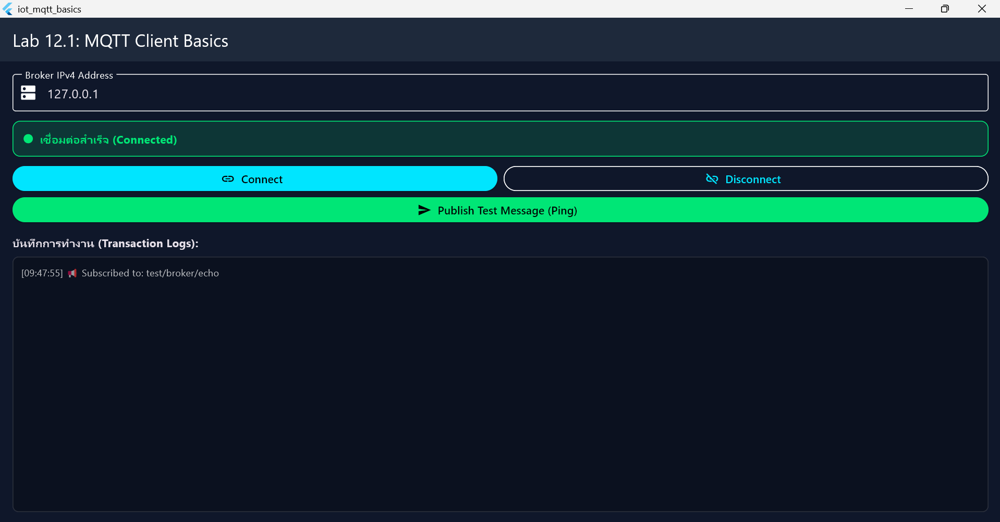
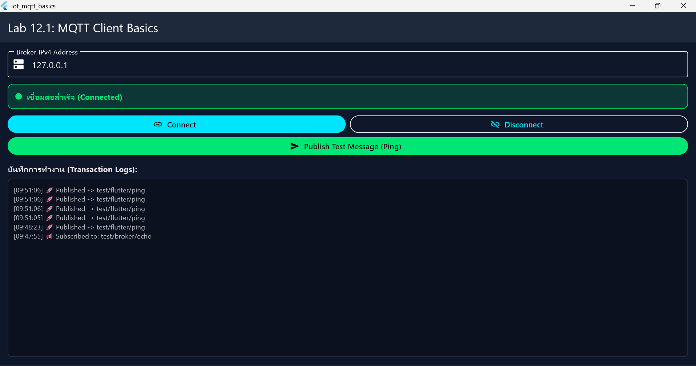
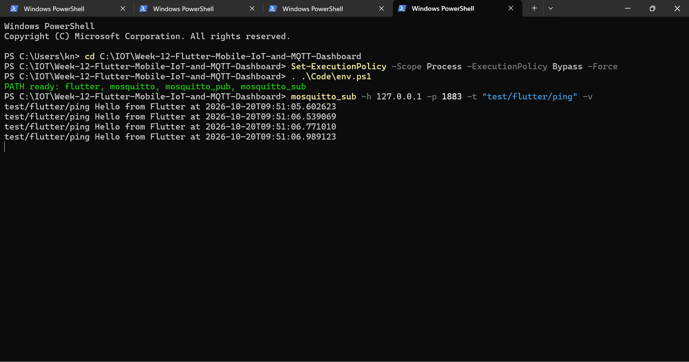
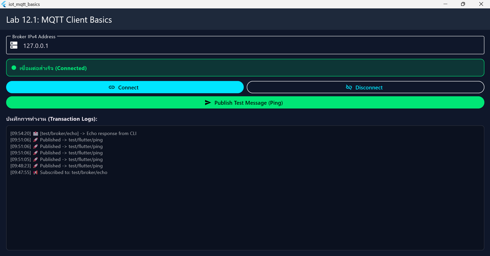
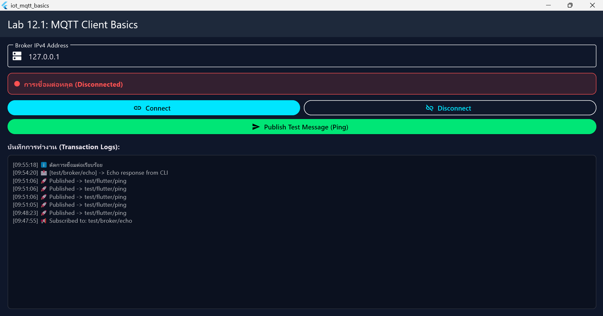

# ใบงานที่ 12.1 – ติดตั้ง Flutter และ MQTT Client พื้นฐาน

> [← กลับหน้ารวม](README.md)  ·  ใบงานนี้ไม่ต้องแนบ screenshot ให้บันทึกผลเป็นตัวอักษรในตารางด้านล่าง

## 1. สภาพแวดล้อมที่ใช้ทดลอง

| รายการ | ค่า |
| :--- | :--- |
| Flutter SDK | 3.47.7 (ติดตั้งที่ `C:\src\flutter`) |
| Mosquitto | 2.1.2 (ติดตั้งที่ `C:\Program Files\mosquitto`) |
| โปรเจกต์ | `Code/Lab12-1/iot_mqtt_basics` |
| แพ็กเกจ MQTT | `mqtt_client: ^10.13.0` (อยู่ใน `pubspec.yaml` แล้ว) |
| อุปกรณ์ที่รันแอป | ☐ Windows Desktop ☐ Android ☐ Chrome (ดูหมายเหตุข้อ 3) |
| IP Broker ที่กรอกในแอป | `127.0.0.1` (รันบนเครื่องเดียวกัน) |

## 2. เตรียมเครื่อง (ทำครั้งเดียวต่อหน้าต่าง PowerShell)

เปิด PowerShell ที่โฟลเดอร์โปรเจกต์ แล้วโหลด PATH ของ Flutter และ Mosquitto (มีจุดและเว้นวรรคนำหน้า):

```powershell
cd C:\IOT\Week-12-Flutter-Mobile-IoT-and-MQTT-Dashboard
. .\Code\env.ps1
flutter --version
```

## 3. ขั้นตอนการทดลอง

### 3.1 ตรวจสอบ Flutter (วัตถุประสงค์ข้อ 1)

```powershell
flutter doctor
```

ผลที่ตรวจไว้บนเครื่องนี้:

```text
[√] Flutter (Channel stable, 3.47.7)
[√] Windows Version (Windows 11)
[X] Android toolchain  - ไม่พบ Android SDK
[√] Chrome - develop for the web
[X] Visual Studio      - ยังไม่ได้ติดตั้ง (จำเป็นสำหรับรัน Windows Desktop)
[√] Network resources
```

> **ข้อจำกัด:** แอปนี้ใช้ TCP Socket (`MqttServerClient`) จึงรันบน Chrome ไม่ได้ ต้องรันบน Windows Desktop หรือ Android
> เครื่องนี้ยังรันได้เฉพาะเมื่อติดตั้ง **Visual Studio พร้อม workload "Desktop development with C++"** หรือ **Android Studio + Android SDK** อย่างใดอย่างหนึ่ง

### 3.2 ตรวจโปรเจกต์และแพ็กเกจ (วัตถุประสงค์ข้อ 2)

```powershell
cd Code\Lab12-1\iot_mqtt_basics
flutter pub get
flutter analyze
flutter test
```

ผลที่ตรวจไว้: `pub get` สำเร็จ, `flutter test` ผ่าน (1 test), `flutter analyze` มีแค่ info เรื่อง `withOpacity` deprecated ซึ่งไม่กระทบการทำงาน

### 3.3 เปิด Broker (หน้าต่าง PowerShell ที่ 1)

```powershell
. .\Code\env.ps1
mosquitto -v -p 1883
```

ปล่อยหน้าต่างนี้ไว้ ถ้าจะให้มือถือหรือ ESP32 ต่อได้ ใช้ `mosquitto -c mosquitto.conf -v` แทน

### 3.4 ดักฟังข้อความจากแอป (หน้าต่างที่ 2)

```powershell
. .\Code\env.ps1
mosquitto_sub -h 127.0.0.1 -p 1883 -t "test/flutter/ping" -v
```

### 3.5 รันแอป (หน้าต่างที่ 3)

```powershell
. .\Code\env.ps1
cd Code\Lab12-1\iot_mqtt_basics
flutter run -d windows
```

(หรือ `flutter run -d <device-id>` สำหรับ Android ดู device ได้จาก `flutter devices`)

### 3.6 ทดสอบสองทาง (วัตถุประสงค์ข้อ 3 และ 4)

1. ในแอป: กรอก `127.0.0.1` → กด **Connect**
2. กด **Publish Test Message (Ping)** → ดูที่หน้าต่างที่ 2
3. ส่งข้อความกลับจากหน้าต่างที่ 4 (หรือหน้าต่างใหม่):

```powershell
mosquitto_pub -h 127.0.0.1 -p 1883 -t "test/broker/echo" -m "Echo response from CLI"
```

## 4. ตารางบันทึกผล (ตามวัตถุประสงค์ของใบงาน)

| # | วัตถุประสงค์ / การกระทำ | ผลที่คาดหวัง | ผลจริง | ผ่าน? |
| :-- | :--- | :--- | :--- | :--- |
| 1 | `flutter doctor` (ข้อ 1) | Flutter ขึ้น `[√]` | Flutter 3.47.7 และ Visual Studio ขึ้น `[√]` (Android SDK ไม่มี แต่ไม่ได้ใช้) | ☑ ผ่าน ☐ ไม่ผ่าน |
| 2 | `mqtt_client` ใน `pubspec.yaml` + `flutter pub get` (ข้อ 2) | `Got dependencies!` | ขึ้น `Got dependencies!` | ☑ ผ่าน ☐ ไม่ผ่าน |
| 3 | กด **Connect** (ข้อ 3) | แถบเขียว Connected และ Log มี `Subscribed to: test/broker/echo` | แถบเขียว Connected, Log มี `Subscribed to: test/broker/echo` เวลา 09:47:55 | ☑ ผ่าน ☐ ไม่ผ่าน |
| 4 | กด **Publish Test Message** (ข้อ 4) | `mosquitto_sub` แสดง `test/flutter/ping Hello from Flutter at ...` | `mosquitto_sub` ได้รับ `Hello from Flutter at 2026-10-20T09:51:05...` ครบทุกครั้งที่กด | ☑ ผ่าน ☐ ไม่ผ่าน |
| 5 | `mosquitto_pub` ไป `test/broker/echo` (ข้อ 4) | Log ในแอปแสดง `[test/broker/echo] -> Echo response from CLI` | Log แสดง `[test/broker/echo] -> Echo response from CLI` เวลา 09:54:20 | ☑ ผ่าน ☐ ไม่ผ่าน |
| 6 | กด **Disconnect** | แถบสถานะแดง “การเชื่อมต่อหลุด” | แถบเป็นสีแดง “การเชื่อมต่อหลุด (Disconnected)” และ Log มี `ตัดการเชื่อมต่อเรียบร้อย` เวลา 09:55:18 | ☑ ผ่าน ☐ ไม่ผ่าน |

**ภาพผลการทดลอง** (เฉพาะข้อที่ผ่าน)

| ข้อ | ภาพ |
| :-- | :--- |
| 3 เชื่อมต่อสำเร็จ |  |
| 4 ส่งจากแอป (ฝั่งแอป) |  |
| 4 ส่งจากแอป (ฝั่ง mosquitto_sub) |  |
| 5 รับ Echo จาก CLI |  |
| 6 ตัดการเชื่อมต่อ |  |

**ปัญหาที่พบและวิธีแก้:** รันไฟล์ `env.ps1` ไม่ได้ เพราะ PowerShell บล็อกสคริปต์ แก้โดยรัน `Set-ExecutionPolicy -Scope Process -ExecutionPolicy Bypass -Force` ก่อน

---

## 5. คำถามท้ายการทดลอง

### ข้อ 1. ทำไมต้องสุ่ม `clientId` เช่นต่อท้ายด้วย Timestamp?

เพราะ Broker ไม่อนุญาตให้มี Client ID ซ้ำกัน ถ้าต่อเข้ามาด้วยชื่อเดิม Broker จะตัดตัวเก่าทิ้งทันที ถ้าใช้ชื่อคงที่แล้วเปิดแอปสองเครื่อง ทั้งสองจะเตะกันหลุดไปมาไม่หยุด การต่อท้ายด้วยเวลาทำให้ทุกครั้งได้ชื่อไม่ซ้ำ

### ข้อ 2. ทำไมบนมือถือจริงใช้ `127.0.0.1` ไม่ได้ และต้องใช้ IP อะไร?

`127.0.0.1` แปลว่า “เครื่องตัวเอง” พอรันบนมือถือ มันจะวิ่งไปหาตัวมือถือเอง ไม่ใช่คอมพิวเตอร์ที่รัน Broker จึงต้องใส่ **IP ของคอมพิวเตอร์ในวง Wi-Fi เดียวกัน** (ดูจาก `ipconfig` ช่อง IPv4 เช่น `192.168.x.x`) และเปิด Broker ด้วย `mosquitto -c mosquitto.conf` เพื่อให้รับการเชื่อมต่อจากเครื่องอื่นได้

### ข้อ 3. `keepAlivePeriod` จำเป็นอย่างไรในเครือข่ายไร้สาย?

Wi-Fi หรือ 4G หลุดได้โดยที่ทั้งสองฝั่งไม่รู้ตัว ค่านี้ทำให้ Client ส่ง Ping ไปหา Broker ทุก 20 วินาที ถ้าเงียบเกินเวลา Broker จะรู้ว่า Client หลุดและตัดการเชื่อมต่อให้ ทำให้ตรวจเจอการหลุดได้เร็วและไม่มีการเชื่อมต่อผีค้างอยู่
