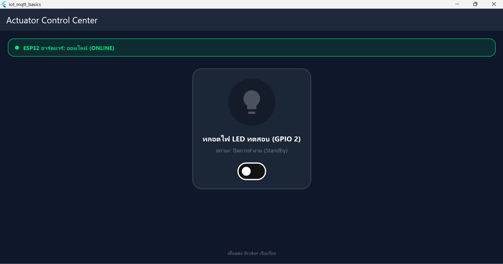
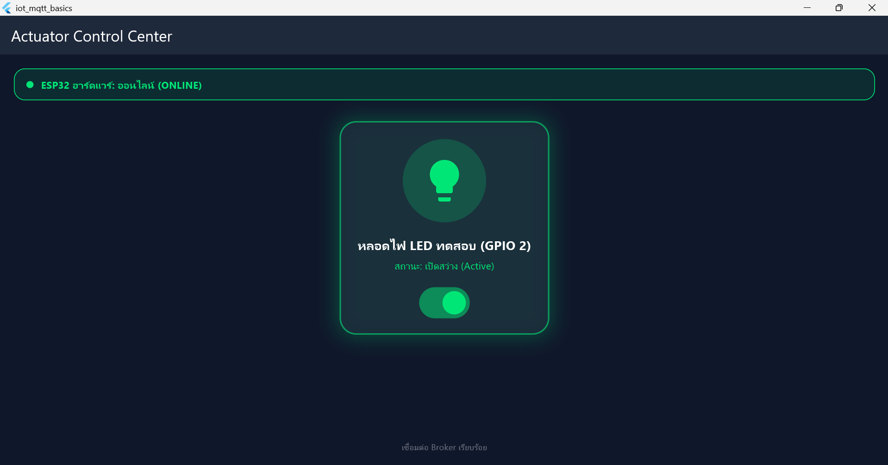
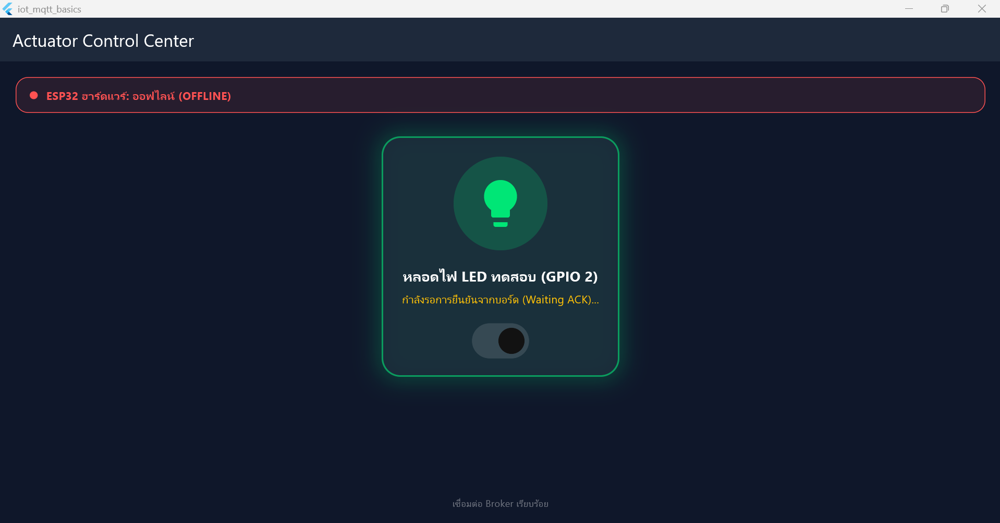

# ใบงานที่ 12.2 – สวิตช์ควบคุม LED สองทาง พร้อม ACK และสถานะ LWT

> [← กลับหน้ารวม](README.md)

## 1. สภาพแวดล้อม

| รายการ | ค่า |
| :--- | :--- |
| โปรเจกต์ | `Code/Lab12-2/iot_actuator_switch` |
| รันบน | Windows Desktop |
| Broker | `127.0.0.1:1883` |
| ฝั่งฮาร์ดแวร์ | ESP32 จริง (COM3) ต่อ Hotspot 2.4 GHz เฟิร์มแวร์จาก `Code/Lab12-4/esp32_firmware` |

## 2. วิธีทำ

ทุกหน้าต่าง PowerShell ให้รัน 3 บรรทัดนี้ก่อน
```powershell
cd C:\IOT\Week-12-Flutter-Mobile-IoT-and-MQTT-Dashboard
Set-ExecutionPolicy -Scope Process -ExecutionPolicy Bypass -Force
. .\Code\env.ps1
```

| หน้าต่าง | คำสั่ง | หน้าที่ |
| :-- | :--- | :--- |
| 1 | `mosquitto -v -p 1883` | Broker (ปล่อยค้างไว้) |
| 2 | `mosquitto_sub -h 127.0.0.1 -p 1883 -t "iot/esp32/control" -v` | ดูคำสั่งที่แอปส่งออกมา |
| 3 | `cd Code\Lab12-2\iot_actuator_switch` แล้ว `flutter run -d windows` | แอป |
| 4 | ใช้ส่งคำสั่งจำลองบอร์ด (ตามตารางข้างล่าง) | จำลอง ESP32 |

## 3. ตารางบันทึกผล

ทำตามลำดับ และสังเกตหน้าจอแอป

| # | ทำอะไร | ผลที่ควรเห็น | ผลจริง | ผ่าน? |
| :-- | :--- | :--- | :--- | :--- |
| 1 | เปิดแอป | แถบบนเป็นสีแดง **OFFLINE** | แถบบนเป็นสีแดง OFFLINE ตอนที่บอร์ดยังไม่ออนไลน์ | ☑ ผ่าน ☐ ไม่ผ่าน |
| 2 | หน้าต่าง 4: `mosquitto_pub -h 127.0.0.1 -p 1883 -t "iot/esp32/status" -m "online" -r` | แถบเปลี่ยนเป็นสีเขียว **ONLINE** | แถบบนสุดเป็นสีเขียว ONLINE (บอร์ดจริงส่ง `online` แบบ Retain เอง) | ☑ ผ่าน ☐ ไม่ผ่าน |
| 3 | แตะสวิตช์ในแอป | หน้าต่าง 2 แสดง `iot/esp32/control {"led":"ON"}` และแอปขึ้น “กำลังรอการยืนยัน (Waiting ACK)” สีเหลือง | | แตะแล้ว LED บนบอร์ด (GPIO 2) ติด และแอปขึ้น Waiting ACK สีเหลืองชั่วครู่ | ☑ ผ่าน ☐ ไม่ผ่าน |
| 4 | หน้าต่าง 4: `mosquitto_pub -h 127.0.0.1 -p 1883 -t "iot/esp32/led_ack" -m '{"led_state": true, "ack": true}'` | สวิตช์เป็น ON หลอดไฟและการ์ดเรืองแสงสีเขียว | | บอร์ดส่ง ACK เอง สวิตช์เป็น ON หลอดไฟและการ์ดเรืองแสงสีเขียว สถานะ “เปิดสว่าง (Active)” | ☑ ผ่าน ☐ ไม่ผ่าน |
| 5 | แตะสวิตช์อีกครั้งเพื่อปิด แล้วส่ง ACK `'{"led_state": false, "ack": true}'` | หน้าต่าง 2 แสดง `{"led":"OFF"}` แล้วสวิตช์กลับเป็น OFF | | LED บนบอร์ดดับ แอปกลับเป็น “ปิดการทำงาน (Standby)” | ☑ ผ่าน ☐ ไม่ผ่าน |
| 6 | หน้าต่าง 4: `mosquitto_pub -h 127.0.0.1 -p 1883 -t "iot/esp32/status" -m "offline" -r` แล้วลองแตะสวิตช์ | แถบเป็นสีแดง OFFLINE และแตะแล้วขึ้นข้อความเตือน ไม่มีคำสั่งออกไปที่หน้าต่าง 2 | แถบเป็นสีแดง OFFLINE แตะสวิตช์แล้วขึ้นข้อความเตือน “อุปกรณ์ ESP32 ออฟไลน์อยู่ ไม่สามารถส่งคำสั่งได้” ไม่มีคำสั่งออกไป | ☑ ผ่าน ☐ ไม่ผ่าน |

> ข้อ 2, 4, 5 ใช้บอร์ดจริงแทนการพิมพ์ `mosquitto_pub` จำลอง (บอร์ดส่ง `online` และ ACK เอง) ผ่านครบทั้ง 6 ข้อ

**ภาพผลการทดลอง** (เฉพาะข้อที่ผ่าน)

| ข้อ | ภาพ |
| :-- | :--- |
| 2 ONLINE (สวิตช์ปิด Standby) |  |
| 4 เปิดสว่าง Active |  |
| 6 OFFLINE |  |
| 6 ข้อความเตือนเมื่อแตะตอน OFFLINE |  |

**ปัญหาที่พบและวิธีแก้:** ESP32 ต่อ Wi-Fi ไม่ได้เพราะ Hotspot เป็น 5 GHz ต้องตั้งเป็น 2.4 GHz แล้วเปิด Hotspot ใหม่ และต้องเปิด Broker ด้วย `mosquitto -c mosquitto.conf` เพื่อให้รับจากเครื่องอื่นได้

---

## 4. คำถามท้ายการทดลอง

### ข้อ 1. ประโยชน์ของการรอ ACK แทนการเปลี่ยน UI ทันที (Optimistic Update)?

หน้าจอจะแสดงความจริงเสมอ สวิตช์เป็น ON ก็ต่อเมื่อบอร์ดยืนยันแล้วว่าเปิดไฟจริง ถ้าคำสั่งหายระหว่างทางหรือบอร์ดดับ แอปจะไม่หลอกผู้ใช้ว่าไฟเปิดแล้ว และระหว่างรอ สวิตช์ถูกล็อกไว้ จึงกดรัวซ้อนกันไม่ได้

### ข้อ 2. ทำไมควรตั้ง Retain (`-r`) ให้ `iot/esp32/status`?

Retain ทำให้ Broker จำข้อความสุดท้ายไว้ แล้วส่งให้ทันทีเมื่อมีใครมา Subscribe ใหม่ ถ้าไม่ตั้ง แอปที่เปิดทีหลังจะไม่รู้ว่าบอร์ดออนไลน์อยู่ เพราะข้อความ `online` ถูกส่งไปตั้งแต่ตอนบอร์ดบูต และจะขึ้น OFFLINE ผิด ๆ ไปเรื่อย ๆ
