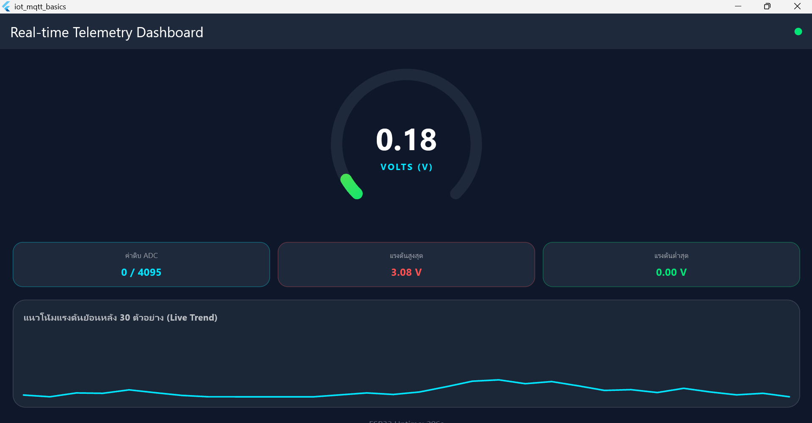
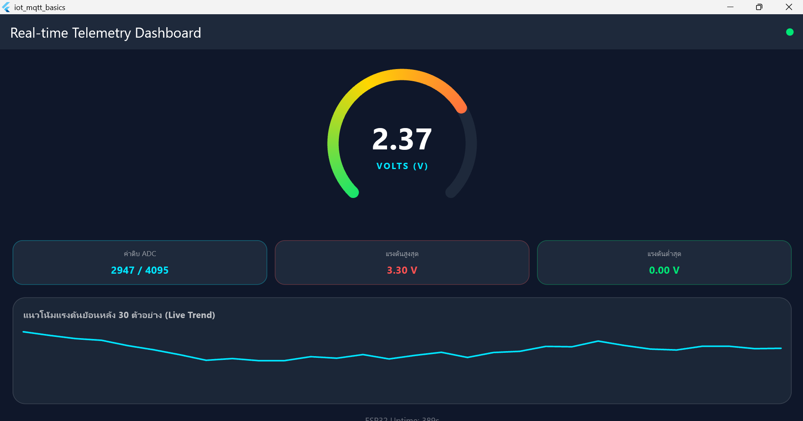

# ใบงานที่ 12.3 – Telemetry Dashboard และ Radial Gauge

> [← กลับหน้ารวม](README.md)

## 1. สภาพแวดล้อม

| รายการ | ค่า |
| :--- | :--- |
| โปรเจกต์ | `Code/Lab12-3/iot_telemetry_gauge` |
| รันบน | Windows Desktop |
| Broker | `127.0.0.1:1883` เปิดด้วย `mosquitto -c mosquitto.conf -v` |
| แหล่งข้อมูล | ESP32 จริง ส่งค่าแรงดันสุ่ม (`SIMULATE_ADC=1` ใน `.env` เพราะไม่มี Potentiometer) ทุก 0.5 วินาที และ `mosquitto_pub` สำหรับทดสอบค่าเฉพาะ |

> ESP32 ส่งแรงดันจากขา GPIO 34 ถ้าไม่ได้ต่อ Potentiometer ค่าจะลอยไม่คงที่ ถ้าต่อ Potentiometer แล้ว หมุนแล้วเกจจะขยับตาม

## 2. วิธีทำ

ทุกหน้าต่าง PowerShell รัน 3 บรรทัดนี้ก่อน
```powershell
cd C:\IOT\Week-12-Flutter-Mobile-IoT-and-MQTT-Dashboard
Set-ExecutionPolicy -Scope Process -ExecutionPolicy Bypass -Force
. .\Code\env.ps1
```

| หน้าต่าง | คำสั่ง |
| :-- | :--- |
| 1 | Broker ที่เปิดอยู่เดิม (`mosquitto -c mosquitto.conf -v`) ปล่อยค้างไว้ |
| 2 | `cd Code\Lab12-3\iot_telemetry_gauge` แล้ว `flutter run -d windows` |
| 3 | ส่งค่าทดสอบด้วย `mosquitto_pub` (ตามตารางข้อ 3.2) |

> Lab 12.1–12.2 ใช้ Windows Desktop และ Python ไม่ได้ติดตั้งในเครื่องนี้ จึงไม่ใช้ `pyTeleSim.py` ใช้บอร์ดจริงหรือ `mosquitto_pub` แทน

## 3. ตารางบันทึกผล

### 3.1 ข้อมูลจากบอร์ดจริง

| # | สิ่งที่สังเกต | ผลที่ควรเห็น | ผลจริง | ผ่าน? |
| :-- | :--- | :--- | :--- | :--- |
| 1 | ไอคอนวงกลมมุมขวาบน | เป็นสีเขียว (เชื่อมต่อ Broker) | จุดมุมขวาบนเป็นสีเขียว | ☑ ผ่าน ☐ ไม่ผ่าน |
| 2 | เกจแรงดัน | ตัวเลขและเส้นโค้งขยับตามค่าที่บอร์ดส่ง นุ่มนวล ไม่กระโดด | เกจแสดง 0.18 V เส้นโค้งสัดส่วนตรงกับค่า (ความนุ่มนวลดูจากภาพนิ่งไม่ได้ แต่ใช้ `TweenAnimationBuilder` ตามโค้ด) | ☑ ผ่าน ☐ ไม่ผ่าน |
| 3 | การ์ดค่าดิบ ADC | แสดง `xxxx / 4095` และเปลี่ยนตามแรงดัน | การ์ดแสดงรูปแบบ `0 / 4095` ถูกต้อง (ภาพนี้ค่าเป็น 0 เพราะค่าสุ่มชนขอบล่าง 0 V พอดี ขณะที่เกจยังเลื่อนลง) | ☑ ผ่าน ☐ ไม่ผ่าน |
| 4 | การ์ด Max / Min | Max/Min อัปเดตตามค่าที่เคยได้รับ | Max = 3.08 V, Min = 0.00 V ต่างกัน แสดงว่าได้รับค่าหลายค่า | ☑ ผ่าน ☐ ไม่ผ่าน |
| 5 | กราฟ Live Trend | เส้นกราฟเลื่อนต่อเนื่อง แสดงไม่เกิน 30 จุด | กราฟเป็นเส้นหยักตามค่าสุ่ม ช่วงกลางแบนที่ 0 V ตอนค่าชนขอบล่าง | ☑ ผ่าน ☐ ไม่ผ่าน |
| 6 | ESP32 Uptime | เพิ่มขึ้นทีละ 1 วินาที | ข้อความ Uptime ท้ายหน้า (ถูกตัดบางส่วนในภาพ) ประมาณ 300 วินาที สอดคล้องกับเวลาตั้งแต่ flash บอร์ด | ☑ ผ่าน ☐ ไม่ผ่าน |

**ภาพผลการทดลอง**





### 3.2 ส่งค่าเฉพาะด้วย `mosquitto_pub`

หมายเหตุ: บอร์ดยังส่งค่าอยู่ตลอด ค่าที่ส่งเองจะถูกบอร์ดทับในอีก 0.5 วินาที ถ้าอยากเห็นค่าชัดเจน ให้ถอดสาย USB ของบอร์ดก่อน หรือดูผลภายในครึ่งวินาทีแรก

| # | ส่งค่านี้ (`-t "iot/esp32/telemetry" -m ...`) | ผลที่ควรเห็น | ผลจริง | ผ่าน? |
| :-- | :--- | :--- | :--- | :--- |
| 1 | `'{"voltage": 1.65, "raw": 2048, "uptime": 10}'` | เกจกึ่งกลาง 1.65 และการ์ด `2048 / 4095` | | ☐ ผ่าน ☐ ไม่ผ่าน |
| 2 | `'{"voltage": 3.3, "raw": 4095, "uptime": 11}'` | เกจเต็มวง แสดง 3.30 | | ☐ ผ่าน ☐ ไม่ผ่าน |
| 3 | `'{"voltage": 5.0, "raw": 4095, "uptime": 12}'` (เกินช่วง) | เส้นเกจหยุดที่เต็มวง แอปไม่แครช | | ☐ ผ่าน ☐ ไม่ผ่าน |
| 4 | `'{"voltage": null}'` | ค่ากลายเป็น 0.00 แอปไม่แครช | | ☐ ผ่าน ☐ ไม่ผ่าน |
| 5 | `hello` (ไม่ใช่ JSON) | ไม่มีอะไรเปลี่ยน แอปไม่แครช | | ☐ ผ่าน ☐ ไม่ผ่าน |

ตัวอย่างคำสั่ง
```powershell
mosquitto_pub -h 127.0.0.1 -p 1883 -t "iot/esp32/telemetry" -m '{"voltage": 1.65, "raw": 2048, "uptime": 10}'
```

**ปัญหาที่พบและวิธีแก้:** ______________________________________________

---

## 4. คำถามท้ายการทดลอง

### ข้อ 1. ทำไม `TweenAnimationBuilder` ทำให้เข็มนุ่มนวลแม้ข้อมูลมาทุก 500 ms?

ถ้าวาดค่าใหม่ตรง ๆ เข็มจะกระโดดจากค่าเก่าไปค่าใหม่ทันที `TweenAnimationBuilder` จะค่อย ๆ เปลี่ยนจากค่าปัจจุบันไปค่าใหม่ในเวลา 300 ms โดยวาดทีละเฟรม เข็มจึงเคลื่อนต่อเนื่อง และเพราะ 300 ms สั้นกว่าช่วงข้อมูล 500 ms แอนิเมชันจึงจบก่อนค่าถัดไปมาถึง

### ข้อ 2. จำกัด `_history` ไม่เกิน 30 ตัวอย่าง ดีต่อหน่วยความจำอย่างไร?

ข้อมูลมาวินาทีละ 2 ค่า ถ้าไม่จำกัด ลิสต์จะโตขึ้นเรื่อย ๆ จนกินหน่วยความจำและวาดกราฟช้าลง การเก็บแค่ 30 ค่าทำให้ใช้หน่วยความจำเท่าเดิมตลอดและวาดกราฟเร็วคงที่ (30 ค่า ย้อนหลังประมาณ 15 วินาที พอดูแนวโน้ม)

### ข้อ 3. ถ้าเซนเซอร์ส่งค่าผิด (นอก 0–3.3 V หรือ `null`) โค้ดส่วนไหนกันแอปแครช?

- `try { ... } catch` ครอบ `jsonDecode` ถ้าข้อมูลไม่ใช่ JSON แอปจะข้ามข้อความนั้น
- `(data['voltage'] as num?)?.toDouble() ?? 0.0` ถ้าค่าเป็น `null` หรือไม่มีคีย์ จะใช้ 0
- `.clamp(0.0, 1.0)` ใน `radial_gauge_widget.dart` และกราฟ ทำให้ค่าเกิน 3.3 V ไม่ทำให้เส้นโค้งวาดเกินวงหรือกราฟหลุดกรอบ
