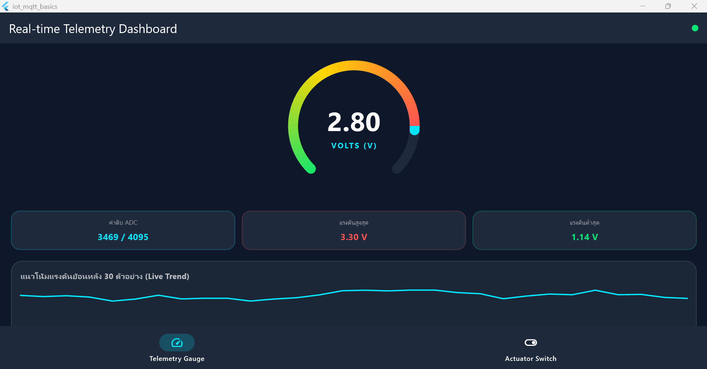
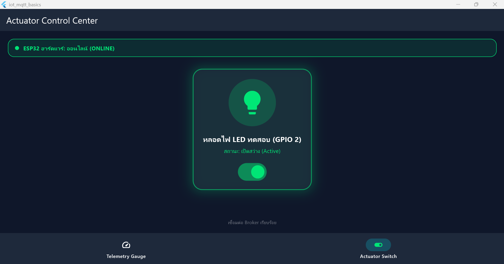
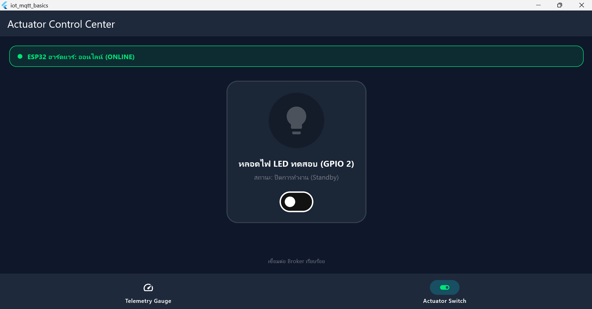
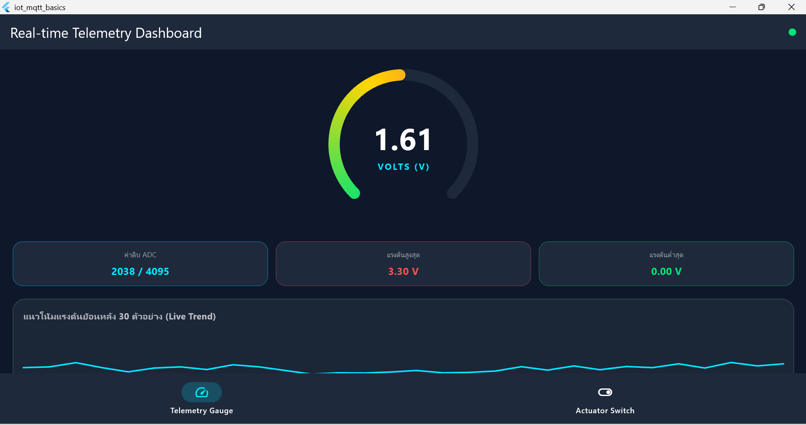
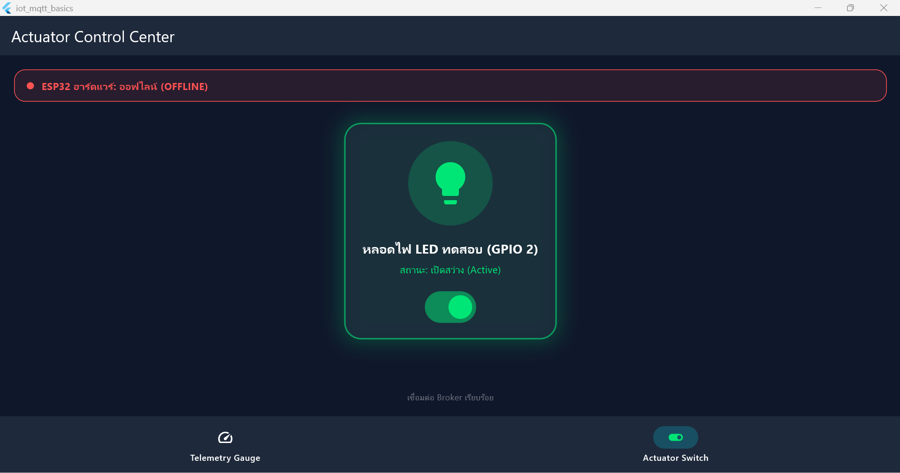

# ใบงานที่ 12.4 – ผสานรวมระบบครบวงจร (ESP32 ⇄ Mosquitto ⇄ Flutter)

> [← กลับหน้ารวม](README.md)

## 1. สภาพแวดล้อม

| รายการ | ค่า |
| :--- | :--- |
| แอป | `Code/Lab12-4/iot_unified_dashboard` (2 แท็บ: Telemetry Gauge / Actuator Switch ใช้ `IndexedStack`) |
| ฮาร์ดแวร์ | ESP32 รุ่นมาตรฐาน LED ที่ GPIO 2 เฟิร์มแวร์ `Code/Lab12-4/esp32_firmware` |
| ค่าแรงดัน | สุ่มจากบอร์ด (`SIMULATE_ADC=1` เพราะไม่มี Potentiometer) |
| เครือข่าย | Hotspot มือถือ 2.4 GHz ทั้งโน้ตบุ๊กและ ESP32 |
| Broker | `mosquitto -c mosquitto.conf -v` (โน้ตบุ๊ก `10.131.32.114:1883`) |
| รหัส Wi-Fi | เก็บใน `esp32_firmware/.env` ซึ่งอยู่ใน `.gitignore` ไม่ขึ้น GitHub (ตัวอย่างค่าดูที่ `.env.example`) |

## 2. วิธีทำ

ทุกหน้าต่าง PowerShell รันก่อน
```powershell
cd C:\IOT\Week-12-Flutter-Mobile-IoT-and-MQTT-Dashboard
Set-ExecutionPolicy -Scope Process -ExecutionPolicy Bypass -Force
. .\Code\env.ps1
```

| หน้าต่าง | คำสั่ง |
| :-- | :--- |
| 1 | `mosquitto -c mosquitto.conf -v` (Broker ปล่อยค้างไว้) |
| 2 | `cd Code\Lab12-4\iot_unified_dashboard` แล้ว `flutter run -d windows` |
| 3 | ดูข้อความทั้งหมดจากบอร์ด: `mosquitto_sub -h 127.0.0.1 -p 1883 -t "iot/esp32/#" -v` |

ถ้าจะเปลี่ยนเฟิร์มแวร์ (แก้ `.env`): เปิด ESP-IDF แล้วรัน `idf.py -p COM3 build flash` ในโฟลเดอร์ `esp32_firmware`

## 3. Test Matrix

| Test Case | ทำอะไร | ผลที่ควรเห็น | ผลจริง | ผ่าน? |
| :--- | :--- | :--- | :--- | :--- |
| **TC1 Telemetry** | เปิดแท็บ Telemetry Gauge | เกจ ค่า ADC และกราฟขยับตามค่าสุ่มจากบอร์ดต่อเนื่อง | จุดมุมขวาบนเขียว เกจ 2.80 V ค่าดิบ 3469 สอดคล้องกัน (3469/4095×3.3 ≈ 2.80) Max 3.30 V Min 1.14 V กราฟเป็นเส้นหยัก | ☑ ผ่าน ☐ ไม่ผ่าน |
| **TC2 Actuator** | แท็บ Actuator Switch แตะสวิตช์ | LED บนบอร์ดติด/ดับ สวิตช์และไอคอนเรืองแสงเขียว | แถบ ONLINE สีเขียว สวิตช์เปิดแล้วการ์ดเรืองแสง “เปิดสว่าง (Active)” และปิดแล้วกลับเป็น “ปิดการทำงาน (Standby)” (ภาพไม่ได้แสดง LED บนบอร์ด) | ☑ ผ่าน ☐ ไม่ผ่าน |
| **TC3 State Sync & ACK** | แตะสวิตช์ แล้วดูสถานะ | ขึ้น Waiting ACK ก่อน แล้วสวิตช์เปลี่ยนตามค่าที่บอร์ดยืนยันกลับมา | สวิตช์ถึงสถานะ ON/OFF ตามที่บอร์ดยืนยัน (โค้ดตั้งค่าสถานะจาก ACK เท่านั้น) ไม่ได้จับภาพช่วง Waiting ACK | ☑ ผ่าน ☐ ไม่ผ่าน |
| **TC4 Fault Tolerance (LWT)** | ถอดสาย USB ของบอร์ด รอประมาณ 90 วินาที (หรือส่ง `mosquitto_pub -h 127.0.0.1 -p 1883 -t "iot/esp32/status" -m "offline" -r`) | แถบเป็นสีแดง OFFLINE แตะสวิตช์แล้วมีข้อความเตือน ไม่ส่งคำสั่ง | หลังส่ง `offline` แถบบนเปลี่ยนเป็นสีแดง OFFLINE ทันที การ์ดยังค้างสถานะเดิม (Active) เพราะเป็นค่าล่าสุดที่เคยได้รับ ข้อความเตือนเมื่อแตะสวิตช์ภาพนี้ไม่ได้จับ แต่เคยยืนยันแล้วใน Lab 12.2 ซึ่งใช้โค้ดไฟล์เดียวกัน | ☑ ผ่าน ☐ ไม่ผ่าน |
| **TC5 สลับแท็บ** | สลับ Telemetry ↔ Actuator หลายครั้ง | กราฟและ Max/Min ไม่รีเซ็ต ไม่ต้องเชื่อมต่อ Broker ใหม่ | กลับมาแท็บ Telemetry จุดเขียว กราฟเต็ม Max 3.30 V Min 0.00 V ยังอยู่ ไม่รีเซ็ต (ก่อนสลับ Min เคยเป็น 1.14 V แล้วลดลงเป็น 0.00 V ตามค่าใหม่ที่รับระหว่างนั้น) | ☑ ผ่าน ☐ ไม่ผ่าน |

**ภาพผลการทดลอง**

| ข้อ | ภาพ |
| :-- | :--- |
| TC1 แท็บ Telemetry |  |
| TC2 สวิตช์เปิด |  |
| TC2 สวิตช์ปิด |  |
| TC5 กลับมาแท็บ Telemetry หลังสลับแท็บ |  |
| TC4 แถบ OFFLINE หลังส่ง `offline` |  |

> LWT บนบอร์ดจริงไม่ได้มาทันที เพราะ `keepalive = 60` วินาที Broker จะส่ง `offline` หลังเงียบเกิน 1.5 เท่า คือประมาณ 90 วินาที
>
> หลังทดสอบ TC4 ด้วยการส่ง `offline` จำลอง ให้ส่ง `online` กลับ: `mosquitto_pub -h 127.0.0.1 -p 1883 -t "iot/esp32/status" -m "online" -r`

## 4. วัดความหน่วง (Round-Trip Time)

วัดด้วยสคริปต์ ส่ง `{"led":"ON"/"OFF"}` ไป `iot/esp32/control` แล้วจับเวลาจนได้ `iot/esp32/led_ack` กลับมา 10 ครั้ง (โน้ตบุ๊ก → Broker → ESP32 → Broker → โน้ตบุ๊ก ไม่รวมเวลาวาดหน้าจอแอป)

| ครั้งที่ | RTT (ms) | ครั้งที่ | RTT (ms) |
| :-- | :-- | :-- | :-- |
| 1 | 670.7 | 6 | 79.2 |
| 2 | 145.9 | 7 | 349.6 |
| 3 | 130.9 | 8 | 40.5 |
| 4 | 61.5 | 9 | 112.5 |
| 5 | 309.5 | 10 | 30.9 |

| สภาพแวดล้อม | ประเภท | RTT เฉลี่ย | ข้อสังเกต |
| :--- | :--- | :--- | :--- |
| Local Wi-Fi LAN | โน้ตบุ๊กและบอร์ดอยู่ Wi-Fi วงเดียวกัน | ไม่ได้ทดสอบ | |
| **Mobile Hotspot (2.4 GHz)** | โน้ตบุ๊กและ ESP32 ต่อ Hotspot มือถือ | **193.1 ms** (min 30.9, max 670.7, ค่ากลาง 121.7) | ครั้งแรกช้าสุด 670.7 ms (ตัดครั้งแรกออก เฉลี่ย 140.1 ms) ค่าแกว่งมากตามสัญญาณ Wi-Fi ของ Hotspot |

ค่าอ้างอิงในใบงาน: Wi-Fi LAN ประมาณ 20–60 ms, Hotspot/4G ประมาณ 80–250 ms ผลที่ได้ (เฉลี่ย 193 ms) อยู่ในช่วงของ Hotspot

**ปัญหาที่พบและวิธีแก้:**
- ESP32 ต่อ Wi-Fi ไม่ได้ เพราะ Hotspot เป็น 5 GHz แก้โดยตั้ง Hotspot เป็น 2.4 GHz แล้วเปิดใหม่
- ESP32 ต่อ Broker ไม่ได้ เพราะ Broker ฟังแค่ `127.0.0.1` แก้โดยเปิดด้วย `mosquitto -c mosquitto.conf`
- ไม่มี Potentiometer แก้โดยให้บอร์ดสุ่มแรงดัน (`SIMULATE_ADC=1`)

---

## 5. คำถามท้ายบทเรียน

### ข้อ 1. ทำไม `IndexedStack` สำคัญกว่า `body: _pages[_currentIndex]`?

แบบ `_pages[_currentIndex]` จะถอดหน้าที่ไม่ได้ดูออกจากต้นไม้วิดเจ็ต State ถูกทำลาย และโค้ดนี้สั่งตัดการเชื่อมต่อ MQTT ในตอนนั้นด้วย พอกลับมาก็ต้องเชื่อมต่อใหม่ กราฟ Max/Min และสถานะ LED หายหมด ระหว่างที่ไปอีกหน้า ข้อความ Telemetry และ ACK ก็ตกหล่น ส่วน `IndexedStack` สร้างทุกหน้าไว้ แต่แสดงทีละหน้า หน้าที่ซ่อนอยู่ยังทำงานต่อ การเชื่อมต่อและข้อมูลไม่หาย สลับแท็บได้ทันที เหมาะกับแอป IoT ที่ต้องรับข้อมูลตลอดเวลา

### ข้อ 2. Flutter เทียบกับหน้าเว็บ HTTP (สัปดาห์ 8–10) แบบไหนดีกว่าเมื่อข้อมูลมาถี่?

Flutter + MQTT ดีกว่า เพราะ MQTT เป็นแบบ Push คือ Broker ส่งข้อมูลมาให้ทันทีผ่านการเชื่อมต่อที่เปิดค้างไว้ ส่วนหน้าเว็บ HTTP ต้องถามซ้ำ (Polling) ซึ่งมีส่วนหัวใหญ่ต่อครั้ง ช้าและสิ้นเปลือง และ ESP32 ต้องรันเว็บเซิร์ฟเวอร์ตอบทุกคำขอ นอกจากนี้ Flutter วาดหน้าจอเองด้วย Engine ของตัวเอง แอนิเมชันเกจลื่นกว่า และรู้สถานะออนไลน์ทันทีผ่าน LWT

### ข้อ 3. ถ้าจะขึ้น Play Store / App Store ต้องปรับความปลอดภัยอะไร?

1. ใช้ MQTTS (TLS) พอร์ต 8883 แทน 1883 ที่ส่งข้อความเปล่า
2. ปิด `allow_anonymous` ให้ทุกอุปกรณ์และผู้ใช้ยืนยันตัวตน (Username/Password, Token อายุสั้น หรือใบรับรองราย Client)
3. ตั้ง ACL จำกัดสิทธิ์ราย Topic ให้เห็นเฉพาะอุปกรณ์ของตัวเอง
4. อย่าฝังรหัสผ่านไว้ในโค้ด เก็บในที่ปลอดภัยของเครื่อง (Keystore/Keychain) และบนบอร์ดใช้ Flash/NVS Encryption (โปรเจกต์นี้ย้ายรหัส Wi-Fi ไป `.env` แล้ว เพื่อไม่ให้ขึ้น GitHub)
5. ไม่เปิด Broker ออกอินเทอร์เน็ตตรง ๆ ใช้ Broker ที่มีผู้ดูแล หรือ VPN พร้อม Firewall
