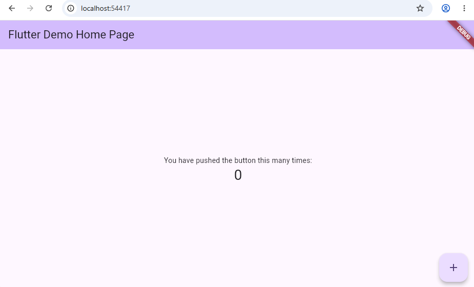

#### 1. ตรวจสอบความพร้อมของเครื่องมือ Flutter
เปิด PowerShell และตรวจสอบสถานะของ Flutter SDK:
```powershell
flutter doctor
```
*(ตรวจสอบว่า Flutter และ Android toolchain หรือ Chrome พร้อมใช้งาน)*

```text
Doctor summary (to see all details, run flutter doctor -v):
[√] Flutter (Channel stable, 3.47.1, on Microsoft Windows [Version 10.0.26300.9711], locale en-US)
[√] Windows Version (Windows 11 or higher, 26H2, 2009)
[!] Android toolchain - develop for Android devices (Android SDK version 36.0.0)
    X cmdline-tools component is missing.
      Try installing or updating Android Studio.
      Alternatively, download the tools from https://developer.android.com/studio#command-line-tools-only and make sure to set the ANDROID_HOME environment variable.
      See https://developer.android.com/studio/command-line for more details.
    X Android license status unknown.
      Run `flutter doctor --android-licenses` to accept the SDK licenses.
      See https://flutter.dev/to/windows-android-setup for more details.
[√] Chrome - develop for the web
[√] Visual Studio - develop Windows apps (Visual Studio Community 2026 18.8.2)
[√] Connected device (3 available)
[√] Network resources

! Doctor found issues in 1 category.
```

#### 2. สร้างโฟลเดอร์และโปรเจกต์ Flutter ใหม่
```powershell
flutter create iot_mqtt_basics
cd iot_mqtt_basics
```

```text
Creating project iot_mqtt_basics...
Resolving dependencies in `iot_mqtt_basics`... 
Downloading packages... 
Got dependencies in `iot_mqtt_basics`.
Wrote 131 files.

All done!
You can find general documentation for Flutter at: https://docs.flutter.dev/
Detailed API documentation is available at: https://api.flutter.dev/
If you prefer video documentation, consider: https://www.youtube.com/c/flutterdev

In order to run your application, type:

  $ cd iot_mqtt_basics
  $ flutter run

Your application code is in iot_mqtt_basics\lib\main.dart.
```


#### 3. ติดตั้งแพ็กเกจ `mqtt_client`
รันคำสั่งเพิ่ม Dependency:
```powershell
flutter pub add mqtt_client
```
หรือตรวจสอบในไฟล์ `pubspec.yaml` ว่ามีส่วนต่อไปนี้:
```yaml
dependencies:
  flutter:
    sdk: flutter
  mqtt_client: ^10.3.0
```

``` text
Resolving dependencies... 
Downloading packages... (1.1s)
+ crypto 3.0.7
  cupertino_icons 1.0.9 (2.0.0 available)
+ event_bus 2.0.1
  material_color_utilities 0.13.0 (0.13.1 available)
  meta 1.18.3 (1.19.0 available)
+ mqtt_client 10.13.0
  test_api 0.7.12 (0.7.15 available)
+ typed_data 1.4.0
  vector_math 2.4.0 (2.4.3 available)
+ web 1.1.1
Changed 5 dependencies!
5 packages have newer versions incompatible with dependency constraints.
Try `flutter pub outdated` for more information.

```

#### ทดสอบรัน flutter 
```powershell
flutter run
```

```text
Connected devices:
Windows (desktop) • windows • windows-x64    • Microsoft Windows [Version 10.0.26300.9711]
Chrome (web)      • chrome  • web-javascript • Google Chrome 155.0.8059.80
Edge (web)        • edge    • web-javascript • Microsoft Edge 155.0.4283.45
[1]: Windows (windows)
[2]: Chrome (chrome)
[3]: Edge (edge)
Please choose one (or "q" to quit): 2
Launching lib\main.dart on Chrome in debug mode...
Waiting for connection from debug service on Chrome...             17.9s

Flutter run key commands.
r Hot reload.
R Hot restart.
h List all available interactive commands.
d Detach (terminate "flutter run" but leave application running).
c Clear the screen
q Quit (terminate the application on the device).

This app is linked to the debug service: ws://127.0.0.1:49556/H8v-eQisCuI=/ws
Debug service listening on ws://127.0.0.1:49556/H8v-eQisCuI=/ws
A Dart VM Service on Chrome is available at: http://127.0.0.1:49556/H8v-eQisCuI=
The Flutter DevTools debugger and profiler on Chrome is available at: http://127.0.0.1:49556/H8v-eQisCuI=/devtools/?uri=ws://127.0.0.1:49556/H8v-eQisCuI=/ws
Starting application from main method in: org-dartlang-app:///web_entrypoint.dart.  
```




