# ใบงานการทดลองที่ 12.1
### การติดตั้งสภาพแวดล้อม Flutter และการพัฒนา MQTT Client พื้นฐานบนสมาร์ตโฟน

> [!NOTE] **คำชี้แจง**
> ในใบงานนี้นักศึกษาจะได้เริ่มต้นสร้างโปรเจกต์โมบายล์แอปพลิเคชันด้วย **Flutter SDK**, ติดตั้งคอมโพเนนต์ **`mqtt_client`**, และเขียนโค้ดสำหรับสร้างการเชื่อมต่อเครือข่ายไปยัง **Eclipse Mosquitto Broker** โดยมีหน้าจออินเทอร์เฟซแสดงผลสถานะการเชื่อมต่อ และปุ่มกดทดสอบการ Publish และ Subscribe ข้อความเบื้องต้น

---

## 1. วัตถุประสงค์การทดลอง
1. สามารถติดตั้งและตรวจสอบความพร้อมของ Flutter SDK ผ่านเครื่องมือ `flutter doctor` ได้
2. สามารถสร้างโปรเจกต์ Flutter ใหม่ และกำหนดค่าแพ็กเกจ `mqtt_client` ใน `pubspec.yaml` ได้
3. สามารถเขียนโค้ดภาษา Dart เพื่อเชื่อมต่อและตัดการเชื่อมต่อกับ Mosquitto Broker ผ่านพอร์ต 1883 ได้
4. สามารถส่งข้อความ (Publish) และบอกรับหัวข้อ (Subscribe) ทดสอบร่วมกับโปรแกรม Mosquitto CLI บนคอมพิวเตอร์ได้

> [!NOTE] **สภาพแวดล้อมที่ใช้ทำการทดลองจริง (รหัสนักศึกษา 67030011)**
> * macOS 15.5 (Apple Silicon), Flutter **3.44.4** / Dart **3.12.2**, Xcode 16.2, Mosquitto **2.0.22**
> * ใบงานเขียนไว้สำหรับ Windows Desktop / Android — บน Mac จึงรันแอปบน **iOS Simulator (iPhone 16 Pro, iOS 18.3)** ซึ่งใช้ Network Stack เดียวกับ Mac จึงต่อ Broker ที่ `127.0.0.1` ได้เหมือน Windows Desktop
> * โปรเจกต์: [Lab12-1/iot_mqtt_basics/](Lab12-1/iot_mqtt_basics/) และ Log ดิบทั้งหมดอยู่ใน [Lab12-1/logs/](Lab12-1/logs/)


---

## 2. โครงสร้างการเชื่อมต่อระบบ (System Architecture)

<p align="center"></p>

---

## 3. ขั้นตอนการทดลอง (Step-by-Step Activities)

### กิจกรรมที่ 12-1.1: ตรวจสอบและสร้างโปรเจกต์ Flutter

#### 1. ตรวจสอบความพร้อมของเครื่องมือ Flutter
เปิด PowerShell และตรวจสอบสถานะของ Flutter SDK:
```powershell
flutter doctor
```
*(ตรวจสอบว่า Flutter และ Windows Desktop หรือ Android Toolchain พร้อมใช้งาน)*

**ผลการทดลอง:** Flutter, Android toolchain, Xcode และ Chrome พร้อมใช้งาน มีคำเตือนเพียง CocoaPods ที่ยังไม่ติดตั้ง ซึ่งไม่กระทบใบงานนี้เพราะ `mqtt_client` เป็น Pure Dart ไม่มี Native Plugin (Build iOS ผ่านโดยไม่ต้องใช้ Pod)

<p align="center">
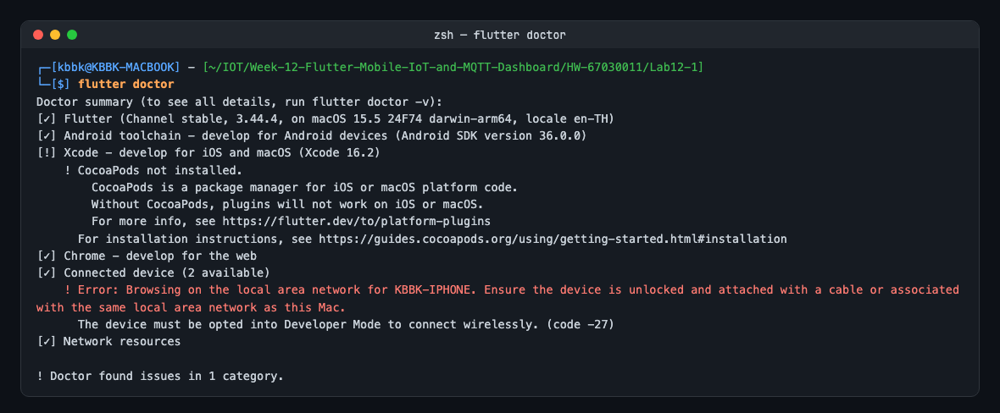
</p>


#### 2. สร้างโฟลเดอร์และโปรเจกต์ Flutter ใหม่
```powershell
flutter create iot_mqtt_basics
cd iot_mqtt_basics
```

**ผลการทดลอง:** สร้างโปรเจกต์ได้ 131 ไฟล์ (Flutter สร้างโฟลเดอร์ android/ios/linux/macos/web/windows ให้ครบทุกแพลตฟอร์ม) มีคำเตือนว่า Java 26 ใหม่กว่าที่ Gradle 9.1 รองรับ ซึ่งมีผลเฉพาะการ Build Android จึงไม่กระทบการทดลองบน iOS

<p align="center">
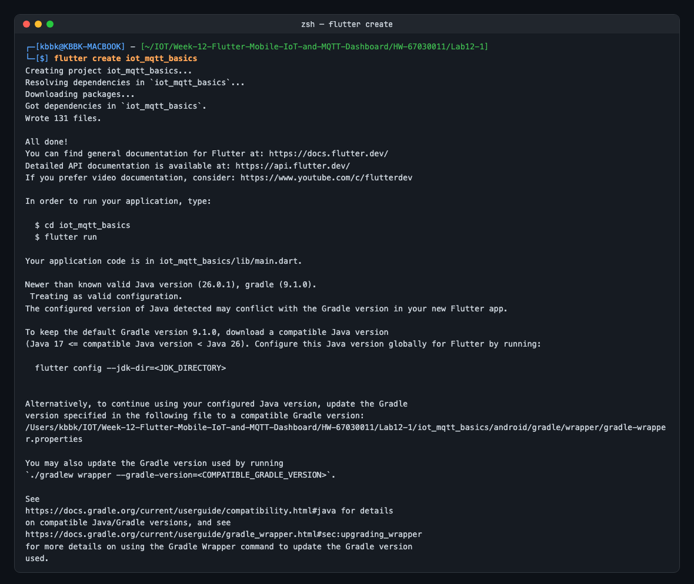
</p>


#### 3. ติดตั้งแพ็กเกจ `mqtt_client`
รันคำสั่งเพิ่ม Dependency:
```powershell
flutter pub add mqtt_client
```
หรือตรวจสอบในไฟล์ `pubspec.yaml` ว่ามีส่วนต่อไปนี้:
```yaml
dependencies:
  flutter:
    sdk: flutter
  mqtt_client: ^10.3.0
```

**ผลการทดลอง:** `flutter pub add` ติดตั้ง **`mqtt_client 10.13.0`** (ใหม่กว่า `^10.3.0` ในใบงานแต่อยู่ใน Major เดียวกัน) พร้อม Dependency `crypto`, `event_bus`, `typed_data`, `web`

<p align="center">
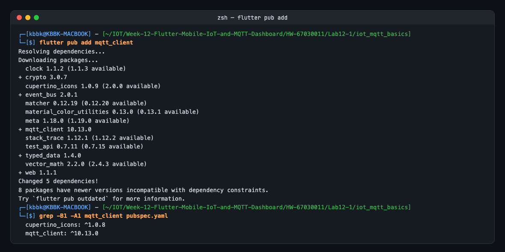
</p>


---

### กิจกรรมที่ 12-1.2: การเขียนโปรแกรม MQTT Client (`lib/main.dart`)

เปิดไฟล์ `lib/main.dart` แล้วแทนที่ด้วยโค้ดสมบูรณ์ต่อไปนี้:

```dart
import 'dart:io';
import 'package:flutter/material.dart';
import 'package:mqtt_client/mqtt_client.dart';
import 'package:mqtt_client/mqtt_server_client.dart';

void main() {
  runApp(const MqttBasicsApp());
}

class MqttBasicsApp extends StatelessWidget {
  const MqttBasicsApp({super.key});

  @override
  Widget build(BuildContext context) {
    return MaterialApp(
      title: 'Lab 12.1 MQTT Basics',
      theme: ThemeData.dark().copyWith(
        scaffoldBackgroundColor: const Color(0xFF0F172A),
        colorScheme: const ColorScheme.dark(
          primary: Color(0xFF00E5FF),
          secondary: Color(0xFF00E676),
        ),
      ),
      home: const MqttBasicsScreen(),
      debugShowCheckedModeBanner: false,
    );
  }
}

class MqttBasicsScreen extends StatefulWidget {
  const MqttBasicsScreen({super.key});

  @override
  State<MqttBasicsScreen> createState() => _MqttBasicsScreenState();
}

class _MqttBasicsScreenState extends State<MqttBasicsScreen> {
  // หมายเลข IP ของเครื่องคอมพิวเตอร์ที่รัน Mosquitto Broker
  final TextEditingController _brokerIpController =
      TextEditingController(text: '127.0.0.1');
  
  MqttServerClient? _client;
  String _statusText = 'ยังไม่ได้เชื่อมต่อ (Disconnected)';
  Color _statusColor = Colors.redAccent;
  final List<String> _receivedLogs = [];

  @override
  void dispose() {
    _brokerIpController.dispose();
    _client?.disconnect();
    super.dispose();
  }

  Future<void> _connectToBroker() async {
    setState(() {
      _statusText = 'กำลังเชื่อมต่อไปยัง Broker...';
      _statusColor = Colors.amber;
    });

    final broker = _brokerIpController.text.trim();
    final clientId = 'Flutter_Lab12_1_${DateTime.now().millisecondsSinceEpoch}';

    _client = MqttServerClient(broker, clientId);
    _client!.port = 1883;
    _client!.keepAlivePeriod = 20;
    _client!.autoReconnect = true;

    _client!.onConnected = () {
      setState(() {
        _statusText = 'เชื่อมต่อสำเร็จ (Connected)';
        _statusColor = const Color(0xFF00E676);
      });
      _subscribeToTestTopic();
    };

    _client!.onDisconnected = () {
      setState(() {
        _statusText = 'การเชื่อมต่อหลุด (Disconnected)';
        _statusColor = Colors.redAccent;
      });
    };

    final connMessage = MqttConnectMessage()
        .withClientIdentifier(clientId)
        .startClean()
        .withWillTopic('iot/flutter/lwt')
        .withWillMessage('Client crashed')
        .withWillQos(MqttQos.atLeastOnce);

    _client!.connectionMessage = connMessage;

    try {
      await _client!.connect();
    } on SocketException catch (e) {
      _appendLog('❌ Socket Error: ไม่สามารถต่อ Broker IP ได้ ($e)');
      _client?.disconnect();
    } catch (e) {
      _appendLog('❌ Error: $e');
      _client?.disconnect();
    }
  }

  void _disconnectFromBroker() {
    _client?.disconnect();
    _appendLog('ℹ️ ตัดการเชื่อมต่อเรียบร้อย');
  }

  void _subscribeToTestTopic() {
    const topic = 'test/broker/echo';
    _client?.subscribe(topic, MqttQos.atMostOnce);
    _appendLog('📢 Subscribed to: $topic');

    _client?.updates?.listen((List<MqttReceivedMessage<MqttMessage>> c) {
      final recMess = c[0].payload as MqttPublishMessage;
      final pt = MqttPublishPayload.bytesToStringAsString(
        recMess.payload.message,
      );
      _appendLog('📩 [${c[0].topic}] -> $pt');
    });
  }

  void _publishTestMessage() {
    if (_client?.connectionStatus?.state != MqttConnectionState.connected) {
      _appendLog('⚠️ ไม่สามารถส่งข้อความได้เนื่องจากยังไม่ได้เชื่อมต่อ');
      return;
    }

    const topic = 'test/flutter/ping';
    final builder = MqttClientPayloadBuilder();
    builder.addString('Hello from Flutter at ${DateTime.now().toIso8601String()}');

    _client?.publishMessage(
      topic,
      MqttQos.atMostOnce,
      builder.payload!,
    );

    _appendLog('🚀 Published -> $topic');
  }

  void _appendLog(String log) {
    setState(() {
      _receivedLogs.insert(0, '[${DateTime.now().toLocal().toString().substring(11, 19)}] $log');
      if (_receivedLogs.length > 50) _receivedLogs.removeLast();
    });
  }

  @override
  Widget build(BuildContext context) {
    return Scaffold(
      appBar: AppBar(
        title: const Text('Lab 12.1: MQTT Client Basics'),
        backgroundColor: const Color(0xFF1E293B),
      ),
      body: Padding(
        padding: const EdgeInsets.all(16.0),
        child: Column(
          children: [
            // ส่วนกรอก IP Broker
            TextField(
              controller: _brokerIpController,
              decoration: const InputDecoration(
                labelText: 'Broker IPv4 Address',
                border: OutlineInputBorder(),
                prefixIcon: Icon(Icons.dns),
              ),
            ),
            const SizedBox(height: 12),

            // แถบแสดงสถานะ
            Container(
              padding: const EdgeInsets.all(12),
              decoration: BoxDecoration(
                color: _statusColor.withOpacity(0.15),
                borderRadius: BorderRadius.circular(10),
                border: Border.all(color: _statusColor),
              ),
              child: Row(
                children: [
                  Icon(Icons.circle, color: _statusColor, size: 14),
                  const SizedBox(width: 8),
                  Text(
                    _statusText,
                    style: TextStyle(
                      color: _statusColor,
                      fontWeight: FontWeight.bold,
                    ),
                  ),
                ],
              ),
            ),
            const SizedBox(height: 12),

            // ปุ่มกดสั่งการ
            Row(
              children: [
                Expanded(
                  child: ElevatedButton.icon(
                    onPressed: _connectToBroker,
                    icon: const Icon(Icons.link),
                    label: const Text('Connect'),
                    style: ElevatedButton.styleFrom(
                      backgroundColor: const Color(0xFF00E5FF),
                      foregroundColor: Colors.black,
                    ),
                  ),
                ),
                const SizedBox(width: 8),
                Expanded(
                  child: OutlinedButton.icon(
                    onPressed: _disconnectFromBroker,
                    icon: const Icon(Icons.link_off),
                    label: const Text('Disconnect'),
                  ),
                ),
              ],
            ),
            const SizedBox(height: 8),
            SizedBox(
              width: double.infinity,
              child: ElevatedButton.icon(
                onPressed: _publishTestMessage,
                icon: const Icon(Icons.send),
                label: const Text('Publish Test Message (Ping)'),
                style: ElevatedButton.styleFrom(
                  backgroundColor: const Color(0xFF00E676),
                  foregroundColor: Colors.black,
                ),
              ),
            ),
            const SizedBox(height: 16),

            // กล่องข้อความ Logs
            const Align(
              alignment: Alignment.centerLeft,
              child: Text(
                'บันทึกการทำงาน (Transaction Logs):',
                style: TextStyle(fontWeight: FontWeight.bold),
              ),
            ),
            const SizedBox(height: 8),
            Expanded(
              child: Container(
                padding: const EdgeInsets.all(10),
                decoration: BoxDecoration(
                  color: Colors.black26,
                  borderRadius: BorderRadius.circular(8),
                  border: Border.all(color: Colors.white12),
                ),
                child: ListView.builder(
                  itemCount: _receivedLogs.length,
                  itemBuilder: (context, index) => Text(
                    _receivedLogs[index],
                    style: const TextStyle(
                      fontFamily: 'monospace',
                      fontSize: 12,
                      color: Colors.white70,
                    ),
                  ),
                ),
              ),
            ),
          ],
        ),
      ),
    );
  }
}
```

**โค้ดที่ใช้จริง:** [lib/main.dart](Lab12-1/iot_mqtt_basics/lib/main.dart) — เริ่มจากโค้ดในใบงานทุกบรรทัด (Commit แรก) แล้วแก้ไขจากปัญหาที่พบระหว่างทดสอบ (รายละเอียดในหัวข้อ "ปัญหาที่พบ" ด้านล่าง)
* เก็บ `StreamSubscription` ของ `_client.updates` ไว้ และ `cancel()` ก่อน `listen()` ใหม่ — โค้ดเดิม `listen` ใน `onConnected` ซึ่งถูกเรียกซ้ำหลัง Auto-Reconnect ทำให้ข้อความแสดงซ้ำ
* เพิ่ม `onAutoReconnect` / `onAutoReconnected` เพื่อให้แถบสถานะเปลี่ยนเป็นสีเหลือง (Reconnecting) เมื่อ Broker หลุด เพราะเมื่อ `autoReconnect = true` ไลบรารีจะไม่เรียก `onDisconnected`
* `setProtocolV311()` — ค่าเริ่มต้นของ `mqtt_client` คือ MQTT **3.1** (`p1` ใน Broker Log)
* กด Connect ซ้ำจะปิด Client เดิมก่อน, ตรวจ `mounted` ก่อน `setState`, ห่อข้อความสถานะด้วย `Expanded` (ข้อความยาวเกิด RenderFlex overflow) และเปลี่ยน `withOpacity` (Deprecated) เป็น `withValues(alpha:)`
* แก้ [test/widget_test.dart](Lab12-1/iot_mqtt_basics/test/widget_test.dart) ที่ `flutter create` สร้างไว้ (ทดสอบแอป Counter `MyApp` ซึ่งไม่มีแล้ว ทำให้ `flutter analyze` ขึ้น Error) ให้ทดสอบหน้าจอนี้แทน

<p align="center">
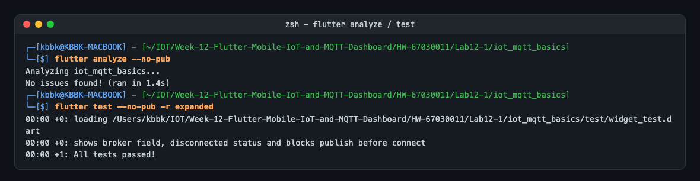
</p>

---

### กิจกรรมที่ 12-1.3: การทดสอบร่วมกับ Mosquitto CLI

#### 1. เปิด Mosquitto Broker บนเครื่องคอมพิวเตอร์
```powershell
mosquitto -v -p 1883
```

> [!NOTE]
> ใน Mosquitto เวอร์ชัน 2.x ขึ้นไป การรันด้วยคำสั่ง `mosquitto -v -p 1883` โดยไม่มีไฟล์คอนฟิก โบรกเกอร์จะดักฟังเฉพาะ Loopback Interface (**`127.0.0.1`**) เท่านั้น ดังนั้นหากทดสอบแอป Flutter บน Windows Desktop เครื่องเดียวกันนี้ ให้กรอก IP เป็น **`127.0.0.1`**  
> *(หากต้องการให้เชื่อมต่อผ่าน IP วง LAN เช่น `192.168.0.x` หรือจากบอร์ด ESP32 ภายนอก จะต้องรันผ่านไฟล์คอนฟิกที่มีการระบุ `listener 1883 0.0.0.0` และ `allow_anonymous true`)*

#### 2. เปิดหน้าต่าง PowerShell เพื่อคอยดักฟังข้อความจาก Flutter
```powershell
mosquitto_sub -h 127.0.0.1 -p 1883 -t "test/flutter/ping" -v
```

#### 3. สั่งรัน Flutter App
> [!WARNING]
> **ข้อควรระวังในการเลือกแพลตฟอร์มทดสอบ:**  
> โค้ดในแล็บนี้ใช้คลาส `MqttServerClient` เพื่อสร้าง Raw TCP Socket ไปยังพอร์ต 1883 ผ่าน `dart:io` ซึ่ง Web Browser (Chrome) ไม่รองรับ (หากรันด้วย `flutter run -d chrome` จะเกิดข้อผิดพลาด `Unsupported operation: default SecurityContext getter` และแอปจะค้าง) ดังนั้น **แนะนำให้รันบน Windows Desktop หรือ Android Device/Emulator เท่านั้น**

```powershell
# รันบน Windows Desktop (แนะนำสำหรับการทดสอบบนคอมพิวเตอร์)
flutter run -d windows

# หรือรันบน Android Device / Emulator
flutter run -d <device-id>
```

**ที่ใช้จริง:** `flutter run -d 73C178BA-9557-4911-AD6E-18890DCC48DD` (iPhone 16 Pro Simulator) Xcode Build 30.1 วินาที

<p align="center">
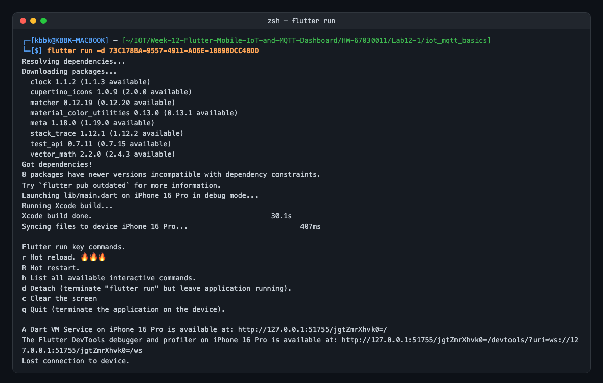
</p>

<p align="center">
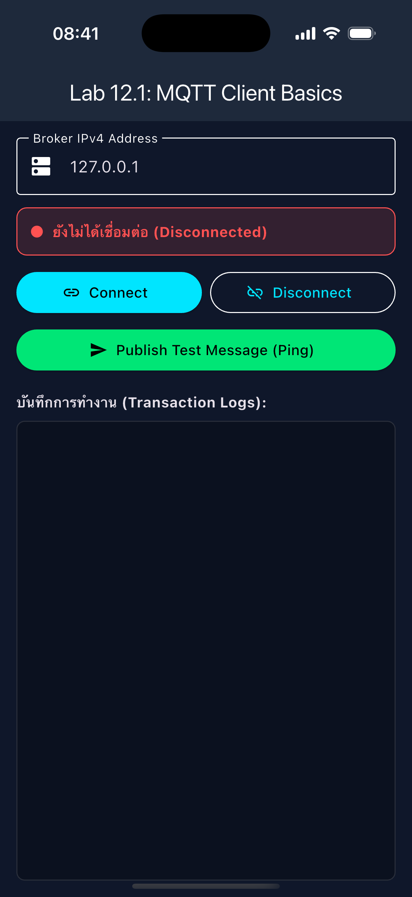
</p>
<p align="center"><b>หน้าจอแอปก่อนเชื่อมต่อ</b></p>


#### 4. ทดสอบส่งข้อความสองทาง
* บนหน้าจอ Flutter: กรอก IP เป็น **`127.0.0.1`** (หรือ IP ของ Broker ที่เปิดรับ) แล้วกดปุ่ม **Connect**
* เมื่อสถานะเปลี่ยนเป็นสีเขียว ให้กดปุ่ม **Publish Test Message**
* สังเกตหน้าต่าง PowerShell `mosquitto_sub` ว่าได้รับข้อความ Ping หรือไม่
* ในอีกหน้าต่าง PowerShell ส่งข้อความตอบกลับไปยังหัวข้อที่ Flutter รอฟัง:
```powershell
mosquitto_pub -h 127.0.0.1 -p 1883 -t "test/broker/echo" -m "Echo response from CLI"
```
* ตรวจสอบว่าในช่อง Logs ของ Flutter App แสดงข้อความที่ได้รับอย่างถูกต้อง

**ผลการทดลอง:** ทดสอบได้ครบทั้งสองทาง
* กด **Connect** → แถบสถานะเป็นสีเขียว Broker บันทึก `New client connected ... as Flutter_Lab12_1_1792465027577 (p1, c1, k20)` พร้อม **Will `iot/flutter/lwt` (r0, q1)** และ SUBSCRIBE `test/broker/echo`
* กด **Publish Test Message** → `mosquitto_sub` ได้รับ `test/flutter/ping Hello from Flutter at 2026-10-20T09:57:12.068981` (48 ไบต์)
* `mosquitto_pub` ส่ง `Echo response from CLI` → Broker ส่งต่อให้ Flutter และขึ้นในช่อง Logs ทันที

<p align="center">

</p>
<p align="center"><b>แอปหลังทดสอบ Publish / Subscribe</b></p>

<p align="center">
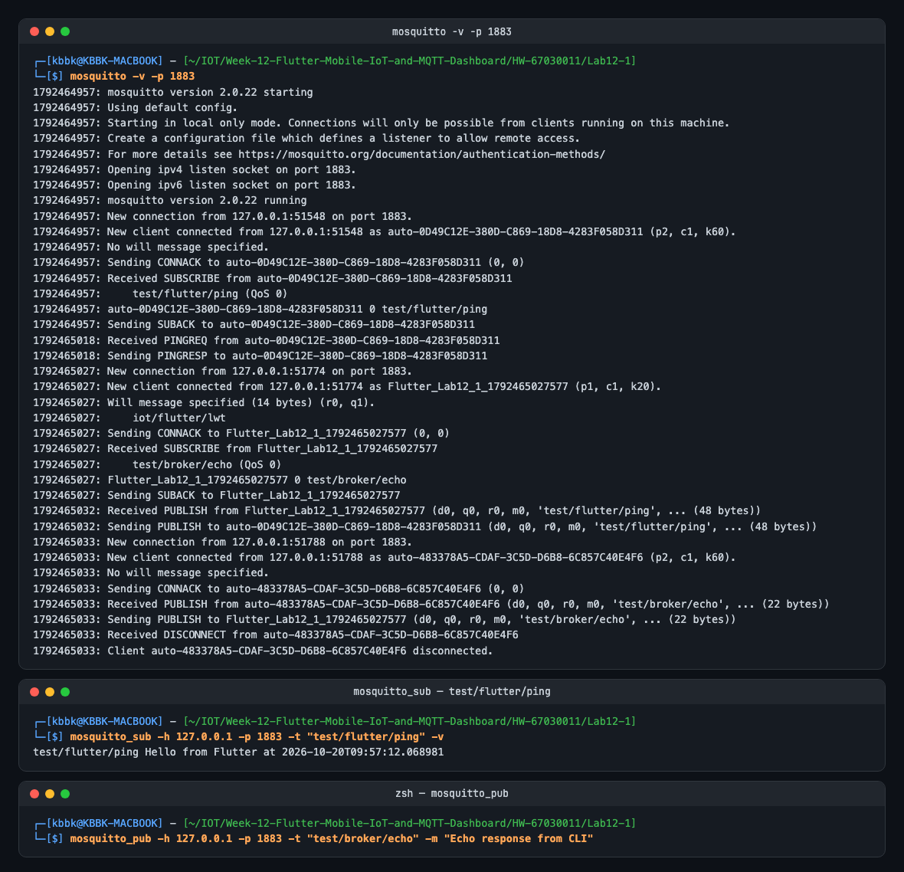
</p>

ทดสอบปุ่มอื่นบน Simulator เพิ่มเติม: กด **Publish ก่อน Connect** แอปไม่ส่งและขึ้นคำเตือน `ไม่สามารถส่งข้อความได้เนื่องจากยังไม่ได้เชื่อมต่อ` ส่วนปุ่ม **Disconnect** ส่งแพ็กเก็ต DISCONNECT ให้ Broker (`Received DISCONNECT from Flutter_Lab12_1_1792465577617`) แถบสถานะเปลี่ยนเป็นสีแดง และเพราะเป็นการตัดแบบตั้งใจ Broker **ไม่ส่ง LWT**

<p align="center">
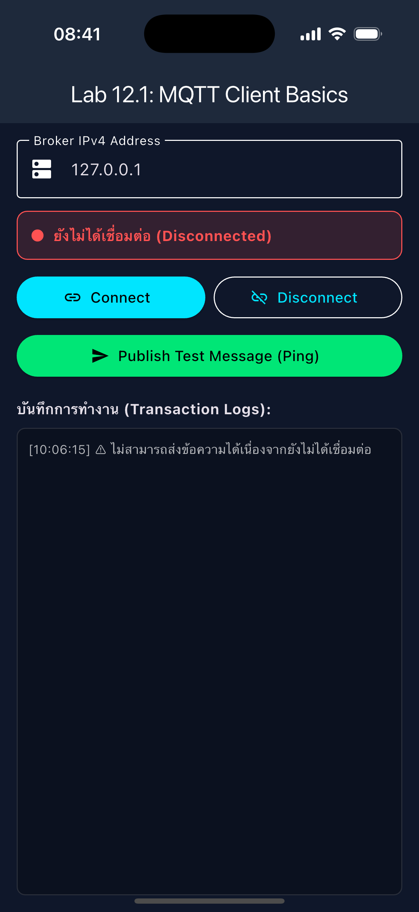
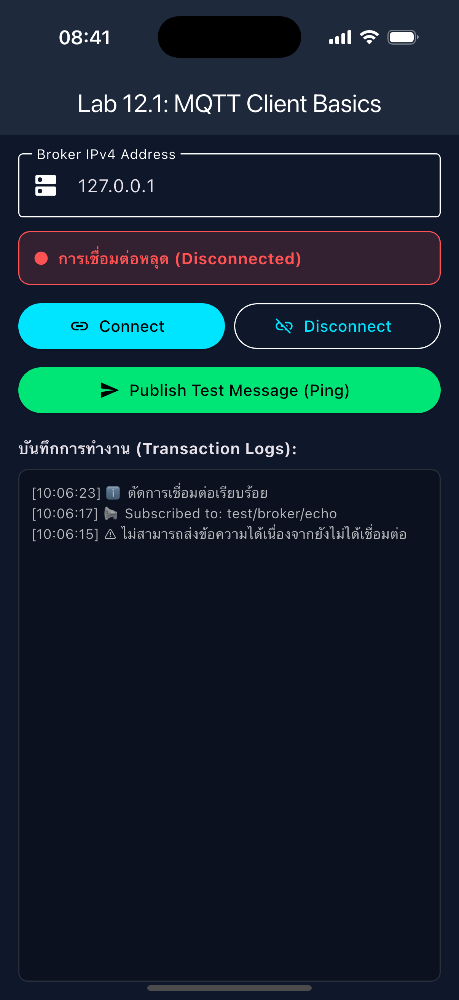
</p>

#### ปัญหาที่พบระหว่างทดสอบ: Auto-Reconnect ทำให้ข้อความซ้ำ และสถานะไม่ตรงความจริง
ทดลองหยุด Broker (`Ctrl+C`) ขณะแอปเชื่อมต่ออยู่ แล้วเปิดใหม่ด้วย `mosquitto -c mosquitto.conf -v`
1. **ระหว่างที่ Broker ปิด แถบสถานะยังเป็นสีเขียว "Connected"** เพราะเมื่อ `autoReconnect = true` ไลบรารีจะเรียก `onAutoReconnect` แทน `onDisconnected` ซึ่งโค้ดในใบงานไม่ได้ดักไว้

<p align="center">
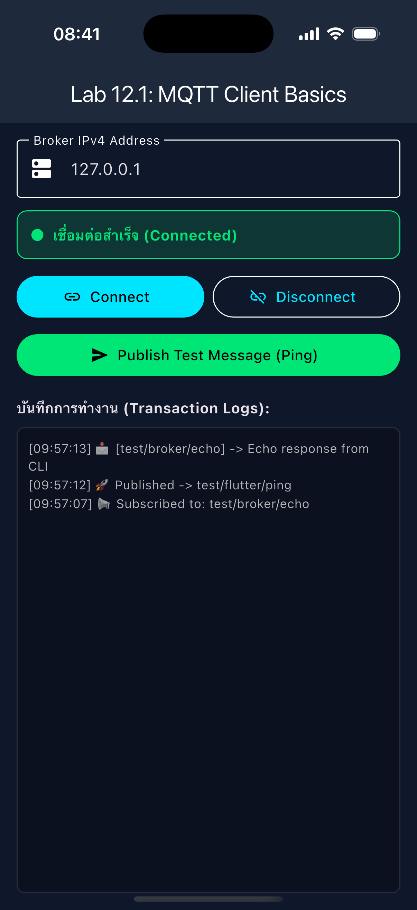
</p>
<p align="center"><b>โค้ดตามใบงาน: Broker ปิดแล้วแต่ยังแสดง Connected</b></p>

2. **หลังเชื่อมต่อใหม่ ข้อความเดียวขึ้น 2 ครั้ง** (`Echo after broker restart` ×2) เพราะ `onConnected` ถูกเรียกอีกครั้ง (เห็น `Subscribed to` บรรทัดที่สอง) และ `_subscribeToTestTopic()` เรียก `_client.updates.listen(...)` เพิ่ม Listener ตัวใหม่บนสตรีมเดิม เชื่อมต่อใหม่ N ครั้งจะได้ข้อความซ้ำ N+1 ครั้ง

<p align="center">
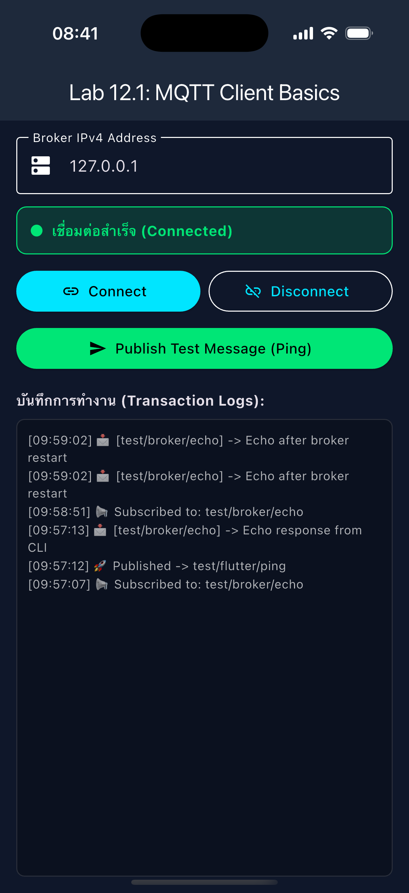
</p>
<p align="center"><b>โค้ดตามใบงาน: หลัง Auto-Reconnect ข้อความแสดงซ้ำ</b></p>

**หลังแก้ไข** (Commit `fix: lab 12-1 ...`): ระหว่าง Broker ปิด แถบเป็นสีเหลือง "Reconnecting" เมื่อ Broker กลับมาขึ้น `Auto-Reconnect สำเร็จ` และข้อความ Echo แสดงครั้งเดียว Broker Log แสดง Client ใช้ **MQTT 3.1.1 (`p2`)** แล้ว

<p align="center">
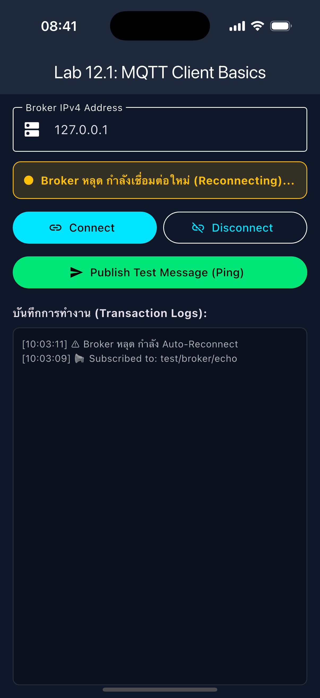
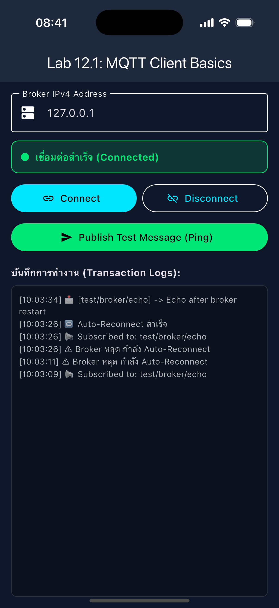
</p>


---

## 4. คำถามท้ายการทดลอง (Review Questions)
1. **เพราะเหตุใดเราจึงต้องสุ่มชื่อ `clientId` เช่นการใส่ Timestamp ต่อท้าย แทนที่จะตั้งชื่อแบบคงที่?**
   * **คำตอบ:** มาตรฐาน MQTT กำหนดให้ Client ID เป็นตัวระบุ Session ที่ **ไม่ซ้ำกันใน Broker เดียว** ถ้ามี Client ใหม่เชื่อมต่อด้วย ID ที่มีคนใช้อยู่ Broker จะ **ตัด Client เดิมทิ้งทันที (Session Takeover)** แอปเดียวกันที่ติดตั้งในมือถือหลายเครื่อง หรือเปิดทั้ง Simulator และเครื่องจริง ถ้าใช้ ID คงที่จะแย่งกันเชื่อมต่อ และเมื่อทั้งคู่เปิด Auto-Reconnect (เหมือนโค้ดนี้) จะ **เตะกันไปมาไม่รู้จบ** ทำให้ข้อความหาย และ LWT ถูกส่งผิดจังหวะ การต่อ Timestamp (ms) ทำให้ ID แต่ละครั้งแทบไม่ซ้ำ และกด Connect ใหม่ก็ได้ Session ใหม่ที่สะอาด (`startClean()`)
   * **ผลทดลองจริง:** เปิด `mosquitto_sub -i Flutter_Lab12_1` สองหน้าต่าง (A แล้ว B ห่างกัน 2 วินาที) Broker บันทึก `Client Flutter_Lab12_1 already connected, closing old connection.` แล้ว A ต่อกลับเข้ามาเตะ B และ B เตะ A กลับ **3 ครั้งใน 4 วินาที** จน B ครบเวลา `-W 3`
   * ข้อควรระวัง: Timestamp ยังซ้ำได้ถ้าเปิดสองเครื่องในมิลลิวินาทีเดียวกัน งานจริงจึงนิยมใช้ UUID หรือ Device ID + User ID และถ้าต้องการ Persistent Session (`cleanSession = false`) จะต้องใช้ ID ที่คงที่ต่ออุปกรณ์ (แต่ไม่ซ้ำข้ามอุปกรณ์) แทนการสุ่มทุกครั้ง

<p align="center">
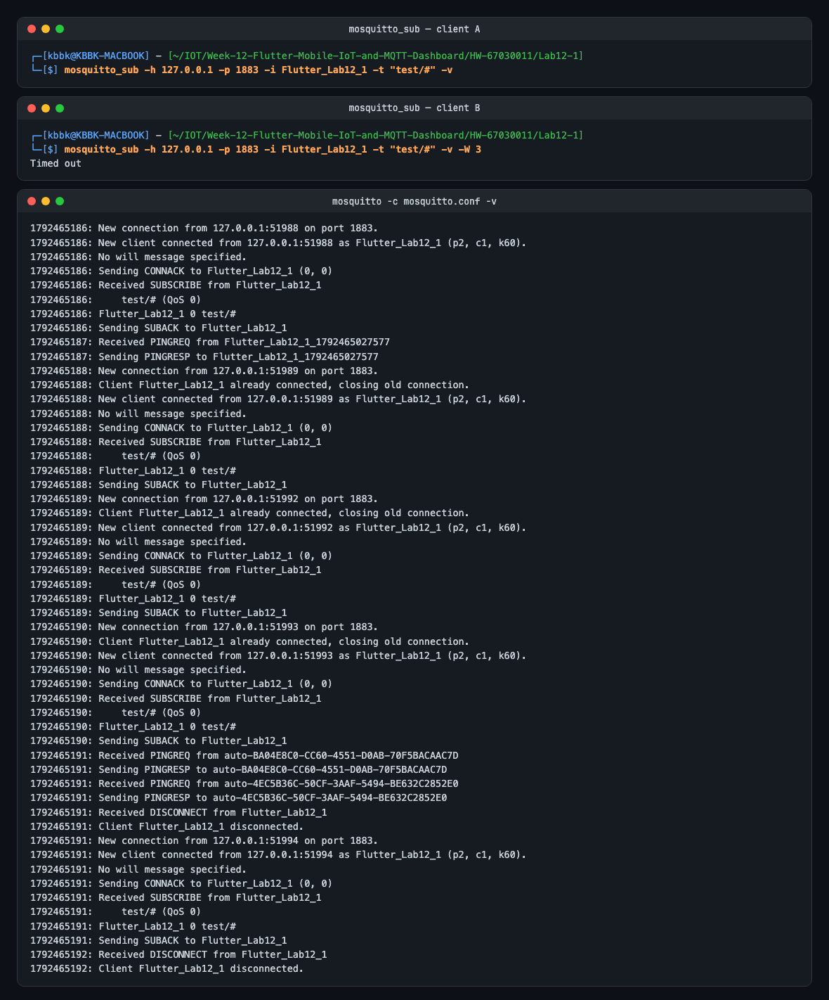
</p>

2. **หากหน้าจอ Flutter รันบนอุปกรณ์จริง (Physical Android Phone) เหตุใดการกรอก IP `127.0.0.1` จึงไม่สามารถเชื่อมต่อ Broker ได้? และต้องใช้ IP ใด?**
   * **คำตอบ:** `127.0.0.1` คือ **Loopback ของเครื่องที่รันโค้ดเอง** บนมือถือจริงจึงหมายถึงตัวมือถือ ซึ่งไม่มี Broker รันอยู่ แพ็กเก็ตไม่ออกไปถึงคอมพิวเตอร์เลย (ได้ Connection refused) ต้องกรอก **IPv4 ของคอมพิวเตอร์ที่รัน Broker ในวงเครือข่ายเดียวกับมือถือ** เช่น Mac เครื่องนี้ `10.15.15.56` (ดูด้วย `ipconfig getifaddr en0` บน Mac หรือ `ipconfig` บน Windows) หรือ `172.20.10.2` เมื่อต่อ iPhone Hotspot และต้องทำให้ Broker รับจาก LAN ได้ด้วย:
     * Mosquitto 2.x ที่รันโดยไม่มี Config จะ **ฟังเฉพาะ Loopback** ต้องใช้ `mosquitto.conf` ที่มี `listener 1883 0.0.0.0` และ `allow_anonymous true`
     * Firewall ของคอมพิวเตอร์ต้องเปิดพอร์ต 1883 และมือถือกับคอมพิวเตอร์ต้องอยู่ Subnet เดียวกัน (Wi-Fi บางแห่งเปิด Client Isolation จะคุยกันไม่ได้)
     * กรณีพิเศษ: **iOS Simulator ใช้ Network Stack ของ Mac** จึงใช้ `127.0.0.1` ได้ (การทดลองนี้), **Android Emulator** ต้องใช้ `10.0.2.2` แทน Loopback ของเครื่อง Host และ iOS 14+ บนเครื่องจริงจะถามสิทธิ์ **Local Network** ก่อนเชื่อมต่อ IP ในวง LAN
   * **ผลทดลองจริง:** Broker แบบไม่มี Config (`mosquitto -p 1884`) ปฏิเสธการเชื่อมต่อผ่าน IP วง LAN `10.15.15.56` (`Error: Connection refused`) แต่ผ่าน `127.0.0.1` ได้ ส่วน Broker ที่รันด้วย `mosquitto.conf` (`listener 1883 0.0.0.0`) รับการเชื่อมต่อผ่าน `10.15.15.56` ได้

<p align="center">
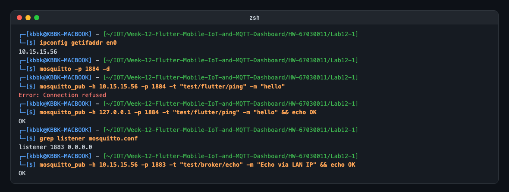
</p>

3. **การตั้งค่า `keepAlivePeriod` มีความจำเป็นอย่างไรในสภาพแวดล้อมเครือข่ายไร้สาย?**
   * **คำตอบ:** เครือข่ายไร้สายมักขาดแบบ **ไม่มีใครส่ง TCP FIN/RST** (สัญญาณหาย, เดินออกนอกระยะ, สลับ Wi-Fi ↔ 4G, มือถือเข้าโหมดประหยัดพลังงาน, NAT ของ Router/ผู้ให้บริการลบ Mapping ที่เงียบนานเกินไป) ทำให้เกิด **Half-open Connection** ที่ทั้งสองฝั่งยังคิดว่าต่ออยู่ `keepAlivePeriod = 20` บังคับให้ Client ส่ง **PINGREQ** ทุก 20 วินาทีเมื่อไม่มีข้อมูลอื่น
     * ฝั่ง **Broker**: ถ้าไม่ได้ยินอะไรเลยภายใน 1.5 × Keep Alive (30 วินาที) จะถือว่า Client ตาย ตัดการเชื่อมต่อ และ **Publish LWT** ให้คนอื่นรู้
     * ฝั่ง **แอป**: ถ้าไม่ได้ PINGRESP กลับมา `mqtt_client` จะรู้ว่าเส้นทางขาด แล้วเริ่ม Auto-Reconnect แทนที่จะรอข้อความที่ไม่มีวันมา
     * PINGREQ เล็ก ๆ ยังช่วยให้ NAT Mapping ไม่หมดอายุ ข้อแลกเปลี่ยนคือค่ายิ่งต่ำ ยิ่งตรวจพบเร็ว แต่ปลุกวิทยุบ่อยขึ้น เปลืองแบตเตอรี่และ Data
   * **ผลทดลองจริง:** Broker บันทึก `(p1, c1, k20)` และ `Received PINGREQ from Flutter_Lab12_1_...` ที่ 1792465047, …067, …087 คือทุก **20 วินาทีพอดี** (ส่วน `mosquitto_sub` ที่ค่าเริ่มต้น `k60` ส่ง PINGREQ ห่างกัน 60 วินาที)

<p align="center">
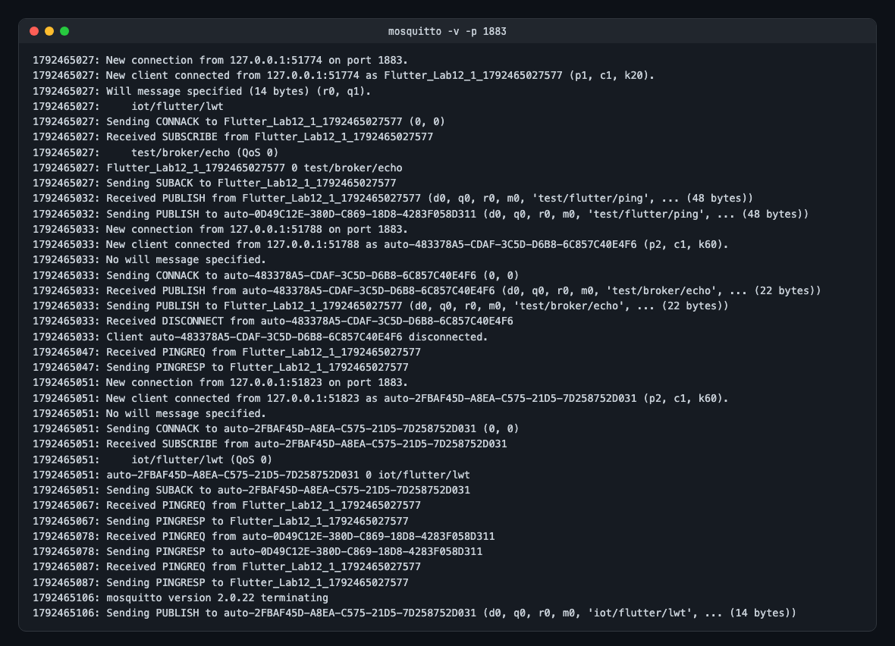
</p>

   * ทดสอบ LWT ที่ตั้งไว้คู่กัน: สั่ง `xcrun simctl terminate` ปิดแอปกะทันหัน (ไม่ได้ส่ง DISCONNECT) Broker บันทึก `Client Flutter_Lab12_1_1792465388974 closed its connection.` แล้ว Publish `iot/flutter/lwt` → `mosquitto_sub` ได้ `Client crashed` (บรรทัดก่อนหน้าใน Subscriber เกิดจากการปิด Broker และการปิดแอปเพื่อรันใหม่ในการทดลองก่อนหน้า ซึ่ง Client ไม่ได้ DISCONNECT เช่นกัน)

<p align="center">
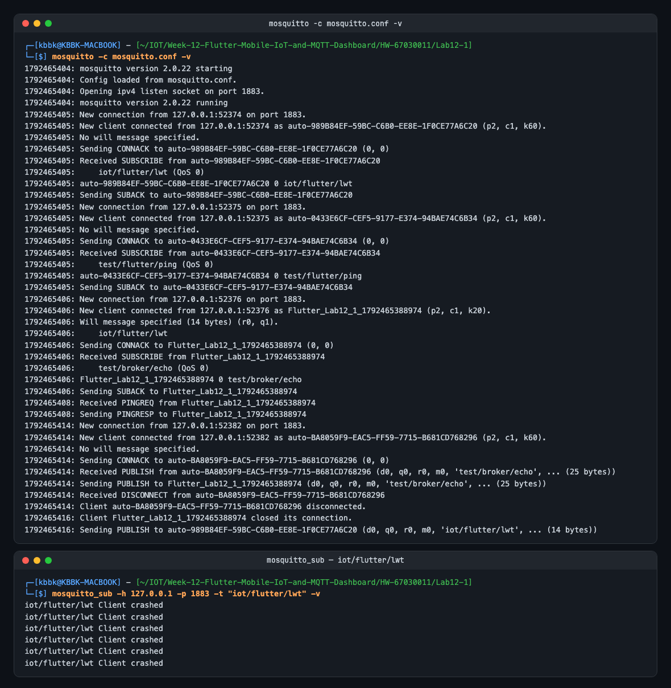
</p>
