# ใบงานการทดลองที่ 12.2
### การสร้างสวิตช์ควบคุมอุปกรณ์สองทาง (Bi-directional Actuator Switch) พร้อมระบบ Feedback และสถานะ LWT

> [!NOTE] **คำชี้แจง**
> ในใบงานนี้นักศึกษาจะได้พัฒนาอินเทอร์เฟซควบคุมอุปกรณ์เปิด-ปิด (Actuator Switch) สไตล์ Glassmorphism ที่สมบูรณ์แบบ โดยมีระบบยืนยันสถานะสองทาง (State Synchronization): เมื่อแตะสวิตช์ แอปจะส่งคำสั่ง JSON ไปยัง Broker และรอรับข้อความยืนยันสถานะจริงจากบอร์ด พร้อมทั้งคอยดักฟังสถานะ Last Will and Testament (LWT) เพื่อแจ้งเตือนทันทีหากบอร์ดหลุดการเชื่อมต่อ

---

## 1. วัตถุประสงค์การทดลอง
1. สามารถออกแบบ UI สวิตช์เปิด-ปิดไฟที่มีเอฟเฟกต์แสงเรือง (Glow Effect) และการสั่นตอบสนอง (Haptic Feedback) ได้
2. สามารถส่งข้อความคำสั่ง JSON Payload ผ่านหัวข้อ `iot/esp32/control` ได้
3. สามารถดักฟังหัวข้อ `iot/esp32/status` เพื่อแสดงสถานะ Online/Offline ของบอร์ดตามกลไก LWT ได้
4. สามารถทดสอบการประสานสถานะ (State Sync) แบบจำลองสถานการณ์ความผิดพลาดของเครือข่ายได้

> [!NOTE] **สภาพแวดล้อมที่ใช้ทำการทดลองจริง (รหัสนักศึกษา 67030011)**
> * macOS 15.5, Flutter 3.44.4, `mqtt_client` 10.13.0, Mosquitto 2.0.22 (`mosquitto -v -p 1883`)
> * รันแอปบน **iOS Simulator (iPhone 16 Pro)** และจำลองบอร์ด ESP32 ด้วย `mosquitto_pub` / `mosquitto_sub` ตามกิจกรรม 12-2.2 (บน macOS ใช้ zsh แทน PowerShell คำสั่ง Mosquitto เหมือนกันทุกตัว)
> * โปรเจกต์: [Lab12-2/iot_actuator_switch/](Lab12-2/iot_actuator_switch/) และ Log ทั้งหมดอยู่ใน [Lab12-2/logs/](Lab12-2/logs/)


---

## 2. โครงสร้างหัวข้อ MQTT (Topic Architecture)

| ชื่อหัวข้อ (Topic) | ทิศทางการส่ง | ชนิดข้อมูล (Payload Format) | วัตถุประสงค์ |
| :--- | :--- | :--- | :--- |
| `iot/esp32/control` | Flutter -> ESP32 | `{"led": "ON"}` หรือ `{"led": "OFF"}` | ส่งคำสั่งควบคุมสวิตช์ไฟ |
| `iot/esp32/led_ack` | ESP32 -> Flutter | `{"led_state": true, "ack": true}` | ส่งการตอบรับสถานะจริงทางกายภาพ |
| `iot/esp32/status` | ESP32 -> Broker (LWT) | Plaintext: `"online"` หรือ `"offline"` | ตัวบ่งชี้ความพร้อมทำงานของบอร์ด |

---

## 3. ขั้นตอนการทดลอง (Step-by-Step Activities)

### กิจกรรมที่ 12-2.1: การเตรียมโปรเจกต์และการสร้างหน้าจอควบคุมสวิตช์

#### 1. คัดลอกโปรเจกต์จาก Lab 12-1
เพื่อประหยัดเวลาและไม่ต้องติดตั้งแพ็กเกจ `mqtt_client` ใหม่อีกครั้ง ให้นักศึกษาคัดลอกโฟลเดอร์โปรเจกต์จาก Lab 12-1 มาเป็นโฟลเดอร์สำหรับ Lab 12-2

**คำสั่ง PowerShell:**
```powershell
# 1. คัดลอกโฟลเดอร์โปรเจกต์จาก Lab12-1 มาเป็น Lab12-2
Copy-Item -Recurse -Path "..\Lab12-1\iot_mqtt_basics" -Destination "..\Lab12-2\iot_actuator_switch"

# 2. ย้ายเข้าไปยังโฟลเดอร์โปรเจกต์ใหม่
cd ..\Lab12-2\iot_actuator_switch

# 3. ล้างแคชการคอมไพล์เดิมออก (จำเป็นอย่างยิ่งเพื่อป้องกัน CMake Error จาก Path เก่า)
flutter clean
```
*(หรือคลิกขวา Copy โฟลเดอร์ `iot_mqtt_basics` ใน File Explorer แล้ว Paste วางในโฟลเดอร์ใหม่ และรันคำสั่ง `flutter clean` เสมอ)*

**ที่ใช้จริง (zsh บน macOS):** `cp -R ../Lab12-1/iot_mqtt_basics ./iot_actuator_switch` แล้ว `flutter clean` (บน Mac ล้าง Xcode workspace, `build/`, `.dart_tool/` และไฟล์ `Generated.xcconfig` ที่ยังชี้ Path เก่า)

<p align="center">
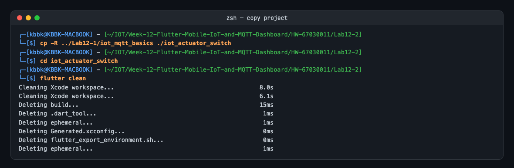
</p>

> [!WARNING] การคัดลอกโฟลเดอร์ทำให้ชื่อแพ็กเกจใน `pubspec.yaml` ยังเป็น **`iot_mqtt_basics`** และ Bundle ID ของ iOS ยังเป็น `com.example.iotMqttBasics` เหมือน Lab 12-1 การติดตั้ง Lab 12-2 จึง **ทับแอป Lab 12-1 บนเครื่องเดิม** (ใช้ `import 'package:iot_mqtt_basics/...'` ในไฟล์ทดสอบ) และ `test/widget_test.dart` ที่ติดมายังเรียก `MqttBasicsApp` ซึ่งไม่มีแล้ว


#### 2. สร้างไฟล์หน้าจอควบคุมสวิตช์ (`lib/actuator_control_screen.dart`)
ในโฟลเดอร์ `lib/` ให้สร้างไฟล์ใหม่ชื่อ `actuator_control_screen.dart` และใส่โค้ดต่อไปนี้

```dart
import 'dart:convert';
import 'package:flutter/material.dart';
import 'package:flutter/services.dart';
import 'package:mqtt_client/mqtt_client.dart';
import 'package:mqtt_client/mqtt_server_client.dart';

class ActuatorControlScreen extends StatefulWidget {
  final String brokerIp;
  const ActuatorControlScreen({super.key, required this.brokerIp});

  @override
  State<ActuatorControlScreen> createState() => _ActuatorControlScreenState();
}

class _ActuatorControlScreenState extends State<ActuatorControlScreen> {
  MqttServerClient? _client;
  bool _isLedOn = false;
  bool _isDeviceOnline = false;
  bool _isWaitingAck = false;
  String _networkStatus = 'กำลังเชื่อมต่อ Broker...';

  @override
  void initState() {
    super.initState();
    _connectMqtt();
  }

  @override
  void dispose() {
    _client?.disconnect();
    super.dispose();
  }

  Future<void> _connectMqtt() async {
    final clientId = 'Flutter_Switch_${DateTime.now().millisecondsSinceEpoch}';
    _client = MqttServerClient(widget.brokerIp, clientId);
    _client!.port = 1883;
    _client!.keepAlivePeriod = 20;

    _client!.onConnected = () {
      setState(() => _networkStatus = 'เชื่อมต่อ Broker เรียบร้อย');
      _subscribeTopics();
    };

    _client!.onDisconnected = () {
      setState(() {
        _networkStatus = 'ขาดการเชื่อมต่อ Broker!';
        _isDeviceOnline = false;
      });
    };

    try {
      await _client!.connect();
    } catch (e) {
      setState(() => _networkStatus = 'เชื่อมต่อล้มเหลว: $e');
    }
  }

  void _subscribeTopics() {
    // 1. บอกรับหัวข้อสถานะบอร์ด (LWT)
    _client?.subscribe('iot/esp32/status', MqttQos.atMostOnce);
    // 2. บอกรับหัวข้อยืนยันการทำงานของหลอดไฟ
    _client?.subscribe('iot/esp32/led_ack', MqttQos.atMostOnce);

    _client?.updates?.listen((List<MqttReceivedMessage<MqttMessage>> c) {
      final recMess = c[0].payload as MqttPublishMessage;
      final pt = MqttPublishPayload.bytesToStringAsString(recMess.payload.message);
      final topic = c[0].topic;

      setState(() {
        if (topic == 'iot/esp32/status') {
          _isDeviceOnline = (pt.trim().toLowerCase() == 'online');
        } else if (topic == 'iot/esp32/led_ack') {
          _isWaitingAck = false;
          try {
            final data = jsonDecode(pt);
            _isLedOn = data['led_state'] == true;
          } catch (_) {}
        }
      });
    });
  }

  void _toggleLed(bool targetState) {
    if (_client?.connectionStatus?.state != MqttConnectionState.connected) {
      ScaffoldMessenger.of(context).showSnackBar(
        const SnackBar(content: Text('⚠️ กรุณาเชื่อมต่อ Broker ก่อนสั่งการ')),
      );
      return;
    }

    if (!_isDeviceOnline) {
      ScaffoldMessenger.of(context).showSnackBar(
        const SnackBar(content: Text('⚠️ อุปกรณ์ ESP32 ออฟไลน์อยู่ ไม่สามารถส่งคำสั่งได้')),
      );
      return;
    }

    // แตะแล้วสั่งสั่น Haptic Feedback
    HapticFeedback.lightImpact();

    setState(() {
      _isWaitingAck = true;
    });

    final payloadMap = {'led': targetState ? 'ON' : 'OFF'};
    final jsonStr = jsonEncode(payloadMap);
    final builder = MqttClientPayloadBuilder();
    builder.addString(jsonStr);

    _client?.publishMessage(
      'iot/esp32/control',
      MqttQos.atLeastOnce,
      builder.payload!,
    );
  }

  @override
  Widget build(BuildContext context) {
    return Scaffold(
      backgroundColor: const Color(0xFF0F172A),
      appBar: AppBar(
        title: const Text('Actuator Control Center'),
        backgroundColor: const Color(0xFF1E293B),
      ),
      body: Padding(
        padding: const EdgeInsets.all(20.0),
        child: Column(
          children: [
            // แถบแสดงสถานะ Device Online/Offline
            Container(
              padding: const EdgeInsets.symmetric(horizontal: 16, vertical: 12),
              decoration: BoxDecoration(
                color: _isDeviceOnline ? const Color(0x1A00E676) : const Color(0x1AFF5252),
                borderRadius: BorderRadius.circular(16),
                border: Border.all(
                  color: _isDeviceOnline ? const Color(0xFF00E676) : const Color(0xFFFF5252),
                ),
              ),
              child: Row(
                children: [
                  Icon(
                    Icons.circle,
                    size: 12,
                    color: _isDeviceOnline ? const Color(0xFF00E676) : const Color(0xFFFF5252),
                  ),
                  const SizedBox(width: 10),
                  Text(
                    _isDeviceOnline ? 'ESP32 ฮาร์ดแวร์: ออนไลน์ (ONLINE)' : 'ESP32 ฮาร์ดแวร์: ออฟไลน์ (OFFLINE)',
                    style: TextStyle(
                      fontWeight: FontWeight.bold,
                      color: _isDeviceOnline ? const Color(0xFF00E676) : const Color(0xFFFF5252),
                    ),
                  ),
                ],
              ),
            ),
            const SizedBox(height: 30),

            // การ์ดควบคุมหลอดไฟแบบ Glassmorphism
            Container(
              padding: const EdgeInsets.all(24),
              decoration: BoxDecoration(
                color: const Color(0xFF1E293B).withOpacity(0.8),
                borderRadius: BorderRadius.circular(24),
                border: Border.all(
                  color: _isLedOn ? const Color(0xFF00E676).withOpacity(0.6) : Colors.white12,
                  width: 2,
                ),
                boxShadow: _isLedOn
                    ? [
                        BoxShadow(
                          color: const Color(0xFF00E676).withOpacity(0.25),
                          blurRadius: 24,
                          spreadRadius: 4,
                        )
                      ]
                    : [],
              ),
              child: Column(
                children: [
                  // ไอคอนหลอดไฟพร้อมเอฟเฟกต์แสง
                  AnimatedContainer(
                    duration: const Duration(milliseconds: 300),
                    padding: const EdgeInsets.all(24),
                    decoration: BoxDecoration(
                      shape: BoxShape.circle,
                      color: _isLedOn ? const Color(0x3300E676) : Colors.black26,
                    ),
                    child: Icon(
                      Icons.lightbulb,
                      size: 72,
                      color: _isLedOn ? const Color(0xFF00E676) : Colors.white24,
                    ),
                  ),
                  const SizedBox(height: 20),
                  const Text(
                    'หลอดไฟ LED ทดสอบ (GPIO 2)',
                    style: TextStyle(fontSize: 18, fontWeight: FontWeight.bold, color: Colors.white),
                  ),
                  const SizedBox(height: 6),
                  Text(
                    _isWaitingAck
                        ? 'กำลังรอการยืนยันจากบอร์ด (Waiting ACK)...'
                        : _isLedOn
                            ? 'สถานะ: เปิดสว่าง (Active)'
                            : 'สถานะ: ปิดการทำงาน (Standby)',
                    style: TextStyle(
                      color: _isWaitingAck ? Colors.amber : (_isLedOn ? const Color(0xFF00E676) : Colors.white38),
                    ),
                  ),
                  const SizedBox(height: 24),
                  // สวิตช์ควบคุม
                  Transform.scale(
                    scale: 1.4,
                    child: Switch(
                      value: _isLedOn,
                      activeColor: const Color(0xFF00E676),
                      onChanged: _isWaitingAck ? null : _toggleLed,
                    ),
                  ),
                ],
              ),
            ),
            const Spacer(),
            Text(
              _networkStatus,
              style: const TextStyle(fontSize: 12, color: Colors.white38),
            ),
          ],
        ),
      ),
    );
  }
}
```

**ผลการทดลอง:** ใส่โค้ดตามใบงานทุกบรรทัดแล้ว `flutter analyze` พบ 5 ปัญหา: `withOpacity` (Deprecated ใน Flutter 3.27+) 3 จุด, `activeColor` ของ `Switch` (Deprecated ตั้งแต่ 3.31 ให้ใช้ `activeThumbColor`) และ Error จาก `widget_test.dart` ที่ติดมาจาก Lab 12-1

<p align="center">
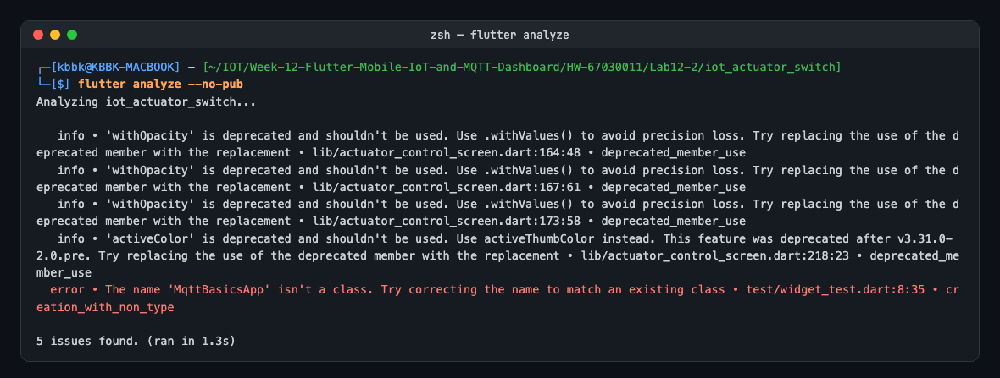
</p>

#### 3. ปรับปรุงไฟล์ `lib/main.dart` เพื่อเรียกใช้งานหน้าจอใหม่
เปิดไฟล์ `lib/main.dart` และแก้ไขโค้ดทั้งหมดให้เรียกใช้งาน `ActuatorControlScreen` เป็นหน้าจอเริ่มต้น (Home Screen)

```dart
import 'package:flutter/material.dart';
import 'actuator_control_screen.dart';

void main() {
  runApp(const ActuatorApp());
}

class ActuatorApp extends StatelessWidget {
  const ActuatorApp({super.key});

  @override
  Widget build(BuildContext context) {
    return MaterialApp(
      title: 'Lab 12.2 Actuator Switch',
      theme: ThemeData.dark().copyWith(
        scaffoldBackgroundColor: const Color(0xFF0F172A),
        colorScheme: const ColorScheme.dark(
          primary: Color(0xFF00E5FF),
          secondary: Color(0xFF00E676),
        ),
      ),
      // กำหนด IP ของ Mosquitto Broker (ใช้ 127.0.0.1 หากรันบนคอมพิวเตอร์เครื่องเดียวกัน)
      home: const ActuatorControlScreen(brokerIp: '127.0.0.1'),
      debugShowCheckedModeBanner: false,
    );
  }
}
```

#### 4. สั่งรัน Flutter App
```powershell
# รันบน Windows Desktop
flutter run -d windows

# หรือรันบน Android Device / Emulator
flutter run -d <device-id>
```

**ผลการทดลอง:** รันบน iPhone 16 Pro Simulator แอปต่อ Broker ได้ทันที (ข้อความล่างจอ `เชื่อมต่อ Broker เรียบร้อย`) แต่แถบสถานะเป็น **OFFLINE** เพราะยังไม่มีใคร Publish `iot/esp32/status` และเมื่อแตะสวิตช์ แอปไม่ส่งคำสั่งแต่ขึ้น SnackBar `อุปกรณ์ ESP32 ออฟไลน์อยู่ ไม่สามารถส่งคำสั่งได้`

<p align="center">
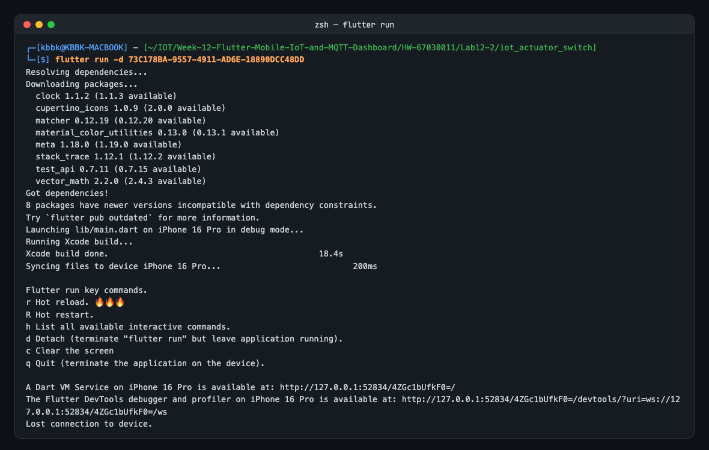
</p>

<p align="center">
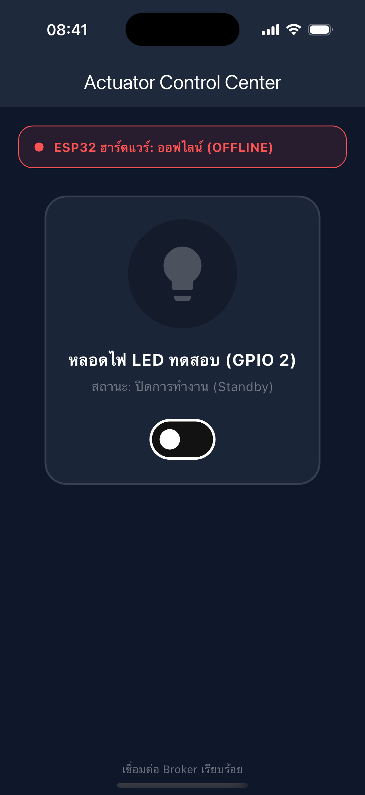
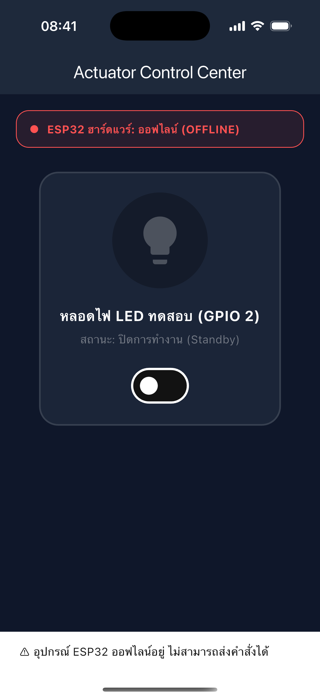
</p>


---

### กิจกรรมที่ 12-2.2: การทดสอบร่วมกับสคริปต์จำลองฮาร์ดแวร์ (Mock Simulation)

หากยังไม่ได้ต่อบอร์ด ESP32 จริง สามารถใช้ PowerShell ทดสอบจำลองพฤติกรรมของฮาร์ดแวร์ได้

#### 1. จำลองส่งสถานะ Online (เสมือน ESP32 บูตเสร็จ)
```powershell
mosquitto_pub -h 127.0.0.1 -p 1883 -t "iot/esp32/status" -m "online" -r
```
*สังเกตหน้าจอ Flutter แถบสถานะด้านบนจะเปลี่ยนเป็นสีเขียวทันที*

**ผลการทดลอง:** แถบสถานะเปลี่ยนเป็น **ONLINE สีเขียว** ทันทีที่ Publish (SnackBar ด้านล่างคือข้อความจากการแตะก่อนหน้า ซึ่งค้างอยู่ 4 วินาที)

<p align="center">
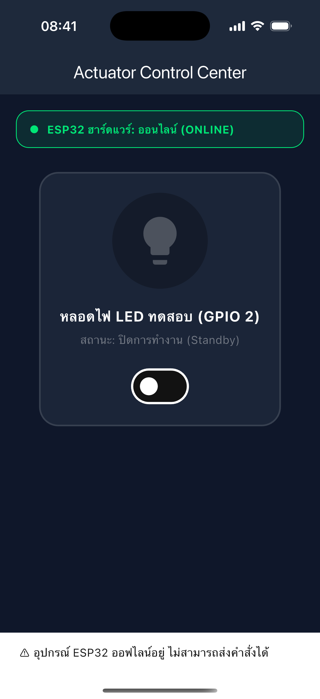
</p>


#### 2. เฝ้าดูคำสั่งที่ส่งมาจากแอป Flutter
```powershell
mosquitto_sub -h 127.0.0.1 -p 1883 -t "iot/esp32/control" -v
```
*เมื่อแตะสวิตช์บน Flutter จะเห็นแพ็กเก็ต `{"led":"ON"}` หรือ `{"led":"OFF"}` ปรากฏในเทอร์มินัล*

**ผลการทดลอง:** แตะสวิตช์ → `mosquitto_sub` ได้รับ `iot/esp32/control {"led":"ON"}` ส่วนแอปยังไม่เปลี่ยนเป็นเปิด แต่ขึ้นข้อความสีเหลือง `กำลังรอการยืนยันจากบอร์ด (Waiting ACK)...` และสวิตช์ถูกปิดกั้น (สีจาง) ระหว่างรอ
<p align="center">
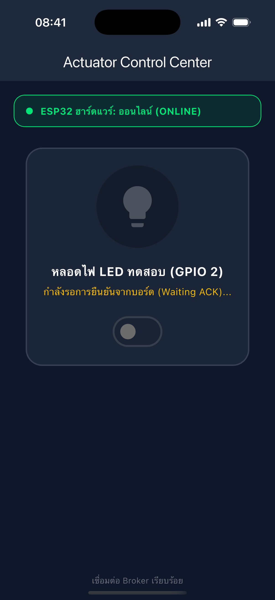
</p>


#### 3. ส่งคำสั่งยืนยันกลับไปยังแอป (เสมือนบอร์ดเปลี่ยนสถานะขา GPIO สำเร็จ)
```powershell
mosquitto_pub -h 127.0.0.1 -p 1883 -t "iot/esp32/led_ack" -m '{"led_state": true, "ack": true}'
```
*สังเกตสวิตช์และไอคอนหลอดไฟบนมือถือจะเรืองแสงสีเขียวทันที*

**ผลการทดลอง:** หลังส่ง ACK `led_state: true` หลอดไฟ ขอบการ์ด และสวิตช์เรืองแสงสีเขียว สถานะ `เปิดสว่าง (Active)` จากนั้นแตะอีกครั้ง → ได้ `{"led":"OFF"}` และเมื่อส่ง ACK `led_state: false` กลับไปเป็น `Standby`
<p align="center">
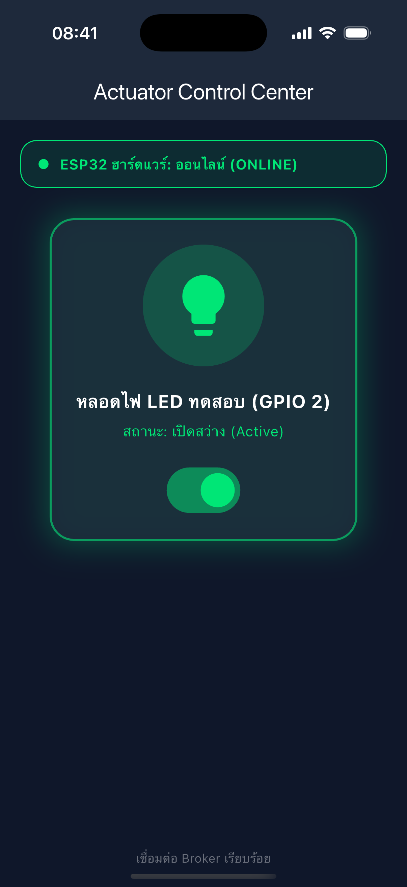
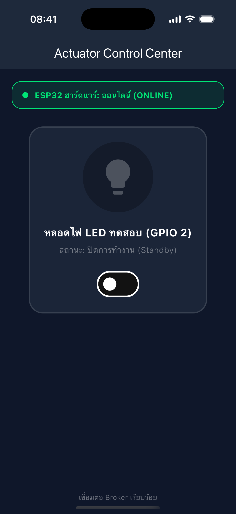
</p>


#### 4. จำลองเหตุการณ์บอร์ดดับหรือเน็ตหลุด (เสมือน Broker ส่ง LWT)
```powershell
mosquitto_pub -h 127.0.0.1 -p 1883 -t "iot/esp32/status" -m "offline" -r
```
*สังเกตว่าหน้าจอจะแจ้งเตือนว่า ESP32 ออฟไลน์ทันที และสวิตช์จะไม่ยอมให้สั่งการ*

**ผลการทดลอง:** แถบสถานะเปลี่ยนเป็น **OFFLINE สีแดง** ทันที แตะสวิตช์แล้วไม่มีคำสั่งออกไป (ขึ้น SnackBar เตือนแทน)
<p align="center">

</p>

คำสั่งจำลองทั้งหมดและคำสั่งที่ `mosquitto_sub` ได้รับจากแอป (บรรทัดที่ 3 คือการแตะในการทดลองหัวข้อถัดไป):

<p align="center">
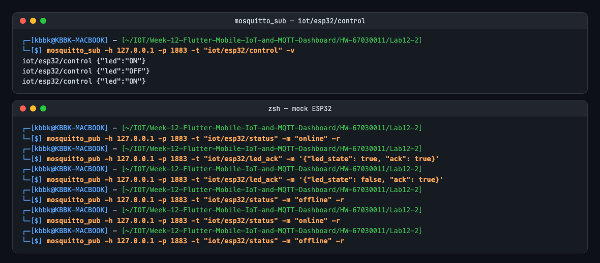
</p>

#### ปัญหาที่พบระหว่างทดสอบ: สวิตช์ค้าง "Waiting ACK" ตลอดไป
จำลองว่าบอร์ดดับระหว่างรอ ACK: ส่ง `online` → แตะสวิตช์ (`{"led":"ON"}` ออกไป) → ไม่ส่ง ACK แต่ส่ง `offline` แทน แล้วรอ 30 วินาที ผลคือแถบเป็น OFFLINE แต่การ์ดยังขึ้น `Waiting ACK...` และสวิตช์ถูกล็อกไว้ **ไม่มีทางกลับมาใช้ได้นอกจากปิดแอป** เพราะโค้ดเคลียร์ `_isWaitingAck` เฉพาะตอนได้รับ `led_ack` เท่านั้น นอกจากนี้ตอนบอร์ด OFFLINE สวิตช์ยังกดได้ (แค่ขึ้น SnackBar) ไม่ได้ถูก Disable ตามที่ Test Case 4 ของใบงาน 12.4 คาดหวัง
<p align="center">
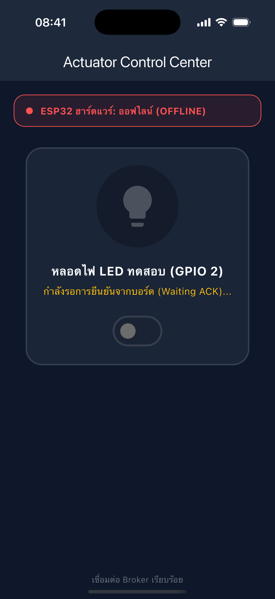
</p>

**การแก้ไข** ([lib/actuator_control_screen.dart](Lab12-2/iot_actuator_switch/lib/actuator_control_screen.dart), Commit `fix: lab 12-2 ...`):
* ตั้ง **ACK Timeout 3 วินาที** ด้วย `Timer` ถ้าไม่ได้ ACK ให้เลิกรอ คงสถานะเดิม และขึ้น SnackBar `ไม่ได้รับการยืนยัน (ACK) จากบอร์ดภายใน 3 วินาที`
* เมื่อได้ `offline` (LWT) หรือ Broker หลุด ให้เลิกรอ ACK ทันที
* `onChanged` ของ `Switch` เป็น `null` (Disabled) เมื่อบอร์ดออฟไลน์ / Broker ไม่ได้เชื่อมต่อ / กำลังรอ ACK
* จับเวลา **RTT** ด้วย `Stopwatch` ตั้งแต่ Publish คำสั่งจนได้ `led_ack` แสดงใต้สถานะ (ใช้ต่อในใบงาน 12.4.4)
* เหมือน Lab 12-1: `setProtocolV311()`, `autoReconnect`, ยกเลิก Listener เดิมก่อน `listen` ใหม่, `withValues`, `activeThumbColor`
* `flutter test` เจอบั๊กเพิ่ม: `dispose()` เรียก `_client.disconnect()` ซึ่งเรียก `onDisconnected` → `setState()` ขณะ Element กำลังถูกถอด (ใน `dispose()` ค่า `mounted` ยังเป็น `true` จึงกันไม่ได้) แก้โดยถอด Callback ก่อน `disconnect()` (แก้ใน Lab 12-1 ด้วย)

<p align="center">
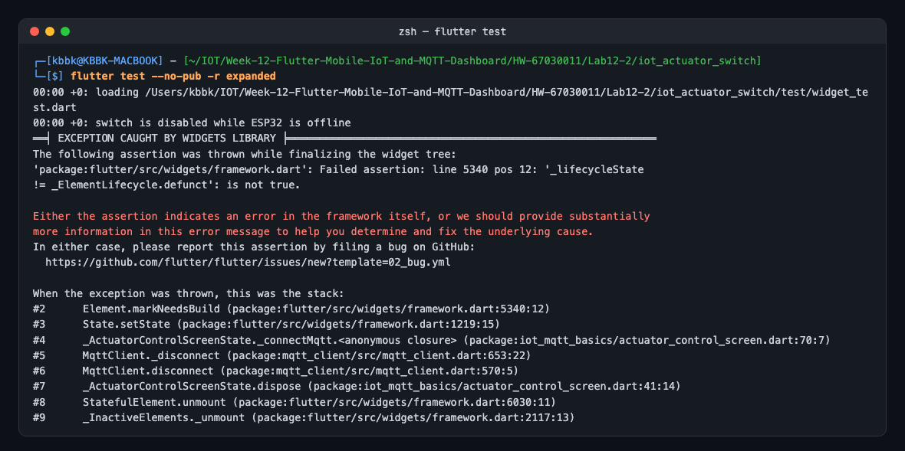
</p>

<p align="center">
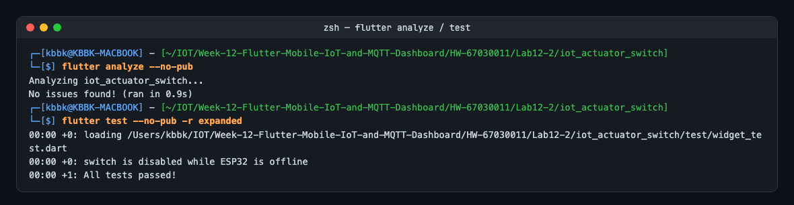
</p>

**ผลหลังแก้ไข** (เรียงจากซ้าย): เปิดแอปแล้วขึ้น ONLINE ทันทีจาก Retained Message → แตะเปิดแล้วส่ง ACK กลับ แสดง `RTT ล่าสุด: 538 ms` (ส่ง ACK ด้วยมือผ่านสคริปต์ จึงรวมเวลารอ 0.5 วินาทีก่อนสั่ง `mosquitto_pub`) → แตะปิดแต่ไม่ส่ง ACK ครบ 3 วินาทีขึ้นเตือนและสวิตช์กลับมาใช้ได้ → ส่ง `offline` สวิตช์ถูก Disable (สีเทา)
<p align="center">
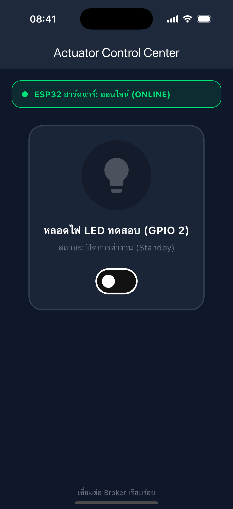
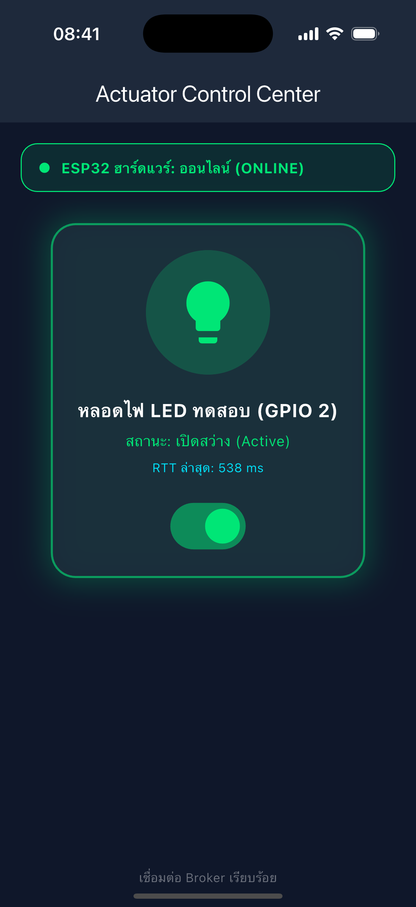
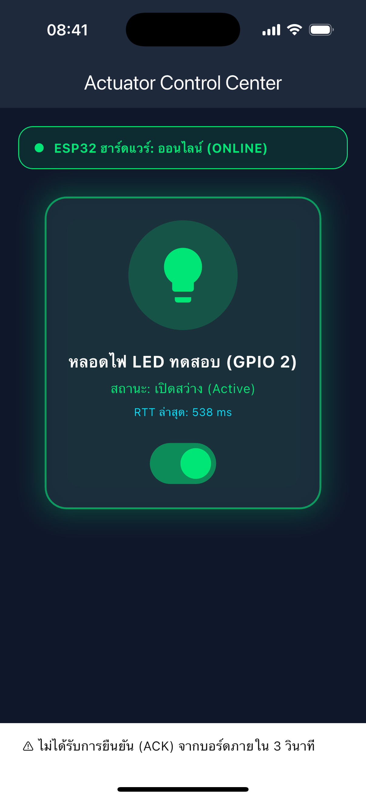
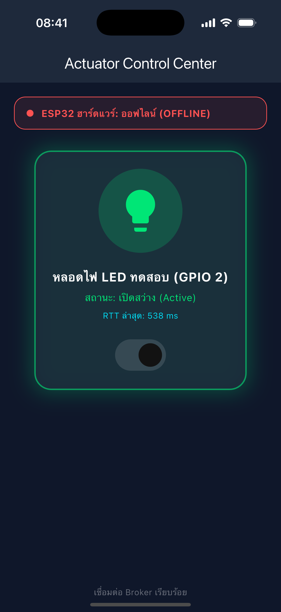
</p>


---

## 4. สรุปผลและคำถามท้ายการทดลอง

**สรุปผล:** แอปส่งคำสั่ง JSON `{"led":"ON"}` / `{"led":"OFF"}` ไปที่ `iot/esp32/control` (QoS 1) และเปลี่ยน UI ตาม `iot/esp32/led_ack` เท่านั้น แถบสถานะเปลี่ยนตาม `iot/esp32/status` (online/offline) ได้ทันที เวอร์ชันที่แก้แล้วจัดการกรณีไม่มี ACK และบอร์ดหลุดระหว่างรอ ACK ได้ถูกต้อง

1. **ประโยชน์ของการรอสัญญาณ ACK จากหัวข้อ `iot/esp32/led_ack` แทนการเปลี่ยน UI ทันที (Optimistic Update) คืออะไร?**
   * **คำตอบ:** ทำให้หน้าจอแสดง **สถานะจริงทางกายภาพ** ของอุปกรณ์ (บอร์ดเป็น Source of Truth) ไม่ใช่แค่ "สิ่งที่ผู้ใช้กด" เพราะระหว่างทางคำสั่งอาจล้มเหลวได้หลายจุด: Broker หลุด, บอร์ดดับ/หลุด Wi-Fi ระหว่างนั้น, ข้อความหาย, Payload ไม่ถูกต้อง หรือ GPIO สั่งไม่สำเร็จ ถ้าใช้ Optimistic Update หน้าจอจะบอกว่า "ไฟเปิดแล้ว" ทั้งที่ไฟไม่ได้เปิด ซึ่งอันตรายสำหรับ Actuator จริง (ปั๊ม, กลอนประตู, ฮีตเตอร์)
     * ACK ยังทำให้ **ทุกแอปที่เปิดอยู่เห็นสถานะตรงกัน** เพราะ `led_ack` เป็นข้อความที่ทุก Client Subscribe ได้ ถ้ามีมือถืออีกเครื่องหรือปุ่มกดบนบอร์ดเปลี่ยนสถานะ หน้าจอนี้ก็อัปเดตตาม
     * ข้อแลกเปลี่ยนคือ UI ตอบสนองช้าลงเท่ากับ RTT (538 ms ในการทดลองที่ส่ง ACK ด้วยมือ) จึงต้องมีสถานะระหว่างกลาง (`Waiting ACK...` + ล็อกสวิตช์ กันกดซ้ำ) และต้องมี **Timeout** ไม่เช่นนั้นจะค้างแบบที่พบในการทดลอง ระบบจริงควรใส่ Command ID ในคำสั่งและ ACK เพื่อจับคู่ว่า ACK นี้ตอบคำสั่งไหน
   * **ผลทดลองจริง:** ตอนส่งคำสั่งแล้วไม่มี ACK หลอดไฟบนจอไม่เคยเปลี่ยนเป็นเปิด ตรงกับความจริงที่ "บอร์ด" ไม่ได้ทำงาน (เวอร์ชันแก้: ครบ 3 วินาทีแจ้งเตือนและคงสถานะเดิม)

2. **ทำไมเราจึงควรตั้งแฟล็ก Retain (`-r`) สำหรับหัวข้อสถานะ `iot/esp32/status`?**
   * **คำตอบ:** MQTT ไม่เก็บข้อความย้อนหลังให้ Subscriber ที่มาทีหลัง ยกเว้น Retained Message ซึ่ง Broker เก็บค่าล่าสุดของแต่ละ Topic ไว้ และส่งให้ทันทีที่มีคน Subscribe สถานะ online/offline เปลี่ยนนาน ๆ ครั้ง (ตอนบอร์ดบูตหรือหลุด) แต่แอปมือถือถูกเปิด/ปิดตลอดเวลา ถ้าไม่ Retain แอปที่เปิดทีหลังจะไม่รู้สถานะเลย (ค้าง OFFLINE ตามค่าเริ่มต้น) จนกว่าบอร์ดจะรีบูต
     * ต้อง Retain ทั้งสองค่า: `online` ที่บอร์ดส่งตอนเชื่อมต่อ และ LWT `offline` ที่ Broker ส่งแทนเมื่อบอร์ดหาย (`retain = 1` ใน `last_will`) เพื่อให้ค่าใหม่ **ทับ** ค่าเก่าเสมอ ถ้า Retain แค่ค่าเดียวจะเกิดสถานะผี เช่น Retain `online` ค้างไว้ทั้งที่บอร์ดดับไปแล้ว
   * **ผลทดลองจริง:** ขณะที่ Retained ล่าสุดคือ `offline` ส่ง `online` แบบ **ไม่มี** `-r` แล้วให้ Subscriber ใหม่มาอ่าน ได้ `iot/esp32/status offline` (ค่าเก่าที่ผิด) แต่เมื่อส่ง `online -r` Subscriber ใหม่ได้ `online` ทันที และเปิดแอปใหม่หลังจากนั้นแถบขึ้น ONLINE ตั้งแต่วินาทีแรก (ภาพซ้ายสุดของผลหลังแก้ไข)

<p align="center">
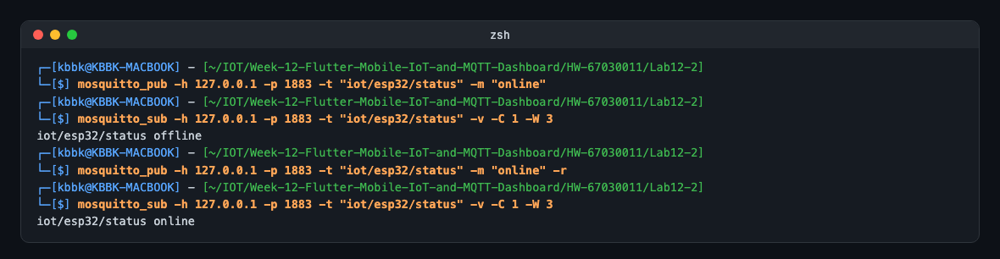
</p>
