# ใบงานการทดลองที่ 12.3
### การสร้างแดชบอร์ดแสดงผลเซนเซอร์เรียลไทม์ด้วย Radial Gauge และ Live Trend Line Chart

> [!NOTE] **คำชี้แจง**
> ในใบงานนี้นักศึกษาจะได้สร้างหน้าจอแดชบอร์ดแสดงผลการตรวจวัดแรงดันไฟฟ้าแอนะล็อกแบบเรียลไทม์ โดยถอดรหัสแพ็กเก็ต JSON ที่ส่งมาจาก ESP32 นำมาขับเคลื่อนเข็มมาตรวัดทรงกลม (Radial Gauge) ด้วยแอนิเมชันที่นุ่มนวล พร้อมทั้งวาดกราฟเส้นแนวโน้มย้อนหลัง (Live Trend Chart) โดยประมวลผลข้อมูลด้วยความเร็วสูงผ่านเอนจินกราฟิกของ Flutter

---

## 1. วัตถุประสงค์การทดลอง
1. สามารถเขียนโค้ดถอดรหัส JSON Payload จากหัวข้อ `iot/esp32/telemetry` เข้าสู่ Data Model ในภาษา Dart ได้
2. สามารถพัฒนามาตรวัดทรงกลม (Radial Gauge) ผ่าน `CustomPainter` และทำแอนิเมชันปรับความนุ่มนวลของเข็มด้วย `TweenAnimationBuilder` ได้
3. สามารถบันทึกประวัติข้อมูลแรงดันและวาดกราฟเส้น (Live Trend Sparkline) ได้อย่างต่อเนื่อง
4. สามารถคำนวณและแสดงผลค่าสถิติ (Max, Min, Uptime) ได้

> [!NOTE] **สภาพแวดล้อมที่ใช้ทำการทดลองจริง (รหัสนักศึกษา 67030011)**
> * macOS 15.5, Flutter 3.44.4, `mqtt_client` 10.13.0, Mosquitto 2.0.22 (`mosquitto -v -p 1883`), Python 3.14 + `paho-mqtt` 2.1.0
> * รันแอปบน **iOS Simulator (iPhone 16 Pro)** ภาพหน้าจอทั้งหมดเป็นภาพจาก Simulator (`xcrun simctl io booted screenshot`)
> * โปรเจกต์: [Lab12-3/iot_telemetry_gauge/](Lab12-3/iot_telemetry_gauge/), สคริปต์จำลอง [pyTeleSim.py](Lab12-3/iot_telemetry_gauge/pyTeleSim.py) และ [sine_loop.sh](Lab12-3/sine_loop.sh), Log อยู่ใน [Lab12-3/logs/](Lab12-3/logs/)


---

## 2. โครงสร้างหัวข้อ MQTT และการไหลของข้อมูล (Topic Architecture & Data Flow)

<p align="center"></p>

| ชื่อหัวข้อ (Topic) | ทิศทางการส่ง | ชนิดข้อมูล (Payload Format) | วัตถุประสงค์ |
| :--- | :--- | :--- | :--- |
| `iot/esp32/telemetry` | ESP32 -> Flutter | JSON: `{"voltage": 2.50, "raw": 3102, "uptime": 10}` | ส่งข้อมูลตรวจวัดแรงดันไฟฟ้าแอนะล็อกและสถานะระบบแบบเรียลไทม์ |

---

## 3. ขั้นตอนการทดลอง (Step-by-Step Activities)

### กิจกรรมที่ 12-3.1: การเตรียมโปรเจกต์และการสร้างคอมโพเนนต์มาตรวัด

#### 1. คัดลอกโปรเจกต์จาก Lab ก่อนหน้า
เพื่อประหยัดเวลาและไม่ต้องติดตั้งแพ็กเกจ `mqtt_client` ใหม่อีกครั้ง ให้นักศึกษาคัดลอกโฟลเดอร์โปรเจกต์จาก Lab 12-1 (หรือ Lab 12-2) มาเป็นโฟลเดอร์สำหรับ Lab 12-3:

**คำสั่ง PowerShell:**
```powershell
# กรณีที่ 1: คัดลอกโฟลเดอร์โปรเจกต์จาก Lab12-1 มาเป็น Lab12-3 (แนะนำ)
Copy-Item -Recurse -Path "..\Lab12-1\iot_mqtt_basics" -Destination "..\Lab12-3\iot_telemetry_gauge"

# กรณีที่ 2: หรือหากต้องการคัดลอกจาก Lab12-2
Copy-Item -Recurse -Path "..\Lab12-2\iot_actuator_switch" -Destination "..\Lab12-3\iot_telemetry_gauge"

# ย้ายเข้าไปยังโฟลเดอร์โปรเจกต์ใหม่
cd ..\Lab12-3\iot_telemetry_gauge

# ล้างแคชการคอมไพล์เดิมออก (จำเป็นอย่างยิ่งเพื่อป้องกัน CMake Error จาก Path เก่า)
flutter clean
```
*(หรือคลิกขวา Copy โฟลเดอร์ใน File Explorer แล้ว Paste วางในโฟลเดอร์ใหม่ และรันคำสั่ง `flutter clean` เสมอ)*

**ที่ใช้จริง:** คัดลอกจาก Lab 12-1 (กรณีที่ 1) ด้วย `cp -R` แล้ว `flutter clean`

<p align="center">
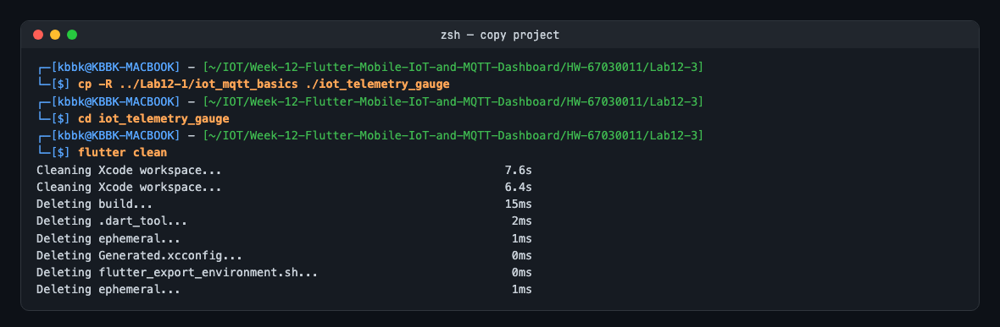
</p>


#### 2. สร้างคอมโพเนนต์มาตรวัด (`lib/radial_gauge_widget.dart`)
ในโฟลเดอร์ `lib/` ให้สร้างไฟล์ใหม่ชื่อ `radial_gauge_widget.dart` สำหรับวาดมาตรวัดความเร็ว/แรงดัน:

```dart
import 'dart:math' as math;
import 'package:flutter/material.dart';

class RadialGaugeWidget extends StatelessWidget {
  final double value; // ค่าแรงดัน (0.0 ถึง 3.3V)
  final double maxLimit;

  const RadialGaugeWidget({
    super.key,
    required this.value,
    this.maxLimit = 3.3,
  });

  @override
  Widget build(BuildContext context) {
    return TweenAnimationBuilder<double>(
      tween: Tween<double>(begin: 0.0, end: value),
      duration: const Duration(milliseconds: 300),
      curve: Curves.easeOutCubic,
      builder: (context, animatedValue, child) {
        return SizedBox(
          width: 260,
          height: 260,
          child: Stack(
            alignment: Alignment.center,
            children: [
              CustomPaint(
                size: const Size(260, 260),
                painter: _GaugePainter(value: animatedValue, maxLimit: maxLimit),
              ),
              Column(
                mainAxisSize: MainAxisSize.min,
                children: [
                  Text(
                    animatedValue.toStringAsFixed(2),
                    style: const TextStyle(
                      fontSize: 48,
                      fontWeight: FontWeight.bold,
                      color: Colors.white,
                      fontFamily: 'monospace',
                    ),
                  ),
                  const Text(
                    'VOLTS (V)',
                    style: TextStyle(
                      fontSize: 14,
                      letterSpacing: 2,
                      fontWeight: FontWeight.bold,
                      color: Color(0xFF00E5FF),
                    ),
                  ),
                ],
              ),
            ],
          ),
        );
      },
    );
  }
}

class _GaugePainter extends CustomPainter {
  final double value;
  final double maxLimit;

  _GaugePainter({required this.value, required this.maxLimit});

  @override
  void paint(Canvas canvas, Size size) {
    final center = Offset(size.width / 2, size.height / 2);
    final radius = size.width / 2 - 20;

    const startAngle = 135 * (math.pi / 180);
    const sweepAngle = 270 * (math.pi / 180);

    // 1. เส้น Track วงกลมพื้นหลัง
    final trackPaint = Paint()
      ..color = const Color(0xFF1E293B)
      ..style = PaintingStyle.stroke
      ..strokeWidth = 18
      ..strokeCap = StrokeCap.round;

    canvas.drawArc(
      Rect.fromCircle(center: center, radius: radius),
      startAngle,
      sweepAngle,
      false,
      trackPaint,
    );

    // 2. เส้นแสดงระดับค่า (Gradient Active Arc)
    final ratio = (value / maxLimit).clamp(0.0, 1.0);
    final currentSweep = sweepAngle * ratio;

    final activePaint = Paint()
      ..shader = const SweepGradient(
        colors: [Color(0xFF00E5FF), Color(0xFF00E676), Color(0xFFFFD600), Color(0xFFFF5252)],
        startAngle: 0.0,
        endAngle: math.pi * 2,
      ).createShader(Rect.fromCircle(center: center, radius: radius))
      ..style = PaintingStyle.stroke
      ..strokeWidth = 18
      ..strokeCap = StrokeCap.round;

    canvas.drawArc(
      Rect.fromCircle(center: center, radius: radius),
      startAngle,
      currentSweep,
      false,
      activePaint,
    );
  }

  @override
  bool shouldRepaint(covariant _GaugePainter oldDelegate) =>
      oldDelegate.value != value;
}
```

> [!WARNING] **บั๊กในโค้ด `_GaugePainter` (พบตอนทดสอบ 3.15 V):** `SweepGradient(startAngle: 0.0, endAngle: math.pi * 2)` วัดมุม 0 ที่ตำแหน่ง 3 นาฬิกา แต่ส่วนโค้งเริ่มที่ 135° และกวาด 270° สีจึงไม่ได้ไล่จากต้นโค้งไปปลายโค้ง: ต้นโค้ง (ค่าต่ำ) เป็นสีเขียว-เหลือง และ **ปลายโค้งช่วงค่าสูงวนกลับเป็นสีฟ้า** แทนที่จะเป็นสีแดง (ดูภาพผลทดสอบ 3.15 V ด้านล่าง) แก้โดยหมุน Gradient ด้วย `transform: GradientRotation(startAngle - capAngle)` และ `endAngle: sweepAngle + 2 * capAngle` (`capAngle` เผื่อหัวมนของเส้น ไม่ให้หัวด้านต้นไปเก็บสีแดงจากปลาย Gradient) — ดู [lib/radial_gauge_widget.dart](Lab12-3/iot_telemetry_gauge/lib/radial_gauge_widget.dart)


---

### กิจกรรมที่ 12-3.2: การสร้างหน้าจอ Telemetry Dashboard (`telemetry_dashboard_screen.dart`)

#### 1. สร้างไฟล์หน้าจอแดชบอร์ด (`lib/telemetry_dashboard_screen.dart`)
ในโฟลเดอร์ `lib/` ให้สร้างไฟล์ใหม่ชื่อ `telemetry_dashboard_screen.dart` และใส่โค้ดต่อไปนี้:

```dart
import 'dart:convert';
import 'dart:math' as math;
import 'package:flutter/material.dart';
import 'package:mqtt_client/mqtt_client.dart';
import 'package:mqtt_client/mqtt_server_client.dart';
import 'radial_gauge_widget.dart';

class TelemetryDashboardScreen extends StatefulWidget {
  final String brokerIp;
  const TelemetryDashboardScreen({super.key, required this.brokerIp});

  @override
  State<TelemetryDashboardScreen> createState() => _TelemetryDashboardScreenState();
}

class _TelemetryDashboardScreenState extends State<TelemetryDashboardScreen> {
  MqttServerClient? _client;
  double _currentVoltage = 0.0;
  int _currentRaw = 0;
  int _currentUptime = 0;
  double _maxVoltage = 0.0;
  double _minVoltage = 3.3;

  final List<double> _history = [];
  bool _isConnected = false;

  @override
  void initState() {
    super.initState();
    _connect();
  }

  @override
  void dispose() {
    _client?.disconnect();
    super.dispose();
  }

  Future<void> _connect() async {
    final clientId = 'Flutter_Telemetry_${DateTime.now().millisecondsSinceEpoch}';
    _client = MqttServerClient(widget.brokerIp, clientId);
    _client!.port = 1883;

    _client!.onConnected = () {
      setState(() => _isConnected = true);
      _client!.subscribe('iot/esp32/telemetry', MqttQos.atMostOnce);
      _client!.updates?.listen(_handleIncomingMessage);
    };

    _client!.onDisconnected = () {
      setState(() => _isConnected = false);
    };

    try {
      await _client!.connect();
    } catch (_) {}
  }

  void _handleIncomingMessage(List<MqttReceivedMessage<MqttMessage>> c) {
    final recMess = c[0].payload as MqttPublishMessage;
    final payload = MqttPublishPayload.bytesToStringAsString(recMess.payload.message);

    try {
      final data = jsonDecode(payload) as Map<String, dynamic>;
      final v = (data['voltage'] as num?)?.toDouble() ?? 0.0;
      final raw = (data['raw'] as num?)?.toInt() ?? 0;
      final up = (data['uptime'] as num?)?.toInt() ?? 0;

      setState(() {
        _currentVoltage = v;
        _currentRaw = raw;
        _currentUptime = up;
        _maxVoltage = math.max(_maxVoltage, v);
        _minVoltage = math.min(_minVoltage, v);

        _history.add(v);
        if (_history.length > 30) _history.removeAt(0);
      });
    } catch (e) {
      debugPrint('Parsing error: $e');
    }
  }

  @override
  Widget build(BuildContext context) {
    return Scaffold(
      backgroundColor: const Color(0xFF0F172A),
      appBar: AppBar(
        title: const Text('Real-time Telemetry Dashboard'),
        backgroundColor: const Color(0xFF1E293B),
        actions: [
          Padding(
            padding: const EdgeInsets.only(right: 16.0),
            child: Icon(
              Icons.circle,
              size: 14,
              color: _isConnected ? const Color(0xFF00E676) : Colors.redAccent,
            ),
          )
        ],
      ),
      body: SingleChildScrollView(
        padding: const EdgeInsets.all(20),
        child: Column(
          children: [
            // 1. มาตรวัดเข็มทรงกลม
            Center(
              child: RadialGaugeWidget(value: _currentVoltage, maxLimit: 3.3),
            ),
            const SizedBox(height: 24),

            // 2. การ์ดสรุปค่าสถิติ (Statistics Cards)
            Row(
              children: [
                _buildMetricCard('ค่าดิบ ADC', '$_currentRaw / 4095', const Color(0xFF00E5FF)),
                const SizedBox(width: 12),
                _buildMetricCard('แรงดันสูงสุด', '${_maxVoltage.toStringAsFixed(2)} V', const Color(0xFFFF5252)),
                const SizedBox(width: 12),
                _buildMetricCard('แรงดันต่ำสุด', '${_minVoltage == 3.3 ? 0.0 : _minVoltage.toStringAsFixed(2)} V', const Color(0xFF00E676)),
              ],
            ),
            const SizedBox(height: 20),

            // 3. กราฟเส้นแนวโน้มสด (Live Sparkline Graph)
            Container(
              padding: const EdgeInsets.all(16),
              decoration: BoxDecoration(
                color: const Color(0xFF1E293B).withOpacity(0.8),
                borderRadius: BorderRadius.circular(20),
                border: Border.all(color: Colors.white12),
              ),
              child: Column(
                crossAxisAlignment: CrossAxisAlignment.start,
                children: [
                  const Text(
                    'แนวโน้มแรงดันย้อนหลัง 30 ตัวอย่าง (Live Trend)',
                    style: TextStyle(fontWeight: FontWeight.bold, color: Colors.white70),
                  ),
                  const SizedBox(height: 16),
                  SizedBox(
                    height: 100,
                    width: double.infinity,
                    child: CustomPaint(
                      painter: _SparklinePainter(history: _history, maxLimit: 3.3),
                    ),
                  ),
                ],
              ),
            ),
            const SizedBox(height: 16),
            Text(
              'ESP32 Uptime: ${_currentUptime}s',
              style: const TextStyle(color: Colors.white38, fontSize: 13),
            ),
          ],
        ),
      ),
    );
  }

  Widget _buildMetricCard(String title, String val, Color color) {
    return Expanded(
      child: Container(
        padding: const EdgeInsets.all(12),
        decoration: BoxDecoration(
          color: const Color(0xFF1E293B),
          borderRadius: BorderRadius.circular(16),
          border: Border.all(color: color.withOpacity(0.3)),
        ),
        child: Column(
          children: [
            Text(title, style: const TextStyle(fontSize: 11, color: Colors.white54)),
            const SizedBox(height: 6),
            Text(val, style: TextStyle(fontSize: 16, fontWeight: FontWeight.bold, color: color)),
          ],
        ),
      ),
    );
  }
}

class _SparklinePainter extends CustomPainter {
  final List<double> history;
  final double maxLimit;

  _SparklinePainter({required this.history, required this.maxLimit});

  @override
  void paint(Canvas canvas, Size size) {
    if (history.length < 2) return;

    final paint = Paint()
      ..color = const Color(0xFF00E5FF)
      ..strokeWidth = 2.5
      ..style = PaintingStyle.stroke
      ..strokeCap = StrokeCap.round;

    final path = Path();
    final dx = size.width / (history.length - 1);

    for (int i = 0; i < history.length; i++) {
      final x = i * dx;
      final y = size.height - ((history[i] / maxLimit).clamp(0.0, 1.0) * size.height);
      if (i == 0) {
        path.moveTo(x, y);
      } else {
        path.lineTo(x, y);
      }
    }

    canvas.drawPath(path, paint);
  }

  @override
  bool shouldRepaint(covariant _SparklinePainter oldDelegate) => true;
}
```

#### 2. ปรับปรุงไฟล์ `lib/main.dart` เพื่อเรียกใช้งานหน้าจอใหม่
เปิดไฟล์ `lib/main.dart` และแก้ไขโค้ดทั้งหมดให้เรียกใช้งาน `TelemetryDashboardScreen` เป็นหน้าจอเริ่มต้น (Home Screen):

```dart
import 'package:flutter/material.dart';
import 'telemetry_dashboard_screen.dart';

void main() {
  runApp(const TelemetryApp());
}

class TelemetryApp extends StatelessWidget {
  const TelemetryApp({super.key});

  @override
  Widget build(BuildContext context) {
    return MaterialApp(
      title: 'Lab 12.3 Telemetry Dashboard',
      theme: ThemeData.dark().copyWith(
        scaffoldBackgroundColor: const Color(0xFF0F172A),
        colorScheme: const ColorScheme.dark(
          primary: Color(0xFF00E5FF),
          secondary: Color(0xFF00E676),
        ),
      ),
      // กำหนด IP ของ Mosquitto Broker (ใช้ 127.0.0.1 หากรันบนคอมพิวเตอร์เครื่องเดียวกัน)
      home: const TelemetryDashboardScreen(brokerIp: '127.0.0.1'),
      debugShowCheckedModeBanner: false,
    );
  }
}
```

#### 3. สั่งรัน Flutter App
```powershell
# รันบน Windows Desktop
flutter run -d windows

# หรือรันบน Android Device / Emulator
flutter run -d <device-id>
```

**ผลการทดลอง:** `flutter analyze` ของโค้ดตามใบงานเหลือ `withOpacity` (Deprecated) 2 จุด และ Error จาก `widget_test.dart` ที่ติดมาจาก Lab 12-1 แอปรันบน Simulator ได้ จุดเขียวมุมขวาบนแสดงว่าเชื่อม Broker แล้ว ก่อนมีข้อมูลการ์ด "แรงดันต่ำสุด" แสดง `0.0 V` (ทศนิยมไม่เท่ากับการ์ดอื่นเพราะเงื่อนไข `_minVoltage == 3.3 ? 0.0 : ...` คืนค่า `double` ที่ไม่ได้ `toStringAsFixed(2)`)

<p align="center">
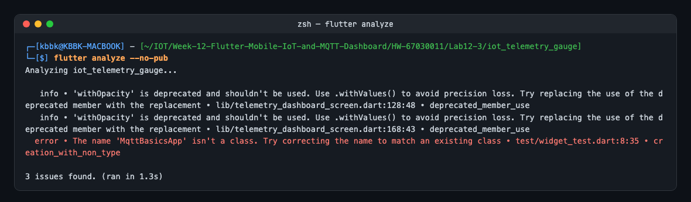
</p>

<p align="center">
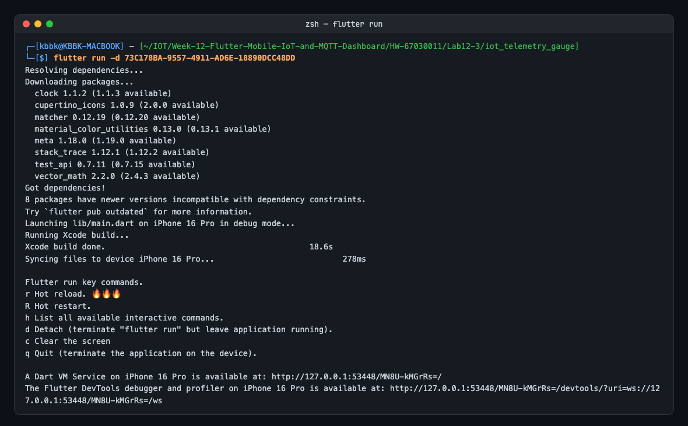
</p>

<p align="center">
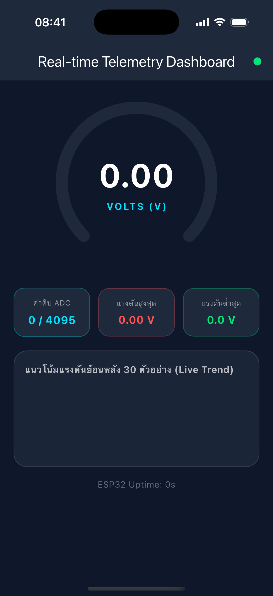
</p>


---

### กิจกรรมที่ 12-3.3: การทดสอบร่วมกับสคริปต์จำลองเซนเซอร์ (Telemetry Mock Simulation)

หากยังไม่ได้ต่อบอร์ด ESP32 จริงกับวงจรแบ่งแรงดัน (Potentiometer) สามารถทดสอบจำลองส่งข้อมูลเซนเซอร์เข้าสู่ Broker ได้ทั้งการใช้สคริปต์ Python และคำสั่ง Mosquitto CLI บน PowerShell:

#### 1. การทดสอบด้วยสคริปต์ Python Telemetry Simulator
สร้างไฟล์สคริปต์ `pyTeleSim.py` (หรือ `Sine_wave_gen.py`) เพื่อจำลองส่งคลื่นสัญญาณ Sine Wave ของแรงดันไฟฟ้า (0.0 ถึง 3.3V) ไปยัง Broker อย่างต่อเนื่อง:

```python
import paho.mqtt.client as mqtt
import time
import json
import math

client = mqtt.Client(mqtt.CallbackAPIVersion.VERSION2, "PyTelemetrySim")
client.connect("127.0.0.1", 1883)

t = 0
while True:
    # สร้างคลื่น Sine จำลองแรงดัน 0.0 ถึง 3.3V
    voltage = round(1.65 + 1.5 * math.sin(t * 0.2), 2)
    raw = int((voltage / 3.3) * 4095)
    payload = json.dumps({"voltage": voltage, "raw": raw, "uptime": t})
    
    client.publish("iot/esp32/telemetry", payload)
    print(f"Published: {payload}")
    t += 1
    time.sleep(0.5)
```

รันสคริปต์ด้วยคำสั่ง:
```powershell
python pyTeleSim.py
```

**ที่ใช้จริง:** ติดตั้ง `paho-mqtt` 2.1.0 ด้วย `pip3 install paho-mqtt` แล้วรัน `python3 pyTeleSim.py` สคริปต์ส่ง JSON ทุก 0.5 วินาที

<p align="center">
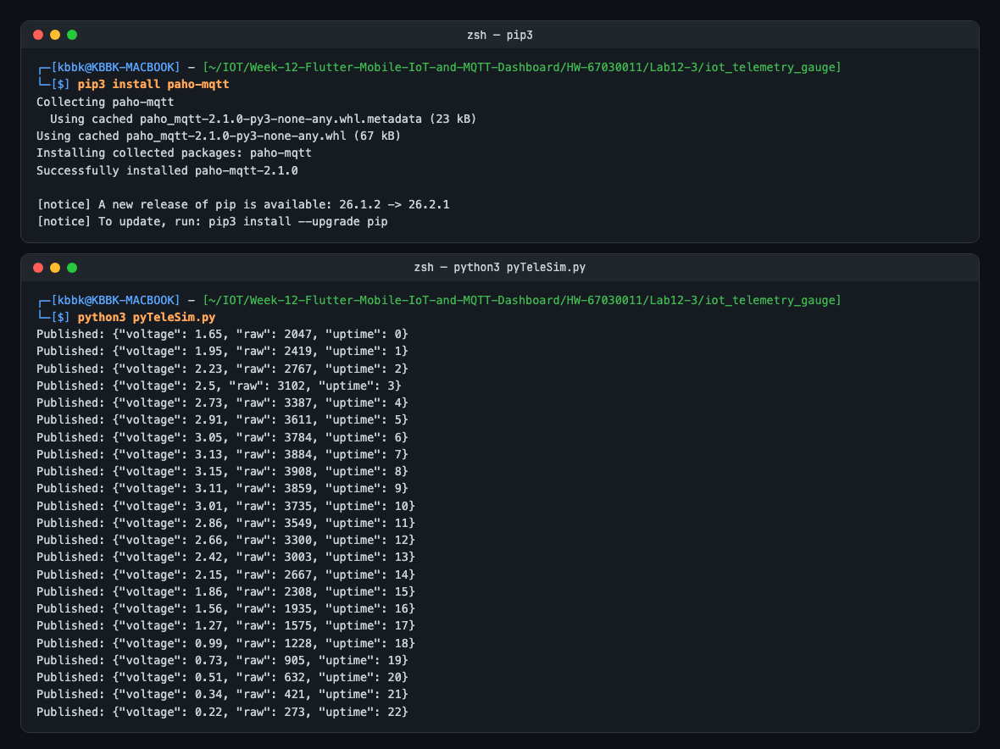
</p>


เมื่อเปิดดูหน้าจอแดชบอร์ดบน Flutter: เข็ม Radial Gauge จะเคลื่อนไหวขึ้นลงอย่างนุ่มนวลตามคลื่น Sine พร้อมกับการ์ดสถิติ (Max, Min, Raw ADC) และกราฟประวัติย้อนหลัง 30 ตัวอย่าง (Live Trend Sparkline) ที่วาดเป็นระลอกคลื่นอย่างสวยงาม:

<p align="center">
  
  <br>
  <em>รูปที่ 12.3-2 ผลการทดสอบแดชบอร์ดแสดงผลค่าแรงดันแบบเรียลไทม์ร่วมกับสัญญาณ Sine Wave</em>
</p>

**ผลการทดลองจริง (Simulator):** เข็มเกจขยับตามคลื่น Sine อย่างต่อเนื่อง การ์ดค่าดิบ ADC เปลี่ยนทุกแพ็กเก็ต กราฟ Live Trend วาดเป็นคลื่นเต็มกรอบ และ Min/Max สะสมเป็น 0.16 V / 3.15 V (ตรงกับ 1.65 ± 1.5 V ที่ปัดเศษ) ภาพที่สองถ่ายห่างจากภาพแรก 6 วินาที คลื่นเลื่อนไปทางซ้ายตาม FIFO 30 ตัวอย่าง

<p align="center">
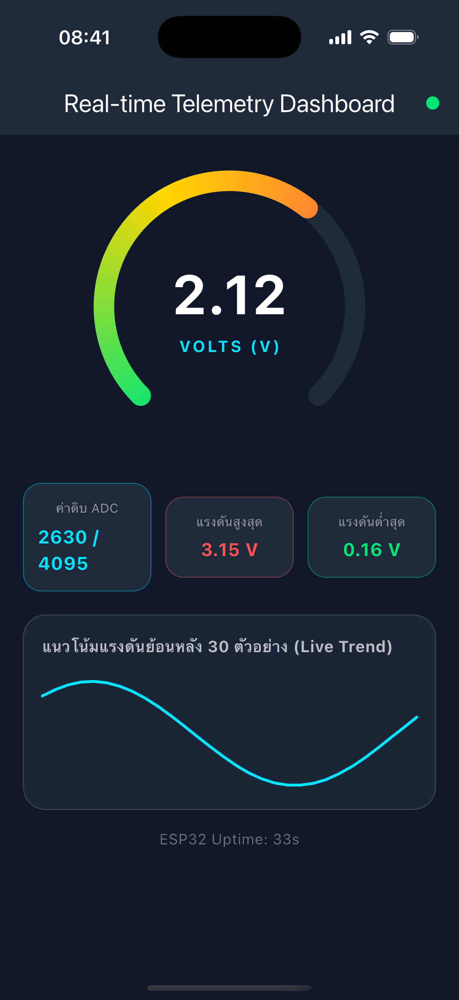
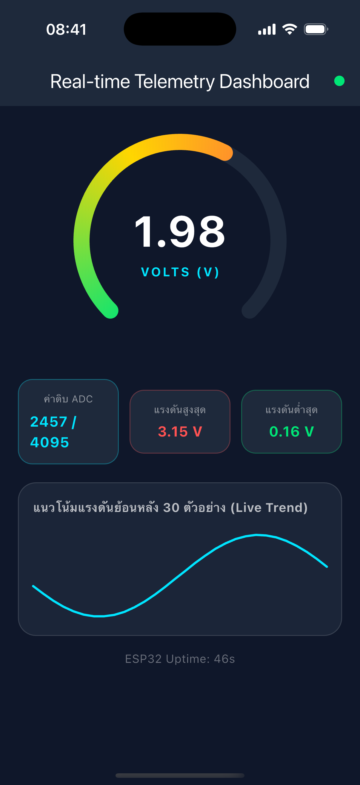
</p>

> [!NOTE] ใน `pyTeleSim.py` ของใบงาน `uptime = t` ซึ่งเพิ่มทีละ 1 ทุก 0.5 วินาที ค่า Uptime ที่แสดงจึงเร็วกว่าเวลาจริง 2 เท่า (รันไป 23 วินาทีแต่ `uptime` ขึ้นถึง 46) และสคริปต์ไม่เรียก `loop_start()` จึงไม่มี Network Loop ของ paho ทำงาน ฉบับที่แก้แล้ว ([pyTeleSim.py](Lab12-3/iot_telemetry_gauge/pyTeleSim.py)) ใช้ `time.monotonic()` คำนวณ `uptime` เป็นวินาทีจริง เรียก `loop_start()` และ `disconnect()` เมื่อกด Ctrl+C


#### 2. การทดสอบแบบเจาะจงค่าผ่าน Mosquitto CLI (PowerShell)
สามารถใช้คำสั่ง `mosquitto_pub` ทดสอบส่งค่าเฉพาะเพื่อตรวจสอบพฤติกรรมของ Gauge ในสภาวะต่างๆ:

- **ทดสอบส่งค่าปกติ (1.65 V):**
```powershell
mosquitto_pub -h 127.0.0.1 -p 1883 -t "iot/esp32/telemetry" -m '{"voltage": 1.65, "raw": 2048, "uptime": 10}'
```
*สังเกตเข็ม Radial Gauge หมุนไปที่กึ่งกลาง (1.65 V) และการ์ดแสดงค่า 2048 / 4095*

**ผลการทดลอง:** เข็มไปหยุดกึ่งกลาง (จุดสูงสุดของโค้ง) การ์ดแสดง `2048 / 4095` Max = Min = 1.65 V และ Uptime 10s (ข้อความ `2048 / 4095` ยาวจนขึ้นสองบรรทัด ทำให้การ์ดสูงไม่เท่ากัน)
<p align="center">
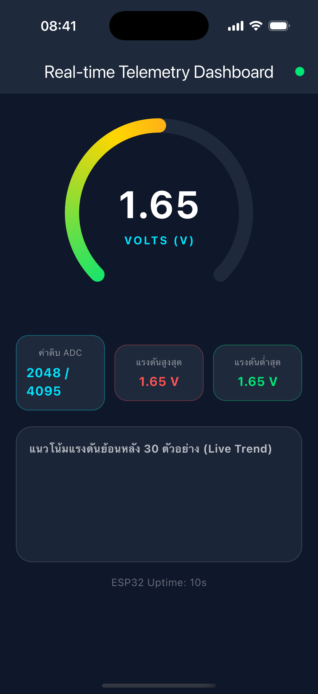
</p>


- **ทดสอบส่งค่าแรงดันสูงแตะขีดจำกัด (3.15 V):**
```powershell
mosquitto_pub -h 127.0.0.1 -p 1883 -t "iot/esp32/telemetry" -m '{"voltage": 3.15, "raw": 3910, "uptime": 20}'
```
*สังเกตเข็มหมุนเข้าสู่โซนสีแดง และการ์ด "แรงดันสูงสุด" ปรับค่าเป็น `3.15 V` ทันที*

**ผลการทดลอง:** การ์ดแรงดันสูงสุดเปลี่ยนเป็น `3.15 V` ทันที และกราฟเริ่มมีเส้น (ต้องมี ≥ 2 ตัวอย่าง) แต่ **ปลายเกจเป็นสีฟ้า ไม่ใช่โซนสีแดง** ตามบั๊ก Gradient ที่อธิบายไว้ข้างต้น

<p align="center">
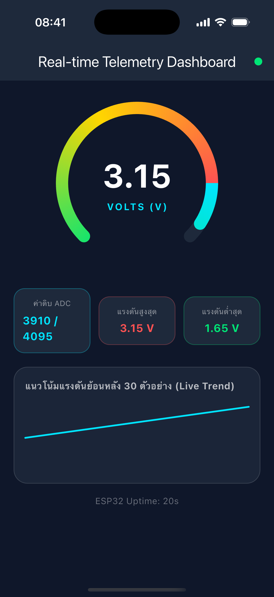
</p>

<p align="center">
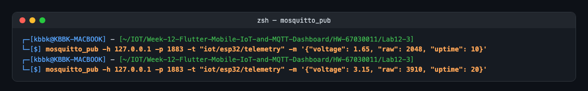
</p>


- **จำลองสตรีมข้อมูลต่อเนื่อง 30 ค่าด้วย PowerShell Loop:**
```powershell
1..30 | ForEach-Object {
    $v = [Math]::Round(1.65 + 1.5 * [Math]::Sin($_ * 0.4), 2)
    $raw = [int](($v / 3.3) * 4095)
    mosquitto_pub -h 127.0.0.1 -p 1883 -t "iot/esp32/telemetry" -m "{`"voltage`": $v, `"raw`": $raw, `"uptime`": $_}"
    Start-Sleep -Milliseconds 500
}
```

**ที่ใช้จริง (zsh):** เขียน Loop เดียวกันเป็น [sine_loop.sh](Lab12-3/sine_loop.sh) (คำนวณ `1.65 + 1.5·sin(i·0.4)` ด้วย Python one-liner แทน `[Math]::Sin`) ส่ง 30 ค่า ทุก 500 ms `mosquitto_sub -C 30` ได้รับครบ 30 ข้อความ (`uptime` 1 – 30) และกราฟบนแอปแสดงคลื่น Sine ประมาณ 2 รอบ (ความถี่ 0.4 rad/ตัวอย่าง สูงกว่า pyTeleSim 2 เท่า)

<p align="center">
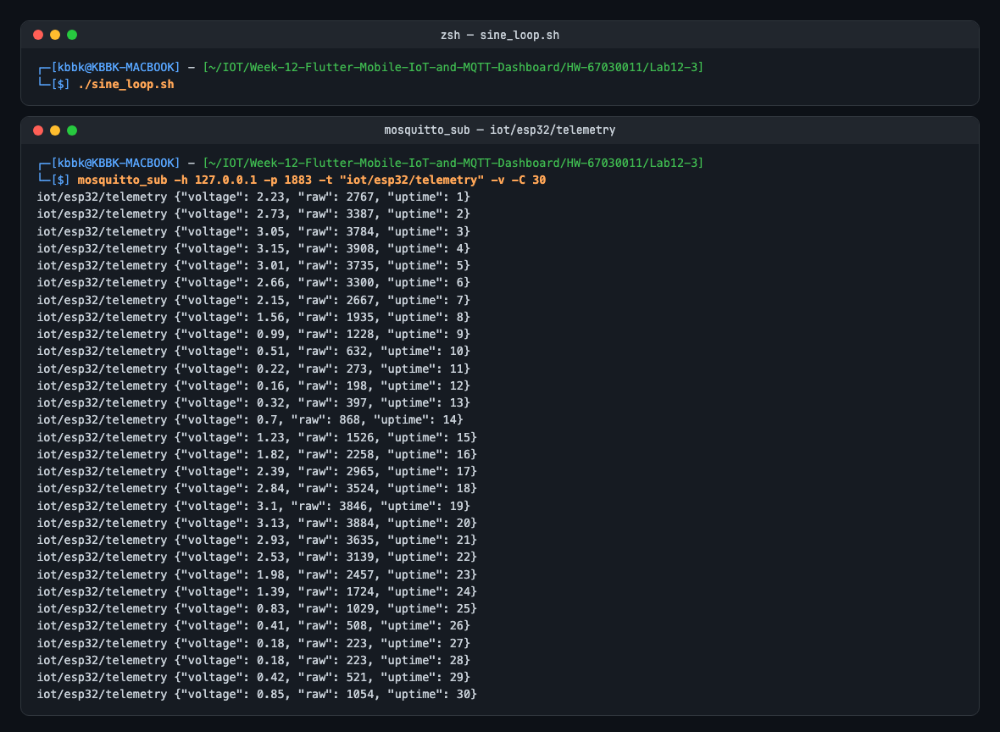
</p>

<p align="center">
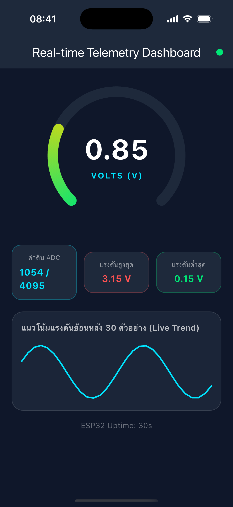
</p>

---

### ปัญหาที่พบและการแก้ไข (Commit `fix: lab 12-3 ...`)
1. **ค่าที่ผิดพลาดเข้าไปปนในหน้าจอและสถิติ** (ทดสอบในคำถามข้อ 3): `voltage: null` ถูกแปลงเป็น 0.00 V และกลายเป็นค่าต่ำสุด, `5.0` / `-1.2` ถูกแสดงและบันทึกเป็น Max/Min และกราฟพุ่งออกนอกกรอบ
   → แยก **Data Model** [lib/telemetry_data.dart](Lab12-3/iot_telemetry_gauge/lib/telemetry_data.dart) (`TelemetryData.tryParse`) ตรวจว่าเป็น JSON Object, `voltage` เป็นตัวเลขจำกัดค่า, อยู่ในช่วง 0 – 3.3 V และ `raw` อยู่ในช่วง 0 – 4095 ถ้าไม่ผ่านจะทิ้งแพ็กเก็ตและนับ `Rejected` แทนการแสดงค่าผิด
2. **สีเกจไม่ตรงระดับ** (ปลายค่าสูงเป็นสีฟ้า) → หมุน `SweepGradient` ด้วย `GradientRotation` ตามที่อธิบายข้างต้น
3. **Min/Max ก่อนมีข้อมูล** แสดง `0.00 V` / `0.0 V` → ใช้ `_hasData` แสดง `-- V` และใช้ค่าแรกเป็นทั้ง Min และ Max, ห่อค่าด้วย `FittedBox` ให้การ์ดสูงเท่ากัน
4. เหมือน Lab 12-1/12-2: `keepAlivePeriod`, `autoReconnect`, `setProtocolV311()`, ยกเลิก Listener เดิมก่อน `listen` ใหม่ และถอด Callback ก่อน `disconnect()` ใน `dispose()`
5. เปลี่ยน `test/widget_test.dart` เป็น Unit Test ของ `TelemetryData.tryParse` (Payload ปกติ 2 แบบ + Payload ผิด 7 แบบ)

<p align="center">
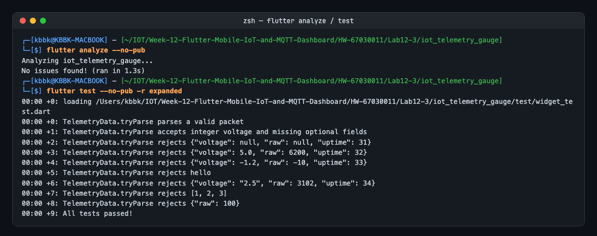
</p>

**ผลหลังแก้ไข** (เรียงจากซ้าย): ก่อนมีข้อมูล Max/Min เป็น `--` → 1.65 V เกจไล่สีจากฟ้าที่ต้นโค้ง → 3.15 V ปลายเกจเป็นส้มแดง → ส่ง Payload ผิด 6 แบบ ทุกค่าบนจอไม่เปลี่ยน → pyTeleSim ฉบับแก้ Uptime ตรงเวลาจริง (15 วินาที)

<p align="center">
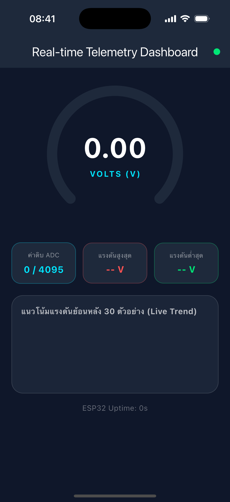
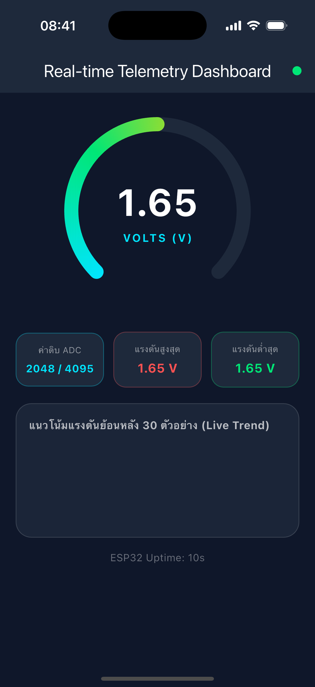
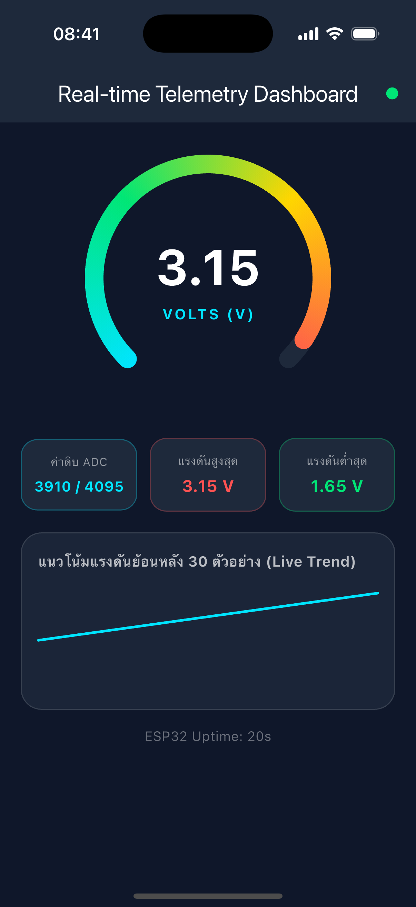

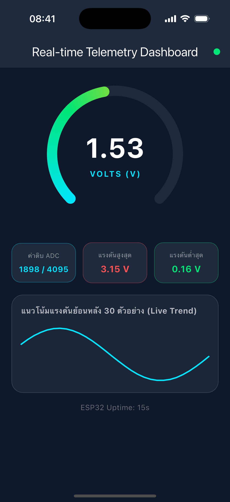
</p>

<p align="center">
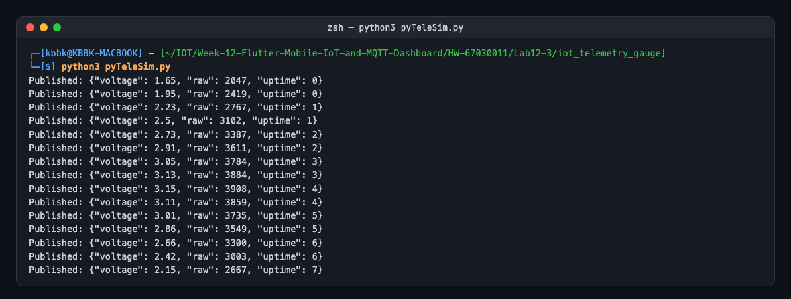
</p>


---

## 4. สรุปผลและคำถามท้ายการทดลอง

**สรุปผล:** แดชบอร์ดถอดรหัส JSON จาก `iot/esp32/telemetry` แล้วแสดงผลบน Radial Gauge (CustomPainter + TweenAnimationBuilder), การ์ดสถิติ ADC/Max/Min, กราฟ Live Trend 30 ตัวอย่าง และ Uptime ได้ครบ ทดสอบด้วย `mosquitto_pub`, `pyTeleSim.py` และ Shell Loop และพบ/แก้บั๊กสีเกจ, การตรวจสอบค่าผิด และการแสดง Min/Max

1. **เหตุใดการใช้ `TweenAnimationBuilder` จึงทำให้เข็มมาตรวัดดูนุ่มนวลและไม่กระตุก แม้ข้อมูลเซนเซอร์จะเข้ามาทุกๆ 500 มิลลิวินาที?**
   * **คำตอบ:** ข้อมูลมาเป็นขั้น (2 ครั้ง/วินาที) ถ้าวาดค่าใหม่ทันที เข็มจะ "กระโดด" ทีละขั้น แต่ `TweenAnimationBuilder` จะสร้าง `AnimationController` ภายในให้เอง เมื่อ `end` เปลี่ยน มันจะ **สร้าง Tween ใหม่จากค่าที่กำลังแสดงอยู่ไปยังค่าใหม่** แล้วเรียก `builder` ทุกเฟรม (60 fps บน Simulator, 120 fps บน ProMotion) ด้วยค่าที่ถูก Interpolate ตาม `Curves.easeOutCubic` (เร็วตอนต้น ค่อย ๆ ชะลอตอนจบ) ใน 300 ms ซึ่ง **สั้นกว่าช่วงห่างของข้อมูล 500 ms** เข็มจึงไปถึงค่าจริงก่อนข้อมูลถัดไปมาถึงเสมอ ไม่สะสมความหน่วง และถ้าข้อมูลใหม่มาระหว่างแอนิเมชัน ก็จะเริ่ม Tween ใหม่จากตำแหน่งปัจจุบันโดยไม่สะดุด (ค่า `begin: 0.0` ใช้แค่ครั้งแรกที่สร้าง Widget เท่านั้น) และตัว `_GaugePainter` มี `shouldRepaint` เทียบค่า จึง Repaint เฉพาะเฟรมที่ค่าเปลี่ยน
   * **ผลทดลองจริง:** อัดวิดีโอ Simulator (`xcrun simctl io booted recordVideo`) ขณะส่ง 0.20 V แล้วตามด้วย 3.10 V แยกเฟรมด้วย `ffmpeg` ได้ **20 เฟรมในช่วง 1.620 – 1.923 วินาที (≈ 300 ms ที่ ~60 fps)** ตัวเลขบนเกจไล่ 0.20 → 1.09 → 2.07 → 2.62 → 2.91 → 3.05 → 3.10 (ภาพด้านล่างคือเฟรมก่อนส่งค่าใหม่ ตามด้วยเฟรมที่ 3, 6, 9, 12, 15 และ 20 ของแอนิเมชัน ห่างกันราว 50 ms) ช่วงแรกขยับเร็วมาก แล้วช้าลงช่วงท้ายตาม easeOutCubic

<p align="center">
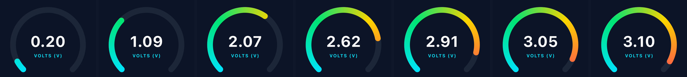
</p>

2. **การจำกัดความยาวของอาร์เรย์ `_history` ให้เก็บไม่เกิน 30 ตัวอย่าง ส่งผลดีต่อประสิทธิภาพหน่วยความจำของสมาร์ตโฟนอย่างไร?**
   * **คำตอบ:** ทำให้หน่วยความจำและงานต่อเฟรม **คงที่ (O(1) เทียบกับเวลา)** แทนที่จะโตไปเรื่อย ๆ
     * **หน่วยความจำ:** 30 × `double` ≈ 240 ไบต์ (+ Header ของ List) ตลอดอายุแอป ถ้าไม่จำกัด ข้อมูล 2 ค่า/วินาที = 7,200 ค่า/ชั่วโมง ≈ 57.6 KB/ชั่วโมง และ ~1.4 MB/วัน เพียงแค่ค่า double ซึ่งยังไม่รวมการจองพื้นที่ใหม่เมื่อ List ขยาย (Growable List ขยายเป็นเท่าตัวแล้วคัดลอก) และภาระของ Garbage Collector ที่ต้องไล่ Object ใหญ่ขึ้นเรื่อย ๆ จนเกิดการกระตุก (GC Pause) แอปที่เปิดทิ้งไว้เป็นแดชบอร์ดทั้งวันจึงมีโอกาสถูก OS ปิดเพราะใช้หน่วยความจำมาก
     * **CPU/GPU:** `_SparklinePainter` สร้าง `Path` ใหม่ทุกครั้งที่ Repaint (`shouldRepaint` คืน `true` เสมอ) วนลูปตามจำนวนจุด ถ้าจุดเพิ่มไม่จำกัด เวลาวาดต่อเฟรมจะโตตามไปด้วยจนเกินงบ 16 ms/เฟรม และพิกัดแกน X `dx = width / (n - 1)` จะเล็กกว่า 1 พิกเซลจนกราฟอ่านไม่ออก
     * ข้อสังเกต: `removeAt(0)` ของ List เป็น O(n) แต่ n = 30 จึงไม่มีผล ถ้าต้องเก็บมากขึ้นควรใช้ Ring Buffer หรือ `ListQueue`

3. **หากเซนเซอร์ส่งค่าผิดพลาด เช่น ค่านอกช่วง 0 - 3.3V หรือค่าเป็น `null` โค้ดส่วนใดใน `telemetry_dashboard_screen.dart` ที่ช่วยป้องกันไม่ให้แอปแครช?**
   * **คำตอบ:** โค้ดตามใบงานกันแครชด้วย 3 ส่วน:
     * **`try { ... } catch (e) { debugPrint('Parsing error: $e'); }`** ใน `_handleIncomingMessage` ครอบทั้ง `jsonDecode` และการ Cast ทุก Exception (เช่น `FormatException` ของข้อความที่ไม่ใช่ JSON, `TypeError` จาก Cast ผิดชนิด) จึงถูกจับไว้ ไม่ทะลุไปถึง Stream ของ `mqtt_client`
     * **Nullable Cast + ค่าเริ่มต้น** `(data['voltage'] as num?)?.toDouble() ?? 0.0` (และ `raw`, `uptime`) ทำให้ Key ที่หายไปหรือเป็น `null` ไม่เกิด Null Error
     * **`.clamp(0.0, 1.0)`** ใน `_GaugePainter` และ `_SparklinePainter` ทำให้ค่านอกช่วงไม่ทำให้มุมของส่วนโค้ง/พิกัดเกินขอบเขต (ส่วนข้อความตัวเลขยังแสดงค่าจริง)
   * **ผลทดลองจริงกับโค้ดตามใบงาน** (ส่ง 6 Payload): แอป **ไม่แครชเลย** — `hello`, `{"voltage": "2.5"}` และ `[1, 2, 3]` ถูกจับเป็น `Parsing error` แต่ **"ไม่แครช" ไม่ได้แปลว่า "ถูกต้อง"**: `voltage: null` ถูกแสดงเป็น `0.00 V` และกลายเป็นค่าต่ำสุด, `5.0 V` กลายเป็นค่าสูงสุดพร้อม ADC `6200 / 4095`, `-1.2 V` กลายเป็นค่าต่ำสุดใหม่ และค่าผิดทั้งหมดเข้าไปอยู่ในกราฟ

<p align="center">
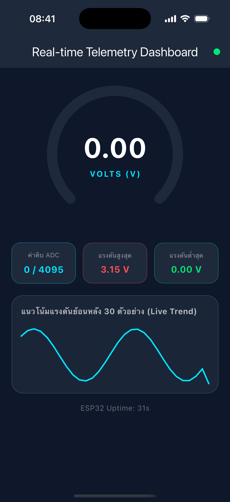
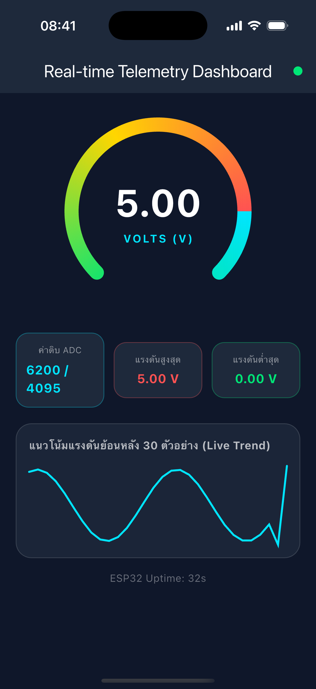
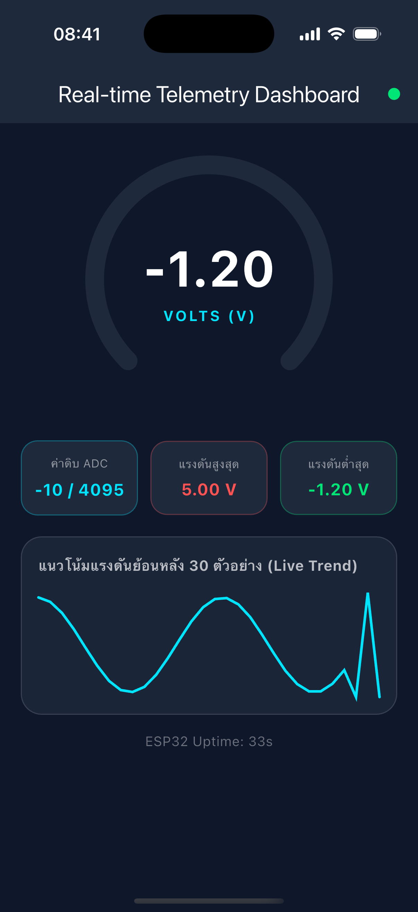
</p>

<p align="center">
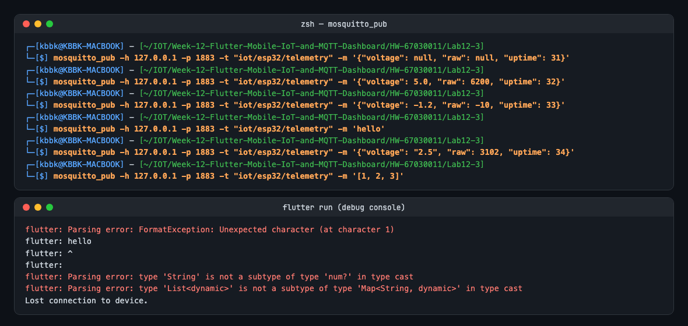
</p>

   * **หลังแก้ไข:** ใช้ `TelemetryData.tryParse` ตรวจทั้งชนิดและช่วงค่าก่อนนำไปใช้ ทั้ง 6 Payload ถูกปฏิเสธ (`Rejected telemetry #1 – #6`) และหน้าจอยังแสดงค่าล่าสุดที่ถูกต้อง (ภาพผลหลังแก้ไขช่องที่ 4)

<p align="center">
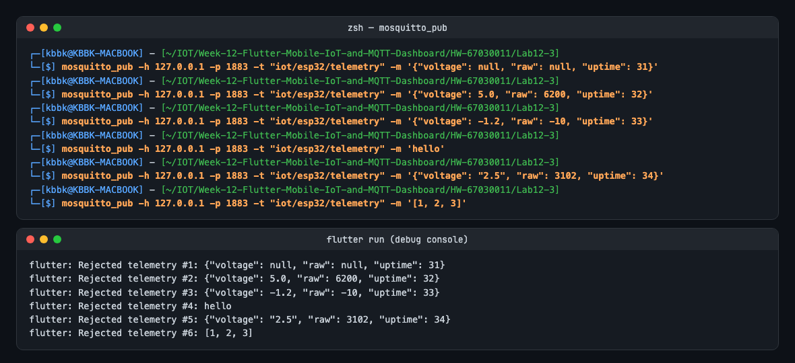
</p>
