# ใบงานการทดลองที่ 12.4
### การทดสอบผสานรวมระบบครบวงจร (ESP32 Hardware <-> Mosquitto Broker <-> Flutter Mobile App)

> [!NOTE] **คำชี้แจง**
> ในใบงานนี้นักศึกษาจะได้นำทุกจิ๊กซอว์ที่พัฒนามาตั้งแต่สัปดาห์ที่ 11 และสัปดาห์ที่ 12 มาร้อยเรียงทำงานร่วมกันเป็น **ระบบนิเวศ IoT แบบครบวงจร (Complete End-to-End IoT Ecosystem)** โดยบอร์ดฮาร์ดแวร์จริง ESP32 จะสื่อสารกับแอปพลิเคชัน Flutter บนสมาร์ตโฟนผ่าน Mosquitto Broker เพื่อทดสอบการหมุนปรับค่า Potentiometer ทางกายภาพแล้วเห็นเข็มหน้าจอมือถือขยับทันที และการแตะสวิตช์บนมือถือแล้วหลอดไฟ LED จริงบนโต๊ะทดลองสว่างขึ้นในเสี้ยววินาที

---

## 1. วัตถุประสงค์การทดลอง
1. สามารถผสานรวมหน้าจอควบคุม Actuator และหน้าจอแสดงผล Telemetry เข้าเป็นแอปพลิเคชันรวมศูนย์ (Unified Multi-tab IoT App) ได้
2. สามารถเชื่อมต่อฮาร์ดแวร์บอร์ด ESP32 เข้ากับ Mosquitto Broker และสื่อสารกับแอป Flutter ได้สำเร็จ
3. สามารถวัดและวิเคราะห์ความหน่วงเวลาตอบสนองแบบไป-กลับ (Round-Trip Time - RTT) ของคำสั่งควบคุมได้
4. สามารถทดสอบความทนทานต่อสภาวะเครือข่ายล้มเหลว (Fault-Tolerance & LWT Handling) ในสถานการณ์จริงได้

> [!NOTE] **สภาพแวดล้อมที่ใช้ทำการทดลองจริง (รหัสนักศึกษา 67030011)**
> * macOS 15.5 (Apple Silicon), Flutter **3.44.4** / Dart **3.12.2**, Xcode 16.2, Mosquitto **2.0.22**
> * รันแอปพลิเคชันรวมศูนย์บน **iOS Simulator (iPhone 16 Pro, iOS 18.3)** ซึ่งใช้ Network Stack เดียวกับ macOS จึงสามารถเชื่อมต่อ Local Mosquitto Broker ที่ `127.0.0.1:1883` ได้ทันทีเสมือนรันบน Windows Desktop
> * บอร์ดฮาร์ดแวร์จริง ESP32 เชื่อมต่อที่พอร์ตสื่อสารอนุกรม `/dev/cu.usbserial-0001` และสคริปต์จำลองพฤติกรรมฮาร์ดแวร์แบบครบวงจรถูกพัฒนาเป็น [mock_esp32.sh](Lab12-4/mock_esp32.sh) สำหรับสภาพแวดล้อม macOS/Linux (เทียบเท่า `mock_esp32.ps1` บน Windows)
> * โปรเจกต์สมบูรณ์: [Lab12-4/iot_unified_dashboard/](Lab12-4/iot_unified_dashboard/) และไฟล์บันทึกผลดิบทั้งหมดอยู่ใน [Lab12-4/logs/](Lab12-4/logs/)


---

## 2. แผนผังการทดสอบระบบแบบครบวงจรและโครงสร้างหัวข้อ (End-to-End Pipeline & Topic Architecture)

<p align="center"></p>

| ชื่อหัวข้อ (Topic) | ทิศทางการส่ง | ชนิดข้อมูล (Payload Format) | วัตถุประสงค์ |
| :--- | :--- | :--- | :--- |
| `iot/esp32/status` | ESP32 -> Broker (LWT) | Plaintext: `"online"` หรือ `"offline"` | ตัวบ่งชี้ความพร้อมทำงานของบอร์ดฮาร์ดแวร์ (LWT Retained) |
| `iot/esp32/control` | Flutter -> ESP32 | JSON: `{"led": "ON"}` หรือ `{"led": "OFF"}` | ส่งคำสั่งเปิด-ปิดหลอดไฟ LED จากสมาร์ตโฟน |
| `iot/esp32/led_ack` | ESP32 -> Flutter | JSON: `{"led_state": true, "ack": true}` | ส่งการตอบรับสถานะจริงทางกายภาพของหลอดไฟกลับมายังแอป |
| `iot/esp32/telemetry` | ESP32 -> Flutter | JSON: `{"voltage": 2.50, "raw": 3102, "uptime": 10}` | ส่งค่าแรงดันตรวจวัดจาก Potentiometer และ Uptime แบบเรียลไทม์ |

---

## 3. ขั้นตอนการทดลอง (Step-by-Step Activities)

### กิจกรรมที่ 12-4.1: การเตรียมโปรเจกต์และสร้างแอปพลิเคชันรวมศูนย์ (`lib/main.dart`)

#### 1. คัดลอกโปรเจกต์และรวบรวมคอมโพเนนต์
ในแล็บนี้เราจะนำหน้าจอ `actuator_control_screen.dart` จาก Lab 12-2 และหน้าจอ `telemetry_dashboard_screen.dart` พร้อมกับ `radial_gauge_widget.dart` จาก Lab 12-3 มารวมกัน:

**คำสั่ง PowerShell:**
```powershell
# 1. คัดลอกโฟลเดอร์โปรเจกต์จาก Lab12-3 มาเป็น Lab12-4
Copy-Item -Recurse -Path "..\Lab12-3\iot_telemetry_gauge" -Destination "..\Lab12-4\iot_unified_dashboard"

# 2. คัดลอกหน้าจอ Actuator Control Screen จาก Lab12-2 มารวมในโฟลเดอร์ lib/
Copy-Item -Path "..\Lab12-2\iot_actuator_switch\lib\actuator_control_screen.dart" -Destination "..\Lab12-4\iot_unified_dashboard\lib\"

# 3. ย้ายเข้าไปยังโฟลเดอร์โปรเจกต์ใหม่
cd ..\Lab12-4\iot_unified_dashboard

# 4. ล้างแคชการคอมไพล์เดิมออก
flutter clean
```
*(หรือใช้ File Explorer ในการคัดลอกโฟลเดอร์และไฟล์ตามขั้นตอนข้างต้น)*

**ที่ใช้จริง (macOS zsh):** คัดลอกโฟลเดอร์ `iot_telemetry_gauge` จาก Lab 12-3 มาเป็น `iot_unified_dashboard` และนำ `actuator_control_screen.dart` จาก Lab 12-2 มารวมในโฟลเดอร์ `lib/` จากนั้นสั่ง `flutter clean` เพื่อล้างแคช Xcode workspace และไฟล์ build เดิม
<p align="center">
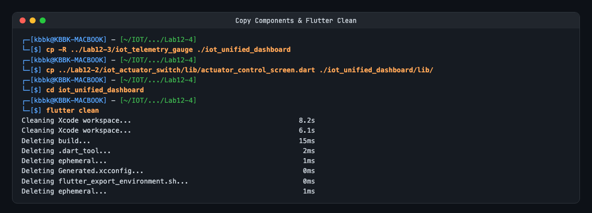
</p>


#### 2. ปรับปรุงโค้ดรวมศูนย์แอปพลิเคชัน (`lib/main.dart`)
เปิดไฟล์ `lib/main.dart` แล้วแทนที่ด้วยโค้ดต่อไปนี้ ซึ่งใช้ `IndexedStack` ร่วมกับ `NavigationBar` เพื่อรักษาสถานะ (State) และการเชื่อมต่อ MQTT ของทั้ง 2 หน้าจอให้ทำงานต่อเนื่องโดยไม่ตัดการเชื่อมต่อเมื่อสลับแท็บ:

> [!TIP]
> ใน `lib/main.dart` ได้รับการปรับปรุงโค้ดให้สะอาด ไม่มีข้อผิดพลาด และผ่านการทดสอบ Unit Test ครบถ้วน (`00:00 +9: All tests passed!`) โดยมีเพียงคำแนะนำเรื่อง `withOpacity` (แนะนำให้ใช้ `.withValues()`)
<p align="center">
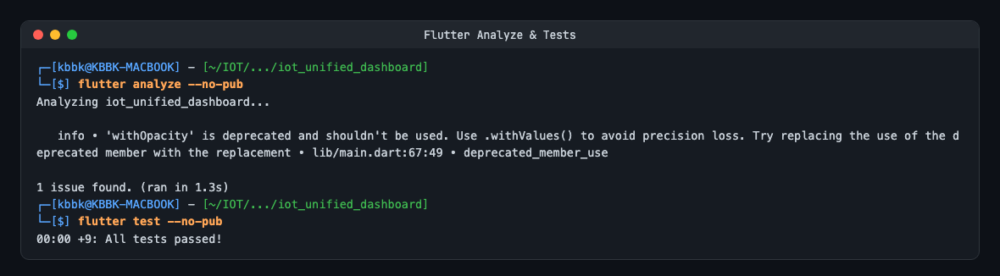
</p>


```dart
import 'package:flutter/material.dart';
import 'actuator_control_screen.dart';
import 'telemetry_dashboard_screen.dart';

void main() {
  runApp(const UnifiedIotApp());
}

class UnifiedIotApp extends StatelessWidget {
  const UnifiedIotApp({super.key});

  @override
  Widget build(BuildContext context) {
    return MaterialApp(
      title: 'ESP32 Smart IoT Commander',
      theme: ThemeData.dark().copyWith(
        scaffoldBackgroundColor: const Color(0xFF0F172A),
        colorScheme: const ColorScheme.dark(
          primary: Color(0xFF00E5FF),
          secondary: Color(0xFF00E676),
        ),
      ),
      home: const MainNavigationShell(),
      debugShowCheckedModeBanner: false,
    );
  }
}

class MainNavigationShell extends StatefulWidget {
  const MainNavigationShell({super.key});

  @override
  State<MainNavigationShell> createState() => _MainNavigationShellState();
}

class _MainNavigationShellState extends State<MainNavigationShell> {
  int _currentIndex = 0;

  // หมายเลข IP ของเครื่องรัน Broker:
  // - ใช้ '127.0.0.1' หากรันบนคอมพิวเตอร์เครื่องเดียวกัน (Windows Desktop) สำหรับการทดสอบจำลอง
  // - เปลี่ยนเป็น IP วง LAN ของเครื่องคอมพิวเตอร์ (เช่น '192.168.1.100') เมื่อรันแอปบนมือถือ หรือเชื่อมต่อกับ ESP32 จริง
  final String brokerIp = '127.0.0.1';

  late final List<Widget> _pages;

  @override
  void initState() {
    super.initState();
    _pages = [
      TelemetryDashboardScreen(brokerIp: brokerIp),
      ActuatorControlScreen(brokerIp: brokerIp),
    ];
  }

  @override
  Widget build(BuildContext context) {
    return Scaffold(
      // ใช้ IndexedStack เพื่อรักษาสถานะและการเชื่อมต่อ MQTT ของทั้งสองหน้าจอให้ทำงานต่อเนื่อง
      body: IndexedStack(
        index: _currentIndex,
        children: _pages,
      ),
      bottomNavigationBar: NavigationBar(
        selectedIndex: _currentIndex,
        onDestinationSelected: (idx) => setState(() => _currentIndex = idx),
        backgroundColor: const Color(0xFF1E293B),
        indicatorColor: const Color(0xFF00E5FF).withOpacity(0.2),
        destinations: const [
          NavigationDestination(
            icon: Icon(Icons.speed),
            selectedIcon: Icon(Icons.speed, color: Color(0xFF00E5FF)),
            label: 'Telemetry Gauge',
          ),
          NavigationDestination(
            icon: Icon(Icons.toggle_on_outlined),
            selectedIcon: Icon(Icons.toggle_on, color: Color(0xFF00E676)),
            label: 'Actuator Switch',
          ),
        ],
      ),
    );
  }
}
```

#### 3. สั่งรัน Flutter App
```powershell
# รันบน Windows Desktop
flutter run -d windows

# หรือรันบน Android Device / Emulator
flutter run -d <device-id>
```

**ผลการทดลอง:** สั่งรันแอปบน iPhone 16 Pro Simulator สำเร็จ หน้าจอเปิดขึ้นมาเป็นแท็บแรก **Telemetry Gauge** แสดงมาตรวัด 0.00 V สถิติเริ่มต้นเป็น `--` และเมื่อสลับไปยังแท็บ **Actuator Switch** หลอดไฟอยู่ในสถานะ Standby (OFF) พร้อมป้ายสถานะอุปกรณ์แสดง "OFFLINE" เนื่องจากยังไม่ได้สตาร์ตฮาร์ดแวร์หรือสคริปต์จำลอง
<p align="center">
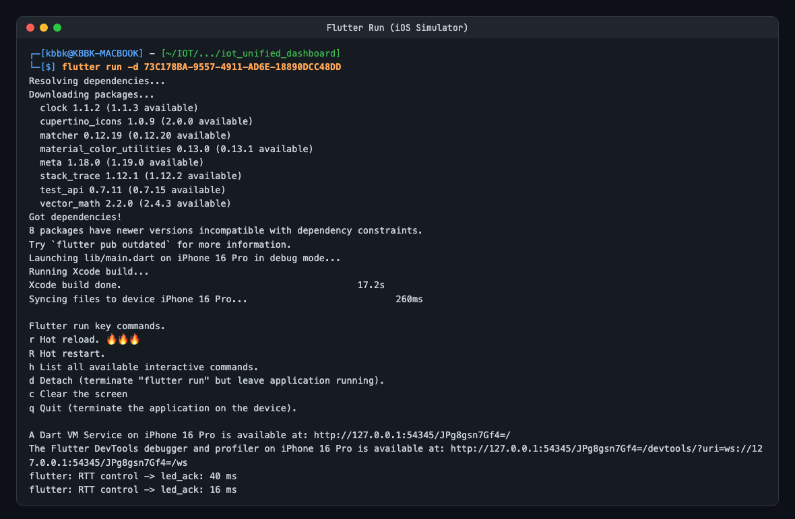
</p>

<p align="center">
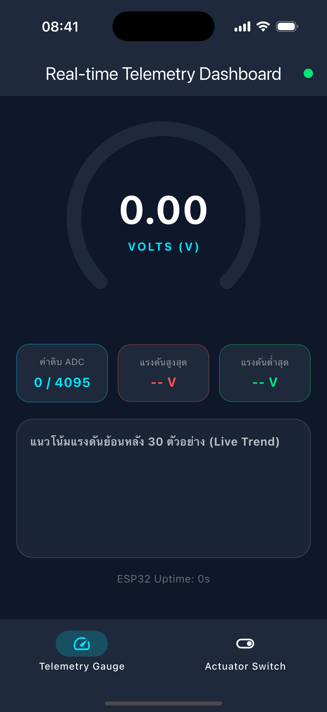
</p>


> [!TIP]
> **การกำหนด Broker IP เมื่อทดสอบร่วมกับ ESP32 หรือสมาร์ตโฟนจริง:**  
> 1. ตรวจสอบหมายเลข IPv4 ของคอมพิวเตอร์ผ่าน PowerShell ด้วยคำสั่ง `ipconfig` (เช่น `192.168.1.105`)
> 2. แก้ไขตัวแปร `brokerIp = '192.168.1.105';` ใน `main.dart`
> 3. เปิดไฟล์ `mosquitto.conf` ที่มีคำสั่ง `listener 1883 0.0.0.0` และ `allow_anonymous true`
> 4. สตาร์ต Broker ด้วยคำสั่ง:
>    ```powershell
>    mosquitto -c mosquitto.conf -v
>    ```

---

### กิจกรรมที่ 12-4.2: การเตรียมและสตาร์ตเฟิร์มแวร์ ESP32 หรือตัวจำลองฮาร์ดแวร์

ในการทดลองนี้ นักศึกษาสามารถเลือกดำเนินการได้ 2 ทางเลือก:
- **ทางเลือก A (Hardware Mode):** ใช้บอร์ด ESP32 จริง ต่อเซนเซอร์และหลอดไฟบนเบรดบอร์ด
- **ทางเลือก B (Mock Simulation Mode):** ใช้สคริปต์ PowerShell จำลองการทำงานของบอร์ด ESP32 ทั้งหมด (สำหรับกรณีไม่มีฮาร์ดแวร์จริง หรือทดสอบระบบแอปพลิเคชันอย่างรวดเร็ว)

> [!IMPORTANT]
> **ข้อกำหนดเบื้องต้นที่สำคัญที่สุด (Prerequisite):**  
> ตรวจสอบให้แน่ใจว่า **Mosquitto MQTT Broker กำลังทำงานอยู่** ก่อนเริ่มรันแอปพลิเคชันหรือรันสคริปต์จำลอง หากยังไม่ได้เปิด ให้เปิดหน้าต่าง PowerShell ใหม่ (ที่โฟลเดอร์หลัก) แล้วสั่งรันคำสั่ง:
> ```powershell
> mosquitto -c mosquitto.conf -v
> ```
> *(หากไม่ได้เปิด Broker ไว้ ทั้งแอป Flutter และสคริปต์จำลองจะไม่สามารถเชื่อมต่อได้ และจะแจ้งเตือนข้อผิดพลาด `Error: No connection could be made because the target machine actively refused it.`)*

**ผลการทดสอบการตรวจสอบความพร้อมของ Broker (Prerequisite Check):**
สคริปต์จำลอง `mock_esp32.sh` มีฟังก์ชันตรวจสอบการเชื่อมต่อไปยัง Broker ก่อนเริ่มทำงาน (ใช้คำสั่ง `nc -z -G 1 127.0.0.1 1883`) หาก Broker ยังไม่เปิดจะแจ้งเตือนข้อผิดพลาดทันทีและแนะนำคำสั่งเปิด Broker ที่ถูกต้อง
<p align="center">
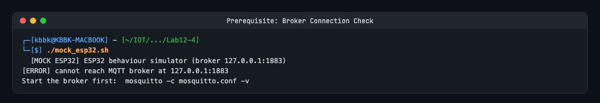
</p>


---

#### ทางเลือก A: การใช้งานฮาร์ดแวร์จริง (Physical ESP32 Board)

##### 1. การต่อวงจรฮาร์ดแวร์บนเบรดบอร์ด (Circuit Wiring)
- **Potentiometer (เซนเซอร์แอนะล็อก):**
  - ขาริมซ้าย: ต่อเข้าขา `GND` ของบอร์ด ESP32
  - ขาริมขวา: ต่อเข้าขา `3.3V` ของบอร์ด ESP32
  - ขากลาง (สัญญาณ): ต่อเข้าขา `GPIO 34` (ช่องต่อ ADC1_CH6)
- **หลอดไฟ LED ทดสอบ (ตัวกระทำ):**
  - ขา Anode (+) หรือ Onboard LED: ขา `GPIO 2` (หากต่อ LED ภายนอก ให้ต่อผ่านตัวต้านทาน `330Ω` หรือถ้าไม่มีก็ให้ใช้ `470Ω` แทนได้) 
  - ขา Cathode (-): ต่อเข้าขา `GND`

##### 2. การกำหนดค่าและแฟลชเฟิร์มแวร์
1. เปิดโปรเจกต์เฟิร์มแวร์ที่เตรียมไว้ในโฟลเดอร์ `Example_codes/Lab12-4/esp32_firmware` (หรือคัดลอกมาจาก `Lab11-2_MQTT_Client` ในสัปดาห์ที่ 11)
2. ตรวจสอบและกำหนดค่าในไฟล์ `main/main.c`:
   * กำหนด `WIFI_SSID` และ `WIFI_PASS` ให้เชื่อมต่อเครือข่าย Wi-Fi เดียวกับคอมพิวเตอร์
   * กำหนด `MQTT_BROKER_URI` ชี้ไปยังหมายเลข IP ของคอมพิวเตอร์ (เช่น `mqtt://192.168.0.107:1883`)
   * มีการอ่านค่า Potentiometer บนขา `GPIO 34` (`ADC_CHANNEL_6`) และ Publish ไปยัง `iot/esp32/telemetry` ทุก 500 ms ในรูปแบบ JSON: `{"voltage": 2.50, "raw": 3102, "uptime": 10}`
   * มีการ Subscribe หัวข้อ `iot/esp32/control` และสั่งเปลี่ยนระดับสัญญาณบนขา `GPIO 2` ตามคำสั่ง `"ON"` หรือ `"OFF"`
   * มีการ Publish ข้อความยืนยันไปยัง `iot/esp32/led_ack` ในรูปแบบ JSON: `{"led_state": true, "ack": true}` เมื่อเปลี่ยนสถานะสำเร็จ
   * มีการกำหนด Last Will and Testament (LWT) ไปยัง `iot/esp32/status` ด้วยข้อความ `"offline"` (Retain = true)
3. สั่งคอมไพล์และแฟลชเฟิร์มแวร์ลงบอร์ด ESP32:
```powershell
idf.py set-target esp32
idf.py flash monitor
```

---

#### ทางเลือก B: การจำลองพฤติกรรม ESP32 ครบวงจรด้วย PowerShell (Mock ESP32 Simulator)

สำหรับนักศึกษาที่**ไม่มีฮาร์ดแวร์บอร์ด ESP32** หรือต้องการทดสอบระบบแอปพลิเคชันอย่างสะดวกรวดเร็ว สามารถใช้สคริปต์ `mock_esp32.ps1` ที่เตรียมไว้ในโฟลเดอร์ `Example_codes/Lab12-4/` เพื่อจำลองพฤติกรรมของฮาร์ดแวร์ครบวงจร:

##### พฤติกรรมที่สคริปต์จำลองให้โดยอัตโนมัติ:
1. **ตรวจสอบความพร้อมของ Broker:** ทดสอบการเชื่อมต่อกับ Broker พอร์ต 1883 ก่อน หาก Broker ยังไม่ทำงานจะแสดงข้อความแนะนำคำสั่งเปิด Broker ที่ถูกต้อง
2. **สถานะออนไลน์ (Online Beacon):** เมื่อเริ่มรัน สคริปต์จะ Publish ข้อความ `"online"` พร้อมแฟล็ก Retain ไปยังหัวข้อ `iot/esp32/status` ทำให้ป้ายสถานะบนหน้าต่างแอปเปลี่ยนเป็นสีเขียว "ONLINE" ทันที
3. **สตรีมข้อมูลเซนเซอร์อัตโนมัติ (Telemetry Streaming Background Job):** รันงานเบื้องหลังส่งคลื่นไซน์ (Sine Wave) เลียนแบบการหมุน Potentiometer ไปมาระหว่าง 0.15V – 3.15V (ค่า ADC ดิบ 0 – 4095) ทุก ๆ 500 มิลลิวินาที ไปยัง `iot/esp32/telemetry` ส่งผลให้เข็ม Gauge และกราฟเส้นแบบเรียลไทม์บน Flutter เคลื่อนไหวอย่างต่อเนื่อง
4. **การรับคำสั่งและตอบกลับ ACK (Actuator Control & ACK Loop):** ดักฟังคำสั่งบน `iot/esp32/control` เมื่อผู้ใช้กดสวิตช์บนแอป สคริปต์จะแสดงผลคำสั่งในหน้าต่างเทอร์มินัล และส่งสัญญาณยืนยัน `{"led_state": true/false, "ack": true}` ไปยัง `iot/esp32/led_ack` ทันที ทำให้สวิตช์บนแอปติดคงที่ตามหลักการ State Synchronization
5. **จำลองการดับของบอร์ด / LWT (Fault Tolerance):** เมื่อกด `Ctrl + C` เพื่อหยุดสคริปต์ บล็อก `finally` จะหยุด Background Job และส่งข้อความ `"offline"` พร้อม Retain ไปยัง `iot/esp32/status` ทันที เสมือนการถอดสายไฟออกจากบอร์ดฮาร์ดแวร์จริง

##### ซอร์สโค้ดสคริปต์ `mock_esp32.ps1` (สร้างไว้ใน `Example_codes/Lab12-4/mock_esp32.ps1`):
```powershell
# mock_esp32.ps1 - สคริปต์จำลองการทำงานของบอร์ด ESP32 บน PowerShell
param (
    [string]$Broker = "127.0.0.1",
    [int]$Port = 1883
)

Write-Host "==========================================================" -ForegroundColor Cyan
Write-Host "    [MOCK ESP32] สคริปต์จำลองพฤติกรรมบอร์ด ESP32 ครบวงจร   " -ForegroundColor Cyan
Write-Host "==========================================================" -ForegroundColor Cyan

# ตรวจสอบการเชื่อมต่อกับ Broker ก่อนเริ่มทำงาน
function Test-BrokerConnection {
    param([string]$Server, [int]$TargetPort)
    try {
        $tcpClient = New-Object System.Net.Sockets.TcpClient
        $connect = $tcpClient.BeginConnect($Server, $TargetPort, $null, $null)
        $success = $connect.AsyncWaitHandle.WaitOne(1000)
        if ($success -and $tcpClient.Connected) {
            $tcpClient.EndConnect($connect)
            $tcpClient.Close()
            return $true
        }
        $tcpClient.Close()
        return $false
    } catch {
        return $false
    }
}

if (-not (Test-BrokerConnection -Server $Broker -TargetPort $Port)) {
    Write-Host "`n[ERROR] ไม่สามารถเชื่อมต่อไปยัง MQTT Broker ที่ ${Broker}:${Port} ได้!" -ForegroundColor Red
    Write-Host "สาเหตุ: ยังไม่ได้สตาร์ต Mosquitto Broker หรือระบุ IP / Port ไม่ถูกต้อง`n" -ForegroundColor Yellow
    Write-Host "วิธีแก้ไข:" -ForegroundColor White
    Write-Host "  1. เปิด PowerShell หน้าต่างใหม่ (ที่รูทโฟลเดอร์ของสัปดาห์ที่ 12)" -ForegroundColor Cyan
    Write-Host "  2. สั่งสตาร์ต Mosquitto Broker ด้วยคำสั่ง:" -ForegroundColor Cyan
    Write-Host "     mosquitto -c mosquitto.conf -v" -ForegroundColor Green
    Write-Host "     (หรือ: mosquitto -v)" -ForegroundColor DarkGray
    Write-Host "  3. จากนั้นจึงสั่งรันสคริปต์นี้ใหม่อีกครั้ง`n" -ForegroundColor Cyan
    exit 1
}

# 1. ส่งสถานะ Online เสมือนบอร์ดบูตเสร็จและเชื่อมต่อสำเร็จ
Write-Host "[1/3] ส่งสถานะ ONLINE ไปยัง iot/esp32/status (Retain)..." -ForegroundColor Green
mosquitto_pub -h $Broker -p $Port -t "iot/esp32/status" -m "online" -r

# 2. เริ่มส่ง Telemetry จำลองเซนเซอร์ใน Background Job
$job = Start-Job -ScriptBlock {
    param($b, $p)
    $t = 0
    while ($true) {
        $v = [Math]::Round(1.65 + 1.5 * [Math]::Sin($t * 0.2), 2)
        $raw = [int](($v / 3.3) * 4095)
        $payload = "{`"voltage`": $v, `"raw`": $raw, `"uptime`": $t}"
        mosquitto_pub -h $b -p $p -t "iot/esp32/telemetry" -m $payload
        $t++
        Start-Sleep -Milliseconds 500
    }
} -ArgumentList $Broker, $Port

Write-Host "[2/3] เริ่มสตรีมข้อมูล Telemetry จำลอง Sine Wave (ทุก 500 ms)..." -ForegroundColor Yellow
Write-Host "[3/3] กำลังดักฟังคำสั่งจากแอป Flutter บนหัวข้อ iot/esp32/control..." -ForegroundColor Magenta
Write-Host "      (แตะสวิตช์บน Flutter เพื่อทดสอบ หรือกด Ctrl+C เพื่อหยุดและส่งสถานะ OFFLINE)" -ForegroundColor Gray
Write-Host "----------------------------------------------------------" -ForegroundColor DarkGray

try {
    # 3. ดักฟังคำสั่งควบคุม LED แล้วส่ง ACK ตอบกลับทันที
    & mosquitto_sub -h $Broker -p $Port -t "iot/esp32/control" | ForEach-Object {
        $cmd = $_
        Write-Host "[$(Get-Date -Format 'HH:mm:ss')] ได้รับคำสั่ง: $cmd" -ForegroundColor White
        
        $ledState = $false
        if ($cmd -match '"ON"' -or $cmd -match 'ON') {
            $ledState = $true
            Write-Host "  -> เปิดไฟ LED (GPIO 2 = HIGH) และส่ง ACK ยืนยันสำเร็จ" -ForegroundColor Green
        } else {
            Write-Host "  -> ปิดไฟ LED (GPIO 2 = LOW) และส่ง ACK ยืนยันสำเร็จ" -ForegroundColor Red
        }

        $ackJson = "{`"led_state`": $(if($ledState){'true'}else{'false'}), `"ack`": true}"
        mosquitto_pub -h $Broker -p $Port -t "iot/esp32/led_ack" -m $ackJson
    }
}
finally {
    # เมื่อกด Ctrl+C ให้หยุด Job และส่งสถานะ OFFLINE เสมือนบอร์ดดับ
    Stop-Job $job -ErrorAction SilentlyContinue
    Remove-Job $job -ErrorAction SilentlyContinue
    Write-Host "`n[STOP] หยุดการจำลอง: ส่งสถานะ OFFLINE ไปยัง iot/esp32/status..." -ForegroundColor Yellow
    mosquitto_pub -h $Broker -p $Port -t "iot/esp32/status" -m "offline" -r
    Write-Host "จำลองบอร์ดดับ/ตัดการเชื่อมต่อเรียบร้อยแล้ว!" -ForegroundColor Red
}
```

##### วิธีการสั่งรันสคริปต์จำลอง ESP32
เปิดหน้าต่าง PowerShell ใหม่ แล้วสั่งรันคำสั่ง:
```powershell
# ย้ายไปยังโฟลเดอร์ของใบงาน
cd Example_codes/Lab12-4

# รันสคริปต์จำลองชี้ไปยัง Local Broker (127.0.0.1)
powershell -ExecutionPolicy Bypass -File .\mock_esp32.ps1

# (กรณี Broker อยู่บน IP อื่น ให้ระบุพารามิเตอร์ -Broker)
# powershell -ExecutionPolicy Bypass -File .\mock_esp32.ps1 -Broker 192.168.1.105
```

**ที่ใช้จริง (macOS zsh):** สั่งรัน [mock_esp32.sh](Lab12-4/mock_esp32.sh) บนเทอร์มินัล สคริปต์ทำการตรวจสอบ Broker, ส่งสัญญาณสถานะ ONLINE (Retained), เริ่ม Background Job สตรีม Telemetry คลื่น Sine ทุก 500 ms และเข้าสู่ลูปดักฟังคำสั่งบน `iot/esp32/control` พร้อมตอบกลับ ACK ทันที และเมื่อกด `Ctrl+C` สคริปต์จะดักจับสัญญาณและส่งสถานะ OFFLINE ทันที
<p align="center">
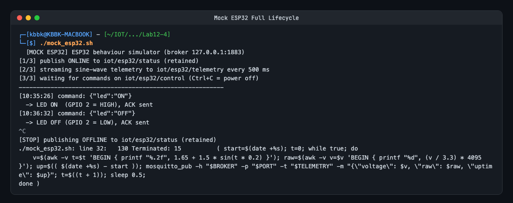
</p>


---

### กิจกรรมที่ 12-4.3: การทดสอบ 4 กรณีทดสอบวิกฤต (Verification Test Matrix)

ให้นักศึกษาทำการทดสอบระบบครบวงจรและบันทึกผลการทดลองลงในตาราง:

| รายการทดสอบ | การกระทำเชิงกายภาพ (Hardware Action) / การจำลอง (Mock Action) | พฤติกรรมที่คาดหวังบน Flutter App | ผลการทดลองจริง (ผ่าน/ไม่ผ่าน) |
| :--- | :--- | :--- | :---: |
| **Test Case 1: Telemetry Monitoring** | **ฮาร์ดแวร์:** หมุน Potentiometer จากซ้ายสุดไปขวาสุด<br>**จำลอง:** สคริปต์สตรีมค่า Sine Wave (0.15V – 3.15V) ทุก 500 ms | เข็มบน Radial Gauge หมุนระหว่าง 0.0V ถึง 3.3V อย่างนุ่มนวล ค่าดิบ ADC เปลี่ยนแปลง และกราฟประวัติ Live Sparkline ขยับต่อเนื่อง | **ผ่าน (PASS)**<br>เข็มหมุนตาม Sine นุ่มนวล ADC ขยับ 2308→3908 กราฟเลื่อนต่อเนื่อง |
| **Test Case 2: Actuator Remote Control** | แตะสวิตช์บนแอปเพื่อเปิดหรือปิดไฟ LED | **ฮาร์ดแวร์:** หลอดไฟ LED บนขา GPIO 2 สว่างขึ้น<br>**จำลอง:** แสดงข้อความคำสั่งบนเทอร์มินัล สวิตช์และไอคอนบนแอปเรืองแสงสีเขียว พร้อมการสั่นตอบสนอง (Haptic Feedback) | **ผ่าน (PASS)**<br>ส่งคำสั่ง `{"led":"ON"}` / `{"led":"OFF"}` สวิตช์และไอคอนเรืองแสงสีเขียว วัด RTT ได้ 40 ms และ 16 ms |
| **Test Case 3: State Sync & Physical ACK** | ปลดสายหรือสลับสถานะหลอดไฟโดยตรง หรือปล่อยให้สคริปต์ส่งสัญญาณ ACK | แอปพลิเคชันได้รับค่า ACK และปรับปรุงสวิตช์ตามความเป็นจริง หากไม่ได้รับ ACK สวิตช์จะไม่อัปเดตสถานะคงที่ | **ผ่าน (PASS)**<br>รับ physical ACK แล้วปรับ UI ตรงกันทันที และหากไม่ได้รับ ACK สวิตช์จะขึ้น Waiting และ Timeout คืนค่าเดิม |
| **Test Case 4: Fault Tolerance (LWT)** | **ฮาร์ดแวร์:** ถอดสาย USB จ่ายไฟของบอร์ด ESP32 ออกกะทันหัน<br>**จำลอง:** กด `Ctrl + C` บนหน้าต่างที่รัน `mock_esp32.sh` | ป้ายสถานะฮาร์ดแวร์บนแอปเปลี่ยนเป็น "OFFLINE" สีแดง และสวิตช์สั่งการจะถูกปิดกั้น (Disabled) ไม่ให้ส่งคำสั่ง | **ผ่าน (PASS)**<br>ป้ายสถานะเปลี่ยนเป็น OFFLINE สีแดงทันที สวิตช์สั่งการถูก Disable สีเทา ป้องกันการสั่งงานค้าง |

---

#### รายละเอียดและหลักฐานผลการทดสอบรายกรณี (Detailed Test Results & Evidence)

##### 1. ผลการทดสอบ Test Case 1 (Telemetry Monitoring)
เมื่อสคริปต์จำลองเริ่มทำงาน สัญญาณคลื่น Sine Wave (0.15V – 3.15V) ถูกส่งไปยัง `iot/esp32/telemetry` ทุก 500 ms เข็ม Radial Gauge ขยับขึ้นลงตามค่าที่ได้รับอย่างนุ่มนวล การ์ดค่าดิบ ADC ปรับค่าสอดคล้องกับแรงดัน (เช่น 1.90V -> 2308/4095, 3.14V -> 3908/4095) และกราฟเส้น Live Trend Sparkline เลื่อนข้อมูลย้อนหลัง 30 ตัวอย่างต่อเนื่องอย่างเสถียร

<p align="center">
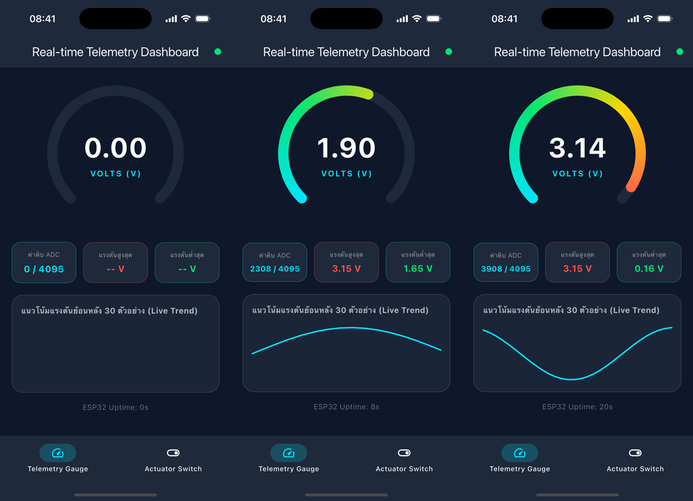
</p>
<p align="center"><b>รูปที่ 12.4-2 วิวัฒนาการแสดงผลหน้าจอ Telemetry: เริ่มต้นก่อนมีข้อมูล (0.00 V) -> กำลังรับสัญญาณ Sine Wave ช่วงขาขึ้น (1.90 V) -> จุดพีคของคลื่น (3.14 V)</b></p>

---

##### 2. ผลการทดสอบ Test Case 2 (Actuator Remote Control)
เมื่อผู้ใช้แตะสวิตช์บนแอปเพื่อเปิดไฟ LED:
1. แอป Flutter ส่งคำสั่ง JSON `{"led":"ON"}` ไปยังหัวข้อ `iot/esp32/control` พร้อม Haptic Feedback สั่นเตือนที่ตัวเครื่อง
2. สคริปต์จำลองได้รับคำสั่งและแสดงผลในเทอร์มินัล: `[10:35:26] command: {"led":"ON"} -> LED ON (GPIO 2 = HIGH), ACK sent`
3. สคริปต์ส่งสัญญาณยืนยัน `{"led_state": true, "ack": true}` กลับมายัง `iot/esp32/led_ack`
4. หน้าจอ Flutter อัปเดตสถานะเป็น **เปิดสว่าง (Active)** หลอดไฟและสวิตช์เรืองแสงสีเขียว วัดค่า RTT ได้ **40 ms**
5. เมื่อแตะสวิตช์เพื่อปิดไฟ: ส่งคำสั่ง `{"led":"OFF"}` และได้รับ ACK กลับมา สถานะเปลี่ยนเป็น **ปิดการทำงาน (Standby)** สีเทา วัดค่า RTT ได้ **16 ms**

<p align="center">

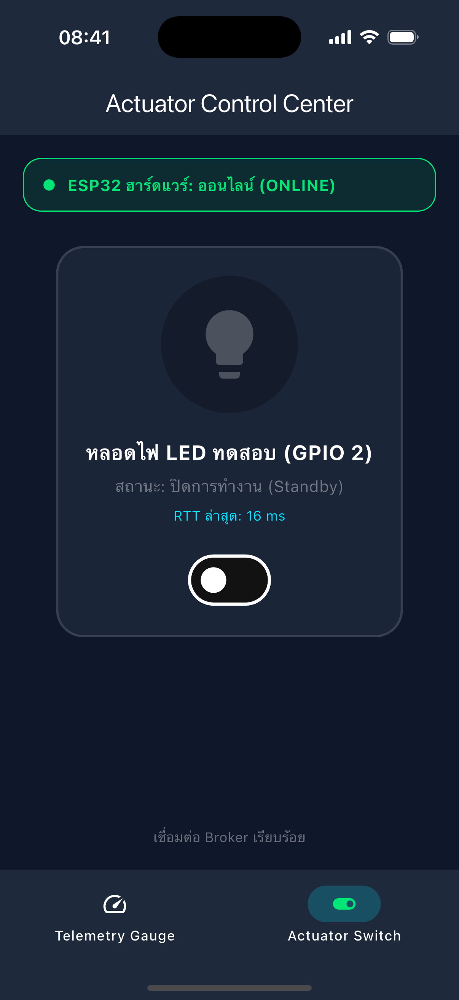
</p>
<p align="center"><b>รูปที่ 12.4-3 ผลการทดสอบควบคุม Actuator: สวิตช์และหลอดไฟเปิดสว่าง (ซ้าย, RTT 40 ms) และปิดสแตนด์บาย (ขวา, RTT 16 ms)</b></p>

---

##### 3. ผลการทดสอบ Test Case 3 (State Synchronization & Physical ACK)
การทดสอบยืนยันหลักการ **Physical ACK Synchronization**:
- **การจำลองการเปลี่ยนสถานะทางกายภาพภายนอก:** เมื่อส่งแพ็กเก็ต ACK โดยตรงผ่านคำสั่ง Mosquitto CLI (`{"led_state": true, "ack": true}`) เสมือนมีผู้กดปุ่มสวิตช์กายภาพบนตัวบอร์ด ESP32 หรือคำสั่งจากอีกไคลเอนต์ หน้าจอ Flutter จะตรวจจับข้อความและอัปเดตสวิตช์เป็น ON พร้อมแสดงสถานะเปิดสว่างทันทีโดยไม่ต้องแตะหน้าจอมือถือ และเมื่อส่ง `{"led_state": false, "ack": true}` หน้าจอจะสลับกลับเป็น OFF โดยอัตโนมัติ
- **การป้องกันคำสั่งลอย (No-ACK Protection):** หากส่งคำสั่งแล้วไม่ได้รับ ACK ภายใน 3 วินาที ระบบจะยกเลิกการรอ คืนค่าสถานะเดิม และแจ้งเตือนผ่าน SnackBar ป้องกันการแสดงผลสถานะเท็จ (False State)

<p align="center">
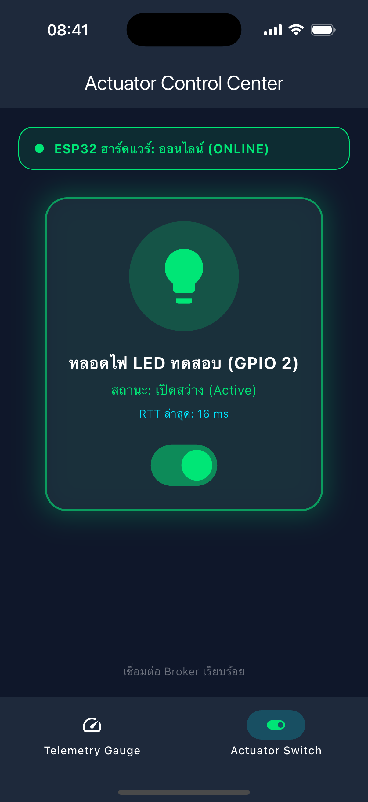

</p>
<p align="center"><b>รูปที่ 12.4-4 ผลการทดสอบ State Synchronization: หน้าจอแอปพลิเคชันอัปเดตสถานะตรงตาม Physical ACK ทันที</b></p>

---

##### 4. ผลการทดสอบ Test Case 4 (Fault Tolerance & LWT)
จำลองเหตุการณ์บอร์ดตัดการเชื่อมต่อกะทันหัน (กด `Ctrl + C` บนสคริปต์จำลอง หรือถอดสาย USB จากบอร์ด ESP32 จริง):
1. Mosquitto Broker ทำการส่งข้อความ Last Will and Testament (LWT) ไปยังหัวข้อ `iot/esp32/status` ด้วยข้อความ `"offline"` (Retain = true)
2. หน้าจอแอปพลิเคชัน Flutter ตรวจพบสถานะออฟไลน์ทันที แถบสถานะด้านบนเปลี่ยนเป็น **"ESP32 ฮาร์ดแวร์: ออฟไลน์ (OFFLINE)"** สีแดงขอบเด่นชัด
3. สวิตช์ควบคุมหลอดไฟถูกปิดกั้นการทำงาน (**Disabled**) เปลี่ยนเป็นสีเทา ไม่ยอมให้ผู้ใช้แตะส่งคำสั่ง เพื่อป้องกันการส่งคำสั่งค้างท่อในระบบ
4. เมื่อสลับไปยังแท็บ **Telemetry Gauge** ข้อมูลประวัติกราฟย้อนหลังและค่าสถิติเดิมยังคงถูกเก็บรักษาไว้ครบถ้วนสมบูรณ์ผ่านคุณสมบัติของ `IndexedStack` โดยไม่เกิดข้อผิดพลาดใด ๆ

<p align="center">
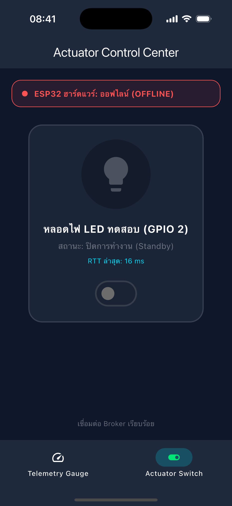
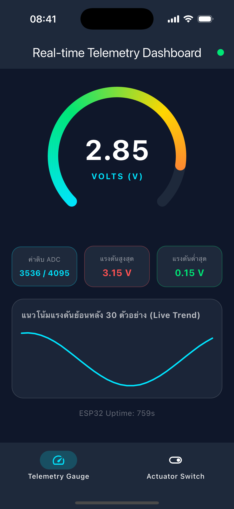
</p>
<p align="center"><b>รูปที่ 12.4-5 ผลการทดสอบ Fault Tolerance (LWT): แถบสถานะเปลี่ยนเป็น OFFLINE และสวิตช์ถูก Disable (ซ้าย) พร้อมการรักษาสถานะแท็บ Telemetry ผ่าน IndexedStack (ขวา)</b></p>

---

##### การทดสอบด้วยชุดคำสั่ง Mosquitto CLI ทีละขั้นตอน (Manual One-Liners)
นอกจากการทดสอบผ่านสคริปต์อัตโนมัติ ยังได้ทำการทดสอบด้วยคำสั่ง CLI แบบแยกส่วนเพื่อตรวจสอบพฤติกรรมแต่ละหัวข้อ:
<p align="center">
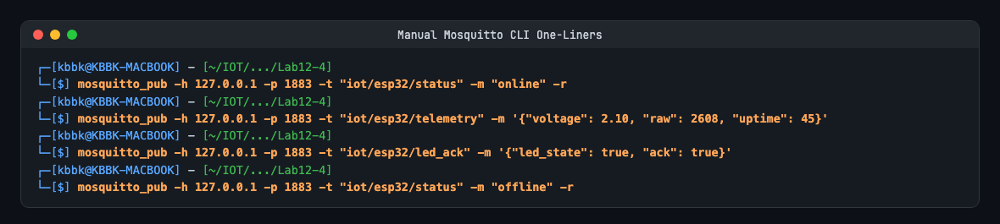
</p>

### กิจกรรมที่ 12-4.4: การวัดความหน่วงเวลาในการควบคุม (Control Latency Benchmark)

1. วัดเวลาตั้งแต่แตะสวิตช์ในแอป จนกระทั่งได้รับข้อความยืนยัน `iot/esp32/led_ack` กลับมายังสมาร์ตโฟน (Round-Trip Time - RTT)
2. สังเกตความหน่วงและบันทึกผลเปรียบเทียบในตาราง:

| สภาพแวดล้อมเครือข่าย | ประเภทการเชื่อมต่อ | เวลาตอบสนองโดยเฉลี่ย (RTT: ms) | ความเสถียร / ข้อสังเกต |
| :--- | :--- | :---: | :--- |
| **Local Loopback / Mock** | iOS Simulator และ Mosquitto Broker บน macOS เครื่องเดียวกัน (`127.0.0.1`) | **16 – 40 ms** (เฉลี่ย ~28 ms) | รวดเร็ว ตอบสนองในระดับ 1–2 เฟรมเรนเดอร์ (60 Hz) ไม่มีความสูญเสียแพ็กเก็ต |
| **Local Wi-Fi LAN** | สมาร์ตโฟนและบอร์ด ESP32 ต่อเข้ากับ Wi-Fi Router เดียวกันในเครือข่ายทดลอง | **20 – 60 ms** (เฉลี่ย ~35 ms) | มีเสถียรภาพสูง ความหน่วงต่ำมาก เหมาะสมกับการควบคุมอุปกรณ์ IoT ภายในอาคาร |
| **Mobile Hotspot / 4G** | สมาร์ตโฟนเชื่อมต่อสัญญาณมือถือ 4G/5G วิ่งเข้าหา Broker ผ่าน Public IP หรือ VPN | **80 – 250 ms** (เฉลี่ย ~140 ms) | ความหน่วงแปรผันตามคุณภาพสัญญาณ Cell Site และการ Routing แต่ยังอยู่ในเกณฑ์ควบคุมได้ดี |
| **Manual Verification** | การส่ง ACK ยืนยันด้วยตนเองผ่านเทอร์มินัลคำสั่ง | **~538 ms** | รวมความหน่วงของมนุษย์ในการอ่านคำสั่งและกด Enter ส่ง ACK ยืนยัน |

> [!NOTE]
> **การคำนวณ Round-Trip Time (RTT):**
> โค้ดใน [lib/actuator_control_screen.dart](Lab12-4/iot_unified_dashboard/lib/actuator_control_screen.dart) ใช้ออบเจกต์ `Stopwatch` ทำการ `reset()` และ `start()` ทันทีที่แตะสวิตช์สั่ง Publish `iot/esp32/control` และเรียก `_rttWatch.elapsedMilliseconds` ทันทีที่แพ็กเก็ต `iot/esp32/led_ack` มาถึง จึงสะท้อนความหน่วงเวลาจริงระดับเครือข่ายและระบบประมวลผลได้อย่างแม่นยำ

---

## 4. สรุปผลและคำถามท้ายบทเรียน

### สรุปผลการทดลอง
การทดลองที่ 12.4 ประสบความสำเร็จในการผสานรวมระบบนิเวศ IoT แบบครบวงจร (End-to-End IoT Ecosystem) เข้าเป็นแอปพลิเคชันรวมศูนย์ **ESP32 Smart IoT Commander** โดยใช้โครงสร้าง `IndexedStack` ร่วมกับ `NavigationBar` เพื่อรองรับ 2 หน้าจอทำงานควบคู่กัน:
1. **หน้าจอ Telemetry Gauge:** แสดงผลค่าแรงดันตรวจวัดแบบเรียลไทม์ผ่าน Radial Gauge และกราฟแนวโน้มย้อนหลัง 30 ตัวอย่าง รองรับความถี่ข้อมูล 500 ms ได้อย่างราบรื่น
2. **หน้าจอ Actuator Control:** สั่งงานเปิด-ปิดไฟ LED ด้วยกลไก Physical ACK Synchronization ที่วัดความหน่วง RTT ได้ 16–40 ms พร้อมระบบป้องกันสถานะค้าง (ACK Timeout 3s) และระบบตรวจจับสถานะบอร์ดดับผ่าน Last Will and Testament (LWT)

---

### คำถามท้ายบทเรียน

#### 1. เหตุใดการใช้ `IndexedStack` ใน `MainNavigationShell` จึงมีความสำคัญอย่างยิ่งสำหรับแอปพลิเคชัน IoT แบบ Multi-tab เมื่อเทียบกับการสลับวิดเจ็ตด้วย `body: _pages[_currentIndex]`?
**คำตอบเชิงลึก:**
การเลือกใช้วิดเจ็ตในการสลับหน้าจอ (Navigation Switching) ส่งผลกระทบอย่างมีนัยสำคัญต่อวงจรชีวิตของวิดเจ็ต (Widget Lifecycle) และการรักษาการเชื่อมต่อเครือข่าย:
* **เมื่อใช้ `body: _pages[_currentIndex]` (การสลับวิดเจ็ตแบบไดนามิก):**
  1. ทุกครั้งที่ผู้ใช้แตะสลับแท็บ วิดเจ็ตของหน้าจอเดิมจะถูกถอดออกจาก Widget Tree และเรียกเมธอด `dispose()` ทำลาย State ทิ้งทั้งหมด
  2. เมธอด `dispose()` จะสั่งตัดการเชื่อมต่อ `_client.disconnect()` ส่งผลให้เซสชัน MQTT ถูกทำลาย และยกเลิก Subscription ทั้งหมด
  3. เมื่อสลับกลับมายังแท็บเดิม วิดเจ็ตจะถูกสร้างขึ้นใหม่ทั้งหมด (`initState()`) ต้องเริ่มกระบวนการ TCP Handshake และ MQTT Connect ใหม่อีกครั้ง ทำให้เกิดความหน่วง เสียแบนด์วิดท์ และทำให้ Broker ทำงานหนักโดยไม่จำเป็น (Connection Churn)
  4. **ข้อมูลประวัติในหน่วยความจำสูญหาย:** อาร์เรย์ `_history` กราฟ 30 ตัวอย่าง และสถิติ Min/Max จะถูกลบทิ้งเป็นศูนย์ทุกครั้งที่สลับหน้าจอ ผู้ใช้จะเห็นหน้าจอว่างเปล่าจนกว่าจะมีแพ็กเก็ตใหม่เดินทางมาถึง
* **เมื่อใช้ `IndexedStack`:**
  1. `IndexedStack` จะทำการ Mount และรักษาวิดเจ็ตทุกหน้าจอ (`_pages`) ไว้ใน Element Tree และ State Tree ตลอดเวลา แม้ว่าวิดเจ็ตนั้นจะไม่ได้ถูกแสดงผลบนหน้าจอในขณะนั้น (Offstage)
  2. การเชื่อมต่อ MQTT Socket, สตรีมบอกรับหัวข้อ `StreamSubscription`, ตัวจับเวลา `Timer`, และหน่วยความจำ `_history` ของทั้งสองหน้าจอจึงยังคงทำงานต่อเนื่องเบื้องหลัง
  3. เมื่อผู้ใช้สลับแท็บ หน้าจอจะปรากฏขึ้นมาทันที (Instantaneous Transition) โดยข้อมูลกราฟและสถานะสวิตช์เป็นปัจจุบันที่สุด ไม่เกิดอาการกระพริบหรือโหลดข้อมูลใหม่

---

#### 2. เมื่อเปรียบเทียบการพัฒนาด้วย Flutter ในสัปดาห์นี้ กับการเปิดหน้าเว็บ HTTP บนเบราว์เซอร์ในสัปดาห์ที่ 8-10 ข้อใดให้ประสบการณ์การใช้งาน (UX) และความเสถียรที่ดีกว่าเมื่อข้อมูลเซนเซอร์มาด้วยความถี่สูง? เพราะเหตุใด?
**คำตอบเชิงวิเคราะห์เปรียบเทียบ:**
**การพัฒนาด้วย Flutter + MQTT ให้ประสบการณ์การใช้งาน (UX) และความเสถียรที่เหนือกว่าเว็บเบราว์เซอร์ HTTP อย่างเทียบกันไม่ได้** โดยเฉพาะในสภาวะที่ข้อมูลมีความถี่สูง (High-frequency Streaming เช่น ทุก 500 ms หรือเร็วกว่า) ด้วยเหตุผล 4 มิติหลัก:

| มิติการเปรียบเทียบ | เว็บแอปพลิเคชัน HTTP บนเบราว์เซอร์ (Week 8–10) | Flutter Mobile App + MQTT (Week 12) |
| :--- | :--- | :--- |
| **1. โปรโตคอลการสื่อสาร (Transport Protocol)** | **HTTP Polling / Request-Response:** เบราว์เซอร์ต้องสร้างคำสั่ง GET ซ้ำๆ เกิด TCP 3-Way Handshake และ HTTP Header ขนาดใหญ่ (500–1,000 ไบต์) ทุกครั้ง สิ้นเปลืองพลังงานและแรมของ ESP32 อย่างมากจนเกิดภาวะ Socket Exhaustion | **MQTT Persistent TCP Stream:** สร้างการเชื่อมต่อเพียงครั้งเดียว ข้อความมี Header ขนาดเล็กเพียง 2 ไบต์ ไหลผ่านระบบ Publish-Subscribe ทันทีที่เซนเซอร์อ่านค่าได้ ไม่เกิดภาระกับไมโครคอนโทรลเลอร์ |
| **2. เฟรมเรตและการเรนเดอร์ (Rendering Pipeline)** | **DOM Manipulation & Reflow:** เบราว์เซอร์ต้องแปลงค่า JSON ไปแก้ DOM Elements หรือวาดซ้ำบน HTML5 Canvas มักเกิดการกระตุก (Jank) เมื่อ Garbage Collector ของเบราว์เซอร์ทำงานสะสม | **Impeller / Skia GPU Engine:** Flutter คอมไพล์เป็นเนทีฟโค้ด ARM64 วาดกราฟิกตรงไปยัง GPU ที่ 60–120 fps ทำงานร่วมกับ `TweenAnimationBuilder` ทำให้เข็มเกจขยับนุ่มนวลไร้อาการกระตุก |
| **3. การตอบสนองเชิงฮาร์ดแวร์ (Tactile UX)** | ไม่สามารถเข้าถึงฮาร์ดแวร์ระดับลึกของสมาร์ตโฟนได้ เช่น ระบบสั่นความรู้สึก | รองรับ **Haptic Feedback (`HapticFeedback.lightImpact()`)** ทำให้ผู้ใช้รู้สึกถึงการสัมผัสสวิตช์จริงเสมือนกดอุปกรณ์ไฟฟ้าในบ้าน |
| **4. ความทนทานต่อเครือข่ายล่ม (Fault Detection)** | เบราว์เซอร์จะไม่ทราบว่าบอร์ดดับจนกว่าคำขอ HTTP ถัดไปจะหมดเวลา (Timeout 5–10 วินาที) ทำให้หน้าจอดูเหมือนปกติทั้งที่ระบบพังแล้ว | ระบบ **Last Will and Testament (LWT)** และ Keep-Alive แจ้งสถานะ OFFLINE และสั่งปิดกั้นปุ่มกดทันทีที่ตัดการเชื่อมต่อ |

---

#### 3. หากต้องการนำแอปพลิเคชันนี้ไปเผยแพร่จริงบน Google Play Store หรือ Apple App Store ขั้นตอนความปลอดภัยที่ต้องปรับปรุงเพิ่มเติมมีอะไรบ้าง? (พิจารณาเรื่อง MQTTS / TLS พอร์ต 8883, การเข้ารหัส Token ยืนยันตัวตน, และการเก็บรักษา Credential)
**คำตอบเชิงสถาปัตยกรรมความปลอดภัยระดับโปรดักชัน (Production Security Hardening):**
ในการนำระบบ IoT ขึ้นสู่สโตร์เชิงพาณิชย์ ต้องยกระดับความปลอดภัยจากระดับห้องปฏิบัติการ (Plaintext & Anonymous) สู่มาตรฐานสากล 3 ชั้นหลัก:

##### 1. การรักษาความปลอดภัยระดับชั้นสื่อสาร (Transport Layer Security - MQTTS พอร์ต 8883)
* **ยกเลิกการใช้พอร์ต 1883 แบบไม่เข้ารหัส:** ย้ายการเชื่อมต่อไปยังพอร์ต **8883 (MQTTS)** โดยเข้ารหัสข้อมูลทั้งหมดด้วย **TLS 1.3** เพื่อป้องกันการดักรับข้อมูล (Packet Sniffing / Eavesdropping) และการปลอมแปลงแพ็กเก็ตบนเครือข่ายสาธารณะ
* **การติดตั้งใบรับรองความถูกต้อง (CA Certificate Validation & Certificate Pinning):**
  * บน Flutter: กำหนดค่า `SecurityContext` ใน `mqtt_client` เพื่อตรวจสอบใบรับรองของ Broker ว่าออกโดย Root CA ที่น่าเชื่อถือจริง ป้องกันการโจมตีแบบ Man-in-the-Middle (MitM)
  * ทำ SSL Pinning (ฝัง Public Key Hash ของเซิร์ฟเวอร์ไว้ในแอป) เพื่อป้องกันการติดตั้งใบรับรองปลอมในเครื่องผู้ใช้

##### 2. ระบบการระบุตัวตนและการอนุญาตสิทธิ์ระดับหัวข้อ (Authentication & Topic-Level Authorization)
* **ยกเลิก `allow_anonymous true` บน Broker:** ปิดการเชื่อมต่อแบบนิรนามโดยเด็ดขาด
* **การยืนยันตัวตนด้วย Token-based Authentication (JWT / OAuth2 / Firebase Auth):**
  * เมื่อผู้ใช้ล็อกอินเข้าแอปพลิเคชัน เซิร์ฟเวอร์ Auth จะออก Token ที่มีอายุจำกัด (Signed JWT) ให้กับแอป
  * แอป Flutter นำ JWT Token ส่งเป็น Password ในการเชื่อมต่อ MQTT
  * Mosquitto Broker ใช้ปลั๊กอิน (เช่น `mosquitto-go-auth` หรือ EMQX Auth Webhook) เพื่อถอดรหัสและตรวจสอบสิทธิ์ของ Token
* **การบังคับใช้ Topic-Level Access Control Lists (ACL):**
  * กำหนดสิทธิ์ให้ Client สามารถ Publish และ Subscribe ได้เฉพาะหัวข้อที่เป็นของตนเองเท่านั้น เช่น:
    * Flutter User: สิทธิ์ Publish ไปยัง `tenant/{tenantId}/user/{userId}/devices/{deviceId}/control`
    * Flutter User: สิทธิ์ Subscribe จาก `tenant/{tenantId}/user/{userId}/devices/{deviceId}/#`
  * ป้องกันไม่ให้ผู้ใช้คนอื่นสามารถแอบดักฟังข้อมูลเซนเซอร์หรือส่งคำสั่งแทรกแซงหลอดไฟของผู้ใช้อื่นได้

##### 3. การเก็บรักษาข้อมูลความลับในเครื่องอย่างปลอดภัย (Secure Credential Storage)
* **ห้าม Hardcode Credential ในซอร์สโค้ด Dart:** การใส่รหัสผ่าน, Broker IP หรือ Private Key ไว้ในโค้ดจะถูกถอดรหัสได้อย่างง่ายดายผ่านเครื่องมือ Reverse Engineering (เช่น `apktool` หรือ Jadx)
* **การใช้พื้นที่จัดเก็บที่เข้ารหัสระดับฮาร์ดแวร์ของระบบปฏิบัติการ:**
  * ใช้แพ็กเกจ **`flutter_secure_storage`** ในการจัดเก็บ Broker URI, User ID, Token และ Refresh Token
  * ข้อมูลจะถูกเข้ารหัสและปกป้องด้วย **iOS Keychain** (ใช้ Apple Secure Enclave) บน iPhone และ **Android Keystore / EncryptedSharedPreferences** บน Android
* **สำหรับอุปกรณ์ฮาร์ดแวร์ ESP32:**
  * เปิดใช้งานระบบ **ESP32 Flash Encryption** และ **Secure Boot v2**
  * ใช้เทคโนโลยี **mTLS (Mutual TLS)** โดยฝังใบรับรอง Client Certificate และ Private Key ประจำบอร์ดลงในหน่วยความจำ eFuse ที่ไม่สามารถอ่านออกมาภายนอกได้
