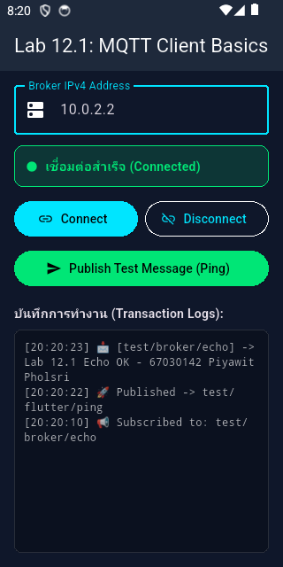
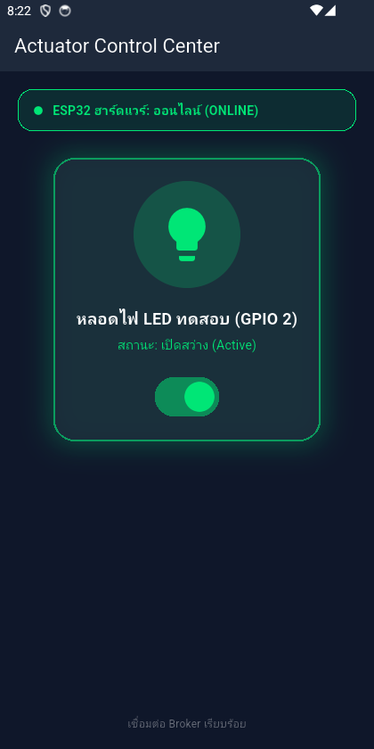
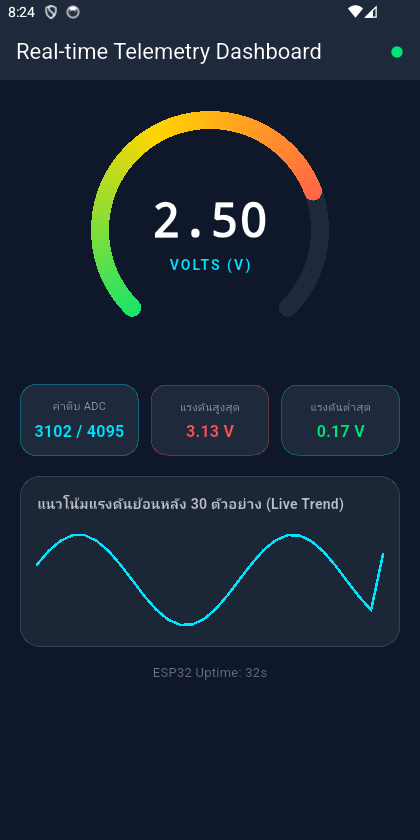
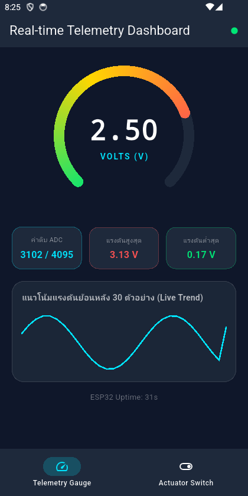
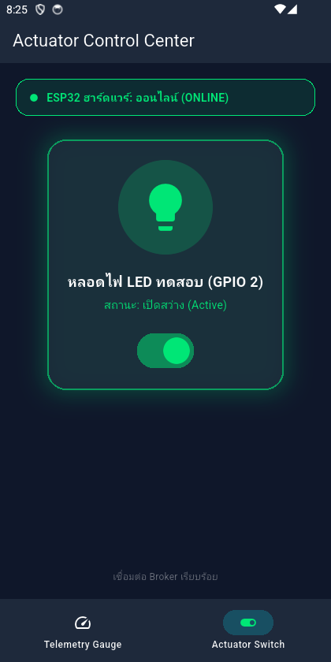

# รายงาน Lab 12: Flutter Mobile IoT และ MQTT Dashboard

## Lab 12.1: Flutter และ MQTT Client พื้นฐาน

ผลการทดลอง: แอปเชื่อมต่อ Mosquitto Broker สำเร็จ ส่งข้อความ Ping และรับ Echo กลับได้

คำถามท้ายการทดลอง

1. Client ID ต้องไม่ซ้ำ เพราะถ้าซ้ำ Broker จะตัด Client ตัวเดิม
2. `127.0.0.1` คืออุปกรณ์ที่รันแอปเอง หากใช้มือถือจริงต้องใช้ LAN IP ของคอมพิวเตอร์ที่รัน Broker
3. Keep Alive ใช้ตรวจว่าการเชื่อมต่อยังทำงาน และช่วยตรวจพบเมื่อ Wi-Fi หลุด

## Lab 12.2: ควบคุม Actuator และยืนยันสถานะ

ผลการทดลอง: แอปรับสถานะ Online ส่งคำสั่ง LED และรับ ACK จนแสดงสถานะ Active สำเร็จ

คำถามท้ายการทดลอง

1. การรอ ACK ยืนยันว่าอุปกรณ์ทำตามคำสั่งจริง ทำให้สถานะในแอปไม่คลาดเคลื่อน
2. Retain ทำให้ Client ที่เพิ่งเชื่อมต่อได้รับสถานะ Online/Offline ล่าสุดทันที

## Lab 12.3: Realtime Telemetry Dashboard

ผลการทดลอง: แอปรับ JSON ผ่าน MQTT แสดงค่า 2.50 V, ADC 3102 และกราฟย้อนหลัง 30 จุดได้

คำถามท้ายการทดลอง

1. `TweenAnimationBuilder` ทำให้เข็มค่อย ๆ เปลี่ยนจากค่าเดิมไปค่าใหม่ จึงเคลื่อนไหวนุ่มนวล
2. จำกัด 30 ค่าเพื่อไม่ให้ใช้ RAM เพิ่มตลอดเวลา และช่วยให้กราฟวาดได้เร็ว
3. `try-catch`, ค่า nullable/default และ `clamp()` ช่วยป้องกัน JSON ผิด, `null` และค่านอกช่วง

## Lab 12.4: End-to-End IoT Ecosystem

ผลการทดลอง: รวม Telemetry และ Actuator ไว้ในแอปเดียว สลับหน้าแล้วยังรับข้อมูลและควบคุม LED ได้

คำถามท้ายการทดลอง

1. `IndexedStack` เก็บสถานะของแต่ละหน้าไว้ จึงไม่สร้างหน้าและเชื่อม MQTT ใหม่ทุกครั้งที่สลับ Tab
2. Flutter รับข้อมูล MQTT ต่อเนื่องและวาด UI ได้ลื่น จึงเหมาะกับ Telemetry แบบเรียลไทม์
3. ระบบจริงควรใช้ MQTTS พอร์ต 8883, ตรวจ Certificate และเก็บรหัสผ่าน/Token ในพื้นที่ปลอดภัยของเครื่อง
