# Week 12: Cross-Platform Mobile IoT Application with Flutter & MQTT Dashboard

## 1. บทนำ (Introduction)

ในสัปดาห์ที่ 11 ที่ผ่านมา เราได้วางรากฐานการสื่อสารผ่านระบบคลาวด์ (**Cloud Communication & Control**) ด้วยโปรโตคอล MQTT และสำรวจระบบนิเวศ ESP RainMaker ซึ่งช่วยให้อุปกรณ์ ESP32 สามารถส่งข้อมูลและรับคำสั่งข้ามเครือข่ายอินเทอร์เน็ตได้ อย่างไรก็ตาม ในการพัฒนาผลิตภัณฑ์เชิงพาณิชย์หรือระบบ IoT ระดับอุตสาหกรรม การมี **โมบายล์แอปพลิเคชันเฉพาะทาง (Dedicated Mobile Application)** ที่ออกแบบส่วนติดต่อประสานกับผู้ใช้ (UI/UX) ได้อย่างอิสระ สวยงาม รวดเร็ว และทำงานได้ข้ามแพลตฟอร์มทั้ง Android และ iOS คือหัวใจสำคัญในการส่งมอบประสบการณ์ที่ดีที่สุดแก่ผู้ใช้งาน

ในสัปดาห์ที่ 12 นี้ นักศึกษาจะได้เรียนรู้การพัฒนาแอปพลิเคชันมือถือสำหรับระบบ IoT ด้วยเฟรมเวิร์ก **Flutter** ซึ่งพัฒนาโดย Google และขับเคลื่อนด้วยภาษา **Dart** โดยโฟกัสที่การเชื่อมต่อโมบายล์แอปพลิเคชันเข้ากับ **MQTT Broker** โดยตรงผ่าน TCP Sockets และ WebSockets เพื่อสร้างแดชบอร์ดแสดงผลข้อมูลเซนเซอร์แบบเรียลไทม์ (Telemetry Monitoring) และแผงควบคุมสวิตช์สั่งการอุปกรณ์ (Actuator Remote Control) ที่ทำงานตอบสนองทันทีโดยไม่ต้องพึ่งพาคลาวด์ภายนอก

เนื้อหาประจำสัปดาห์นี้แบ่งออกเป็น 4 เสาหลัก:
1. **สถาปัตยกรรม Cross-Platform IoT & พื้นฐาน Flutter**: สถาปัตยกรรมการเรนเดอร์กราฟิกของ Flutter (Impeller Engine), โครงสร้างต้นไม้วิดเจ็ต (Widget Tree), วงจรชีวิตของวิดเจ็ต (Stateless vs Stateful Lifecycle), และเปรียบเทียบการรับส่งข้อมูลแบบ Reactive UI กับการ Polling แบบดั้งเดิม
2. **การผสานโปรโตคอล MQTT ใน Flutter**: การใช้งานแพ็กเกจ `mqtt_client`, การจัดการการเชื่อมต่อผ่าน TCP Socket และ WebSocket (พอร์ต 8083/9001), การดักฟังสตรีมข้อมูล (Stream Subscription), การแปลงข้อมูล JSON Payload, และกลไก Reconnection อัตโนมัติเมื่อสัญญาณเน็ตหลุด
3. **การจัดการสถานะเชิงปฏิกิริยา (Reactive State Management)**: การออกแบบสถาปัตยกรรมแอปพลิเคชันเพื่อแยก Network Layer ออกจาก Presentation Layer โดยใช้โมเดล Reactive เช่น `ChangeNotifier`, `ValueNotifier`, หรือ `StreamBuilder` รองรับการอัปเดตข้อมูลเซนเซอร์ความถี่สูงโดยไม่ทำให้หน้าจอกระตุก
4. **การออกแบบแดชบอร์ด IoT ระดับมืออาชีพ (IoT Dashboard UI Design)**: การสร้างคอมโพเนนต์มาตรวัดแบบเกจทรงกลม (Radial Gauge), กราฟแนวโน้มข้อมูลแบบเรียลไทม์ (Live Trend Line Chart), สวิตช์เปิด-ปิดแบบโต้ตอบ (Interactive Toggle Switch), แถบแจ้งเตือนสถานะการเชื่อมต่อ (Connection Banner), และชุดสี Dark Mode ที่ทันสมัย

---

## 2. แผนผังเนื้อหาการเรียนรู้ประจำสัปดาห์ (Lesson Roadmap)

  2. แผนผังเนื้อหาการเรียนรู้ประจำสัปดาห์ (Lesson Roadmap)

---

## 3. สถาปัตยกรรมการเชื่อมต่อของระบบ (End-to-End System Topology)

ในสัปดาห์นี้ เราจะสร้างวงจรการทำงานที่สมบูรณ์แบบของระบบ IoT โดยเชื่อมต่อ 3 องค์ประกอบหลักเข้าด้วยกัน:

  3. สถาปัตยกรรมการเชื่อมต่อของระบบ (End-to-End System Topology)

---

## 4. แผนภาพการต่อสายฮาร์ดแวร์ (Hardware Wiring)

การทดลองใช้ฮาร์ดแวร์ต่อเนื่องจากสัปดาห์ที่ 11 เพื่อให้นักศึกษาสามารถนำบอร์ดเดิมมาทดสอบร่วมกับแอปพลิเคชัน Flutter ได้ทันที:

| อุปกรณ์ | ขาบนอุปกรณ์ | ขาต่อบน ESP32-C3 | ขาต่อบน Classic ESP32 | หน้าที่การทำงาน |
| :--- | :--- | :--- | :--- | :--- |
| **LED 5mm** | Anode (+) ผ่าน R 220Ω | **GPIO 8** | **GPIO 2** | ตัวแทน Actuator รับคำสั่งเปิด-ปิดจากสวิตช์บนมือถือ |
| **Resistor 220Ω** | ขาใดก็ได้ | อนุกรมกับ LED | อนุกรมกับ LED | จำกัดกระแสไฟป้องกัน LED เสียหาย |
| **Potentiometer 10k** | ขากลาง (Wiper) | **GPIO 0** (ADC1_CH0) | **GPIO 34** (ADC1_CH6) | ตัวแทน Sensor ส่งค่าแรงดันขึ้นไปแสดงบนเกจวัดในแอป |
| **Potentiometer 10k** | ขาริม 2 ขา | **3.3V / GND** | **3.3V / GND** | แรงดันไฟเลี้ยงและกราวด์อ้างอิง |

---

## 5. รายการเอกสารบทเรียนและใบงานประจำสัปดาห์

1. **[01-Cross-Platform-IoT-and-Flutter-Architecture.md](01-Cross-Platform-IoT-and-Flutter-Architecture.md)** - สถาปัตยกรรม Flutter, การทำงานของ Widget Tree, Reactive Programming, และการเปรียบเทียบการพัฒนา Mobile IoT ด้วย Flutter vs Native vs Web
2. **[02-MQTT-Client-Integration-in-Flutter.md](02-MQTT-Client-Integration-in-Flutter.md)** - การติดตั้งแพ็กเกจ `mqtt_client`, การเชื่อมต่อผ่าน TCP Sockets และ WebSockets, วงจรชีวิตการเชื่อมต่อ, การถอดรหัส JSON Payload, และกลไก Auto-Reconnect
3. **[03-State-Management-and-Reactive-IoT-UI.md](03-State-Management-and-Reactive-IoT-UI.md)** - การจัดการสถานะของข้อมูลเซนเซอร์ความถี่สูงด้วย `ChangeNotifier` และ `Streams`, การแยกเลเยอร์การสื่อสารเครือข่ายออกจาก UI
4. **[04-IoT-Dashboard-UI-Design-and-Interactive-Controls.md](04-IoT-Dashboard-UI-Design-and-Interactive-Controls.md)** - หลักการออกแบบ UI แดชบอร์ด IoT, การสร้าง Radial Gauge มาตรวัดเข็ม, กราฟเส้นแสดงข้อมูลย้อนหลัง, สวิตช์ควบคุมแอนิเมชัน, และชุดสีสไตล์ Dark Mode & Glassmorphism
5. **[05-Glossary.md](05-Glossary.md)** - อภิธานศัพท์และคำย่อทางเทคนิคประจำสัปดาห์ที่ 12
6. **[06-Labsheet-12-1-Flutter-Environment-Setup-and-MQTT-Basics.md](06-Labsheet-12-1-Flutter-Environment-Setup-and-MQTT-Basics.md)** - **ใบงานที่ 12.1: การติดตั้งสภาพแวดล้อม Flutter และการพัฒนา MQTT Client พื้นฐานบนสมาร์ตโฟน**
7. **[07-Labsheet-12-2-Interactive-Actuator-Control-Switch-and-Status.md](07-Labsheet-12-2-Interactive-Actuator-Control-Switch-and-Status.md)** - **ใบงานที่ 12.2: การสร้างสวิตช์ควบคุมอุปกรณ์สองทาง (Bi-directional Actuator Switch) พร้อมระบบ Feedback และสถานะ LWT**
8. **[08-Labsheet-12-3-Realtime-Telemetry-Dashboard-and-Radial-Gauge.md](08-Labsheet-12-3-Realtime-Telemetry-Dashboard-and-Radial-Gauge.md)** - **ใบงานที่ 12.3: การสร้างแดชบอร์ดแสดงผลเซนเซอร์เรียลไทม์ด้วย Radial Gauge และ Live Trend Line Chart**
9. **[09-Labsheet-12-4-End-to-End-IoT-Ecosystem-Integration.md](09-Labsheet-12-4-End-to-End-IoT-Ecosystem-Integration.md)** - **ใบงานที่ 12.4: การทดสอบผสานรวมระบบครบวงจร (ESP32-C3 Hardware <-> Mosquitto Broker <-> Flutter Mobile App)**

---

## 6. เครื่องมือและข้อกำหนดเบื้องต้น (Prerequisites)

* **เครื่องคอมพิวเตอร์สำหรับการพัฒนา**:
  * ติดตั้ง **Flutter SDK v3.19+** หรือเวอร์ชันล่าสุด
  * ติดตั้ง **VS Code** พร้อมส่วนขยาย *Flutter* และ *Dart* หรือ **Android Studio**
  * ติดตั้ง **Google Chrome** (สำหรับรันและทดสอบ Flutter Web) หรือติดตั้ง **Android Emulator** / มือถือจริงที่เปิด Developer Mode & USB Debugging
* **เครื่องมือเครือข่าย**:
  * ซอฟต์แวร์ **Eclipse Mosquitto Broker** จากสัปดาห์ที่ 11 (รันอยู่บนพอร์ต 1883 และสามารถเปิด WebSocket พอร์ต 8083/9001 ได้)
* **ฮาร์ดแวร์ฝั่งไมโครคอนโทรลเลอร์**:
  * บอร์ด **ESP32-C3** หรือ **ESP32** ที่แฟลชเฟิร์มแวร์ MQTT Client จากใบงานที่ 11.2 ไว้แล้ว
  * โมดูลเซนเซอร์ Potentiometer 10k และหลอดไฟ LED พร้อมตัวต้านทาน 220Ω
